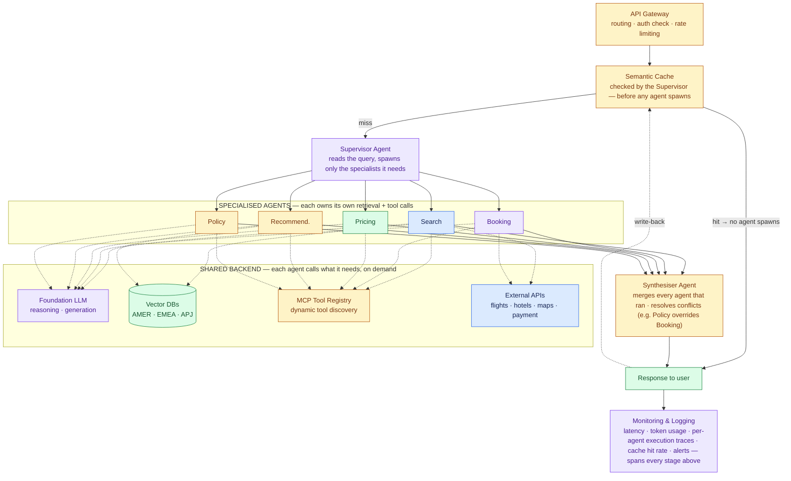

# Travel Agent System Design

*Reference design: the corrected version*

- System design is the plan for how software parts work together to solve a business problem quickly, reliably and at scale.
- This page applies that plan to one sample system: an agentic AI travel assistant for customers in AMER, EMEA and APJ.
- It starts from a first-draft reference architecture and folds in five structural fixes that came out of two later reviews.

> **What this is:** A first-draft architecture for a travel-agent system laid it out as a rigid pipeline. Five agents fanned out, then all passed, in order, through one shared cache, one retrieval stage, one LLM step and one tool-calling stage. An architecture review found four points where that order does not match how a multi-agent system runs. A separate blueprint, written independently, reached the same four fixes and added a fifth: a named Synthesiser Agent to fill the missing aggregation step. This page combines all five into one final architecture.

---

## What changed, and why

The first draft needed five structural fixes. Four came from the architecture review and one from the earlier blueprint.

### 1 · Rate limiting moved inside the API Gateway

In the first draft, Rate Limiter was a separate box off the load balancer, next to the Gateway, with nothing flowing out of it. It was a dead end. Rate limiting is a rule the Gateway enforces on every request, not a path a request takes.

### 2 · Semantic Cache checked before any agent spawns

The cache used to come after all five agents had finished. A cache that is meant to cut LLM latency and cost can only do so if it sits ahead of the costly work. It is now the first thing the Supervisor checks, and on a hit the answer returns with no agent spawned.

### 3 · RAG owned by each agent, not a shared stage

A single required retrieval box after all five agents made every agent hit the vector DB, even agents with no use for it. Search and Recommendation do need regional travel content. Booking and Policy seldom do. So each agent now calls retrieval for itself, when it needs to.

### 4 · Tool calling, MCP, and external APIs sit alongside the agents

The draft pushed every agent through one shared LLM step, then a single Tool Calling step, then a single MCP Registry, as though the request had only one turn in total. The Booking Agent needs the Payment and Flight MCP servers while *it* is running, not after four unrelated agents have wrapped up.

### 5 · A Synthesiser Agent replaces the missing aggregation step (*added by the prior blueprint*)

- The draft never said how five parallel outputs turn into one reply.
- It kept going as a single line, as if merging happened by itself.
- Now a named Synthesiser Agent combines the output of every agent that ran and settles conflicts between them before the user sees anything.
- A Policy decision that overrides a Booking choice is a typical case.

---

## Architecture

The components and the regional footprint match the first draft. The structure is what changes: a cache hit is now cheap, each agent uses its tools within its own loop, and all results pass through one accountable step before the reply leaves.

- Solid lines: the request path, and the agents, each running its own loop in parallel
- Dashed lines: the shared backend, called only when needed
- New in this version: the Synthesiser Agent

- A cache hit returns before the Supervisor spawns any agent. On a miss, the Supervisor spawns only the agents this query needs.
- Each of them calls the shared backend on its own (the Foundation LLM, the regional vector DBs, the MCP registry and the external APIs) for only what its task requires.
- The Synthesiser Agent then combines whatever ran into a single reply, and that reply is written back to the cache so the next similar query can reuse it.

---

## Key components

The list of components matches the first draft. The Gateway, the Cache and the agent-owned services have a new scope, and the Synthesiser is new.

| Component | Purpose |
| --- | --- |
| **Client** | The web and mobile app where users search, book and manage trips. |
| **Authentication** | Confirms identity through SSO with OpenID Connect (an identity layer on top of OAuth 2.0), using JWTs as tokens, before any other step runs. |
| **Load Balancer** | Shares traffic across API instances to keep the service available. |
| **API Gateway** `now holds rate limiting` | The one way in. Routing, request validation and throttling form a single policy layer rather than an extra hop. |
| **Supervisor Agent** `refocused` | Reads the query and checks the cache. Only when the cache misses does it choose which specialised agents to spawn. |
| **Semantic Cache** `now checked first` | Consulted as soon as the Supervisor has the query. On a hit, the answer goes back with no agent spawned. |
| **Search / Booking / Pricing / Recommendation / Policy Agents** `own their RAG and tools` | Each agent fetches its own domain context and calls its own tools. The Booking Agent talks to the Payment gateway itself, and nothing passes through a single shared LLM step. |
| **Regional Vector DBs** (AMER / EMEA / APJ) | Still the shared retrieval layer, but now something agents call into, not a stage that every request must pass through in turn. |
| **MCP Tool Registry** | Finds tools at run time. Any agent can reach it on its own, whenever it needs to. |
| **External APIs** | Flight, hotel, map and payment providers, called through MCP servers. |
| **Synthesiser Agent** `added` | Combines the output of every agent that ran, settles conflicts between them (for example, Policy overriding a Booking choice) and returns one coherent reply. |
| **Monitoring & Logging** | Records latency, token usage, failures and per-agent traces for the whole request. |

---

## Data flow

The ten steps from the first draft, put in a new order so that the cache check comes first.

1. A user sends a request from the web or mobile client.
2. Authentication confirms the user's identity. The Load Balancer sends the request to a free API instance. The API Gateway enforces rate limits and hands the request to the Supervisor.
3. Before making any decision about agents, the Supervisor checks the Semantic Cache.
4. If the cache hits, the stored answer goes straight back and no agent is spawned at all.
5. If it misses, the Supervisor spawns the specialised agents this query calls for (Search, Booking, Pricing, Recommendation, Policy).
6. Each agent pulls the context it needs from the right regional Vector DB, using a tool call within its own loop.
7. Each agent calls the external APIs it needs (flights, hotels, maps, payment) through the MCP Tool Registry, again within its own loop.
8. The Synthesiser Agent gathers every agent's output, settles conflicts and writes one grounded reply.
9. The user gets the final reply, and the answer is stored in the Semantic Cache so later queries can reuse it.
10. Monitoring and logging record latency, token usage and per-agent traces for the whole request.

---

## Non-functional requirements

These are the same as in the first draft. The new order above makes the cache-first row true in practice.

| Requirement | Example solution |
| --- | --- |
| Scalability | Scale out horizontally, autoscale and balance load. |
| Reliability | Run in several regions, retry and fail over. |
| Availability | Regions run in active-active mode. |
| Performance | A semantic cache ahead of the fan-out, Redis, a CDN and tuned vector search. |
| Security | OAuth, JWT, encryption, RBAC and managed secrets. |
| Cost optimisation | A cache-first design where the cache decides whether agents spawn, small models for easy tasks, and routing by region. |
| Observability | Metrics, logs, distributed tracing for each agent, dashboards and alerts. |
| Maintainability | Microservices, modular agents that each own their tools, CI/CD and infrastructure as code. |

---

## Trade-offs worth naming out loud

The contrasts an interviewer wants to hear you draw.

**Shared retrieval service vs. per-agent RAG.** A shared Vector DB layer puts data-residency and guardrail enforcement in one place, but it ties every agent to that single service. Retrieval per agent mirrors how LangGraph- and CrewAI-style frameworks attach tools, yet without governance it duplicates the embedding infrastructure. Both positions hold up. The real mistake is drawing RAG as a peer of the agents, when it is infrastructure or a tool.

**Single agent vs. multi-agent.** Several agents bring coordination and synthesis costs. Those costs pay off when sub-tasks need their own tools, their own guardrails or their own scaling, which is plainly true of Booking and Policy here.

**Semantic cache vs. traditional cache.** A semantic cache hits on near-duplicate queries as well as exact repeats. That is why it can skip the entire agent fan-out instead of saving a single call further down.

**Global vs. regional vector DBs.** Stores per region (AMER/EMEA/APJ) make data-residency rules easier to meet and cut latency. A single global store is simpler to operate and keeps regions consistent with each other.

---

## Mental model: an international airport

The airport comparison from the first draft, stretched to cover the cache gate and the Synthesiser.

| Airport | System |
| --- | --- |
| Travellers | Users |
| Terminal entrance | Authentication |
| Security screening and bag scan `a single lane` | API Gateway with rate limiting inside it |
| Help desk asking "have we answered this already?" | Semantic Cache, checked before any staff member is sent out |
| Control tower | Supervisor Agent |
| Airline crews, each with its own manuals and radios | Specialised agents, each with its own retrieval and tool access |
| Reference binders kept at each desk | Vector databases, used by whichever desk needs them |
| Ground handlers, caterers and fuel trucks | External APIs (flights, hotels, maps, payments) |
| Dispatcher who writes one departure report from every crew `added` | Synthesiser Agent |
| CCTV and the operations room | Monitoring, logging and observability |
