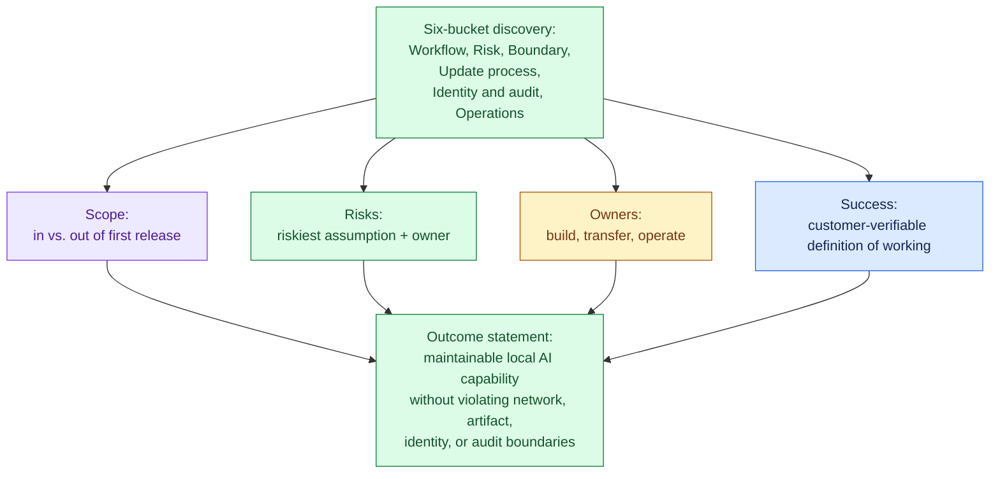

# Design an AI System for an Air-Gapped Environment

## Table of Contents
- [1. The Customer Problem and Discovery](#1-the-customer-problem-and-discovery)
  - [The Core Tension and Outcome Statement](#the-core-tension-and-outcome-statement)
  - [Stakeholder Map](#stakeholder-map)
  - [Six-Bucket Discovery Framework](#six-bucket-discovery-framework)
  - [Scope, Risks, Owners, Success](#scope-risks-owners-success)
  - [Choosing a Business-Outcome Metric](#choosing-a-business-outcome-metric)
- [2. Clarifying Questions, Requirements, and Constraints](#2-clarifying-questions-requirements-and-constraints)
  - [Six Architecture-Changing Questions](#six-architecture-changing-questions)
  - [From Discovery to Requirements](#from-discovery-to-requirements)
  - [Constraints vs. Preferences](#constraints-vs-preferences)
  - [A Compact Interview Question Tree](#a-compact-interview-question-tree)
  - [MVP Prioritisation: Must, Should, Could](#mvp-prioritisation-must-should-could)
  - [What the MVP Will Not Support](#what-the-mvp-will-not-support)
  - [Requirement-to-Component Traceability](#requirement-to-component-traceability)
  - [The One Assumption to Protect First](#the-one-assumption-to-protect-first)
  - [Why This Is a Strong FDE Signal](#why-this-is-a-strong-fde-signal)
- [3. Scale Estimates, SLOs, and Capacity](#3-scale-estimates-slos-and-capacity)
  - [Anchor the Load Envelope to Customer Reality](#anchor-the-load-envelope-to-customer-reality)
  - [Storage Sketch](#storage-sketch)
  - [Memory and Throughput per Replica](#memory-and-throughput-per-replica)
  - [The Replica Sizing Formula](#the-replica-sizing-formula)
  - [Worked Example: 1,000 Users, 20 QPS](#worked-example-1000-users-20-qps)
  - [Sensitivity Analysis: Baseline vs. 10x Growth](#sensitivity-analysis-baseline-vs-10x-growth)
  - [What Changes First at 10x Growth](#what-changes-first-at-10x-growth)
  - [SLIs Tied to the Workflow](#slis-tied-to-the-workflow)
- [4. Architecture and End-to-End Flow](#4-architecture-and-end-to-end-flow)
  - [Two Worlds Separated by a Controlled Update Path](#two-worlds-separated-by-a-controlled-update-path)
  - [Nine Components in Dependency Order](#nine-components-in-dependency-order)
  - [Top-Down Architecture Diagram](#top-down-architecture-diagram)
  - [System of Record vs. Cache vs. Queue](#system-of-record-vs-cache-vs-queue)
  - [End-to-End Happy Path](#end-to-end-happy-path)
  - [Sequence Diagram of the Happy Path](#sequence-diagram-of-the-happy-path)
  - [Dependency-Failure Drill: Fail Closed](#dependency-failure-drill-fail-closed)
  - [Backpressure and Flow Control](#backpressure-and-flow-control)
  - [Component Responsibility Table](#component-responsibility-table)
  - [MVP vs. Later Evolution](#mvp-vs-later-evolution)
  - [Control Plane vs. Data Plane](#control-plane-vs-data-plane)
- [5. Data Model, APIs, and Working Code](#5-data-model-apis-and-working-code)
  - [Three Governable Records](#three-governable-records)
  - [API Contracts](#api-contracts)
  - [Release Verification: The Highest-Risk Code Path](#release-verification-the-highest-risk-code-path)
  - [Verify-Bundle Flow](#verify-bundle-flow)
  - [What the Snippet Omits on Purpose](#what-the-snippet-omits-on-purpose)
  - [Failure Behaviour to State Explicitly](#failure-behaviour-to-state-explicitly)
  - [Contract and Failure-Injection Tests](#contract-and-failure-injection-tests)
  - [Why This Is a Strong FDE Answer](#why-this-is-a-strong-fde-answer)
- [6. Security, Reliability, and Failure Handling](#6-security-reliability-and-failure-handling)
  - [Lead With the Failure, Not the Model](#lead-with-the-failure-not-the-model)
  - [Threat-Model the Offline Control Plane](#threat-model-the-offline-control-plane)
  - [Failure Policy: Fail Open, Fail Closed, Degrade, Queue](#failure-policy-fail-open-fail-closed-degrade-queue)
  - [Five-Condition Decision Table](#five-condition-decision-table)
  - [Blast Radius](#blast-radius)
  - [Critical Incident Drill: Missing Transitive Package](#critical-incident-drill-missing-transitive-package)
  - [Other Failure Paths](#other-failure-paths)
  - [Code: Proving One Security Invariant](#code-proving-one-security-invariant)
  - [Evidence, Runbooks, and Operational Readiness](#evidence-runbooks-and-operational-readiness)
  - [Why This Matters for the Job](#why-this-matters-for-the-job)
- [7. Delivery Plan, Observability, and Business Impact](#7-delivery-plan-observability-and-business-impact)
  - [From Prototype to Trusted Production](#from-prototype-to-trusted-production)
  - [Four Phases That Move Risk Out of the Dark](#four-phases-that-move-risk-out-of-the-dark)
  - [Technical Health Metrics](#technical-health-metrics)
  - [User and Business Metrics](#user-and-business-metrics)
  - [A Dashboard That Tells One Story](#a-dashboard-that-tells-one-story)
  - [Ownership, Gates, and Rollback Triggers](#ownership-gates-and-rollback-triggers)
  - [Standardisation Strategy](#standardisation-strategy)
  - [Risk Register](#risk-register)
  - [The Delivery Story the Interviewer Wants to Hear](#the-delivery-story-the-interviewer-wants-to-hear)
- [8. Interview Walkthrough, Trade-Offs, and Practice](#8-interview-walkthrough-trade-offs-and-practice)
  - [Minute Zero: Open With the Customer Outcome](#minute-zero-open-with-the-customer-outcome)
  - [A 50-Minute Pacing Plan](#a-50-minute-pacing-plan)
  - [Trade-Off: Model Size vs. Hardware Fit](#trade-off-model-size-vs-hardware-fit)
  - [Trade-Off: Containers vs. Virtual Appliances](#trade-off-containers-vs-virtual-appliances)
  - [Trade-Off: Update Frequency vs. Accreditation Cost](#trade-off-update-frequency-vs-accreditation-cost)
  - [Trade-Off: Central Cluster vs. Workstation Deployment](#trade-off-central-cluster-vs-workstation-deployment)
  - [Four Hard Follow-Up Questions](#four-hard-follow-up-questions)
  - [Common Weak Answers and Repairs](#common-weak-answers-and-repairs)
  - [Self-Scoring Rubric](#self-scoring-rubric)
  - [The Final 90-Second Summary](#the-final-90-second-summary)
  - [Practice Assignments](#practice-assignments)
- [Coverage Notes](#coverage-notes)
  - [My Perspective on the Gaps](#my-perspective-on-the-gaps)

## 1. The Customer Problem and Discovery

### The Core Tension and Outcome Statement
- The enclave has no route to the outside world, yet the customer wants AI inside it, kept running by their own people. Every design choice must hold up against that fact.
- State the outcome in one line and hold the rest of the design to it: **maintainable AI that runs locally and never crosses the enclave's network, artifact, identity or audit boundaries.**
  - Test each later architecture choice against this line.
- **Key takeaway:** the boundary is the design. Do not bolt it onto an ordinary AI system as an afterthought.
  - Requirements, architecture, data model, security and delivery all start from it.

> 🎯 **Interview Pointer:** Learn the outcome line word for word: "maintainable AI that runs locally and never crosses the enclave's network, artifact, identity or audit boundaries". End each later 90-second summary with it. Interviewers notice when every section points back to one goal.

### Stakeholder Map
- Each stakeholder wants one thing and dreads another, and they pull in different directions. Fill in both columns before you draw a box.

| Stakeholder | What they want | What worries them |
|---|---|---|
| Security/compliance officer | Proof that the boundary holds and that every update can be audited | A stopgap that quietly becomes permanent |
| Operations/IT admin | A system the local team can support without calling the vendor | An outage at 2 a.m. that no one on-site can fix |
| End users (analysts) | Quick, correct answers about their own documents | A tool that is slower than doing the work by hand, or harder to trust |
| Program sponsor | Measurable value, delivered when promised | Accreditation review stalling the program |
| External vendor/build team | A clear, clean handoff | Taking the blame for problems that appear once releases cross the boundary |

### Six-Bucket Discovery Framework
- Sort your discovery questions into six buckets instead of firing them off at random:
  - **Workflow**: the real job the user needs done.
  - **Risk**: the cost of an answer that is wrong, slow or compromised.
  - **Boundary**: precisely what sits inside the enclave and what stays outside.
  - **Update process**: the lawful, safe route by which new capability gets in.
  - **Identity and audit**: who may act, and how you prove it afterwards.
  - **Operations**: who keeps the system up from one day to the next.

### Scope, Risks, Owners, Success
- Discovery should end with clear answers to four questions:
  - **Scope:** Which capabilities ship in the first release, and which are deliberately left out?
  - **Risks:** Which assumption is most dangerous, and who is responsible for reducing it?
  - **Owners:** Which team answers for each part: build, transfer and operate?
  - **Success:** How will the customer check, on their own terms, that the system works?

### Choosing a Business-Outcome Metric
- Pick a business metric the customer can check from inside the enclave, without opening the boundary.
- Analyst turnaround time per case works: the customer sees it locally. A vendor-reported figure is weaker, because believing it means trusting an outside system.

## 2. Clarifying Questions, Requirements, and Constraints

### Six Architecture-Changing Questions
- In this scenario, six questions shape the architecture more than all the rest:
  1. How is the data classified, and which handling rules follow from that?
  2. What compute hardware sits inside the enclave?
  3. How good must answers be, and how long can a person wait for one?
  4. What path does a software artifact follow to be imported, approved, scanned, signed and rolled in?
  5. Which identity system runs locally, and which storage and directory services can the application depend on?
  6. Inside the network, what limits apply to logging, retention, backup and disaster recovery?
- What each answer changes:
  - Handling rules decide whether you may store document text, keep prompts, cache intermediate results, or write audit records that hold sensitive content.
  - The hardware picks one of three shapes: a single smaller model, a bigger model with batching, or a workflow that leans on retrieval and pairs it with a light model.
  - Quality and latency targets set the product's role: a tool that assists a person, a batch analyst, or a copilot that feels close to interactive.
  - The import process sets how fast the customer can patch a vulnerability or refresh the model.
  - Identity and storage decide whether you can plug into local SSO, file shares, object storage or authorisation backed by a directory.
  - Logging and recovery limits settle two things. Can you see failures without exposing classified data? Can the organisation ride out a lost node or a lost site and still stay within policy?

### From Discovery to Requirements
- Once about half the questions have answers, stop chasing a complete picture. State your assumptions and turn them into requirements, kept in three lists: functional, nonfunctional and constraints.
- **Functional requirements** (what the system has to do):
  - Package the model and services for offline use, so the whole runtime deploys with no internet connection.
  - Sign and version every artifact, so each model, container and dependency traces back to an approved release.
  - Run a local registry and a dependency mirror, so installs and redeploys never reach beyond the enclave.
  - Integrate with local identity, so access follows the customer's approved accounts and groups.
  - Provide observability, backups and restore procedures that work offline, so operations need no outside telemetry.
  - Run an update and rollback ceremony that leaves an audit trail, so each promotion to production can be reviewed and undone.
- **Nonfunctional requirements** (how well it has to behave):
  - Nothing depends on the internet at runtime.
  - Installs from approved artifacts are reproducible.
  - Every code file, model file and packaged dependency has provenance you can check.
  - The system stays supportable when patches and model refreshes arrive only rarely.

### Constraints vs. Preferences
- A constraint is a wall the design must stay inside. Examples: all compute stays on-premises, logs are kept only locally, and updates arrive only through a manual approval path.
- A preference is softer, such as favouring one storage engine over another.
- Keep the two apart in your answer. Otherwise the team may optimise for convenience and break a boundary by accident.

### A Compact Interview Question Tree
- A small decision tree shows how you reason when facts are missing. Settling the hardest unknowns first tells the interviewer you are protecting delivery.

```mermaid
flowchart TD
    A["Is the data classified<br/>or otherwise restricted?"] -->|Yes| A1["Define which fields may be<br/>stored, logged, cached, or exported"]
    A -->|No| A2["Still define retention and<br/>audit expectations"]
    B["Does the enclave<br/>have GPUs?"] -->|Yes| B1["Consider a larger model,<br/>batching, or separate embedding/<br/>inference services"]
    B -->|No| B2["Prefer smaller models,<br/>retrieval-first workflows,<br/>or asynchronous processing"]
    C["Does the customer require<br/>interactive responses?"] -->|Yes| C1["Prioritise low-latency model<br/>serving and document pre-processing"]
    C -->|No| C2["Batch analysis may be<br/>acceptable and easier to govern"]
    D["Can artifacts be<br/>imported automatically?"] -->|Yes| D1["Enforce signatures,<br/>scanning, and approval gates"]
    D -->|No| D2["Design a manual ceremony<br/>with clear provenance records"]
    E["Does the customer already have<br/>local identity and storage platforms?"] -->|Yes| E1["Integrate with them"]
    E -->|No| E2["MVP may need a minimal internal<br/>service — high-risk scope expansion"]

    %% Casebook colours: entry, reasoning, results, controls, and stopped paths.
    classDef cbReason fill:#ede9fe,stroke:#7c3aed,color:#4c1d95
    class A,B1,B2,C1,D,E1 cbReason
    classDef cbAction fill:#dcfce7,stroke:#15803d,color:#14532d
    class A1,A2,C,E2 cbAction
    classDef cbPolicy fill:#fef3c7,stroke:#b45309,color:#78350f
    class B,D1,D2 cbPolicy
    classDef cbInput fill:#dbeafe,stroke:#2563eb,color:#172554
    class C2,E cbInput
```

### MVP Prioritisation: Must, Should, Could
- The MVP must have:
  - Offline packaging for the model and services.
  - Signed, versioned artifacts.
  - A local registry and dependency mirror.
  - Integration with local identity.
  - Offline observability and backups.
  - An update and rollback ceremony that can be audited.
- The list is short on purpose. It is the least the system needs to be operationally credible on a controlled network.
- Could-haves include richer analytics dashboards, a choice of models, automatic canary releases and replication across sites. In an air-gapped setting they pull attention from the core problem.

### What the MVP Will Not Support
- Calls to a live model on the internet.
- Unmanaged package installs, or fetching dependencies on the fly.
- Agents that update themselves and skip the approved import process.
- Any promise of unlimited model size or of running arbitrary plugins.
- Any assumption that logs can go to a cloud observability stack.
- Backup as a vague promise. Every backup runs through a storage and restore path the customer has already approved.
- Naming these exclusions guards against scope creep and makes you look more trustworthy.

### Requirement-to-Component Traceability
- Map every requirement to a component. A requirement with no component behind it is a wish.

| Requirement | Component or mechanism |
|---|---|
| Offline model and service packaging | A build pipeline that emits one deployable bundle holding the model, the service and the runtime assets |
| Signed versioned artifacts | Signing step, artifact registry, release manifest and a record of each promotion |
| Local registry and dependency mirror | A container registry on-premises, plus package mirrors for each language's dependencies |
| Local identity integration | A bridge to the directory or SSO, with role mapping and authorisation checks |
| Offline observability and backups | Logs and a metrics store kept locally, backup jobs, and checks that restores work |
| Auditable update and rollback ceremony | A workflow for approving changes, a ledger of releases and a rollback runbook |
| No runtime internet dependency | Network policy that denies egress, plus an allowlist of dependencies |
| Reproducible installs | Every version pinned, every manifest locked, and build inputs that never vary |
| Verifiable supply chain | Provenance records, signatures, scan results and evidence of approval |
| Supportable under long update intervals | Cautious dependency choices, compatibility checks and written restore paths |

### The One Assumption to Protect First
- If you can defend only one assumption, defend the network boundary. The system has to work completely with no internet access at runtime.
- It shapes packaging, dependency management, model deployment, observability and rollback.
- If the customer relaxes it later, the design gets simpler. If you assume the reverse and are wrong, the whole architecture falls apart.

> 🎯 **Interview Pointer:** If the interviewer says "assume whatever you need", pin down the no-internet-at-runtime assumption first. I would expect an interviewer to check that one before any other.

### Why This Is a Strong FDE Signal
- The panel wants to see three habits at once. You care about the customer, you judge well as an engineer, and you deliver. Here that means finding the constraints that matter, prioritising while facts are missing, and keeping the solution shippable.
- You also guard the riskiest constraint rather than tuning the design to the easiest feature.
- **What to say in the interview:** ask the six questions: data handling rules, compute, latency and quality, artifact approval, local identity and storage, and logging and recovery limits. Turn the answers into the six must-haves listed above. Name the four nonfunctional requirements out loud. Finish with what the MVP leaves out.
