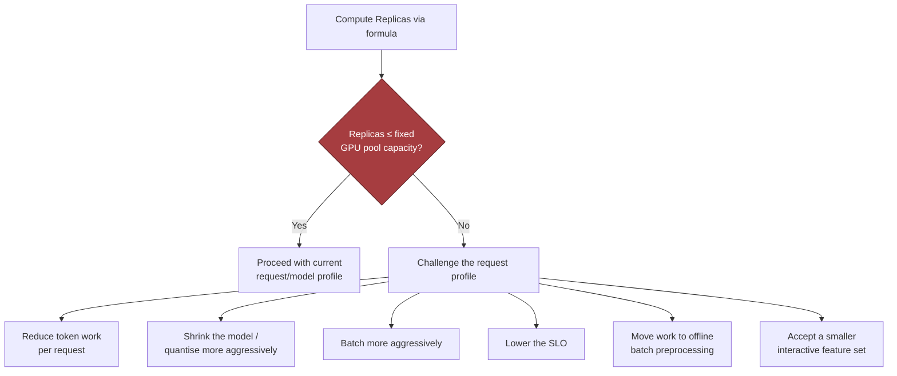

# Design an AI System for an Air-Gapped Environment, part 2

## 3. Scale Estimates, SLOs, and Capacity

### Anchor the Load Envelope to Customer Reality
- Candidates often slip on the first pass. They picture an on-prem service that analyses documents, guess at a few dozen active users, and settle on one model replica behind a queue. That holds up on an average day. Then the customer names a deadline (their busiest day, or a date by which the backlog must be gone) and the plan falls over.
- An enclave gives you little or no room to scale out later. Get the capacity plan right before anything ships.
- Start from how the customer really works. The case fixes four facts: 1,000 users, 20 QPS at peak, a corpus of 50 million pages, and a GPU pool that cannot grow.
  - Those figures pick the architecture for you. The options are batch processing, online interactive extraction, or a split where indexing runs asynchronously under a smaller interactive layer.
  - They also decide what failure looks like: a "slow response", or a "missed mission deadline".
- Keep four figures apart, since each answers its own question:
  - Average load → describes ordinary daily behaviour.
  - Peak load → guards you when bursts pile up in the queue.
  - Growth → tells you whether the design lasts through a year of adoption.
  - Headroom → stops you running on the brink of collapse when a large document lands.

### Storage Sketch
- Model weights and runtime packages, kept as one primary release and two versions you can roll back to.
- Vector or search indexes covering 50 million pages, with room for metadata and sharding overhead.
- Logs, audit trails and operational metrics, held for as long as the customer's local policy requires.
- Short-lived staging space for signed updates, validation artifacts and the packages behind a canary rollout.
- Real sizes hinge on the model you pick, how you chunk, the embedding dimension, the retention policy and compression. Skip false precision, but show that storage is never "just the model".
- Keep those rollback copies. Inside an enclave, reverting can be slow, or the approval process can hold it up, so a bad release may stay live for a long time.

### Memory and Throughput per Replica
- Work out two figures for each replica: the memory it needs and the work it can serve.
  - Memory has to fit model weights, the KV cache (or an equivalent state), framework overhead and batch buffers.
  - Throughput normally means tokens per second for one replica, given the model, quantisation and batch size you settled on.
  - Quote GPU count with no throughput and you miss the bottleneck. Quote memory with no throughput and you miss the placement constraint.
- A memory estimate at interview scale (my own illustrative figures; none come from real hardware):
  - Weights after quantisation: 12 GB.
  - Runtime and framework overhead in the serving stack: 2 GB.
  - KV cache plus transient activations at the target context length: 6 GB.
  - Batch buffers, with slack for fragmentation: 2 GB.
  - Sum: about 22 GB of GPU memory for each replica.
  - A 24 GB card leaves too thin a margin for a noisy batch or a context longer than planned. You would probably step up to a 32 GB GPU, or else pick a smaller model, cap context harder, or quantise further.
  - Use the estimate to decide whether today's class of hardware can carry the workload at all. It is not an exact promise.

### The Replica Sizing Formula
- One equation drives the sizing:

$$
Replicas = \left\lceil \frac{QPS \times Tokens_{request}}{TokensPerSecond_{replica} \times UtilizationTarget} \right\rceil
$$

- Terms: *QPS* is how fast requests arrive. *Tokens_request* is the mean token work in one request. *TokensPerSecond_replica* is what a single replica can sustain. *UtilizationTarget* is the share of peak capacity you will spend before latency gets too bad.
- The top of the fraction turns request rate into token demand. The bottom turns one replica into the capacity it can really offer once headroom is set aside.
- If the answer is larger than the fixed GPU pool, cut the token work in each request, use a smaller model, batch harder, relax the SLO, shift work into offline preprocessing, or agree to a smaller interactive feature set.

### Worked Example: 1,000 Users, 20 QPS
- The case supplies 1,000 users who drive a peak of 20 QPS in a surge window. Everything else is my assumption. A typical request costs 2,000 tokens of model work, covering retrieval augmentation and the generated output. At our chosen batch shape, a replica holds 120 tokens/sec. I'd aim for 70% utilisation:

$$
Replicas = \left\lceil \frac{20 \times 2000}{120 \times 0.70} \right\rceil = \left\lceil \frac{40000}{84} \right\rceil = 477
$$

- The result is meant to feel wrong. It says the assumptions are likely wrong for a government deployment behind an air gap, where the GPU pool is fixed.
- Do not defend 477. Question the request profile:
  - Not all of the 20 QPS may be LLM inference. Much of it could be retrieval or metadata lookups.
  - Chunking, caching or form-based extraction might shrink the average model work behind each request.
  - The customer's workflow could really be batch-first. Then a queue with a nightly SLA is the better fit.
- The arithmetic forces the design towards something real. That is why you estimate at all.

> 🎯 **Interview Pointer:** Interviewers often choose numbers that give a ridiculous replica count on purpose. They want to see whether you cling to the result or question the assumed request mix. State the formula, reach the awkward number, then move to how the workload shape could change. Do not ask for more hardware.

### Sensitivity Analysis: Baseline vs. 10x Growth
- Strong answers give ranges instead of fake exactness. A sensitivity view beats one heroic number because it shows which design lever matters most.

| Scenario | QPS | Avg tokens/request | Effective token demand | Replica implication | Design pressure |
|---|---|---|---|---|---|
| Baseline illustrative case | 20 | 2,000 | 40,000 tokens/sec of demand, counted before headroom | The toy formula gives 477 replicas, a sign that this request mix cannot fit the fixed GPU pool | Steers you to batch or offline processing, less work in each request, or a far smaller model fraction |
| 10x growth case | 200 | 2,000 | 400,000 tokens/sec of demand, counted before headroom | About 4,760 replicas on the same toy assumptions | Shows the same architecture would break badly; you would need to partition the workload, precompute, or serve it another way |

- Read the direction more than the exact figures. In an enclave you cannot fix ten times the load by buying more of the same: the fixed GPU pool, the storage and the operational process cannot stretch on demand.

### What Changes First at 10x Growth
- More users? Identity, audit and queueing feel the strain before raw inference does.
- More pages? The index grows, and its rebuild time or storage bandwidth may become the limit.
- Longer documents? The bottleneck moves to token count and context length.
- Stricter SLOs? You need more headroom, and the fixed GPU pool runs short.
- State uncertainty plainly: *"These numbers are illustrative. I'd build the first deployment around the 20 QPS peak, plus a growth factor and some rollback margin. If the real request mix leans towards batch, the interactive pool gets smaller. If the average request is longer, we either add replicas or narrow what each request may ask for."*
- I expect per-request token demand to steer component choice and partitioning more than anything else:
  - Light requests → one general-purpose inference tier with retrieval may do the job.
  - Heavy requests → the design tends to split three ways: cheap preprocessing up front, a retrieval/rules layer in the middle, and a small set of expensive inference workers.
  - Inside an enclave, each added replica eats scarce offline capacity. Each added dependency makes updates and audits heavier.

### SLIs Tied to the Workflow
- Pick SLIs whose movement a customer would notice:
  - **Availability:** share of working hours in which the system takes jobs and hands back results.
  - **Latency:** how soon a submitted document yields its first useful result; separately, how long a whole batch takes.
  - **Freshness:** time from the arrival of approved content until it can be searched or used by the model.
  - **Quality:** accuracy of extraction, relevance of retrieval, or the rate at which analysts accept output.
  - **Security:** whether the network, identity, signing and audit boundaries hold.
  - **Cost:** GPU hours, storage footprint, support load and what a rollback costs.
- Fit objectives to the workflow. If analysts review results interactively, the interactive latency budget is the SLO that matters most. If ingestion runs nightly, freshness and completion time outrank latency per request.
- A latency budget breaks the end-to-end target into parts you can control: upload, preprocessing, retrieval, inference, validation and rendering the response.
  - When inference eats most of that budget, you likely need a smaller model, a shorter context or retrieval done ahead of time.
- **What to say in the interview:** work out size from the peak request rate, the average token work and the throughput of the fixed GPU pool. Turn that into a replica count, a storage footprint and headroom. Keep average load apart from peak load. Build SLOs around the customer's workflow. Use sensitivity ranges to find the assumption that moves the design most. Reshape the workload before you ask for unlimited hardware.
