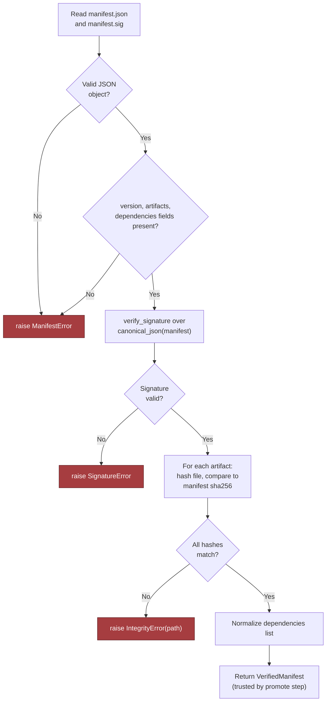

# Design an AI System for an Air-Gapped Environment, part 4

## 5. Data Model, APIs, and Working Code

### Three Governable Records
- `ReleaseManifest(version, artifact_hashes, signatures, dependencies)`: the promise a bundle makes, and so the contract you deploy against.
  - Primary key: `version`. Operators need one stable name they can cite, rebuild against and promote.
  - Lifecycle: written in the connected build environment, then signed, carried into the offline side, validated and staged. Finally it is promoted or turned away.
  - Retention: keep the manifest, its signature material and enough dependency detail to show later why the release passed or failed. Audit needs and local policy set the period; no universal standard applies.
- `ModelDeployment(model_id, version, hardware, status)`: the runtime truth about which model is live, and where.
  - Preferred primary key: `deployment_id`. When one model family can sit in several release states across different targets, add a unique constraint over `(model_id, version, hardware)`.
  - Without a dedicated deployment identifier, the composite `(model_id, version, hardware)` is the natural key. Pick one on purpose.
  - Lifecycle states: `staged`, `validated`, `active`, `draining`, `retired`.
  - Retention: hold enough history to answer *"Which model served this document when we analysed it?"*
- `OfflineAuditEvent(actor, action, artifact_hash, time)`: which actor took which action, on which artifact, at what moment.
  - Primary key: usually an event ID. The `(actor, action, artifact_hash, time)` tuple serves as the business key.
  - Lifecycle: append-only. Nobody rewrites an audit row once it exists.
  - Retention: follow the customer's audit policy. Purge too eagerly and trust goes; hoard too much and you may break local retention rules.
- **Ownership boundaries:** the build team holds signed release material up to the handoff into offline validation. The offline runtime holds deployment state. Security/operations holds the audit trail. This split stops a government network from turning into one huge mutable blob.

### API Contracts
- **`POST /v1/documents/analyze`**: the data-plane call that users hit.
  - Request: an authenticated document payload, plus optional metadata such as an idempotency key or an analysis profile.
  - Response: a typed analysis result with a pointer to the model version and a request identifier.
  - Authentication stays inside the boundary, through an offline identity provider or a token minted on the network itself. "Just use OAuth" is not an answer.
  - Idempotency: if one idempotency key arrives twice with an identical body, the caller gets the same result, or a stable "already processed" reply.
  - Errors separate bad input, unauthorised access, no free model capacity and a policy rejection.
- **`GET /v1/models/status`**: the read path for operators.
  - It reports each model's deployment state, the live version and whether each hardware target is ready.
  - Repeated calls change nothing, so they are harmless. Callers still authenticate, because status data can reveal operational details.
  - Its errors tell apart "unknown model", "not deployed" and "temporarily unavailable".
- **`POST /v1/admin/releases/validate`**: the gate in the control plane.
  - It takes a pointer to a bundle or the uploaded bundle itself. It checks the manifest signature, compares artifact hashes and confirms every declared dependency is on hand. It returns a structured pass/fail result or a validation report.
  - It is idempotent per release identifier. Two runs on one bundle yield a single logical validation record, unless the content changed in between.
- **`POST /v1/admin/releases/{id}/promote`**: moves a release from validated to active.
  - Three guards protect it: authorisation, policy checks and optimistic concurrency.
  - It refuses when the release cannot be promoted from its current state, when the target deployment moved since the client last read it, or when the live release is not the one the client expected.
  - Request and response shapes carry versions, so a later change to the manifest or to validation output cannot break older tooling overnight.
- Versioning does not stop at public APIs. The bundle format, the manifest schema and the audit event schema need it too. When nobody can update the offline environment at will, each breaking change must be planned as a migration, never treated as a light refactor.

### Release Verification: The Highest-Risk Code Path
- No component carries more risk than release verification. If the system cannot check a bundle offline, the rest is theatre. Hence the first production gate: no bundle enters the enclave until it has proved, offline, that it is intact, complete and compatible.

```python
from __future__ import annotations

import hashlib
import hmac
import json
from dataclasses import dataclass
from typing import Any, Mapping


class IntegrityError(Exception):
    pass


class ManifestError(Exception):
    pass


class SignatureError(Exception):
    pass


class ValidationError(Exception):
    pass


@dataclass(frozen=True)
class VerifiedManifest:
    version: str
    artifacts: tuple[dict[str, str], ...]
    dependencies: tuple[str, ...]


def canonical_json(obj: Any) -> bytes:
    return json.dumps(obj, sort_keys=True, separators=(",", ":")).encode("utf-8")


def sha256_hex(data: bytes) -> str:
    return hashlib.sha256(data).hexdigest()


def verify_signature(trusted_public_key: bytes, payload: bytes, signature: bytes) -> None:
    # Interview sketch: replace with a real signature primitive such as Ed25519 verification.
    expected = hmac.new(trusted_public_key, payload, hashlib.sha256).digest()
    if not hmac.compare_digest(expected, signature):
        raise SignatureError("manifest signature verification failed")


def _require_str(mapping: Mapping[str, Any], key: str) -> str:
    value = mapping.get(key)
    if not isinstance(value, str) or not value.strip():
        raise ManifestError(f"missing or invalid string field: {key}")
    return value


def _require_list(mapping: Mapping[str, Any], key: str) -> list[Any]:
    value = mapping.get(key)
    if not isinstance(value, list):
        raise ManifestError(f"missing or invalid list field: {key}")
    return value


def verify_bundle(bundle, trusted_public_key: bytes) -> VerifiedManifest:
    manifest_raw = bundle.read_bytes("manifest.json")
    signature = bundle.read_bytes("manifest.sig")

    try:
        manifest = json.loads(manifest_raw)
    except json.JSONDecodeError as exc:
        raise ManifestError("manifest.json is not valid JSON") from exc

    if not isinstance(manifest, dict):
        raise ManifestError("manifest root must be an object")

    version = _require_str(manifest, "version")
    artifacts = _require_list(manifest, "artifacts")
    dependencies = _require_list(manifest, "dependencies")

    verify_signature(trusted_public_key, canonical_json(manifest), signature)

    normalized_artifacts: list[dict[str, str]] = []
    for idx, item in enumerate(artifacts):
        if not isinstance(item, dict):
            raise ManifestError(f"artifacts[{idx}] must be an object")
        path = _require_str(item, "path")
        expected_hash = _require_str(item, "sha256")
        if len(expected_hash) != 64 or any(c not in "0123456789abcdef" for c in expected_hash.lower()):
            raise ManifestError(f"artifacts[{idx}].sha256 is not a valid hex digest")
        actual_hash = sha256_hex(bundle.read_bytes(path))
        if not hmac.compare_digest(actual_hash, expected_hash):
            raise IntegrityError(path)
        normalized_artifacts.append({"path": path, "sha256": expected_hash})

    normalized_deps: list[str] = []
    for idx, dep in enumerate(dependencies):
        if not isinstance(dep, str) or not dep.strip():
            raise ManifestError(f"dependencies[{idx}] must be a non-empty string")
        normalized_deps.append(dep)

    return VerifiedManifest(
        version=version,
        artifacts=tuple(normalized_artifacts),
        dependencies=tuple(normalized_deps),
    )
```

- Walk through it piece by piece:
  - `canonical_json` turns the manifest into deterministic bytes before the signature check, so one logical manifest always hashes the same way.
  - `sha256_hex` produces a stable digest to compare artifacts against.
  - `verify_signature` is labelled a sketch on purpose. Production code needs a genuine asymmetric primitive where this HMAC stand-in sits.
  - Three exception classes tell the caller what broke: the signature, the shape of the manifest or the integrity of the content. Each calls for a different operator response.
  - `VerifiedManifest` is frozen, so nothing can quietly alter a successful validation result afterwards.
  - `_require_str`/`_require_list` check types at the boundary. Malformed input fails early, before any state moves.
  - `verify_bundle` reads the manifest and signature, parses the JSON defensively and checks the required fields. It verifies the signature over the canonical form, then compares each artifact hash with `hmac.compare_digest` to avoid timing leaks. It returns a normalised, typed result that a later promote step can rely on.

### Verify-Bundle Flow



### What the Snippet Omits on Purpose
- The sketch leaves out concurrency, retries and observability. They belong to the production layer around the core path.
- **Concurrency:** promotion should rely on optimistic concurrency in the control plane. Each release object holds a version/revision token that the promote call sends back. If another operator has already moved the deployment state on, the server refuses the write. Two people cannot then push incompatible releases live at once.
- **Retries:** retry safe reads and validation calls automatically, and nothing else by default. Retry a promotion only when it was built to be idempotent and a write token guards it. Document analysis requests should take an idempotency key, so a client retry creates neither duplicate work nor duplicate audit rows.
- **Observability:** surround the path with logs, counters and structured audit events. Each validation pass should record who validated which bundle, which hash it checked and, on failure, the reason. An air gap has no external vendor console, so these records are the only practical way to rebuild an incident.

### Failure Behaviour to State Explicitly
- Duplicate requests reveal whether a design truly handles idempotency. Say an operator submits one validated bundle twice because the first response timed out. With a matching idempotency key and bundle hash, the second call returns the same validation outcome and does not move state forward again.
- If a promote request is resent after a transient fault inside the boundary, the server either returns the state already reached or rejects the repeat with a clear, stable error: this version is not waiting for promotion any more.
- The key drill is a missing transitive package. When a manifest names a dependency the offline artifact store lacks, validation must fail before installation, not at runtime. That is why `dependencies` sits in the manifest rather than in someone's head.

### Contract and Failure-Injection Tests
- The tests show how the deployment gate acts on a pass and on a failure. Full coverage is not the goal.

```python
class BundleStub:
    def __init__(self, files):
        self.files = files

    def read_bytes(self, path):
        return self.files[path]


def test_verify_bundle_accepts_known_good_bundle():
    manifest = {
        "version": "2024.10.1",
        "artifacts": [{"path": "model.bin", "sha256": ""}],
        "dependencies": ["tokenizer.json"],
    }
    files = {
        "model.bin": b"weights-bytes",
        "tokenizer.json": b"vocab-bytes",
    }
    manifest["artifacts"][0]["sha256"] = sha256_hex(files["model.bin"])
    manifest_bytes = canonical_json(manifest)
    key = b"trusted-key"
    sig = hmac.new(key, manifest_bytes, hashlib.sha256).digest()
    bundle = BundleStub({
        "manifest.json": manifest_bytes,
        "manifest.sig": sig,
        **files,
    })

    verified = verify_bundle(bundle, key)

    assert verified.version == "2024.10.1"
    assert verified.artifacts[0]["path"] == "model.bin"
    assert verified.dependencies == ("tokenizer.json",)


def test_verify_bundle_rejects_corrupted_artifact_hash():
    manifest = {
        "version": "2024.10.1",
        "artifacts": [{"path": "model.bin", "sha256": "0" * 64}],
        "dependencies": ["tokenizer.json"],
    }
    manifest_bytes = canonical_json(manifest)
    key = b"trusted-key"
    sig = hmac.new(key, manifest_bytes, hashlib.sha256).digest()
    bundle = BundleStub({
        "manifest.json": manifest_bytes,
        "manifest.sig": sig,
        "model.bin": b"tampered-weights",
        "tokenizer.json": b"vocab-bytes",
    })

    try:
        verify_bundle(bundle, key)
        raise AssertionError("expected IntegrityError")
    except IntegrityError as exc:
        assert str(exc) == "model.bin"
```

- Test 1 (contract test): with a valid manifest, a valid signature and matching artifact hashes, the verifier returns a normalised `VerifiedManifest` holding the expected version and dependency list.
- Test 2 (failure-injection test): it fakes corruption with a wrong hash and altered artifact bytes, then checks that `IntegrityError` names the exact path that failed.
- A real repository would add a third test that damages `manifest.sig` and expects `SignatureError`, since a bad signature and a bad artifact need different operational responses. For a whiteboard sketch, one contract test and one failure-injection test are enough.

### Why This Is a Strong FDE Answer
- An FDE turns the architecture into production-grade detail a customer can trust.
- An answer earns credibility once its state changes, API contracts and failure-safe code are spelled out.
- **90-second implementation summary:** I'd ship each release as a signed manifest that lists every artifact hash and declares every dependency. Deployment state lives apart from audit state. Versioned endpoints cover analysis, status, validation and promotion. Every write path is idempotent and uses optimistic concurrency. Release verification is the riskiest part, so I'd build and test it first: typed checks on the manifest, a signature check, a hash check per artifact, and clearly structured failure modes. The result is maintainable AI that runs locally and never crosses the enclave's network, artifact, identity or audit boundaries.
