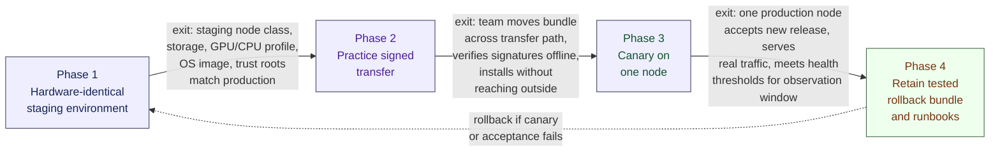

# Design an AI System for an Air-Gapped Environment, part 6

## 7. Delivery Plan, Observability, and Business Impact

### From Prototype to Trusted Production
- A working demo is only the start. The milestone is the customer seriously asking when they can rely on it in production.
- Once that question lands, the interview moves past architecture into delivery. You now need a phased rollout, gates you can measure, named owners and a support model that holds up when the first incident hits.
- Inside an air gap, delivery belongs to the design itself. If the team must improvise to move, verify, install, watch or roll back the software, they have an encouraging demo they cannot deploy.
- The FDE's job is to turn the prototype into an operating path: safe enough for the enclave, dull enough for operators, valuable enough for users.

### Four Phases That Move Risk Out of the Dark

1. **Stand up a staging environment on identical hardware.**
   - **Owner:** infrastructure or platform engineering, with a security review by the enclave team.
   - **Exit criteria:** trust roots, OS image, GPU/CPU profile, storage layout and node class all match production, so install and runtime results are representative.
   - **Why it matters:** a staging setup built for convenience masks the problems that bite later, such as package incompatibility, driver mismatch, disk layout surprises and painful upgrades.
2. **Rehearse the signed transfer.**
   - **Owner:** release engineering runs it; security and operations watch the drill together.
   - **Exit criteria:** the team carries a release bundle along the controlled transfer path, checks its signatures offline and installs it with no call beyond the boundary.
   - **Why it matters:** real systems often fail at the transfer step. A plan of "someone will hand-carry it" falls short unless the handoff is written down, repeatable and auditable.
3. **Run a canary on a single node.**
   - **Owner:** operations runs it, while the product owner and an incident responder stay on call.
   - **Exit criteria:** a single production node takes the new release, handles real traffic and stays within the agreed health thresholds for a set observation window.
   - **Why it matters:** the canary contains the risk. No cloud-scale rollback shortcut exists on a closed network. So the first live node must show that configuration, dependencies, model and bundle behave well together.
4. **Keep a tested rollback bundle and its runbooks.**
   - **Owner:** operations carries out a rollback, release engineering keeps the artifacts, and the technical lead approves.
   - **Exit criteria:** the last known-good bundle sits stored, tested and ready for immediate use, along with its escalation path, operator checklist, rollback steps and signatures.
   - **Why it matters:** treat rollback as a prepared artifact. When a release goes wrong, the team needs a trusted route back instead of a scramble to rebuild confidence under pressure.
- Each phase gets an owner, a gate and a stopping point before damage spreads. That separates a staged rollout from deployment by hope.

### Technical Health Metrics
- **Offline install success rate**
  - *Calculation:* offline installs that succeed divided by offline installs attempted, both counted over the same release window.
  - *Data from:* installer logs, release logs and node boot records.
  - *Owner:* release engineering.
  - *Alert threshold:* a rate under baseline, or failures on more than one staging or production node in one release cycle, halts expansion. Check bundle integrity, dependency drift and environment mismatch.
- **Signature verification failures**
  - *Calculation:* how many signature checks on bundles, artifacts or manifests fail in transfer or at install.
  - *Data from:* transfer logs, plus the verification logs written at install time.
  - *Owner:* security engineering or release engineering, whichever the local operating model assigns.
  - *Alert threshold:* treat any unexpected failure as a go/no-go blocker until the root cause is clear.
- **Model throughput and latency**
  - *Calculation:* documents or pages handled per unit of time, together with request latency at the chosen percentile on user-facing paths.
  - *Data from:* local performance counters and service telemetry.
  - *Owner:* platform or ML operations.
  - *Alert threshold:* when latency leaves the band users accept, or throughput drops under the demand forecast, look at queue limits, hardware saturation, model quantisation or batching changes.
- **Capacity saturation**
  - *Calculation:* how much of the safe operating headroom is in use, across token budget, queue depth, disk I/O, memory, GPU or CPU.
  - *Data from:* service queues and host metrics.
  - *Owner:* infrastructure or SRE.
  - *Alert threshold:* if the system runs close to its ceiling for a sustained period, scale up, shed load or throttle workflows before it turns unstable.
- **Mean time to repair**
  - *Calculation:* the average time between declaring an incident and restoring service.
  - *Data from:* incident timelines.
  - *Owner:* incident management together with the primary on-call team.
  - *Alert threshold:* if repair times climb from one release to the next, the team probably lacks documentation, automation or spare capacity.
- **Release age**
  - *Calculation:* time elapsed since the approved bundle now running was signed off and deployed.
  - *Data from:* deployment records and the release registry.
  - *Owner:* release manager.
  - *Alert threshold:* a release that is too old has drifted away from the latest security fixes and operational lessons. Releases that change too fast get too little soak time.

### User and Business Metrics
- Keep these apart from technical health. A healthy system can still go unused.
- **Adoption metrics:** repeat use, active users, documents submitted, and the share of workflows done with no manual workaround.
- **Business outcome metrics:** time saved on each case, a lighter manual review load, more analyst throughput, and fewer missed deadlines or rework cycles.
- **Outcome owner:** normally the business sponsor or the operations manager, backed by product and the FDE.
- Tie the layers together. Faster throughput means little if analysts distrust the output. And if users adopt it but still correct results by hand, the workflow gain is smaller than the demo implied.

### A Dashboard That Tells One Story
- Avoid a wall of green lights. The dashboard should trace how value for users depends on each layer of the stack.
- **Top row: user outcome.**
  - Documents handled in each shift.
  - Mean turnaround time per case.
  - Proportion of cases finished without any manual fallback.
- **Middle row: service behaviour.**
  - Offline install success rate for each release.
  - Signature verification failures for each transfer event.
  - Model latency and throughput per node.
  - Indicators of queue depth and saturation.
- **Bottom row: operational control.**
  - Age of the release now running.
  - Whether a rollback bundle is available.
  - Mean time to repair, alongside open incidents.
  - The most recent successful signed transfer.
- Laid out this way, the dashboard settles the question that counts most in a closed network. Is the user's problem getting better because the system is healthy? Or is the system only staying alive while the workflow stays painful?

> 🎯 **Interview Pointer:** "How would you dashboard this?" comes up often. Answer with three rows (user outcome, service behaviour, operational control) rather than a flat list of metrics. It shows you reason in causal layers instead of collecting green lights.

### Ownership, Gates, and Rollback Triggers
- **Product or business owner:** sets the case-review workflow and decides what success means.
- **Release engineering:** packages the artifacts, signs the bundles and keeps the release records.
- **Security:** signs off on trust-root handling, audit evidence and the transfer process.
- **Operations or SRE:** monitors health metrics, runs the canary and carries out rollback.
- **ML or platform engineering:** answers for model performance, runtime efficiency and compatibility.
- **Help desk or support lead:** sorts user problems, training gaps and documentation defects.
- **Go/no-go gates:** the first two apply the rule that no bundle enters the enclave until it has proved, offline, that it is intact, complete and compatible.
  - Offline verification of the bundle passes.
  - The bundle is complete and fits the target node class.
  - On hardware close enough to production, the staging run shows the expected behaviour.
  - Latency, throughput and saturation on the canary node stay within thresholds.
  - Someone has tested the rollback bundle; archiving it is not enough.
- **Rollback triggers:** signature failures that repeat, an install failure nobody can explain, a latency regression on the canary, a climbing error rate, or any sign that the release puts enclave integrity at risk. In an air-gapped setting, "we'll debug it live" is no plan. Saying it means the team never had a working way back.

### Standardisation Strategy
- Sort what should be the same for every customer from what should stay local:
  - **Configuration:** approval thresholds, retention rules, document types, queue limits, which approved offline model to use, and the rules that route workflows.
  - **Adapter:** importers that read the customer's document sources, connectors that export to case systems, and translation layers that map local formats into the analysis pipeline.
  - **Shared service:** the release registry, audit logging, bundle validation, signature verification and model serving primitives. These are strong candidates to reuse across enclaves.
  - **Core product:** the document analysis engine, the health-check framework, the offline package manager and the discipline of rollback. Improve these and every deployment benefits.
- This split shows product thinking. The FDE should not hand-build one-off integrations forever. The goal is to turn repeated local pain into reusable product capability while respecting every customer boundary.

### Risk Register
- **Risk:** the offline bundle lacks a transitive package.
  - *Owner:* release engineering.
  - *Mitigation:* dependency lockfiles, a preflight check that validates the bundle, and an install rehearsed in staging.
  - *Trigger:* an install fails, or an import cannot be resolved at boot.
- **Risk:** signatures do not match during transfer.
  - *Owner:* security engineering.
  - *Mitigation:* validating the trust root offline, checking signed manifests, and transfer steps that need dual control.
  - *Trigger:* any verification failure nobody expected.
- **Risk:** on one node, model latency goes beyond what users will tolerate.
  - *Owner:* platform or ML operations.
  - *Mitigation:* a smaller variant of the model, adjusted batching, or moving the work to other hardware.
  - *Trigger:* the canary shows a latency regression or queues keep growing.
- **Risk:** operators need tribal knowledge to support the workflow.
  - *Owner:* support lead and technical lead.
  - *Mitigation:* incident drills, runbooks, training, and explanations attached to alerts.
  - *Trigger:* the same questions keep coming, escalations stall, or people handle cases inconsistently.

### The Delivery Story the Interviewer Wants to Hear
- The prototype runs, and the customer wants to know when it will be production-ready. "After we tune the model some more" is the wrong reply.
- The right reply takes four steps from prototype to staged rollout. Build staging on hardware identical to production, rehearse the signed transfer, run a canary on one node, and keep a tested rollback bundle with runbooks.
- Track release age, mean time to repair, saturation, latency, throughput, signature verification failures and offline install success rate.
- Track business outcome, adoption, model quality and technical health as separate layers. Only then can you tell whether the product makes the workflow better.
- Name owners and set gates, so a bad release halts before it turns into an incident.
- Measurable customer impact statement: the system counts as a success only when analysts use it, documents are handled faster and more consistently, and the operating team keeps it running as maintainable AI that runs locally and never crosses the enclave's network, artifact, identity or audit boundaries.
