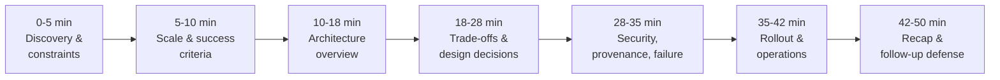

# Design an AI System for an Air-Gapped Environment, part 7

## 8. Interview Walkthrough, Trade-Offs, and Practice

### Minute Zero: Open With the Customer Outcome
- Lead with what the customer gains, phrased the way they would say it: *"We want local AI we can maintain inside an air-gapped government network. Updates have to be controlled, nothing can lean on the internet, and we need an audit trail that stands up to scrutiny."*
- It shows you heard the operating constraint, and it keeps you out of a stock chatbot design.
- Before you draw anything, get the interviewer to confirm which boundary carries the most risk:
  - What does the air gap protect?
  - Is the isolation total, or do governed transfer points exist for media, packages and logs?
  - Are we deploying into one secure enclave, several disconnected sites, or a staged network split into separate trust zones?
  - Should analysts share one service, or do especially sensitive teams need their own isolated workstations?
- Spend minutes by risk, not by diagram size. Software ingress, provenance, identity and rollback deserve the most. Cosmetic model debates and over-tuned UI features deserve the least.
- Announce the plan out loud: *"First I'll cover how software gets into the enclave and how we show it's safe. After that, we can walk the request path and how the team runs it."*

### A 50-Minute Pacing Plan

- **0–5 minutes: discovery and constraints**
  - Give the customer outcome back in a single sentence.
  - Pin down the air-gap boundary, how updates happen and what auditors expect.
  - Ask who the users are, which document types matter and whether success means search, extraction, classification, summarisation, or all of them.
  - Check where it runs: centrally, on analyst workstations, or both.
  - Flag your riskiest assumption and promise to return to it.
- **5–10 minutes: scale and success criteria**
  - Estimate daily documents, typical size, peak concurrent analysts and freshness needs.
  - Without given latency targets, state them in words: interactive queries feel quick; batch jobs may run slower.
  - Track user adoption, offline install success, signature verification, release age and incident recovery time.
  - Treat every capacity figure as illustrative until the customer confirms the workload.
- **10–18 minutes: architecture overview**
  - Sketch the trust zones: outside sits the build environment; a transfer gate links it to the enclave, which holds the admin plane, audit store, document pipeline, inference service, model registry and package repository.
  - Keep the data plane apart from the control plane.
  - Documents move inward; results and logs reach only approved destinations; nothing relies on cloud telemetry.
  - No path ever breaches the identity, artifact or audit boundary.
- **18–28 minutes: trade-offs and system design decisions**
  - Bigger-model quality against hardware fit.
  - Containers or virtual appliances.
  - Update cadence against accreditation cost.
  - A central cluster or workstations.
  - Justify each by customer value and running cost, never taste.
- **28–35 minutes: security, provenance, and failure handling**
  - Cover signed artifacts, pinned dependencies and repeatable builds.
  - Show a patch passing a controlled import gate and checks before promotion.
  - Explain offline debugging with reproducible replay, health endpoints, structured event traces and local logs.
  - Run the drill: new model weights, old index. What happens?
- **35–42 minutes: rollout and operations**
  - Walk through staging, the canary, rollback and user training.
  - Say who owns each area: the platform, security, support and the analyst community.
  - Show release age and approval gates lowering risk without freezing progress.
  - Explain reuse in similar enclaves.
- **42–50 minutes: recap and follow-up defence**
  - Give the ninety-second version of the architecture.
  - Point out the biggest trade-off.
  - State the first production gate.
  - Take questions; tie each answer back to boundaries, provenance or rollback.

### Trade-Off: Model Size vs. Hardware Fit
- This is usually the first tension interviewers probe.
- Extraction and summaries may improve with a bigger model. But it may not fit in local GPU memory, it answers slower, patching gets harder and the customer may have to buy or borrow hardware.
- A smaller model fits easily and is simpler to support, yet may struggle with noisy documents, specialised vocabulary or long-context reasoning.
- "Always biggest" and "always smallest" are both wrong. Optimise for the mission:
  - For triage or structured extraction, a reliable, well-tuned small model can beat a brittle large one that is costly to maintain.
  - Subtle legal or technical interpretation can justify bigger inference hardware, but only if enclave operators can sustain and safely patch it.
- Interview line: *"I'd pick the smallest model that clears the quality bar on the customer's own documents. Each step up in size competes for enclave hardware, adds latency and adds accreditation work."*

### Trade-Off: Containers vs. Virtual Appliances
- Containers give portability, repeatable deployment and cleaner separation of concerns. They fit an enclave with an existing platform team and components refreshed one at a time.
- A virtual appliance seals the stack in a fixed boundary with fewer moving parts, which some security teams find easier to review.
- The tension is operational complexity against governance simplicity:
  - Pick containers if efficient scaling, controlled patching and reusable components rank highest.
  - Pick an appliance if the customer prefers one tight, inspectable unit and slow, deliberate change.
- Let the organisation's existing standards decide. An existing hardened virtualisation standard favours the appliance. An existing secure container platform favours containers for upkeep and reuse.

### Trade-Off: Update Frequency vs. Accreditation Cost
- Frequent updates cut vulnerability exposure, lift model quality and speed feedback. Yet each one must be packaged, signed, transferred, verified, staged, tested and approved, and may trigger re-accreditation.
- "Ship weekly because we're agile" is wrong. Size the release train to the governance load the customer can carry:
  - Keep urgent security patches on a separate track from new features.
  - Prebuild trusted update bundles.
  - Promote from dev to staging to the enclave.
  - Make each high-friction change smaller, more predictable and easier to audit, so fewer are needed.
- Strong phrasing: *"I'd favour fewer releases that we trust more. In an air-gapped setting, change costs you in engineering and in governance."*

### Trade-Off: Central Cluster vs. Workstation Deployment
- One central cluster is easier to manage and observe, and every analyst reaches the same models. It suits many analysts on one service, where a managed platform is allowed.
- Workstations help on a heavily segmented network, at low volume, or when the capability must survive limited central infrastructure.
- Decide on user count, concurrency, isolation needs and how much central administration the customer can sustain.
  - Workstations reduce reliance on shared infrastructure, at the price of harder patch distribution, more support and weaker consistency.
  - A central service raises reuse and control, but becomes one operational asset to protect and monitor closely.
- If the enclave can host it, start central: governance and updates are easier there. Fall back to workstations for isolated teams or cut-off sub-enclaves.

> 🎯 **Interview Pointer:** The four trade-offs follow one pattern. Lay out both options, name the deciding factor in terms of the customer's real constraints, then commit to a default and say when you would leave it. Use the same pattern live for trade-offs this section does not list.

### Four Hard Follow-Up Questions
- **"How do patches enter the network?"**
  - Via controlled import, never casual file copying. Builds happen outside the enclave; each patch is signed, scanned and packaged as an immutable release artifact.
  - It crosses by a customer-approved transfer mechanism into a quarantine or staging repository inside the air gap.
  - Before promotion, the enclave checks the signature and dependency manifests and runs regression tests.
  - If pushed, split emergency security updates from planned releases. Emergencies still need provenance and validation but can use a faster approval path with pre-agreed criteria. Every crossing carries a named owner, a checksum or signature, and a promotion record.
- **"With no cloud telemetry, how do you find faults?"**
  - On site, by design, with enough instrumentation that nobody guesses. The enclave keeps its own audit events, local metrics, health checks, trace correlation IDs and structured logs.
  - Replayable fixtures from representative documents let you reproduce failures offline.
  - Support flow: once an analyst flags a fault, record the index revision, document hash, model version, request context and involved service logs. You can then reproduce it with no data leaving the network. If policy bars full payloads, keep the smallest safe subset or a redacted reproduction bundle.
  - Principle: disciplined internal observability plus rich release metadata replace external observability.
- **"The weights changed but the index didn't. Now what?"**
  - It probes whether you see coupled artifacts. Version model and retrieval index together as a compatible pair.
  - New weights that alter embeddings, tokenisation or ranking behaviour may force an index rebuild or revalidation.
  - Index schema, embedding pipeline, prompts, tokeniser and model package form a single compatibility surface.
  - A pure runtime gain behind the same interface may keep the index. A representation change needs a rebuild, or a parallel index staged to compare outputs before traffic moves.
  - You show the unwritten contract between retrieval and generation, and a safe upgrade path rather than "updating the model."
- **"How do you prove build provenance?"**
  - As chain of custody: where the artifact came from, which code built it, which dependencies went in and who approved its entry to the enclave.
  - The evidence: artifact hashes, reproducible build steps, pinned dependency manifests, tagged releases or signed commits, plus a verification record at every hand-off.
  - For detail, a build system emits attestations and policy checks verify them before install.
  - Never claim absolute proof. You get strong evidence and a control you can defend. It ends the guesswork when an auditor or operator asks, "What exactly is running here?"

### Common Weak Answers and Repairs
- **"Let's run our usual cloud stack on-prem."** → Repair: name the cloud dependencies that would breach the air-gap boundary, and the enclave-local services that replace them.
- **"Pick the largest model we can get."** → Repair: tie the choice of model to what the hardware holds, the latency users accept and the cost of upkeep.
- **"Security can handle the rest."** → Repair: show that you own the artifact flow, identity, logs and rollback.
- **"We'll patch monthly."** → Repair: explain release trains, the emergency-fix path and the approval cost every update brings.
- **"Logs can wait; we'll look when something breaks."** → Repair: say what you must capture from day one so offline debugging is possible.
- **"Model and index are independent."** → Repair: admit that embedding behaviour, retrieval quality and index freshness have to stay compatible.
- To sound senior, drop the generic answer and say: *"That works in plenty of environments. In an air-gapped enclave, though, the hard part isn't technical feasibility. It's managing change safely."*

### Self-Scoring Rubric
- **Discovery:** Did you surface the customer's true outcome, where the boundaries sit and which unknowns are most dangerous?
- **Estimation:** Did you convey a sensible scale and capacity, and flag numbers as illustrative where needed?
- **Architecture:** Were the update flow, the trust boundaries, and the data and control planes each kept separate?
- **Depth:** Did you dig into the riskiest areas rather than give every box the same airtime?
- **Security:** Did you cover provenance, identity, transfer controls, logging and rollback, while admitting no control makes risk vanish?
- **Delivery:** Did you show the path from prototype through staged rollout to production support?
- **Communication:** Were you crisp and structured, and did you welcome redirection?
- Winning answers show judgement rather than box count: what matters, what can wait, what needs control and how the customer gains.

### The Final 90-Second Summary
- *"I'd run document analysis inside the air gap as an enclave service under central management. Signed releases come in through a controlled import path. The model and index ship together as versioned bundles. Local observability lets us support it offline. On model size, I'd go as small as approved hardware allows while still passing the customer's quality bar on their documents. Accuracy matters, but so do hardware fit, update cost and accreditation friction. If the customer already runs a secure platform, I'd use containers. If governance simplicity comes first, I'd switch to a virtual appliance. My biggest risk is the tension between how often we update and how much review each update needs. A staged release train, signed artifacts and bundles we can roll back keep that in check. The first production gate: no bundle enters the enclave until it has proved, offline, that it is intact, complete and compatible. After that, an in-enclave canary has to show verified provenance, steady latency and a support runbook we've already tested."*
- It works because it ties the design to the customer's goal, **maintainable AI that runs locally and never crosses the enclave's network, artifact, identity or audit boundaries**, and proves you can hold the design under pressure.

### Practice Assignments
- **Solo exercise:** Without looking at this page, write your own 90-second answer to this scenario. Then cut it again under one rule: a sentence stays only if it names a production risk, defends a trade-off or makes a boundary clearer.
- **Pair mock:** One person plays a sceptical security reviewer whose only questions are follow-ups on patches, provenance and logging. The candidate may say "secure," "robust" or "scalable" only if they define the mechanism behind the word straight away.
- **Implementation exercise:** Map the life of a single enclave update: commit the code, build, sign, stage, import, validate, promote and roll back. Flag each step that alters the audit log, the index or the model artifact. Then pick the exact step where you would halt the rollout if the weights changed and retrieval quality dropped.
- **What to remember under interview pressure:** when lost, come back to what the customer needs, where trust ends, how releases travel and how you undo one. Great FDE answers are structured, carry believable numbers, stay safe without theatre, keep the customer in view and name trade-offs openly.
