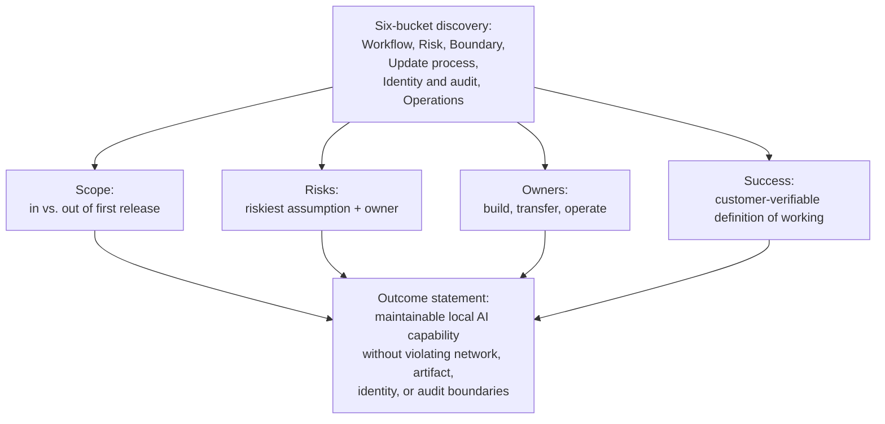
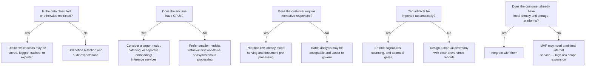

# Chapter 7: Design an AI System for an Air-Gapped Environment

*Source: THE FORWARD DEPLOYED ENGINEER SYSTEM DESIGN INTERVIEW*

## Table of Contents
- [1. The Customer Problem and Discovery](#1-the-customer-problem-and-discovery)
  - [The Core Tension and Outcome Statement](#the-core-tension-and-outcome-statement)
  - [Stakeholder Map](#stakeholder-map)
  - [Six-Bucket Discovery Framework](#six-bucket-discovery-framework)
  - [Scope, Risks, Owners, Success](#scope-risks-owners-success)
  - [Choosing a Business-Outcome Metric](#choosing-a-business-outcome-metric)
- [2. Clarifying Questions, Requirements, and Constraints](#2-clarifying-questions-requirements-and-constraints)
  - [Six Architecture-Changing Questions](#six-architecture-changing-questions)
  - [From Discovery to Requirements](#from-discovery-to-requirements)
  - [Constraints vs. Preferences](#constraints-vs-preferences)
  - [A Compact Interview Question Tree](#a-compact-interview-question-tree)
  - [MVP Prioritisation: Must, Should, Could](#mvp-prioritisation-must-should-could)
  - [What the MVP Will Not Support](#what-the-mvp-will-not-support)
  - [Requirement-to-Component Traceability](#requirement-to-component-traceability)
  - [The One Assumption to Protect First](#the-one-assumption-to-protect-first)
  - [Why This Is a Strong FDE Signal](#why-this-is-a-strong-fde-signal)
- [3. Scale Estimates, SLOs, and Capacity](#3-scale-estimates-slos-and-capacity)
  - [Anchor the Load Envelope to Customer Reality](#anchor-the-load-envelope-to-customer-reality)
  - [Storage Sketch](#storage-sketch)
  - [Memory and Throughput per Replica](#memory-and-throughput-per-replica)
  - [The Replica Sizing Formula](#the-replica-sizing-formula)
  - [Worked Example: 1,000 Users, 20 QPS](#worked-example-1000-users-20-qps)
  - [Sensitivity Analysis: Baseline vs. 10x Growth](#sensitivity-analysis-baseline-vs-10x-growth)
  - [What Changes First at 10x Growth](#what-changes-first-at-10x-growth)
  - [SLIs Tied to the Workflow](#slis-tied-to-the-workflow)
- [4. Architecture and End-to-End Flow](#4-architecture-and-end-to-end-flow)
  - [Two Worlds Separated by a Controlled Update Path](#two-worlds-separated-by-a-controlled-update-path)
  - [Nine Components in Dependency Order](#nine-components-in-dependency-order)
  - [Top-Down Architecture Diagram](#top-down-architecture-diagram)
  - [System of Record vs. Cache vs. Queue](#system-of-record-vs-cache-vs-queue)
  - [End-to-End Happy Path](#end-to-end-happy-path)
  - [Sequence Diagram of the Happy Path](#sequence-diagram-of-the-happy-path)
  - [Dependency-Failure Drill: Fail Closed](#dependency-failure-drill-fail-closed)
  - [Backpressure and Flow Control](#backpressure-and-flow-control)
  - [Component Responsibility Table](#component-responsibility-table)
  - [MVP vs. Later Evolution](#mvp-vs-later-evolution)
  - [Control Plane vs. Data Plane](#control-plane-vs-data-plane)
- [5. Data Model, APIs, and Working Code](#5-data-model-apis-and-working-code)
  - [Three Governable Records](#three-governable-records)
  - [API Contracts](#api-contracts)
  - [Release Verification: The Highest-Risk Code Path](#release-verification-the-highest-risk-code-path)
  - [Verify-Bundle Flow](#verify-bundle-flow)
  - [What the Snippet Omits on Purpose](#what-the-snippet-omits-on-purpose)
  - [Failure Behaviour to State Explicitly](#failure-behaviour-to-state-explicitly)
  - [Contract and Failure-Injection Tests](#contract-and-failure-injection-tests)
  - [Why This Is a Strong FDE Answer](#why-this-is-a-strong-fde-answer)
- [6. Security, Reliability, and Failure Handling](#6-security-reliability-and-failure-handling)
  - [Lead With the Failure, Not the Model](#lead-with-the-failure-not-the-model)
  - [Threat-Model the Offline Control Plane](#threat-model-the-offline-control-plane)
  - [Failure Policy: Fail Open, Fail Closed, Degrade, Queue](#failure-policy-fail-open-fail-closed-degrade-queue)
  - [Five-Condition Decision Table](#five-condition-decision-table)
  - [Blast Radius](#blast-radius)
  - [Critical Incident Drill: Missing Transitive Package](#critical-incident-drill-missing-transitive-package)
  - [Other Failure Paths](#other-failure-paths)
  - [Code: Proving One Security Invariant](#code-proving-one-security-invariant)
  - [Evidence, Runbooks, and Operational Readiness](#evidence-runbooks-and-operational-readiness)
  - [Why This Matters for the Job](#why-this-matters-for-the-job)
- [7. Delivery Plan, Observability, and Business Impact](#7-delivery-plan-observability-and-business-impact)
  - [From Prototype to Trusted Production](#from-prototype-to-trusted-production)
  - [Four Phases That Move Risk Out of the Dark](#four-phases-that-move-risk-out-of-the-dark)
  - [Technical Health Metrics](#technical-health-metrics)
  - [User and Business Metrics](#user-and-business-metrics)
  - [A Dashboard That Tells One Story](#a-dashboard-that-tells-one-story)
  - [Ownership, Gates, and Rollback Triggers](#ownership-gates-and-rollback-triggers)
  - [Standardisation Strategy](#standardisation-strategy)
  - [Risk Register](#risk-register)
  - [The Delivery Story the Interviewer Wants to Hear](#the-delivery-story-the-interviewer-wants-to-hear)
- [8. Interview Walkthrough, Trade-Offs, and Practice](#8-interview-walkthrough-trade-offs-and-practice)
  - [Minute Zero: Open With the Customer Outcome](#minute-zero-open-with-the-customer-outcome)
  - [A 50-Minute Pacing Plan](#a-50-minute-pacing-plan)
  - [Trade-Off: Model Size vs. Hardware Fit](#trade-off-model-size-vs-hardware-fit)
  - [Trade-Off: Containers vs. Virtual Appliances](#trade-off-containers-vs-virtual-appliances)
  - [Trade-Off: Update Frequency vs. Accreditation Cost](#trade-off-update-frequency-vs-accreditation-cost)
  - [Trade-Off: Central Cluster vs. Workstation Deployment](#trade-off-central-cluster-vs-workstation-deployment)
  - [Four Hard Follow-Up Questions](#four-hard-follow-up-questions)
  - [Common Weak Answers and Repairs](#common-weak-answers-and-repairs)
  - [Self-Scoring Rubric](#self-scoring-rubric)
  - [The Final 90-Second Summary](#the-final-90-second-summary)
  - [Practice Assignments](#practice-assignments)
- [Coverage Notes](#coverage-notes)
  - [My Perspective on the Gaps](#my-perspective-on-the-gaps)

## 1. The Customer Problem and Discovery

### The Core Tension and Outcome Statement
- The customer wants AI capability delivered *inside* a network that cannot talk to the outside world; every design decision must be argued against that constraint, not around it.
- The customer wants a maintainable local AI capability that never violates the network, artifact, identity, or audit boundaries of an air-gapped enclave.
- The outcome restatement that anchors the rest of the design: **provide maintainable local AI capability without violating network, artifact, identity, or audit boundaries.**
  - Every later architecture decision gets tested against that sentence.
- **What to carry forward:** the boundary is not a limitation layered on top of an otherwise-normal AI system — it *is* the system design.
  - Every subsequent section (requirements, architecture, data model, security, delivery) treats the boundary as the organising constraint, not an afterthought.

> 🎯 **Interview Pointer:** Memorise the outcome sentence verbatim — "maintainable local AI capability without violating network, artifact, identity, or audit boundaries" — and reuse it as the closing line of your 90-second summaries in later sections; interviewers notice when a candidate ties every section back to one stated goal.

### Stakeholder Map
- Stakeholders disagree on different axes: what they care about vs. what they fear — map both before designing anything.

| Stakeholder | What they care about | What they fear |
|---|---|---|
| Security/compliance officer | Provable boundary integrity, auditable updates | A "temporary" workaround that becomes permanent |
| Operations/IT admin | Supportability without vendor hand-holding | A system nobody on-site can fix at 2 a.m. |
| End users (analysts) | Fast, accurate answers on their documents | A tool that is slower or less trustworthy than manual work |
| Program sponsor | Delivering measurable value on schedule | The program stalling in accreditation review |
| External vendor/build team | A clean handoff process | Being blamed for issues after the network boundary is crossed |

### Six-Bucket Discovery Framework
- Organise discovery into six buckets rather than asking scattered questions:
  - **Workflow** — what job the user is actually trying to do.
  - **Risk** — what happens if the system is wrong, slow, or compromised.
  - **Boundary** — what exactly is inside vs. outside the enclave.
  - **Update process** — how new capability legally and safely enters the network.
  - **Identity and audit** — who is allowed to act, and how that's proven after the fact.
  - **Operations** — who keeps the system running day to day.

### Scope, Risks, Owners, Success
- Four practical questions structure the outcome of discovery:
  - **Scope:** What is explicitly in vs. out of the first release?
  - **Risks:** What is the single riskiest assumption, and who owns mitigating it?
  - **Owners:** Which team is accountable for each moving part (build, transfer, operate)?
  - **Success:** What does "working" look like to the customer, in terms they can independently verify?

### Choosing a Business-Outcome Metric
- A good business-outcome metric is one the customer can verify without violating the boundary itself.
- Example: analyst turnaround time on a case — observable locally — rather than a vendor-reported number that requires trusting an external system.

## 2. Clarifying Questions, Requirements, and Constraints

### Six Architecture-Changing Questions
- Six questions matter more than any others in this scenario:
  1. What classification level is the data, and what handling rules apply?
  2. What hardware is available locally?
  3. What quality target does the customer need, and what latency is acceptable for a human workflow?
  4. How are software artifacts imported, approved, scanned, signed, and rolled into the enclave?
  5. What identity system exists locally, and what storage or directory services can the application rely on?
  6. What are the logging, retention, backup, and disaster recovery limits inside the network?
- Why each question matters:
  - Classification/handling rules determine whether the system may store document text, retain prompts, cache intermediate outputs, or generate audit records containing sensitive content.
  - Hardware determines whether you can run a single smaller model, a larger model with batching, or only a retrieval-heavy workflow with a lightweight model.
  - Quality/latency targets decide whether the solution is a human-assist tool, a batch analyst, or a near-interactive copilot.
  - The import process shapes how quickly the customer can patch vulnerabilities or update the model.
  - Identity and storage define whether you can integrate with local SSO, file shares, object storage, or directory-backed authorisation.
  - Logging and recovery limits determine whether you can observe failures without exposing classified data, and whether the organisation can survive a node or site outage without violating policy.

### From Discovery to Requirements
- Once the interviewer has answered half the questions, a strong candidate stops fishing for perfection, states reasonable assumptions explicitly, and converts them into requirements — separating functional from nonfunctional requirements and from constraints.
- **Functional requirements** (what the system must do):
  - Offline model and service packaging so the full runtime can be deployed without internet access.
  - Signed, versioned artifacts so every model, container, and dependency can be traced to an approved release.
  - A local registry and dependency mirror so installs and redeploys do not reach outside the enclave.
  - Local identity integration so access control follows the customer's approved accounts and groups.
  - Offline observability, backups, and restore procedures so operations continue without external telemetry.
  - An auditable update and rollback ceremony so every promotion into production can be reviewed and reversed.
- **Nonfunctional requirements** (how well the system must behave):
  - No runtime internet dependency.
  - Reproducible installs from approved artifacts.
  - A verifiable supply chain for code, model files, and packaged dependencies.
  - Supportable under long update intervals — the system remains operable even when patches and model refreshes are infrequent.

### Constraints vs. Preferences
- Constraints are the walls around the design, not nice-to-haves: e.g., all compute must remain on-premises, logs retained only locally, updates enter only through a manual approval path.
- Preferences are softer choices, such as preferring one storage engine over another.
- A strong interview answer distinguishes the two so the team does not optimise a convenience and accidentally violate a boundary.

### A Compact Interview Question Tree
- A simple decision tree demonstrates how to think under ambiguity — narrowing the design around the hardest unknowns first, and signalling that you are protecting delivery, not just collecting facts.

### MVP Prioritisation: Must, Should, Could
- Must-have capabilities for the MVP:
  - Offline model and service packaging.
  - Signed versioned artifacts.
  - Local registry and dependency mirror.
  - Local identity integration.
  - Offline observability and backups.
  - An auditable update and rollback ceremony.
- That list is intentionally short — it's the minimum that makes the system operationally credible in a controlled network.
- Could-have items: richer analytics dashboards, multiple model choices, automatic canary release flows, or cross-site replication — attractive but can distract from the core problem in an air-gapped environment.

### What the MVP Will Not Support
- No live internet model calls.
- No unmanaged package installation or ad hoc dependency fetching.
- No self-updating agents that bypass the approved import process.
- No promise of unlimited model size or arbitrary plugin execution.
- No assumption that logs can be shipped to a cloud observability stack.
- "Backup" is not a vague aspiration — it relies only on the storage and restore paths the customer already permits.
- These exclusions protect the design from scope creep and make the candidate look more trustworthy.

### Requirement-to-Component Traceability
- A simple requirement-to-component mapping keeps the design honest — if a requirement has no component, you have written a wish list, not a system.

| Requirement | Component or mechanism |
|---|---|
| Offline model and service packaging | Build pipeline that produces a single deployable bundle for model, service, and runtime assets |
| Signed versioned artifacts | Signing process, artifact registry, release manifest, and promotion record |
| Local registry and dependency mirror | On-prem registry for containers and package mirrors for language dependencies |
| Local identity integration | Directory or SSO bridge with role mapping and authorisation checks |
| Offline observability and backups | Local logs, metrics store, backup jobs, and restore validation |
| Auditable update and rollback ceremony | Change approval workflow, release ledger, and rollback runbook |
| No runtime internet dependency | Network policy, egress denial, and dependency allowlist |
| Reproducible installs | Pinned versions, locked manifests, and deterministic build inputs |
| Verifiable supply chain | Provenance records, signatures, scanning, and approval evidence |
| Supportable under long update intervals | Conservative dependency choices, compatibility checks, and documented restore paths |

### The One Assumption to Protect First
- If you can only protect one assumption, protect the network boundary first: the system must remain fully functional with no runtime internet access.
- That assumption influences artifact packaging, dependency management, model deployment, observability, and rollback.
- If the customer later relaxes it, you can simplify; if you assume the opposite and are wrong, the entire architecture collapses.

> 🎯 **Interview Pointer:** When an interviewer says "assume whatever you need," anchor on the no-runtime-internet-access assumption before anything else — it's the assumption I'd expect an interviewer to check first that you protected correctly.

### Why This Is a Strong FDE Signal
- A hiring team wants someone who can discover the constraints that matter, prioritise requirements under ambiguity, and keep the solution shippable — customer empathy, engineering judgement, and delivery discipline.
- It shows you can protect the highest-risk constraint instead of overfitting to the easiest feature.
- **What to say in the interview:** clarify classification/handling rules, compute, latency/quality targets, artifact approval workflow, local identity/storage, and logging/recovery limits; convert answers into must-have capabilities (offline packaging, signed versioned artifacts, local registry/mirror, local identity integration, offline observability/backups, auditable update-and-rollback); state nonfunctional requirements explicitly (no runtime internet dependency, reproducible installs, verifiable supply chain, supportability under long update intervals); declare MVP exclusions.
