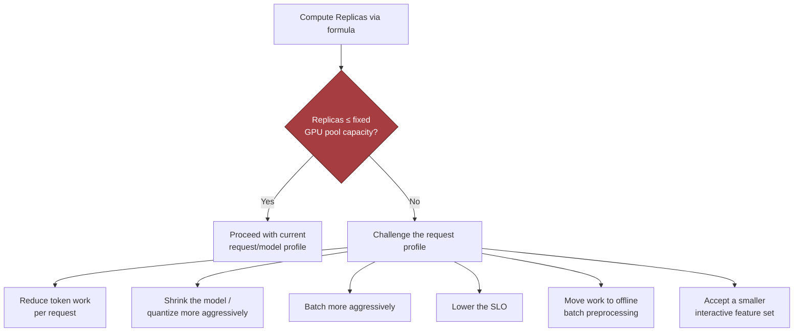

# Chapter 7: Design an AI System for an Air-Gapped Environment, part 2

## 3. Scale Estimates, SLOs, and Capacity

### Anchor the Load Envelope to Customer Reality
- A common first-pass mistake: sketching an on-prem document-analysis service, assuming a few dozen active users, and concluding one model replica plus a queue is enough — plausible at average load, but fails the moment the customer asks for a deadline, a peak day, or a backlog catch-up window.
- In an air-gapped environment, elasticity is limited or nonexistent, so the capacity plan has to be correct up front.
- Anchor to the customer's operating reality. The case gives us 1,000 users, 20 QPS at peak, 50 million pages in the corpus, and a fixed GPU pool.
  - These numbers shape the architecture: batch vs. online interactive extraction vs. a split design with asynchronous indexing and a smaller interactive layer.
  - They determine whether the failure mode is "slow response" or "missed mission deadline."
- State average load, peak load, growth, and headroom separately:
  - Average load → day-to-day behaviour.
  - Peak load → protects against queued bursts.
  - Growth → whether the design survives a year of adoption.
  - Headroom → keeps you from operating at the edge of collapse when a large document arrives.

### Storage Sketch
- Model weights and runtime packages: one primary release plus two rollback versions.
- Vector or search indexes for 50 million pages, plus metadata and sharding overhead.
- Logs, audit trails, and operational metrics retained under the customer's local policy.
- Temporary staging for signed updates, validation artifacts, and canary rollout packages.
- Exact sizes depend on model choice, chunking strategy, embedding dimension, retention policy, and compression — false precision isn't needed, but storage is never "just the model."
- Rollback copies matter because in an air-gapped environment a bad deployment can remain bad for a long time if reversion is slow or blocked by the approval process.

### Memory and Throughput per Replica
- Estimate both memory per replica and throughput per replica.
  - Memory must cover model weights, KV cache or equivalent state, framework overhead, and batch buffers.
  - Throughput is usually tokens per second per replica under the chosen model, quantisation, and batch size.
  - A candidate who only talks GPU count without throughput misses the bottleneck; one who only talks memory without throughput misses the placement constraint.
- Concrete interview-scale memory estimate (my own illustrative numbers, not measured on real hardware):
  - Quantised model weights: 12 GB.
  - Serving stack runtime/framework overhead: 2 GB.
  - KV cache and transient activations at target context length: 6 GB.
  - Batch buffers plus fragmentation slack: 2 GB.
  - Total: roughly 22 GB of GPU memory per replica.
  - On a 24 GB card, that leaves too little safety margin for noisy batches or longer-than-expected contexts — the design would likely move to a 32 GB GPU, a smaller model, tighter context limits, or more aggressive quantisation.
  - This is a decision tool, not a precise promise: it tells you whether the current hardware class can host the workload at all.

### The Replica Sizing Formula
- The key sizing equation:

$$
Replicas = \left\lceil \frac{QPS \times Tokens_{request}}{TokensPerSecond_{replica} \times UtilizationTarget} \right\rceil
$$

- *QPS* = request arrival rate; *Tokens_request* = average token work per request; *TokensPerSecond_replica* = sustained throughput of one replica; *UtilizationTarget* = fraction of peak capacity you're willing to burn before latency degrades too much.
- The numerator converts request rate into token demand; the denominator converts one replica into usable service capacity after reserving headroom.
- If the result exceeds the fixed GPU pool, the response is not "hope harder" — reduce token work per request, shrink the model, batch more aggressively, lower the SLO, move work to offline preprocessing, or accept a smaller interactive feature set.

### Worked Example: 1,000 Users, 20 QPS
- The case gives us 1,000 users generating a 20 QPS peak during a surge window. The rest are my own assumptions: an average request needs 2,000 tokens of model work (retrieval augmentation + output generation), one replica sustains 120 tokens/sec at the desired batch shape, and I'd set a 70% utilisation target:

$$
Replicas = \left\lceil \frac{20 \times 2000}{120 \times 0.70} \right\rceil = \left\lceil \frac{40000}{84} \right\rceil = 477
$$

- That number is intentionally uncomfortable — it signals the assumption set is probably wrong for an air-gapped government deployment with a fixed GPU pool.
- The response is to challenge the request profile, not defend the number:
  - Maybe 20 QPS is not all LLM inference — most requests may be retrieval or metadata lookup.
  - Maybe average model work per request is lower after chunking, caching, or form-based extraction.
  - Maybe the customer's workflow is actually batch-first, where a queue and a nightly SLA fit better.
- That is the point of the estimate: it pressures the design into realism.

> 🎯 **Interview Pointer:** Expect the interviewer to hand you numbers that produce an absurd replica count on purpose — the test is whether you defend the number or challenge the request-mix assumption. Say the formula, get the uncomfortable answer, then pivot to "what changes in the workload shape" rather than asking for more hardware.

### Sensitivity Analysis: Baseline vs. 10x Growth
- A strong interview answer shows ranges, not fake exactness — sensitivity is more useful than a single heroic number because it exposes the design lever that matters most.

| Scenario | QPS | Avg tokens/request | Effective token demand | Replica implication | Design pressure |
|---|---|---|---|---|---|
| Baseline illustrative case | 20 | 2,000 | 40,000 tokens/sec demand before headroom | 477 replicas by the toy formula, which signals the request mix is unrealistic for the fixed GPU pool | Pushes you toward batch/offline processing, narrower per-request work, or a much smaller model fraction |
| 10x growth case | 200 | 2,000 | 400,000 tokens/sec demand before headroom | Roughly 4,760 replicas under the same toy assumptions | Confirms the same architecture would fail hard; you would need workload partitioning, precomputation, or a different serving strategy |

- The exact numbers matter less than the direction: a 10x load increase is not a linear "buy more of the same" problem in an air-gapped environment, because the fixed GPU pool, storage, and operational process do not scale elastically.

### What Changes First at 10x Growth
- More users? Identity, audit, and queueing load expand before raw inference does.
- More pages? Index size, storage bandwidth, and rebuild time may dominate.
- Longer documents? Token count and context length become the bottleneck.
- More stringent SLOs? Headroom must rise and the fixed GPU pool gets tight.
- Communicate uncertainty cleanly: *"These are illustrative estimates. I would size the initial deployment against the 20 QPS peak, then add a growth factor and a rollback margin. If the customer's real request mix is more batch-heavy, the interactive pool shrinks; if the average request is longer, we need either more replicas or a narrower per-request contract."*
- I'd expect token demand per request to have the most leverage over component selection and partitioning:
  - Light requests → a single general-purpose inference tier plus retrieval may be enough.
  - Heavy requests → design often splits into a cheap preprocessor, a retrieval/rules layer, and a smaller number of expensive inference workers.
  - In an air-gapped environment, every extra replica consumes scarce offline capacity and every extra dependency increases update and audit burden.

### SLIs Tied to the Workflow
- Define SLIs in terms the customer can feel:
  - **Availability:** the fraction of working hours when the system accepts jobs and returns results.
  - **Latency:** time from document submission to first useful result, and separately time to complete a batch.
  - **Freshness:** time from approved content arrival to searchability or model use.
  - **Quality:** extraction accuracy, retrieval relevance, or analyst acceptance rate.
  - **Security:** adherence to network, identity, signing, and audit boundaries.
  - **Cost:** GPU hours, storage footprint, support burden, and rollback cost.
- Set objectives that match the workflow: interactive analyst review → interactive latency budget is the critical SLO; nightly ingestion run → freshness and completion time matter more than per-request latency.
- A latency budget decomposes an end-to-end target into controllable pieces: upload, preprocessing, retrieval, inference, validation, response rendering.
  - If inference consumes most of the budget, you probably need a smaller model, shorter context, or precomputed retrieval.
- **What to say in the interview:** size the system from peak request rate, average token work, and fixed GPU throughput; translate into replica count, storage footprint, and headroom; separate average load from peak load; define SLOs around customer workflow; use sensitivity ranges to see which assumption most changes the design; change the workload shape before asking for infinite hardware.
