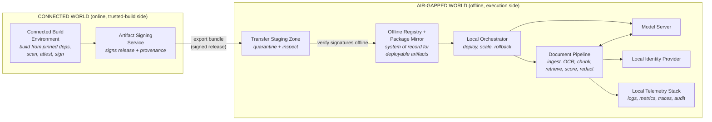
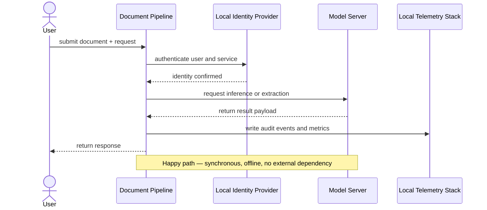
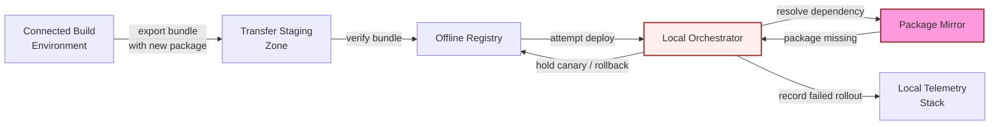

# Chapter 7: Design an AI System for an Air-Gapped Environment, part 3

## 4. Architecture and End-to-End Flow

### Two Worlds Separated by a Controlled Update Path
- A good air-gapped design is easiest to defend by tracing one user request, then a second pass where something critical is missing.
- Scenario: a user uploads a packet inside the classified/restricted network, asks for classification, extraction, or redaction, and expects a result that is useful, auditable, and generated without internet dependency.
- The hidden constraint that changes the design: software, models, and metadata can only enter through a controlled update path — so the architecture must separate the online build world from the offline execution world very deliberately.

### Nine Components in Dependency Order
- Introduce components in dependency order, not slide order:
  1. **Connected build environment** — where source, pinned dependencies, and model artifacts are assembled before export.
  2. **Artifact signing service** — produces verifiable attestations and signatures for the bundle crossing the boundary.
  3. **Transfer staging zone** — quarantine/inspection area for the bundle before admission to the offline side.
  4. **Offline registry and package mirror** — the local source of truth for approved container images, libraries, and model packages.
  5. **Local orchestrator** — schedules services, enforces deployment policy, manages canary rollout.
  6. **Model server** — serves the local model or inference runtime used by the document pipeline.
  7. **Document pipeline** — ingestion, OCR/parsing, chunking, retrieval, scoring, redaction, result assembly.
  8. **Local identity provider** — authenticates users and services inside the boundary.
  9. **Local telemetry stack** — collects logs, metrics, traces, and audit events without exporting them externally.
- The trust boundary runs between the connected build environment and everything else.
- Internal boundaries also matter: between orchestrator and workloads, between identity and services, between document pipeline and telemetry store — air-gapped does not mean untrusted code disappears; the threat model shifts from internet exposure to controlled admission, least privilege, and strong auditability.

### Top-Down Architecture Diagram
- Every box exists because it satisfies a requirement, not because it completes the diagram:
  - Connected build environment → reproducible inputs.
  - Signing service → proves what crossed the boundary.
  - Transfer zone → offline side never ingests unvetted material directly.
  - Registry and mirror → keeps deployments deterministic.
  - Orchestrator → manages the runtime.
  - Model server and document pipeline → perform the work.
  - Identity and telemetry stacks → authenticated access and auditable operations.

### System of Record vs. Cache vs. Queue
- This distinction is where strong interview answers separate themselves from decorative architecture:
  - **System of record:** the offline registry for approved images/packages, the identity provider for users/service identities, the audit log for what was deployed and when.
  - **Cache:** local model weights in memory, retrieval indexes or hot document fragments, any response cache used to avoid repeated expensive computation.
  - **Queue:** document ingestion jobs, scan/attest/export tasks, asynchronous enrichment or post-processing jobs.
  - **External dependency:** none for end-user traffic — the only "outside" dependency is the controlled build pipeline feeding the offline bundle.
- A common mistake: letting a cache behave like a source of truth. In an air-gapped environment this is more dangerous because a stale cache can survive a long time without an internet check to correct it.
  - If the registry says an image is approved, the runtime should not silently prefer a cached older copy.
  - If the identity provider revokes a service credential, the local control plane must honour that revocation consistently.

> 🎯 **Interview Pointer:** This system-of-record/cache/queue split is a favourite interviewer probe — be ready to name, for any component you draw, which bucket it's in and what happens if it goes stale.

### End-to-End Happy Path
- The happy path narrated as a chain of explicit state changes:
  1. **Build from pinned dependencies.** Source code, model package versions, and system packages locked to known revisions in the connected build environment.
  2. **Scan, attest, sign, and export bundle.** Scanned for policy violations, attested for provenance, signed, packaged for export.
  3. **Inspect in the transfer zone.** Checked for integrity, policy conformance, chain-of-custody before crossing inward.
  4. **Verify signatures offline.** Confirms the bundle came from an authorised signer and was not altered in transit.
  5. **Import to local registry.** Approved images, libraries, and model files become available to the offline runtime through the local mirror.
  6. **Deploy canary.** Orchestrator brings up a limited slice of the document pipeline and model server against a safe test set.
  7. **Run acceptance tests.** Checks authentication, document ingestion, output quality, latency, logging, and rollback readiness.
  8. **Promote or rollback.** If canary passes, traffic expands; if not, deployment is reverted and the failed bundle is quarantined for review.
- Build/scan/attest/export/inspect are asynchronous administrative steps. Deployment, request processing, and user-facing inference are synchronous during live operation.
- Say this plainly in the interview: the offline runtime must respond synchronously to document requests, but the supply chain and update pipeline should be asynchronous so they do not block the user workflow.

### Sequence Diagram of the Happy Path

### Dependency-Failure Drill: Fail Closed
- The required fail-closed drill: a missing transitive package.

- If the package mirror does not contain a dependency, the offline system should fail closed rather than improvise by reaching outside the boundary.
- Policy: unresolved dependencies block promotion; the bundle stays in staging/mirror quarantine until the dependency issue is repaired and re-approved.

### Backpressure and Flow Control
- Backpressure is the difference between a stable offline service and a system that melts under a burst of document uploads.
  - **At ingestion:** limit concurrent uploads, validate file size/type early, place oversized jobs in a queue instead of letting them consume parser resources immediately.
  - **At the pipeline:** partition document work by a stable key such as document ID, tenant, or case ID so related state lands together and retries are deterministic.
  - **At the model server:** bound concurrency, cap batch size, reject or defer work when GPU/CPU saturation crosses a safe threshold.
  - **At the orchestrator:** set rollout limits so only a small fraction of traffic reaches the canary until acceptance tests pass.
- The partitioning key matters because it preserves locality and avoids cross-document state corruption — e.g., partitioning by document ID keeps retries and partial failures easier to reason about than spraying requests randomly across workers, which matters when document-specific context, redaction decisions, or audit trails must stay aligned.

### Component Responsibility Table

| Component | Primary responsibility | State ownership | Notes |
|---|---|---|---|
| Connected build environment | Compile, package, and pin offline-ready artifacts | Source tree and build metadata | Outside runtime trust boundary |
| Artifact signing service | Sign and attest artifacts | Signing keys and provenance records | Keys should be tightly controlled |
| Transfer staging zone | Inspect bundles before admission | Quarantine manifests | Not a runtime serving tier |
| Offline registry / package mirror | Serve approved images and packages | Approved artifact catalogue | System of record for deployable bits |
| Local orchestrator | Deploy, scale, and roll back services | Desired state and rollout state | Enforces policy locally |
| Model server | Run inference | Model runtime state, cached weights | Keep API stable and minimal |
| Document pipeline | Ingest, analyse, redact, and assemble outputs | Document processing state | Often the main request path |
| Local identity provider | Authenticate users and services | Identities, groups, tokens | System of record for access |
| Local telemetry stack | Store logs, metrics, traces, audit events | Observability data | Must be retained per policy |

### MVP vs. Later Evolution
- MVP should be small and opinionated: one offline registry, one orchestrator, one identity provider, one telemetry stack, one model server, and one document pipeline with a clear canary process.
- The transfer zone, signing, and verification path are not optional — they are part of the first release because they make offline updates defensible.
- Later evolution: smarter scheduling, multi-model routing, more advanced retrieval, background reindexing, richer policy engines — follow-on capabilities, not prerequisites.
- Interview signal: first make the air-gapped path reliable and auditable; then optimise throughput and operator convenience.
- **Failure overlay to describe out loud:** bundle arrives, but a transitive package is missing from the offline mirror; orchestrator cannot complete promotion so the canary stays isolated; telemetry stack records the failed rollout; registry keeps the bundle quarantined; operator fixes the package in the connected build environment before trying again.

### Control Plane vs. Data Plane
- The diagram is useful only when you can narrate data, identity, state, and failure through it.
- **Control plane:** deployment, signing, verification, identity, policy.
- **Data plane:** live document requests and inference.
- Know where synchronous vs. asynchronous workflows belong, and which system owns each durable state transition.
- The job-market signal: this decomposition shows you can communicate one architecture to both customer and engineering stakeholders.
  - Customer hears: *"We can keep the system inside our boundary and still support controlled updates."*
  - Engineering hears: *"We know where state lives, where failure is contained, and how to promote safely."*
- **90-second interview summary:** separate the connected build world from the offline runtime with a signing and staging path; run the live system on a local registry, orchestrator, model server, document pipeline, identity provider, and telemetry stack; request path is synchronous, update path is asynchronous and tightly controlled; system of record for deployable artifacts is the offline registry, audit trail lives in local telemetry and identity; riskiest trade-off is update friction versus security; first production gate is a canary that verifies signature provenance, dependency completeness, authentication, and rollback before any broad promotion.
