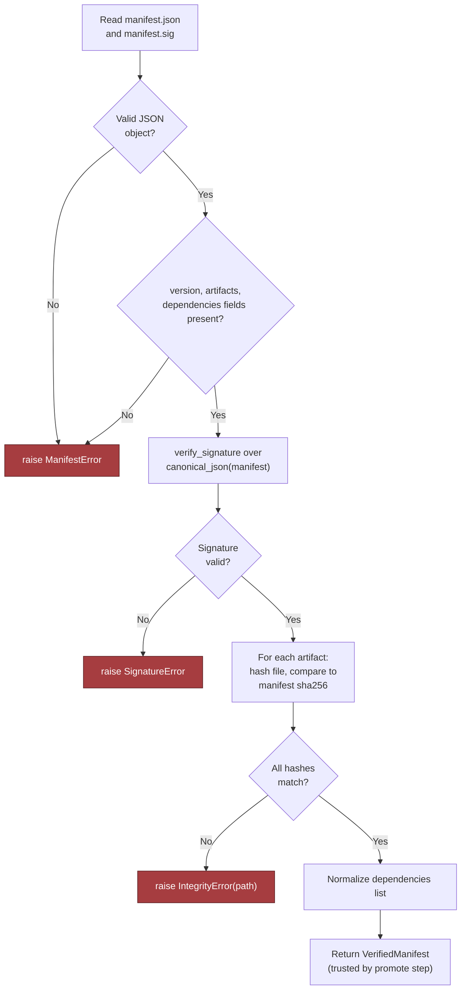

# Chapter 7: Design an AI System for an Air-Gapped Environment, part 4

## 5. Data Model, APIs, and Working Code

### Three Governable Records
- `ReleaseManifest(version, artifact_hashes, signatures, dependencies)` — the deployable contract for a bundle.
  - Primary key: `version` — must be referable, repeatable, promotable by a stable identifier.
  - Lifecycle: drafted in connected build environment → signed → transferred into offline boundary → validated → staged → promoted or rejected.
  - Retention: preserve the manifest, signature material, and enough dependency metadata to reconstruct why a release was accepted or refused — driven by audit needs and local policy, not a universal standard.
- `ModelDeployment(model_id, version, hardware, status)` — the operational view of what is actually running.
  - Preferred primary key: `deployment_id`, with a unique constraint across `(model_id, version, hardware)` if the same model family can exist in multiple release states on different targets.
  - If no separate deployment identifier exists, `(model_id, version, hardware)` becomes the natural composite key — choose one explicitly.
  - Lifecycle states: `staged`, `validated`, `active`, `draining`, `retired`.
  - Retention: preserve deployment history long enough to answer, *"What was running when this document was analysed?"*
- `OfflineAuditEvent(actor, action, artifact_hash, time)` — the system's memory of who did what, to which artifact, and when.
  - Primary key: often an event ID; business key is the `(actor, action, artifact_hash, time)` tuple.
  - Lifecycle: append-only — audit rows should not be edited in place.
  - Retention: aligned to customer audit policy — deleting too aggressively destroys trust, keeping too much can violate local retention rules.
- **Ownership boundaries:** the build team owns signed release material until handoff into offline validation; the offline runtime owns its deployment state; security/operations owns the audit trail. Not cosmetic — this is how you keep a government network from becoming one giant mutable blob.

### API Contracts
- **`POST /v1/documents/analyze`** — user-facing data-plane call.
  - Request: authenticated document payload plus optional metadata (idempotency key, analysis profile).
  - Response: analysis result object with typed fields, model version reference, request identifier.
  - Authentication local to the boundary (offline identity provider or a network-minted service token) — never hand-wave with "just use OAuth."
  - Idempotency: same idempotency key + same request body arriving twice → return the same result or a stable "already processed" response.
  - Errors distinguish malformed input, unauthorised access, unavailable model capacity, and policy rejection.
- **`GET /v1/models/status`** — operational read path.
  - Returns current model deployment state, active version, hardware target readiness.
  - Safe to call repeatedly, does not mutate state; still requires authentication because status can leak operational details.
  - Error semantics distinguish "unknown model," "not deployed," "temporarily unavailable."
- **`POST /v1/admin/releases/validate`** — control-plane gate.
  - Accepts a bundle reference or uploaded bundle; verifies manifest signature, checks artifact hashes, confirms declared dependencies are present; returns a structured pass/fail result or validation report.
  - Idempotent with respect to the same release identifier — validating the same bundle twice should not create a second logical validation record unless content changed.
- **`POST /v1/admin/releases/{id}/promote`** — state transition from validated to active.
  - Guarded by authorisation, policy checks, and optimistic concurrency.
  - Fails if the release is not in a promotable state, if the target deployment changed since the client last read it, or if the current active release differs from what the client assumed.
  - Accepts versioned request/response shapes so a future manifest/validation-output change doesn't break older tooling overnight.
- Contract versioning applies to the bundle format, manifest schema, and audit event schema too, not just public APIs — if the offline environment cannot be updated arbitrarily, every breaking change is a migration event, not a casual refactor.

### Release Verification: The Highest-Risk Code Path
- This is the highest-risk component: release verification. If the system cannot validate a release bundle offline, everything else is theater.

```python
from __future__ import annotations

import hashlib
import hmac
import json
from dataclasses import dataclass
from typing import Any, Mapping


class IntegrityError(Exception):
    pass


class ManifestError(Exception):
    pass


class SignatureError(Exception):
    pass


class ValidationError(Exception):
    pass


@dataclass(frozen=True)
class VerifiedManifest:
    version: str
    artifacts: tuple[dict[str, str], ...]
    dependencies: tuple[str, ...]


def canonical_json(obj: Any) -> bytes:
    return json.dumps(obj, sort_keys=True, separators=(",", ":")).encode("utf-8")


def sha256_hex(data: bytes) -> str:
    return hashlib.sha256(data).hexdigest()


def verify_signature(trusted_public_key: bytes, payload: bytes, signature: bytes) -> None:
    # Interview sketch: replace with a real signature primitive such as Ed25519 verification.
    expected = hmac.new(trusted_public_key, payload, hashlib.sha256).digest()
    if not hmac.compare_digest(expected, signature):
        raise SignatureError("manifest signature verification failed")


def _require_str(mapping: Mapping[str, Any], key: str) -> str:
    value = mapping.get(key)
    if not isinstance(value, str) or not value.strip():
        raise ManifestError(f"missing or invalid string field: {key}")
    return value


def _require_list(mapping: Mapping[str, Any], key: str) -> list[Any]:
    value = mapping.get(key)
    if not isinstance(value, list):
        raise ManifestError(f"missing or invalid list field: {key}")
    return value


def verify_bundle(bundle, trusted_public_key: bytes) -> VerifiedManifest:
    manifest_raw = bundle.read_bytes("manifest.json")
    signature = bundle.read_bytes("manifest.sig")

    try:
        manifest = json.loads(manifest_raw)
    except json.JSONDecodeError as exc:
        raise ManifestError("manifest.json is not valid JSON") from exc

    if not isinstance(manifest, dict):
        raise ManifestError("manifest root must be an object")

    version = _require_str(manifest, "version")
    artifacts = _require_list(manifest, "artifacts")
    dependencies = _require_list(manifest, "dependencies")

    verify_signature(trusted_public_key, canonical_json(manifest), signature)

    normalized_artifacts: list[dict[str, str]] = []
    for idx, item in enumerate(artifacts):
        if not isinstance(item, dict):
            raise ManifestError(f"artifacts[{idx}] must be an object")
        path = _require_str(item, "path")
        expected_hash = _require_str(item, "sha256")
        if len(expected_hash) != 64 or any(c not in "0123456789abcdef" for c in expected_hash.lower()):
            raise ManifestError(f"artifacts[{idx}].sha256 is not a valid hex digest")
        actual_hash = sha256_hex(bundle.read_bytes(path))
        if not hmac.compare_digest(actual_hash, expected_hash):
            raise IntegrityError(path)
        normalized_artifacts.append({"path": path, "sha256": expected_hash})

    normalized_deps: list[str] = []
    for idx, dep in enumerate(dependencies):
        if not isinstance(dep, str) or not dep.strip():
            raise ManifestError(f"dependencies[{idx}] must be a non-empty string")
        normalized_deps.append(dep)

    return VerifiedManifest(
        version=version,
        artifacts=tuple(normalized_artifacts),
        dependencies=tuple(normalized_deps),
    )
```

- Walk it line by line:
  - `canonical_json` serialises the manifest deterministically before signature verification, so the same logical manifest doesn't hash differently.
  - `sha256_hex` gives a stable digest for artifact comparison.
  - `verify_signature` is intentionally labelled a sketch — real code would use a real asymmetric primitive, not an HMAC stand-in.
  - Three exception classes let the caller distinguish signature failure, malformed manifest, and content integrity failure — the operator response differs for each.
  - `VerifiedManifest` is immutable so a successful validation result cannot be accidentally mutated later.
  - `_require_str`/`_require_list` are typed boundary validation: reject malformed input early, before any state changes.
  - Inside `verify_bundle`: reads manifest and signature, parses JSON safely, validates required fields, verifies signature over canonicalised content, checks every artifact hash with `hmac.compare_digest` to avoid timing leaks, returns a normalised typed result a later promote step can trust.

### Verify-Bundle Flow



### What the Snippet Omits on Purpose
- No concurrency, retries, or observability — those are production concerns around the core path.
- **Concurrency:** the control plane should use optimistic concurrency on promotion. A release object carries a version/revision token; the promote call includes it; the server rejects the write if someone else already advanced the deployment state — avoids two operators promoting incompatible releases at once.
- **Retries:** only safe read and validation operations should be retried automatically. Promotion should be retried only if idempotent by design and guarded by a write token. Document analysis requests should accept an idempotency key so a client retry doesn't create duplicate work or duplicate audit rows.
- **Observability:** wrap with logs, counters, structured audit events. A validation pass should emit who validated what, what hash was checked, and why a bundle failed if it failed — in an air-gapped environment this is the only practical way to reconstruct incidents without an external vendor console.

### Failure Behaviour to State Explicitly
- A duplicate request tests whether the design understands idempotency: if an operator submits the same validated bundle twice (e.g., first response timed out) and the idempotency key/bundle hash are the same, the second call should return the same validation outcome rather than advancing state twice.
- If a promote request is repeated after a transient issue inside the boundary, the server should either return the already-promoted state or reject the repeat with a clear, stable error saying the version is no longer pending promotion.
- The critical failure drill is the missing transitive package: if a manifest declares a dependency not available in the offline artifact store, validation should fail before installation, not during runtime — that's why `dependencies` lives in the manifest, not tribal knowledge.

### Contract and Failure-Injection Tests
- Tests don't need to be exhaustive — they need to show the candidate understands how the deployment gate behaves on success and on failure.

```python
class BundleStub:
    def __init__(self, files):
        self.files = files

    def read_bytes(self, path):
        return self.files[path]


def test_verify_bundle_accepts_known_good_bundle():
    manifest = {
        "version": "2024.10.1",
        "artifacts": [{"path": "model.bin", "sha256": ""}],
        "dependencies": ["tokenizer.json"],
    }
    files = {
        "model.bin": b"weights-bytes",
        "tokenizer.json": b"vocab-bytes",
    }
    manifest["artifacts"][0]["sha256"] = sha256_hex(files["model.bin"])
    manifest_bytes = canonical_json(manifest)
    key = b"trusted-key"
    sig = hmac.new(key, manifest_bytes, hashlib.sha256).digest()
    bundle = BundleStub({
        "manifest.json": manifest_bytes,
        "manifest.sig": sig,
        **files,
    })

    verified = verify_bundle(bundle, key)

    assert verified.version == "2024.10.1"
    assert verified.artifacts[0]["path"] == "model.bin"
    assert verified.dependencies == ("tokenizer.json",)


def test_verify_bundle_rejects_corrupted_artifact_hash():
    manifest = {
        "version": "2024.10.1",
        "artifacts": [{"path": "model.bin", "sha256": "0" * 64}],
        "dependencies": ["tokenizer.json"],
    }
    manifest_bytes = canonical_json(manifest)
    key = b"trusted-key"
    sig = hmac.new(key, manifest_bytes, hashlib.sha256).digest()
    bundle = BundleStub({
        "manifest.json": manifest_bytes,
        "manifest.sig": sig,
        "model.bin": b"tampered-weights",
        "tokenizer.json": b"vocab-bytes",
    })

    try:
        verify_bundle(bundle, key)
        raise AssertionError("expected IntegrityError")
    except IntegrityError as exc:
        assert str(exc) == "model.bin"
```

- Test 1 (contract test): a valid manifest, valid signature, matching artifact hashes should produce a normalised `VerifiedManifest` with the intended version and dependency list.
- Test 2 (failure-injection test): simulates corruption via a wrong hash and tampered artifact bytes, then asserts the verifier raises `IntegrityError` on the exact failing path.
- A third useful test in a real repo would corrupt `manifest.sig` and assert `SignatureError` (signature failure and artifact failure are operationally distinct) — but one contract test plus one failure-injection test is enough for a whiteboard-friendly sketch.

### Why This Is a Strong FDE Answer
- An FDE is not just drawing architecture — they translate architecture into production-grade implementation details a customer can trust.
- The takeaway: a design answer becomes credible when its state transitions, API contracts, and failure-safe code are concrete.
- **90-second implementation summary:** make the deployable unit a signed release manifest with explicit artifact hashes and dependency declarations; store deployment state separately from audit state; expose versioned endpoints for analysis, status, validation, and promotion; every write boundary gets idempotency and optimistic concurrency; release verification is the highest-risk component, so implement and test it first with typed manifest validation, signature verification, artifact hash checks, and structured failure modes — that gives the customer maintainable local AI capability without violating network, artifact, identity, or audit boundaries.
