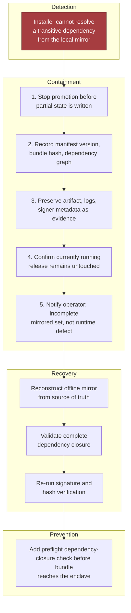

# Chapter 7: Design an AI System for an Air-Gapped Environment, part 5

## 6. Security, Reliability, and Failure Handling

### Lead With the Failure, Not the Model
- Security and operations open the review by injecting the failure that matters most: the update package arrives, but a transitive package is missing from the offline mirror.
- Reaching for "just retry" already misses the core issue — in a disconnected environment, retries do not manufacture missing artifacts.
- The right answer: stop the promotion, preserve the manifest, preserve the evidence, and contain the impact to the smallest possible slice of the system.

### Threat-Model the Offline Control Plane
- The design problem is broader than inference — you're protecting a local AI capability that depends on package repositories, model artifacts, signing keys, update workflows, index files, and privileged admin actions.
- **Control 1 — pin and attest every dependency** before anything reaches the air-gapped network: the release manifest enumerates exact versions and hashes, the installer verifies signatures against offline trust roots, and deployment rejects anything not already known-good.
- **Control 2 — avoid telemetry egress assumptions.** In connected products, teams often lean on crash reporting, remote metrics, and cloud diagnostics as harmless defaults; here those assumptions are wrong. Every observability path must be local-first and explicitly approved. Metrics go to an internal collector; support artifacts export through a controlled operator workflow. Never let a library quietly "phone home" and call it monitoring.
- **Control 3 — treat privileged administration as a high-risk interface.** Keep admin commands separate from normal user workflow, require role-based approvals locally, and make sensitive actions deliberate: key rotation, index rebuilds, trust-root updates, rollback promotion should all be explicit operations with audit records.

> 🎯 **Interview Pointer:** The "avoid telemetry egress assumptions" control is an easy trap — interviewers listen for whether you casually mention "ship logs to our SaaS dashboard" out of habit. Explicitly say every observability path is local-first and approved.

### Failure Policy: Fail Open, Fail Closed, Degrade, Queue
- An FDE answer gets stronger when it states plainly what fails open, what fails closed, what degrades, what queues, and what demands a human:
  - Authentication and signature verification fail closed.
  - Document ingestion may queue if the downstream classifier is down, but only within a bounded local buffer.
  - Search over stale indexes can degrade with a visible freshness warning.
  - Model serving should degrade to a smaller approved model if memory is insufficient, but only if that fallback is pre-verified.
  - Trust-root updates and bundle promotion require human approval.
- That is the difference between a system that is merely unavailable and a system that is unsafe.

### Five-Condition Decision Table

| Condition | Policy | User-visible behaviour | Recovery path |
|---|---|---|---|
| Missing transitive package | Fail closed | Block promotion, keep current release running | Restore mirrored artifact, re-run verification |
| Artifact corrupted during transfer | Fail closed | Reject bundle before install | Re-copy from source, verify hash and signature |
| Model exceeds GPU memory | Degrade or queue | Use smaller approved model or wait for capacity | Adjust routing or retrain packaging policy |
| Local certificate expires | Fail closed for admin actions, degrade for read-only flows if allowed by policy | Admin operations blocked; limited reads may continue | Rotate cert from offline trust anchor |
| Update breaks stored-index compatibility | Queue or rollback | Pause promotion, keep old index active | Rebuild index offline, or roll back both model and index |

### Blast Radius
- Blast radius must be stated by tenant, region (enclave/site), workflow, and dependency.
- In an air-gapped government network, "region" may mean a physical enclave or site rather than a cloud geography.
- A bad index rebuild should not take down document search for the entire enclave if tenants/workspaces can be isolated.
- A failed model rollout should not invalidate the audit service.
- A certificate problem in the admin plane should not break read-only document lookup if policy allows read continuation.
- Each dependency deserves its own containment boundary.

### Critical Incident Drill: Missing Transitive Package
- This is the required drill because it exposes whether the candidate understands offline reality: the bundle is signed, but operations finds the installer cannot resolve a transitive dependency from the local mirror.
- The instinctive failure — letting the install continue "just this once" — is exactly the wrong move.
- **Containment (immediate):**
  1. Stop the promotion before any partial state is written.
  2. Record the exact manifest version, bundle hash, and dependency graph that failed.
  3. Preserve the artifact, logs, and signer metadata as evidence.
  4. Confirm the currently running release remains untouched.
  5. Notify the operator that the issue is an incomplete mirrored set, not a runtime defect.
- **Recovery:** reconstruct the offline mirror from the source of truth, validate the complete dependency closure, re-run signature and hash verification.
- **Prevention:** add a preflight that checks dependency closure before the bundle reaches the enclave — if the release process cannot prove completeness, it should never reach the installer.



### Other Failure Paths
- **Artifact corruption during transfer:** verify cryptographic hashes and signatures after every transfer hop, not just at the source; a bundle that passes source verification but fails at the enclave boundary must be treated as hostile or damaged; preserve the bad artifact separately for investigation, don't overwrite it.
- **Model exceeds GPU memory:** a capacity/packaging problem, not a runtime surprise; route to a smaller approved model, queue until a compatible worker is available, or reject with a clear operational error — never crash the node and hope the scheduler recovers. Detect memory pressure before admission when possible; maintain an explicit compatibility map between model size, quantisation format, and hardware profiles.
- **Local certificate expiring:** an availability/administration issue that can become a security issue if the system bypasses checks to stay alive. Use a short-lived operational certificate with monitored expiry, local renewal from an offline trust anchor, and an escalation path if rotation is overdue. Read-only workflows may degrade under policy; privileged actions should stop.
- **Update breaks stored-index compatibility:** version the index format alongside the model and reader code, promoting the new trio together only after the new reader can interpret the old index or rebuild it deterministically. If the new release cannot read the existing index, pause promotion and keep the old path serving. Human intervention is appropriate if the compatibility matrix is unclear or a rebuild would exceed the recovery objective.

### Code: Proving One Security Invariant
- The interview code should demonstrate a security invariant, not a toy success path: a tampered bundle is rejected before deployment.

```python
from __future__ import annotations

from dataclasses import dataclass
from pathlib import Path
import hashlib
import hmac
import json
import tempfile
from typing import Mapping


class IntegrityError(RuntimeError):
    pass


@dataclass(frozen=True)
class TrustedKey:
    name: str
    secret_key: bytes


@dataclass(frozen=True)
class Bundle:
    root: Path

    def replace(self, relative_path: str, content: bytes) -> None:
        target = self.root / relative_path
        if not target.is_file():
            raise FileNotFoundError(relative_path)
        target.write_bytes(content)


@dataclass(frozen=True)
class AuditEvent:
    action: str
    detail: str


def _sha256_file(path: Path) -> str:
    digest = hashlib.sha256()
    with path.open("rb") as f:
        for chunk in iter(lambda: f.read(1024 * 1024), b""):
            digest.update(chunk)
    return digest.hexdigest()


def _load_manifest(bundle: Bundle) -> Mapping[str, object]:
    manifest_path = bundle.root / "manifest.json"
    if not manifest_path.is_file():
        raise IntegrityError("missing manifest")
    try:
        manifest = json.loads(manifest_path.read_text(encoding="utf-8"))
    except json.JSONDecodeError as exc:
        raise IntegrityError("invalid manifest") from exc
    if not isinstance(manifest, dict):
        raise IntegrityError("invalid manifest")
    return manifest


def _audit(log: list[AuditEvent], action: str, detail: str) -> None:
    log.append(AuditEvent(action=action, detail=detail))


def verify_bundle(bundle: Bundle, trusted_key: TrustedKey, audit_log: list[AuditEvent] | None = None) -> None:
    audit_log = audit_log if audit_log is not None else []
    manifest = _load_manifest(bundle)

    if manifest.get("signer") != trusted_key.name:
        _audit(audit_log, "verify_bundle", "untrusted signer")
        raise IntegrityError("untrusted signer")

    signature = manifest.get("signature")
    if not isinstance(signature, str) or not signature:
        _audit(audit_log, "verify_bundle", "missing signature")
        raise IntegrityError("missing signature")

    expected = manifest.get("artifacts")
    if not isinstance(expected, dict):
        _audit(audit_log, "verify_bundle", "invalid artifact list")
        raise IntegrityError("invalid artifact list")

    # Validate the closure of the bundle before any promotion occurs.
    for relative_path, expected_hash in expected.items():
        if not isinstance(relative_path, str) or not isinstance(expected_hash, str):
            _audit(audit_log, "verify_bundle", "invalid artifact entry")
            raise IntegrityError("invalid artifact entry")
        artifact_path = bundle.root / relative_path
        if not artifact_path.is_file():
            _audit(audit_log, "verify_bundle", f"missing artifact: {relative_path}")
            raise IntegrityError(f"missing artifact: {relative_path}")
        actual_hash = _sha256_file(artifact_path)
        if not hmac.compare_digest(actual_hash, expected_hash):
            _audit(audit_log, "verify_bundle", f"hash mismatch: {relative_path}")
            raise IntegrityError(f"hash mismatch: {relative_path}")

    # Offline trust-root check: the manifest is authenticated with a pinned local key.
    material = json.dumps(
        {"signer": manifest["signer"], "artifacts": manifest["artifacts"]},
        sort_keys=True,
        separators=(",", ":"),
    ).encode("utf-8")
    expected_sig = hmac.new(trusted_key.secret_key, material, hashlib.sha256).hexdigest()
    if not hmac.compare_digest(signature, expected_sig):
        _audit(audit_log, "verify_bundle", "signature verification failed")
        raise IntegrityError("signature verification failed")

    _audit(audit_log, "verify_bundle", "bundle accepted")


def _write_bundle(root: Path, signer: str, secret_key: bytes, model_bytes: bytes) -> Bundle:
    root.mkdir(parents=True, exist_ok=True)
    (root / "model.bin").write_bytes(model_bytes)
    artifact_hash = hashlib.sha256(model_bytes).hexdigest()
    manifest_body = {"signer": signer, "artifacts": {"model.bin": artifact_hash}}
    material = json.dumps(manifest_body, sort_keys=True, separators=(",", ":")).encode("utf-8")
    signature = hmac.new(secret_key, material, hashlib.sha256).hexdigest()
    manifest = {**manifest_body, "signature": signature}
    (root / "manifest.json").write_text(json.dumps(manifest), encoding="utf-8")
    return Bundle(root=root)


def test_tampered_model_is_rejected():
    with tempfile.TemporaryDirectory() as tmpdir:
        bundle_root = Path(tmpdir) / "bundle"
        trusted_key = TrustedKey(name="offline-root-1", secret_key=b"local-trust-root-secret")
        bundle = _write_bundle(
            bundle_root,
            signer=trusted_key.name,
            secret_key=trusted_key.secret_key,
            model_bytes=b"approved-model-bytes",
        )

        bundle.replace("model.bin", b"tampered")
        audit_log: list[AuditEvent] = []

        try:
            verify_bundle(bundle, trusted_key, audit_log=audit_log)
        except IntegrityError:
            assert any(event.action == "verify_bundle" for event in audit_log)
            assert (bundle_root / "model.bin").read_bytes() == b"tampered"
            return
        raise AssertionError("tampered bundle should be rejected")
```

- This is intentionally an interview-sized sketch. In production, keep the same control flow but replace the teaching scaffold with a hardened release verifier, validate the manifest schema explicitly, record structured audit events to local storage, and test negative cases for missing files, malformed manifests, signer mismatch, and dependency-closure failure.
- The point of the test is not merely that the code runs — it proves the system refuses to install a bundle whose integrity cannot be established.

### Evidence, Runbooks, and Operational Readiness
- Before launch, the team should have runbooks for verification failure, rollback, trust-root rotation, certificate renewal, index rebuild, and node replacement.
- Each runbook should say who can execute it, what evidence is preserved, what systems are paused, and what success looks like.
- Audit evidence should include the signed manifest, hash list, trust-root fingerprint, operator identity, approval record, installation logs, and any rollback decision.
- If the customer later asks why a release was blocked, the answer should be reconstructible from the evidence alone.
- Without this discipline, every incident becomes a forensic guessing game; with it, operations can prove a release was rejected for a legitimate integrity reason, not because the installer was flaky.

### Why This Matters for the Job
- A strong FDE does not stop at a happy-path architecture — they show they can survive malicious input, partial failure, retries that do not help, stale state, dependency outages, and political pressure to "just make it work."
- They know when to queue, when to degrade, when to fail closed, and when to involve a human; they can articulate blast radius, preserve evidence, and write a test that proves a safety invariant.
- **90-second interview summary:** treat the offline release pipeline as a high-trust control plane; every dependency is pinned and attested; signatures verified against offline trust roots; telemetry never assumes egress; privileged administration is separated from normal use; the riskiest failure is an incomplete or corrupted bundle, so the system must fail closed, preserve evidence, and keep the currently running release intact; runtime issues get clear failure policies (some queue, some degrade to approved fallbacks, some require human intervention); first production gate — if the bundle cannot prove integrity, completeness, and compatibility offline, it does not enter the enclave.

> 🎯 **Interview Pointer:** If asked "what's your first production gate," this chapter's answer is consistently the same sentence across sections — memorise it: the bundle must prove integrity, completeness, and compatibility offline before it enters the enclave.
