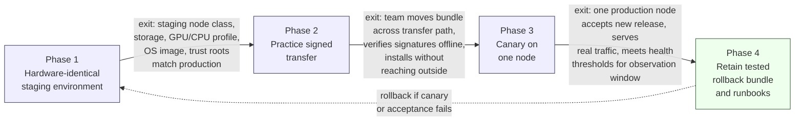

# Chapter 7: Design an AI System for an Air-Gapped Environment, part 6

## 7. Delivery Plan, Observability, and Business Impact

### From Prototype to Trusted Production
- The prototype working is not the milestone — the milestone is the customer asking, with a straight face, when it can be trusted in production.
- That question shifts the interview answer from architecture-only to delivery discipline: phased rollout, measurable gates, explicit owners, and a support model that survives the first incident.
- In an air-gapped environment, delivery is part of the system design: if software cannot be moved, verified, installed, observed, and rolled back without improvisation, it's a promising demo, not a deployable solution.
- The FDE answer: turn the prototype into an operational path that is safe enough for the enclave, boring enough for operators, and useful enough for users.

### Four Phases That Move Risk Out of the Dark

1. **Build a hardware-identical staging environment.**
   - **Owner:** infrastructure/platform engineering, with security review from the enclave team.
   - **Exit criteria:** staging node class, storage layout, GPU/CPU profile, OS image, and trust roots match production closely enough that install and runtime behaviour are representative.
   - **Why it matters:** convenient staging hides the failures that matter later — package incompatibility, driver mismatch, disk layout issues, upgrade friction.
2. **Practice signed transfer.**
   - **Owner:** release engineering, with security and operations jointly observing the drill.
   - **Exit criteria:** the team can move a release bundle across the controlled transfer path, verify signatures offline, and install it without reaching outside the boundary.
   - **Why it matters:** the transfer process is often where the real system breaks — "someone will hand-carry it" is not enough unless the handoff is documented, repeatable, and auditable.
3. **Canary on one node.**
   - **Owner:** operations, with the product owner and incident responder on call.
   - **Exit criteria:** one production node accepts the new release, serves real traffic, and meets agreed health thresholds for a defined observation window.
   - **Why it matters:** the canary isolates risk — in a closed network you cannot rely on cloud-scale rollback shortcuts, so the first live node is proof that bundle, model, dependencies, and configuration all behave together.
4. **Retain the tested rollback bundle and runbooks.**
   - **Owner:** operations for execution, release engineering for artifact retention, technical lead for approval.
   - **Exit criteria:** the previous known-good bundle, its signatures, rollback steps, operator checklist, and escalation path are stored, tested, and immediately usable.
   - **Why it matters:** rollback is a prepared artifact, not a concept — if a release is bad, the team needs a trusted way back that doesn't require rebuilding confidence under pressure.
- Each phase has an owner, a gate, and a way to stop before the problem spreads — that's the difference between staged rollout and wishful deployment.

### Technical Health Metrics
- **Offline install success rate**
  - *Calculation:* successful offline installs / attempted offline installs over the same release window.
  - *Source:* release logs, installer logs, node boot records.
  - *Owner:* release engineering.
  - *Alert threshold:* rate drops below baseline or fails on more than one staging/production node in a release cycle → stop expansion, investigate bundle integrity, dependency drift, environment mismatch.
- **Signature verification failures**
  - *Calculation:* count of bundle/artifact/manifest signature checks that fail during transfer or installation.
  - *Source:* transfer logs and install-time verification logs.
  - *Owner:* security engineering or release engineering, depending on local operating model.
  - *Alert threshold:* any unexpected failure is a go/no-go blocker until root cause is understood.
- **Model throughput and latency**
  - *Calculation:* documents/pages processed per unit time, plus request latency at the chosen percentile for user-facing paths.
  - *Source:* service telemetry and local performance counters.
  - *Owner:* platform or ML operations.
  - *Alert threshold:* latency crosses the user-acceptable band or throughput falls below demand forecast → consider batching changes, model quantisation, hardware saturation, or queue limits.
- **Capacity saturation**
  - *Calculation:* fraction of CPU, GPU, memory, disk I/O, queue depth, or token budget consumed relative to safe operating headroom.
  - *Source:* host metrics and service queues.
  - *Owner:* infrastructure or SRE.
  - *Alert threshold:* sustained operation near ceiling capacity → trigger scaling action, load shedding, or workflow throttling before the system becomes unstable.
- **Mean time to repair**
  - *Calculation:* average elapsed time from incident declaration to service restoration.
  - *Source:* incident timeline records.
  - *Owner:* incident management and the primary on-call team.
  - *Alert threshold:* repair time trending upward release over release → team likely lacks documentation, automation, or spare capacity.
- **Release age**
  - *Calculation:* elapsed time since the currently running approved bundle was signed off and deployed.
  - *Source:* release registry and deployment records.
  - *Owner:* release manager.
  - *Alert threshold:* release age too old → drift from latest security fixes/operational learnings; changing too quickly → not enough soak time.

### User and Business Metrics
- Not the same as technical health — a system can be healthy and still not be adopted.
- **Adoption metrics:** active users, documents submitted, repeat use, percentage of workflows completed without manual workarounds.
- **Business outcome metrics:** time saved per case, reduction in manual review burden, increased throughput for analysts, fewer missed deadlines or rework cycles.
- **Outcome owner:** usually the business sponsor or operations manager, with product and FDE support.
- Connect the layers explicitly: if throughput improves but analysts don't trust the output, the product has not succeeded; if users adopt it but the process still needs manual correction, the workflow benefit is smaller than the demo suggests.

### A Dashboard That Tells One Story
- Not a wall of green indicators — it should show how user value flows through the stack.
- **Top row: user outcome.**
  - Documents processed per shift.
  - Average turnaround time for a case.
  - Share of cases completed with no manual fallback.
- **Middle row: service behaviour.**
  - Offline install success rate by release.
  - Signature verification failures by transfer event.
  - Model latency and throughput by node.
  - Queue depth and saturation indicators.
- **Bottom row: operational control.**
  - Current release age.
  - Rollback bundle availability.
  - Open incidents and mean time to repair.
  - Last successful signed transfer.
- This structure answers the one question that matters in a closed network: is the user problem improving because the system is healthy, or is the system merely surviving while the workflow remains painful?

> 🎯 **Interview Pointer:** Interviewers often ask "how would you dashboard this?" — the strongest answer is the three-row layout (user outcome / service behaviour / operational control), not a flat metrics list. It signals you think in terms of causal layers, not a wall of green.

### Ownership, Gates, and Rollback Triggers
- **Product or business owner:** defines the case-review workflow and success criteria.
- **Release engineering:** packages artifacts, signs bundles, manages release records.
- **Security:** approves trust-root handling, transfer process, and audit evidence.
- **Operations or SRE:** watches health metrics, runs the canary, executes rollback.
- **ML or platform engineering:** owns model performance, runtime efficiency, and compatibility.
- **Help desk or support lead:** triages user issues, training gaps, and documentation defects.
- **Go/no-go gates:**
  - The bundle verifies offline.
  - The bundle is complete and compatible with the target node class.
  - The staging run reproduces expected behaviour on hardware identical enough to production.
  - The canary node stays inside latency, throughput, and saturation thresholds.
  - The rollback bundle has been tested, not merely archived.
- **Rollback triggers:** repeated signature failures, unexplained install failure, canary latency regression, rising error rate, or any evidence the release is compromising enclave integrity. "We'll debug it live" is not a strategy in an air-gapped setting — it's an admission the rollback path was never real.

### Standardisation Strategy
- Clarifies what should be standardised across customers vs. remain local:
  - **Configuration:** document types, retention rules, approval thresholds, queue limits, model choice among approved offline options, workflow routing rules.
  - **Adapter:** importers for the customer's document sources, export connectors for case systems, translation layers mapping local formats into the analysis pipeline.
  - **Shared service:** signature verification, bundle validation, audit logging, model serving primitives, the release registry — good candidates for reuse across enclaves.
  - **Core product:** the document analysis engine, health-check framework, offline package manager, and rollback discipline — leverage points that improve every deployment.
- Shows product thinking, not just implementation thinking — the FDE is not asked to handcraft one-off integrations forever; they turn repeated local pain into reusable product capability without breaking the customer's boundaries.

### Risk Register
- **Risk:** missing transitive package in the offline bundle.
  - *Owner:* release engineering.
  - *Mitigation:* dependency lockfiles, preflight bundle validation, staging install rehearsal.
  - *Trigger:* install failure or unresolved import at boot.
- **Risk:** signature mismatch during transfer.
  - *Owner:* security engineering.
  - *Mitigation:* offline trust root validation, signed manifest checks, dual-control transfer steps.
  - *Trigger:* any unexpected verification failure.
- **Risk:** model latency exceeds user tolerance on one node.
  - *Owner:* platform or ML operations.
  - *Mitigation:* smaller model variant, batching adjustment, or hardware reassignment.
  - *Trigger:* canary latency regression or queue growth.
- **Risk:** operators cannot support the workflow without tribal knowledge.
  - *Owner:* support lead and technical lead.
  - *Mitigation:* training, runbooks, alert explanations, incident drills.
  - *Trigger:* repeated questions, stalled escalations, or inconsistent human handling.

### The Delivery Story the Interviewer Wants to Hear
- The prototype works, but the customer asks when it can be trusted in production; the answer is not "after more model tuning."
- It is: move from prototype to staged rollout through a hardware-identical staging environment, a practised signed transfer, a one-node canary, and a tested rollback bundle with runbooks.
- Measure offline install success rate, signature verification failures, throughput, latency, saturation, mean time to repair, and release age.
- Keep technical health, model quality, adoption, and business outcome separate so you can see whether the product is actually improving the workflow.
- Assign owners and gates so a bad release stops before it becomes an incident.
- Measurable customer impact statement: the system is successful only when analysts adopt it, document handling gets faster and more consistent, and the operating team can keep it running inside the enclave without violating network, artifact, identity, or audit boundaries.
