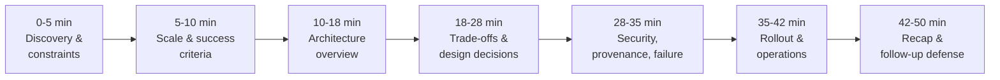

# Chapter 7: Design an AI System for an Air-Gapped Environment, part 7

## 8. Interview Walkthrough, Trade-Offs, and Practice

### Minute Zero: Open With the Customer Outcome
- Start by naming the value in the customer's language: *"We need maintainable local AI capability inside an air-gapped government network, with controlled software updates, no internet dependency, and an audit trail we can defend."*
- This shows you heard the operational constraint and prevents drift into a generic chatbot architecture.
- Ask the interviewer to confirm the highest-risk boundary before drawing anything:
  - What is the air-gap really protecting?
  - Is the restriction absolute, or are there governed transfer points for media, packages, and logs?
  - Is the deployment a single secure enclave, multiple disconnected sites, or a staged network with different trust zones?
  - Do they expect one shared service for analysts, or isolated workstations for especially sensitive teams?
- Spend time in proportion to risk, not diagram size. Highest-risk topics: software ingress, provenance, identity, rollback. Lowest-risk: decorative model choice debates or overfitted UI features.
- Say it explicitly: *"I'll focus first on how software enters the enclave and how we prove it is safe, then I'll sketch the serving path and operations."*

### A 50-Minute Pacing Plan

- **0–5 minutes: discovery and constraints**
  - Restate the customer outcome in one sentence.
  - Clarify the air-gap boundary, update process, and audit expectations.
  - Ask who uses the system, what document types matter, and what "good" means (search, extraction, classification, summarisation, or all).
  - Confirm whether deployment must run centrally, on analyst workstations, or both.
  - Identify the riskiest assumption and say you'll return to it.
- **5–10 minutes: scale and success criteria**
  - Estimate daily document volume, average size, peak concurrent analysts, freshness needs.
  - Define latency targets qualitatively if not given: interactive queries should feel responsive, batch jobs can be slower.
  - Name operational measures: offline install success, signature verification, release age, incident recovery time, user adoption.
  - State that all capacity numbers are illustrative until the customer confirms actual workload.
- **10–18 minutes: architecture overview**
  - Draw the trust boundaries: external build environment, transfer gate, enclave package repository, model registry, inference service, document pipeline, audit store, admin plane.
  - Separate data plane from control plane.
  - Documents flow inward; results/logs flow to approved destinations; nothing assumes cloud telemetry.
  - Identity, artifact, and audit boundaries stay intact.
- **18–28 minutes: trade-offs and system design decisions**
  - Larger model quality vs. hardware fit.
  - Containers vs. virtual appliances.
  - Update frequency vs. accreditation cost.
  - Central cluster vs. workstation deployment.
  - Tie each trade-off to customer value and operational cost, not just preference.
- **28–35 minutes: security, provenance, and failure handling**
  - Explain signed artifacts, pinned dependencies, repeatable builds.
  - Describe how patches enter the network through a controlled import gate and are verified before promotion.
  - Walk through debugging without cloud telemetry: local logs, structured event traces, health endpoints, reproducible replay.
  - Address the failure drill: what if the model weights change but the index does not?
- **35–42 minutes: rollout and operations**
  - Propose staging, canary, rollback, and training.
  - Identify owners for platform, security, support, and analysts.
  - Show how release age and approval gates reduce risk while still allowing progress.
  - Explain how the product becomes reusable across similar enclaves.
- **42–50 minutes: recap and follow-up defence**
  - Summarise the architecture in ninety seconds.
  - Call out the biggest trade-off.
  - Name the first production gate.
  - Invite further questions, answering by returning to boundaries, provenance, or rollback.

### Trade-Off: Model Size vs. Hardware Fit
- Usually the first tension the interviewer wants to see reasoned through.
- A larger model may improve extraction/summarisation quality but can exceed local GPU memory, increase latency, complicate patching, and force the customer to buy or reassign hardware.
- A smaller model may fit the enclave cleanly and be easier to support, but can underperform on noisy documents, specialised terminology, or long-context reasoning.
- The right answer is not "always biggest" or "always smallest" — optimise for the mission:
  - Document triage/structured extraction → a smaller, well-tuned model that runs reliably may deliver more value than a brittle, expensive-to-maintain larger model.
  - Subtle legal/technical interpretation → larger inference hardware may be justified, but only if the enclave can sustain it and the operating team can patch it safely.
- Interview line: *"I would select the smallest model that meets the quality threshold on the customer's real documents, because every increment in model size competes with enclave hardware, latency, and accreditation effort."*

### Trade-Off: Containers vs. Virtual Appliances
- Containers give portability, repeatable deployment, and clearer separation of concerns — attractive when the enclave supports an existing platform team and components need independent refresh.
- Virtual appliances can be easier for some security teams to review — package the stack into a more fixed boundary, reducing moving parts exposed to operators.
- The trade-off is operational complexity vs. governance simplicity:
  - Containers often win when the customer values component reuse, controlled patching, efficient scaling.
  - Virtual appliances may win when the customer values a tighter, more easily inspected deployment unit and a slower, more deliberate change process.
- Tie it to the organisation, not a technical purity debate: hardened virtualisation standard already in place → virtual appliance may reduce friction; secure container platform already in place → containers may improve maintainability and reuse.

### Trade-Off: Update Frequency vs. Accreditation Cost
- More frequent updates reduce vulnerability exposure, improve model quality, and shorten feedback loops — but each update carries nontrivial cost: packaging, signing, transfer, verification, staging, testing, approvals, possibly re-accreditation.
- The answer is not "ship weekly because agile" — design a release train that matches the customer's governance capacity:
  - Decouple urgent security fixes from feature releases.
  - Prebuild trusted update bundles.
  - Use a promotion ladder from dev to staging to enclave.
  - Reduce frequency of high-friction changes by making each change smaller, more predictable, more auditable.
- Strong phrasing: *"I would favour fewer, higher-confidence releases, because in an air-gapped setting the cost of change is partly technical and partly governance-related."*

### Trade-Off: Central Cluster vs. Workstation Deployment
- A central cluster simplifies management, observability, and shared model access — often best when many analysts need the same service and the enclave allows a managed platform.
- Workstation deployment is useful when the network is highly segmented, the workload is low volume, or the customer wants the capability to function even if central infrastructure is constrained.
- Deciding factors: number of users, concurrency, isolation requirements, how much central administration the customer can support.
  - Workstation model → reduces dependency on shared infrastructure but increases patch distribution complexity, support burden, and consistency risk.
  - Central service → improves reuse and control but creates a single operational asset that must be protected and monitored carefully.
- Default to a central service when the enclave can support it (easier to govern/update); workstation deployments are a valid fallback for isolated teams or disconnected sub-enclaves.

> 🎯 **Interview Pointer:** All four trade-offs share the same rhetorical shape — state both sides, name the deciding factor tied to the customer's actual constraints, then give a default with an explicit escape hatch. Reuse that pattern live even for trade-offs not listed here.

### Four Hard Follow-Up Questions
- **"How do patches enter the network?"**
  - Controlled import process, not casual file copying: patches built outside the enclave, signed, scanned, packaged as immutable release artifacts.
  - Enter through a designated transfer mechanism approved by the customer, land in a quarantine/staging repository inside the air gap.
  - Enclave verifies signature, checks dependency manifests, runs regression tests before promotion.
  - If pressed: distinguish emergency security updates (still need provenance/validation, but may use a faster approval path with preapproved criteria) from planned releases — nothing crosses the boundary without a traceable owner, checksum/signature, and promotion record.
- **"How do you debug without cloud telemetry?"**
  - Debug locally, intentionally, with enough instrumentation to avoid guesswork: structured logs, trace correlation IDs, health checks, audit events, local metrics stored inside the enclave.
  - Keep replayable test fixtures for representative documents so failures can be reproduced offline.
  - Support workflow: when an analyst reports a failure, preserve the request context, model version, document hash, index revision, and relevant service logs — reproduce the problem without sending data outside the network. If full payload retention is forbidden, store the minimum safe subset or a redacted reproduction bundle per policy.
  - Principle: you replace external observability with disciplined internal observability and strong release metadata.
- **"What if model weights change but the index does not?"**
  - Exposes whether you understand coupled artifacts. Model and retrieval index should be versioned as a compatible pair.
  - If weight changes affect embeddings, tokenisation, or ranking behaviour, the index may need rebuilding or revalidation.
  - Treat model package, tokeniser, prompts, embedding pipeline, and index schema as a compatibility surface.
  - Pure runtime improvement with the same interface → may keep the index. Representation changes → rebuild or stage a parallel index and compare outputs before switching traffic.
  - Shows you understand the hidden contract between retrieval and generation, and that you think in safe upgrade paths, not just "update the model."
- **"How do you prove build provenance?"**
  - Provenance is a chain-of-custody problem: show where the artifact came from, what source produced it, what dependencies were included, who approved promotion into the enclave.
  - In practice: signed source commits or tagged releases, pinned dependency manifests, reproducible build steps, artifact hashes, a record of verification at each transfer point.
  - If pressed for specifics: a build system that emits attestations, plus policy checks that validate those attestations before installation.
  - Don't oversell as absolute proof — it's strong evidence and a defensible control, not magic. The point is reducing ambiguity when auditors or operators ask, "What exactly is running here?"

### Common Weak Answers and Repairs
- **"I'd just run the same cloud stack locally."** → Repair: explain which cloud dependencies break the air-gap boundary and how you replace them with enclave-local services.
- **"We should use the biggest model available."** → Repair: tie model choice to hardware fit, latency, and maintenance burden.
- **"Security can handle the rest."** → Repair: show ownership of artifact flow, identity, logs, and rollback.
- **"We'll patch monthly."** → Repair: discuss release trains, emergency fixes, and the approval cost of each update.
- **"We can always inspect logs later."** → Repair: specify what must be captured up front to enable offline debugging.
- **"The index is separate from the model."** → Repair: acknowledge compatibility between embedding behaviour, retrieval quality, and index freshness.
- If you want to sound senior, avoid defending a generic answer — instead say: *"That would work in many environments, but in an air-gapped enclave the real constraint is not just technical feasibility; it is safe change management."*

### Self-Scoring Rubric
- **Discovery:** Did you identify the real customer outcome, the boundary conditions, and the riskiest unknowns?
- **Estimation:** Did you give a reasonable sense of scale and capacity, while labelling numbers as illustrative when necessary?
- **Architecture:** Did you separate data plane, control plane, trust boundaries, and update flow?
- **Depth:** Did you go deep on the highest-risk areas instead of narrating every box equally?
- **Security:** Did you address provenance, identity, transfer controls, logging, and rollback without pretending controls eliminate all risk?
- **Delivery:** Did you explain how the system gets from prototype to staged rollout to production support?
- **Communication:** Did you stay crisp, structured, and open to redirection?
- A strong answer is not one that draws the most boxes — it shows judgement: what matters, what can wait, what must be controlled, and how the customer benefits.

### The Final 90-Second Summary
- *"I'd deliver document analysis inside the air gap as a centrally managed enclave service, with a controlled import path for signed releases, versioned model-and-index bundles, and local observability for offline support. I'd choose the smallest model that meets the customer's document quality needs on approved hardware, because hardware fit, update cost, and accreditation friction matter as much as accuracy. I'd prefer containers if the customer already operates a secure platform, but I'd be ready to use a virtual appliance if governance simplicity is the priority. The riskiest trade-off is update frequency versus review burden, so I'd use a staged release train, signed artifacts, and rollback-ready bundles. The first production gate is a successful canary in the enclave with verified provenance, stable latency, and a tested support runbook."*
- This works because it ties the architecture to the customer outcome — **maintainable local AI capability without violating network, artifact, identity, or audit boundaries** — and shows you can defend the design under pressure instead of merely describing it.

### Practice Assignments
- **Solo exercise:** Write your own 90-second answer for this scenario without looking at the page. Then rewrite it once with a stricter rule: every sentence must either clarify a boundary, justify a trade-off, or state a production risk.
- **Pair mock:** Have one person play a skeptical security reviewer and ask only follow-up questions about patches, provenance, and logging. The candidate may not use the words "secure," "robust," or "scalable" unless they immediately define the mechanism behind them.
- **Implementation exercise:** Sketch the release lifecycle for one enclave update: source commit, build, signing, staging, import, validation, promotion, and rollback. Mark where the model artifact, the index, and the audit log each change, and identify the exact step where you would stop the rollout if the weights changed but retrieval quality regressed.
- **What to remember under interview pressure:** if you get lost, return to four anchors — the customer outcome, the trust boundary, the release path, and the rollback path. An FDE answer is strongest when it is structured, quantitative enough to be credible, safe without being theatrical, customer-aware, and explicit about trade-offs.
