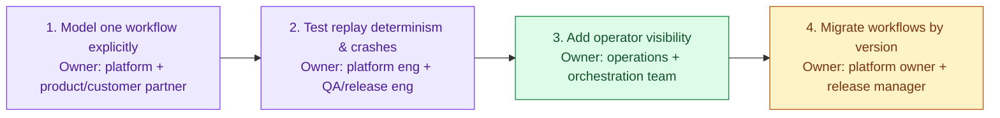

# Design a Reliable Workflow Orchestration System, part 7

## 7. Delivery Plan, Observability, and Business Impact

### Start with One Workflow, Not the Whole Platform

- The prototype runs, so the customer asks: when can we rely on it in production? The design talk now becomes a delivery plan, with measurable gates, a named owner per step and a route into support.
- Begin by modelling a single workflow in explicit form. A good candidate is document approval, then payment, then the email, then the three internal updates.
- A slice this narrow tells you whether business effects survive retries, pauses and crashes. It also keeps the first release small, so the team can reason through every move from one state to the next.
- The aim is learning, not breadth of features. Confirm three things: the workflow definition holds steady, anyone can inspect the state model, and the team can say what happens when a worker dies after the card is charged but before the email goes out.
- When you name that first workflow out loud, you signal that you think in MVP terms and stage the rollout instead of one big, risky launch.

### Determinism and Crash Recovery as the First Gate

- Test two things before any traffic grows:
  - Feed a recorded workflow history back through the engine. Check that every decision comes out the same as before.
  - Kill workers in the middle of a run and bring them back. Check that the engine picks up from durable state and does not blindly fire the side effects again.
- This pair is the first go/no-go gate. It shows whether the orchestration logic lives through the failures that hurt most.
- A line worth having ready: "I won't promote this until we can replay a run from its history, recover from a worker crash, and show that no irreversible effect happens twice."

> 🎯 **Interview Pointer:** Put deterministic replay and crash recovery *first* in the gate order, ahead of operator tooling and ahead of a wider release. That ordering marks a seasoned delivery plan. A weaker answer promises to "add monitoring later".

### Operator Visibility Before Broadening Scope

- With recovery proven, give operators a window into the system: dashboards, logs, traces and admin screens. Support staff should be able to answer three things quickly. What is in flight? What has stalled? What needs a human?
- Treat this as core. Without it, broken work piles up quietly; with it, a support team can run the platform.
- A rule that works in practice: show workflow-level state in the words the business uses (pending approval, payment authorised, compensation pending, completed). Beside it, show activity-level signals such as retry counts, timeouts, failed workers, how deep each queue is and how slow downstream calls are. Link the two, so a complaint from a user leads straight to the step that failed.

### Version Workflows Instead of Mutating Them

- Ship changes as a new workflow version. Never edit running executions in place. A run in flight may wait for days on an approval, a human reviewer or an outside system. If you swap its logic while it waits, old and new instances start to behave differently.
- Versions keep the operating model easy to follow. A run keeps the rules it began with. New runs get the new logic. During an incident, operators know which history applies.
- The customer starts to trust the platform once changes ship predictably.

### Rollout Scorecard: Six Metric Layers

- Strong FDE candidates do not squash every number into "the system is up". Their scorecard has six separate layers.

**Technical health metrics**

- **Workflow completion time**: elapsed time from a run's start to its terminal state. Data comes from orchestration history and timer records. The platform team owns it. Alert when p95, or a threshold agreed with the customer, moves well above the baseline.
- **Activity retry rate**: retries over total activity attempts. Data comes from worker and scheduler telemetry. The worker-runtime owner is responsible. Alert on a sudden spike, or when the rate stays high over a rolling window.
- **Stuck workflow age**: how long the oldest non-terminal run has waited past its expected time. Data comes from durable state and inspection of the queues. Operations owns it. Alert as soon as any run passes the maximum age the team will accept.

**Model quality metrics** (whether the orchestration model itself stays correct and stable: do the workflow definition, the replay behaviour and the state transitions still match the business logic they were meant to encode?)

- **Replay determinism pass rate**: the share of sampled histories that produce identical decisions on replay. Data comes from replay test jobs and checks on history. Workflow-runtime engineering owns it. Alert when it drops under the release gate, because nondeterminism can break the whole model.
- **State-transition validation failures**: how many invalid or surprising transitions tests, canaries or runtime guards catch. Data comes from the engine's validation and canary telemetry. The platform team owns it. Alert on any rise that persists, because it hints that the model or the versioning rules have drifted.
- **Schema or definition compatibility failures**: how many definition changes old or new runs cannot load safely. Data comes from versioning checks and validation at deploy time. Release engineering owns it. Alert if compatibility fails in staging or canary, because every version of the model has to stay loadable.

**Reliability and correctness metrics**

- **Duplicate effect count**: external effects caught happening twice, such as a repeated payment attempt or a second copy of an email. Data comes from idempotency logs, receipts from downstream systems and reconciliation jobs. The workflow platform and the integration owner share it. Alert on any confirmed rise, because even a handful can be costly.
- **Compensation rate**: the share of runs that end up taking a compensating action. Data comes from workflow history. Product and operations own it together. Alert on an unexpected climb, which can point to a bad release or a brittle dependency.

**Operational burden metrics**

- **Manual repair count**: runs that needed a person to step in. Data comes from operator actions and support tickets. Support operations owns it. Alert when it outgrows what the team can handle, or keeps climbing from one release to the next.

**Adoption metrics**

- Track workflows that real customers start, the share of teams that have migrated and how often operators log in to the visibility tools. These count because an elegant orchestration platform that no one trusts has failed as a product.

**Business outcome metrics**

- Look for fewer failed approvals, a shorter gap from payment to email, fewer customer escalations and a shorter cycle for the whole process. Say in the interview that technical health tells you the machine works; business outcomes tell you the customer gains from it.

### Phased Rollout: Owners, Exit Criteria, Rollback Triggers

- Give every phase a named owner, clear exit criteria and a trigger for rolling back:
  1. **Model one workflow explicitly**
     - Owner: a platform engineer, paired with someone from product or a design partner on the customer side.
     - Exit criteria: the definition has settled, each state transition is written down and everyone agrees on the business effect.
     - Rollback trigger: the first workflow cannot be modelled cleanly, or the customer disputes what success means.
  2. **Test replay determinism and crashes**
     - Owner: platform engineering, with QA or release engineering.
     - Exit criteria: crash-recovery tests pass, replays give steady results and failure drills show no duplicated side effects.
     - Rollback trigger: some crash path repeats an irreversible action that has no idempotency guard.
  3. **Add operator visibility**
     - Owner: operations, working with the orchestration team.
     - Exit criteria: operators find stalled work, explain its state and carry out approved repairs from written runbooks.
     - Rollback trigger: support cannot diagnose an incident without pulling in engineering.
  4. **Migrate workflows by version**
     - Owner: the platform owner and the release manager.
     - Exit criteria: old and new versions run side by side safely, the migration rules are written down and no in-flight run is rewritten.
     - Rollback trigger: a versioned migration gives inconsistent results or gets in the way of recovery.
- A real go/no-go gate never asks whether the code compiles. It asks three things. Can support run it? Can we execute the rollback? Can the customer live with the risk that remains?

### Connect the Dashboard to the User Journey

- A good dashboard reads like the business story, from left to right, for someone who is not an expert. The request comes in, approval is pending, payment is authorised, internal systems get their updates, the email goes out and the run closes.
- Beneath each status a user would recognise, put the matching component signals: retries, latency, queue age and compensation state.
- Triage gets faster, because support can see where the story went off course. The customer also sees that the platform is no black box. Visibility then becomes part of what they are buying, not only a tool for operations.

### Core Product vs Adapter vs Configuration vs Shared Service

- The core orchestration engine should not hold everything:
  - **Core product**: durable workflow state, retry policy, compensation orchestration, replay, versioning and the building blocks of operator visibility. These are the reusable behaviours the platform ought to own.
  - **Adapters**: the payment gateway, the email providers, document systems and the three internal systems, each reached through its own adapter. They sit behind interfaces because they differ from one customer and environment to the next.
  - **Configuration**: retry budgets, timeout windows, rules for routing approvals, escalation thresholds and visibility settings per tenant. These change more often than code does, so it must be safe to adjust them.
  - **Shared services**: identity, audit logging, metrics export and notification plumbing, where the organisation already has a standard for them. Reusing them cuts duplication, but only if the team can keep ownership lines and support commitments intact.
- The split shows product judgement: you pull reusable product value out of the pilot instead of building a bespoke workflow engine for a single customer.

### Train Operators Before the First Wide Rollout

- Being ready for production means having trained people and written guidance.
- Support needs a runbook for the usual failures: a worker crashes after payment, an outside call times out during approval, an upstream system sends the same callback twice, a run sits waiting on a human reply.
- The docs should explain how to read state, when and how to escalate, and which compensations an operator may safely trigger by hand.
- Teach through scenarios, not slides. Take each operator through a stalled run, a clean replay and a call on whether to roll back. If they cannot explain a workflow from the dashboard and the runbook, the system is not ready for wide use.

### The Risk Register Should Be Owned, Not Implied

- Keep the risk register short; it stops the rollout drifting into wishful thinking. Every entry has an owner, a mitigation and a trigger:
  - **Worker crash after payment succeeds**: platform engineering owns it. Idempotency keys, durable state and replay tests mitigate it, because the durable history and the completion receipt decide whether to redeliver or compensate; worker memory never does. Trigger: a payment event with no terminal workflow record.
  - **Replay nondeterminism**: the workflow-runtime team owns it. Deterministic APIs and replay tests driven by history mitigate it. Trigger: a replayed decision that differs from the recorded one.
  - **Operator overload**: operations owns it. Dashboards, runbooks and tuned alerts mitigate it. Trigger: the manual repair count keeps going up.
  - **Version migration error**: the release manager owns it. Version gating and a canary rollout mitigate it. Trigger: old and new runs reach different outcomes.
- The register turns a technical design into a service people can support.
- A strong rollout story goes in order. Prove one workflow end to end. Next, check replay and crash recovery. Then give operators visibility. Finally, migrate by version behind a canary and a rollback plan. Through every step, keep an eye on six numbers: completion time, retries, how long work sits stuck, duplicated effects, compensations and manual repairs. Hold off on calling it a success until customers use it, the business process gets better and support can run it without heroics.
- The customer impact you can measure: a workflow platform that can apply each business effect of a long-running process exactly once, keep its state visible, and compensate when a step fails. Recovery stays under control and manual work drops. Approval, payment, email and the internal updates then run as one dependable service, not a chain of brittle one-off scripts.
