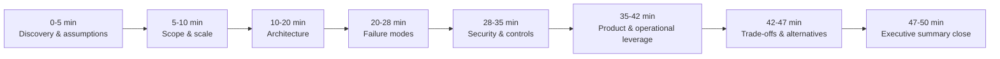

# Design a Reliable Workflow Orchestration System, part 8

## 8. Interview Walkthrough, Trade-Offs, and Practice

### Minute-Zero Opening: Lead with the Business Effect

- Sound like an FDE who is already in the room with a customer under production pressure. Do not sound like a candidate listing patterns. Start from the outcome and flag the riskiest assumptions early. Then keep steering back to three things: the business effect, how the system recovers, and what control operators keep.
- Model opening: "Approval of documents, a payment, an email and three internal systems all have to move together, and any one of them can fail or sit waiting for days. My goal is to apply each business effect of a long-running process exactly once, keep its state visible, and compensate when a step fails. First I'll pin down what a successful business effect means here. Next I'll size the workflow volume. Then I'll propose the orchestration model, the storage and the recovery approach. I'll finish with failure handling, security and rollout."
- That opening earns four things in one go. It proves you grasp the customer's need, centres the design on business effect rather than plain task execution, and signals a plan for the hour. It also lets the interviewer steer you if their setting has a different constraint.

### A Practical 50-Minute Answer Plan

- Spend minutes where the risk is, not where the diagram is biggest:
  - **0–5 min: discovery and assumptions.** Find out what a finished workflow looks like. Ask which steps a person does and which are automated, whether an approval can take hours or days, and which system owns the truth about state. Say your assumptions aloud and ask to be corrected.
  - **5–10 min: scope and scale.** Estimate how many workflows are active, how long each runs on average and how many instances peak at once. Add the extra writes that history and retries create. Use that to choose between a simple queue-based engine and a sturdier, durable workflow service.
  - **10–20 min: architecture.** Sketch the orchestration boundary, the workflow state store, the worker pool, idempotent activity executors, compensation handlers and the external systems. Make clear that the orchestrator owns ordering and durable state, while workers carry out the side effects.
  - **20–28 min: failure modes.** Step through four cases: a worker crashing after payment, a timeout while approval is pending, a webhook delivered twice, and a run that completes only partly across internal systems. For each, explain which guard stops the duplicate: the event history, the retry policy, the idempotency keys, or a compensation or escalation path.
  - **28–35 min: security and controls.** Walk through who the caller is at each hop (identity propagation), least privilege, secret handling, audit logs, retention, and what you redact or minimise. Each control should answer a named failure mode or compliance need.
  - **35–42 min: product and operations.** Talk through observability, dashboards for operators, how stuck workflows get handled and how in-flight workflows are versioned. Show that one platform can serve many business processes, so it does not turn into a factory for one-off scripts.
  - **42–47 min: trade-offs and alternatives.** Weigh an orchestrated saga against choreography, history size against debuggability, automatic compensation against human review, and workflow code against declarative definitions.
  - **47–50 min: close with a concise executive summary.** Come back to the customer outcome, the architecture, the largest trade-off and the gate for rollout.

### Keeping the Conversation at the Right Depth

- Candidates often lose the hour drawing boxes and leave the fragile edges almost untouched.
- Let the risk profile set how deep you go:
  - Approvals that can wait a week → long-lived state and versioning outweigh small latency optimisations.
  - Payments that cannot be undone → idempotency and compensation outweigh clever orchestration syntax.
  - Several internal systems that are only eventually consistent → event ordering and reconciliation outweigh the precise choice of queue.
- State your assumptions and give the interviewer a chance to change course. For example:
  - "My assumption is that the workflow engine keeps a history per step and can pick up again after a crash. If a simpler build-versus-buy view would help, I can lay that out as well."
  - "Workers may see a task more than once, so I'll make every action that changes something idempotent."
  - "My assumption is that the business wants state it can see and audit. So the orchestrator stays the source of truth for progress."
- Framed this way, you pick the smallest design that stays safe under realistic growth and failure, rather than building for every imaginable future.

### Trade-off Framing to Defend

- **Orchestrated saga vs. choreography.**
  - Orchestrated saga: one control plane holds state transitions, retries, compensation and visibility. That suits long-lived, audit-heavy processes that have to ride out worker crashes and manual steps. The cost is a central dependency that needs high availability and careful versioning.
  - Choreography: services share the work by reacting to events. Central coupling drops, and ownership of each service can look tidier. But nobody can easily tell where a given run has got to, or what halted it. Reasoning about cross-service compensation and human review gets harder too.
  - Verdict: for a small event-driven system, choreography can appeal. Once the customer wants state they can see, retries under control and recovery that support can run, orchestration is easier to operate.
- **History size vs. debuggability.**
  - Keeping every transition, input, output and retry helps debugging, because you can replay the path a decision took and see exactly where it failed. The price is growing storage, heavier reads and more care with redaction.
  - Cutting history back saves overhead, yet it throws away the forensic record that operators and support depend on.
  - Verdict: "keep what you need to replay and explain each decision, compress or summarise older segments once it is safe, and hold the audit trail as long as customer policy says". The answer is not "keep everything forever."
- **Automatic compensation vs. human review.**
  - Automatic compensation works well when the undo is deterministic and safe. Examples: cancel a reservation, void a pending authorisation, flag a record as failed, or send a correcting notification.
  - It is weaker once a side effect is irreversible, unclear or regulated. There, a queue for human review may be the better fallback.
  - The tension is speed against correctness. Full automation cuts latency and manual effort, but it can magnify a wrong call. Human review is slower, yet legal, financial or high-risk operational lines may demand it.
- **Workflow code vs. declarative definitions.**
  - Code allows rich branching, shared helper logic and complex compensation flows. In return it brings harder versioning and more testing.
  - Declarative definitions are simpler to inspect and validate, and people who are not engineers can follow them. In return they can prove too rigid for the branching real enterprises need.
  - Balanced position: offer a declarative model for the common shape, and let code handle business-specific logic where it has to.

> 🎯 **Interview Pointer:** Expect "orchestration vs. choreography" to be the trade-off an interviewer pushes hardest, often as a blunt "why not let events drive it all?" Have a one-line verdict to hand. Choreography lowers coupling, but nobody can then point to where a run stands, and that rules it out once the customer needs visible state and recovery support can run.

### Follow-up Drills and Strong Answers

- **"What if payment succeeds and the worker dies?"** Protection comes from idempotency plus durable workflow state, not from hoping the worker lives. Say the charge went through and the worker crashed before it recorded completion. The orchestrator replays the workflow and sees the payment step already committed. It then either carries on from the persisted state or checks with the payment provider using the idempotency key or transaction reference. In short, the durable history and the completion receipt decide whether to redeliver or compensate; worker memory never does. A restarted worker must never cause a second irreversible payment.
- **"How do you change code for running workflows?"** Shipping new code and crossing your fingers is not an answer. In-flight runs need explicit versioning rules. One route is backward-compatible definitions. The other pins every new instance to a versioned definition, while older instances finish on the logic they started under. When a change has to reach in-flight workflows, use a deliberate migration path, a compatibility layer or a controlled cutover policy. Describe the operating routine too: try the new version on fresh instances, canary it, check the outcomes, then widen it.
- **"What is the idempotency boundary?"** It sits at each side-effecting business action, not around the whole workflow. Give every effect the outside world can see its own idempotency key: submitting a payment, sending an email, writing to an internal system, posting an approval record. Match the boundary to how much harm a duplicate does in the external system. Payment is irreversible, so it gets the strictest discipline. Email is a notification, so it needs duplicate suppression but can be looser.
- **"How do you handle a week-long approval?"** Approval is a stored, durable wait; no thread stays busy for it. Persist the state, set a reminder or SLA timer where needed, and resume once the approval event comes in. When it runs late, escalate it, reassign it or move it to a manual review lane. For waits like this, never lean on in-memory timers or worker leases.

### Common Weak Answers and How to Repair Them

- "I'd just retry until it works." → Separate transient failures from permanent ones. Add limits and backoff, plus a clear dead-letter or human escalation path.
- "The worker can keep the state in memory." → Workers crash, get redeployed and get scaled away. Anything that runs for days must persist its progress.
- "We can always compensate later." → Some effects cannot be undone. Name the irreversible steps and set out the fallback for each.
- "Choreography is more scalable." → Scale on its own does not settle it. Talk about observability, recovery and how support will run it.
- "One generic retry policy is enough." → A payment, an approval and an email fail in different ways. Give each its own retries and alerts.
- "We'll change the code and restart everything." → Pin versions on live runs so instances already under way still work.

### Scoring Rubric for Self-Evaluation

- **Discovery**: Did the candidate find out what "done" means, which steps people do and which effects cannot be reversed?
- **Estimation**: Were concurrency, duration and retry pressure sized sensibly, even with illustrative numbers only?
- **Architecture**: Was there a clean account of control flow, durable state, how workers behave and the external integrations?
- **Depth**: Did crash recovery, idempotency and versioning get more time than drawing boxes?
- **Security**: Were least privilege, secret handling, audit trails and keeping data to a minimum all raised?
- **Delivery**: Were rollout, tools for operators and the handoff to support covered?
- **Communication**: Was the answer structured, were the assumptions explicit, and did it close with an executive summary?
- A strong answer has a clear structure and uses numbers where they count. It treats side effects safely, names its trade-offs openly and keeps returning to the customer outcome.

### A 90-Second Architecture Summary

- A close you can give at minute 50: "A durable workflow orchestrator is the source of truth for progress, and every business effect sits behind its own idempotent step. The orchestrator stores state and event history. That lets it survive worker crashes, wait out long approvals and pick up again without repeating irreversible actions such as payment. People review only the cases where compensation is unsafe or unclear. I'd version the workflow model so running instances keep going safely. Observability and operator tooling come early, so support can tell where any run is blocked. The riskiest trade-off is orchestration against choreography. Choreography is simpler across services. For a long, customer-facing process, orchestration wins on debugging, recovery and support. My first rollout gate: before wider adoption, a single end-to-end workflow must prove replay, crash recovery and visible state in a production-like setting."
- Reuse that summary as an artifact. Its parts: the durable orchestrator as source of truth, idempotent steps, surviving crashes and long waits with no repeated irreversible action, human review only for unsafe or unclear compensation, a versioned model, observability and operator tooling first, and the riskiest trade-off named next to the first rollout gate.

### Practice Loop: Solo, Pair, Implementation

- **Solo exercise**: run the 50-minute plan out loud, then answer the four follow-ups with no notes: the payment crash, the version change, the idempotency boundary and the week-long approval.
- **Pair mock**: a partner cuts in with the events-only challenge from the Interview Pointer above. Defend orchestration, and never repeat a sentence.
- **Implementation exercise**: sketch, by hand, the states a workflow moves through. Then trace a crash at the precise moment the payment has succeeded but its state is not yet acknowledged. Explain each step: how the system detects the completion and how it blocks a duplicate effect.
- Give that answer without rushing. It shows the interviewer you can run a customer's multi-day process live and explain, with no hand-waving, how it stays trustworthy when reality knocks it off the happy path.
