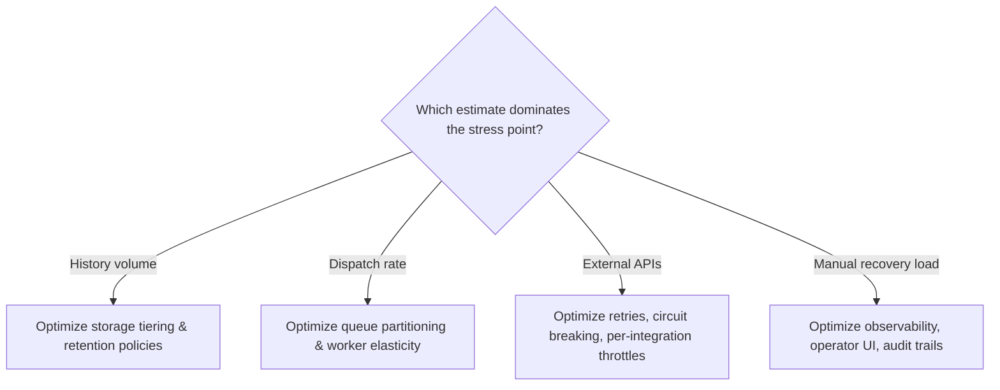

# Chapter 13: Design a Reliable Workflow Orchestration System, part 3

## 3. Scale Estimates, SLOs, and Capacity

### Start with the Load That Breaks the First Draft

- The first architecture a candidate draws is usually reasonable at average load: workflow service, queue, worker pool, database for state, blob store for attachments.
- That draft is often too optimistic about timing — the hidden constraint is not just volume, it's the combination of long waits, retries, and deadline pressure.
- A workflow can sit for days, then surge into a burst when approvals land, a payment gateway returns, or a downstream system recovers. Sizing only for average traffic can miss the business deadline in production.
- Next move: estimate the envelope — how many workflows exist concurrently, how many events they generate, how much state must be retained durably, how fast tasks must be dispatched, and how much slack the system needs for peaks and partial outages.

### Working Assumptions and Activity Rate

- Scenario numbers used as planning inputs, not gospel:
  - 10 million active workflows
  - 100 million activities per day
  - Week-long waits between some steps
- These already imply the system is a durable state machine with a large inactive population and a smaller, constantly moving subset.
- Daily-to-per-second conversion: 100,000,000 activities/day ÷ 86,400 seconds/day ≈ **1,157 activities/second on average**.
- Average is useful but not what you provision for — office-hours concentration, morning reminder batching, or a dependency outage causing delayed retries to resume together can push true peak several times higher.
- Practical framing to state out loud. The multipliers below are planning choices I'd defend for this case, not industry standards:
  - Average dispatch rate: about 1.2k activities/sec
  - Peak dispatch rate: 3x–10x average depending on customer usage patterns
  - Headroom: at least 2x above the observed peak for a new system, more if retries or regional failover are in scope
  - Growth factor: model both 2x and 10x future scale before locking in partition counts or storage layout

### Separate Workflow State from Payloads

- Common scaling mistake: storing everything in the workflow history.
- Durable state should carry only the minimal facts needed to replay, resume, audit, and compensate: step status, timestamps, correlation IDs, business references, version markers.
- Large documents, PDFs, images, or payloads from internal systems belong in object storage or a document store, referenced by pointer.
- This separation matters for three reasons:
  1. **Replay cost** — pulling megabytes of payload into the orchestration engine on every retry/rehydration grows latency and worker memory pressure.
  2. **Retention cost** — workflow histories often need audit/support retention; keeping large payloads in the hot path turns an operational ledger into an expensive archive.
  3. **Blast radius** — a payload leak or accidental mutation is far more damaging if the payload is copied across every event record.
- Rule of thumb: workflow state should be enough to make the system deterministic and inspectable; payload storage should hold the large, mutable, or externally sourced data. The workflow references the payload, but does not become the payload.

### Estimating Event-History Storage

- Back-of-envelope method: active workflows × events retained per workflow × bytes per event — not a magic number.
- Working assumptions (the 10 million comes from the scenario; the per-workflow numbers are mine):
  - 10 million active workflows
  - 40 events retained per workflow on average
  - 1 KB per event record, illustrative
- Yields roughly **400 GB** of raw event data, before replication, indexing, compaction overhead, or backups.
  - At 2 KB/event instead of 1 KB → about **800 GB**.
  - If the active set is really 20 million rather than 10 million, it doubles again.
- The purpose of the estimate is to reveal which dimension dominates the storage design, not to prove a final number.
- Practical design choice: if history retention is long, separate the hot execution path (execution metadata, task leases) from the colder audit path so compaction, tiering, and retention policies are easier to reason about.

### Estimating Task-Queue Throughput

- Task-queue throughput is the operational choke point — approval notifications, payment requests, internal API calls, and status updates all become queued work.
- At 100M activities/day, sustained rate above ~1,157 activities/second must be accepted, leased, and completed.
- That number alone is incomplete: every activity typically creates at least two queue-related actions (enqueue, dequeue), sometimes more with leasing, visibility timeouts, or requeues.
- Throughput envelope should describe both task creation and task execution:
  - Task enqueues: roughly proportional to activity count
  - Task leases and acknowledgments: at least one per activity, often more with retries
  - Retry traffic: additional load after transient failures or worker restarts
- The queue subsystem must tolerate a retry storm without starving new tasks — a practical design choice is to partition queues by workflow tenant, workflow type, or priority class so one customer or one runaway workflow family cannot monopolise all dispatch capacity.

### Sensitivity at 10x Growth

- A sensitivity table makes the scaling decision concrete and shows what breaks first when assumptions move:

| Scenario | Active workflows | Activities/day | Avg activities/sec | Likely architectural pressure |
|---|---|---|---|---|
| Base case | 10M | 100M | ~1.2k | Durable history, moderate partitioning, warm worker pool |
| 10x growth | 100M | 1B | ~11.6k | Stronger sharding, stricter queue isolation, heavier compaction/tiering |

- At 10x growth I wouldn't expect application-server CPU to be the bottleneck — I'd expect storage fan-out, queue hot spots, replay latency, or operational cost to bind first.
- If the design cannot absorb that growth without a full rewrite, say so and choose a more partition-friendly layout from the start.

### Latency Budgets and Workflow SLOs

- A workflow orchestration system needs SLIs/SLOs distinct from a typical API server:
  - **Availability SLI**: percentage of time workflow submission, progress updates, and operator controls are reachable
  - **Latency SLI**: time to accept a new step, time to dispatch an activity, time to reflect state changes in the UI
  - **Freshness SLI**: delay between a real-world event and its visible representation in workflow state
  - **Quality SLI**: rate of duplicate side effects, missed transitions, failed compensations, or stuck workflows
  - **Security SLI**: fraction of requests correctly authorised and audited; sensitive-data-exposure rate driven toward zero by design (not described as impossible)
  - **Cost SLI**: cost per workflow or per thousand activities, plus support burden for operator intervention
- Translate into customer-felt objectives: the customer may not care about an 80ms vs. 120ms task lease, but does care if a payment step takes so long to appear in the UI that an operator assumes it's lost and manually retries it, or if a workflow that should be compensating sits invisible for hours.
- Queue subsystem sizing must tolerate a retry storm without starving new tasks — partition by tenant, workflow type, or priority class so one runaway workflow family can't monopolise dispatch capacity.

### Retry Math Is Not Compensation

- Retry formula bounds repeated attempts without a thundering herd:

**backoff_n = min(cap, base × 2^n) + jitter**

- *n* = retry attempt number, *base* = initial delay, *cap* = maximum delay, *jitter* = randomised variation to avoid synchronised retries.
- Exponential backoff slows repeated attempts after failure, protecting dependencies and giving transient incidents time to recover.
- Backoff is **not** business compensation:
  - Payment succeeds, email fails → retrying email is appropriate.
  - Payment succeeds, workflow later discovers a validation error → backoff does not undo the charge; an explicit compensation step (refund, mark for review) is needed.
  - Retry answers "try again later"; compensation answers "what business action reverses or mitigates the completed side effect?" — keeping these distinct is essential.
- Cap and jitter are operational trade-off decisions tied to the business process, not chosen by habit:
  - Low cap → faster recovery for user-facing work, but can overload a flaky dependency.
  - High cap → protects the dependency, but delays customer-visible progress.

> 🎯 **Interview Pointer:** "Retry vs. compensation" is a common conceptual trap interviewers set — always state explicitly that backoff never substitutes for a business-level reversal (e.g., a refund) when a completed side effect must be undone.

### Which Estimate Should Drive the Architecture

- Usually not total workflow count by itself — it's the combination of long waits, visible state, and side-effect safety:
  - Week-long waits force durable storage and replayability.
  - 100 million daily activities force queue scalability and partition strategy.
  - Irreversible side effects force idempotency, unique business keys, and compensation tooling.
- Component selection should follow the stress point, not whichever is easiest to draw:
  - If history volume dominates → optimise storage tiering and retention policies.
  - If dispatch rate dominates → optimise queue partitioning and worker elasticity.
  - If external APIs dominate → optimise retries, circuit breaking, and per-integration throttles.
  - If manual recovery dominates → optimise observability, operator UI, and audit trails.

### Communicating Uncertainty Like an Operator

- Interviewers want evidence you know how to use estimates as a control surface, not fake certainty.
- Example phrasing: "I would treat 10 million active workflows as the initial working set, but I would size the partitions and queue namespaces with a 10x sensitivity case because growth and retry bursts are likely to concentrate load unevenly. If the customer later confirms that only 20% of workflows are long-running, the storage plan gets easier; if they confirm that 80% have week-long waits, the retention and replay path becomes the top concern."
- This shows you are choosing the smallest design that remains safe under plausible growth and failure modes — not overengineering for every imaginable future.
- This section is a job-market filter: many engineers can describe distributed systems abstractly; fewer can say which number matters, why, and what decision it changes.
- Estimates are decision tools — each number should justify an architectural choice or operational limit. If a metric doesn't change partitioning, storage, retry policy, latency budget, or support model, it's probably the wrong metric to foreground.
