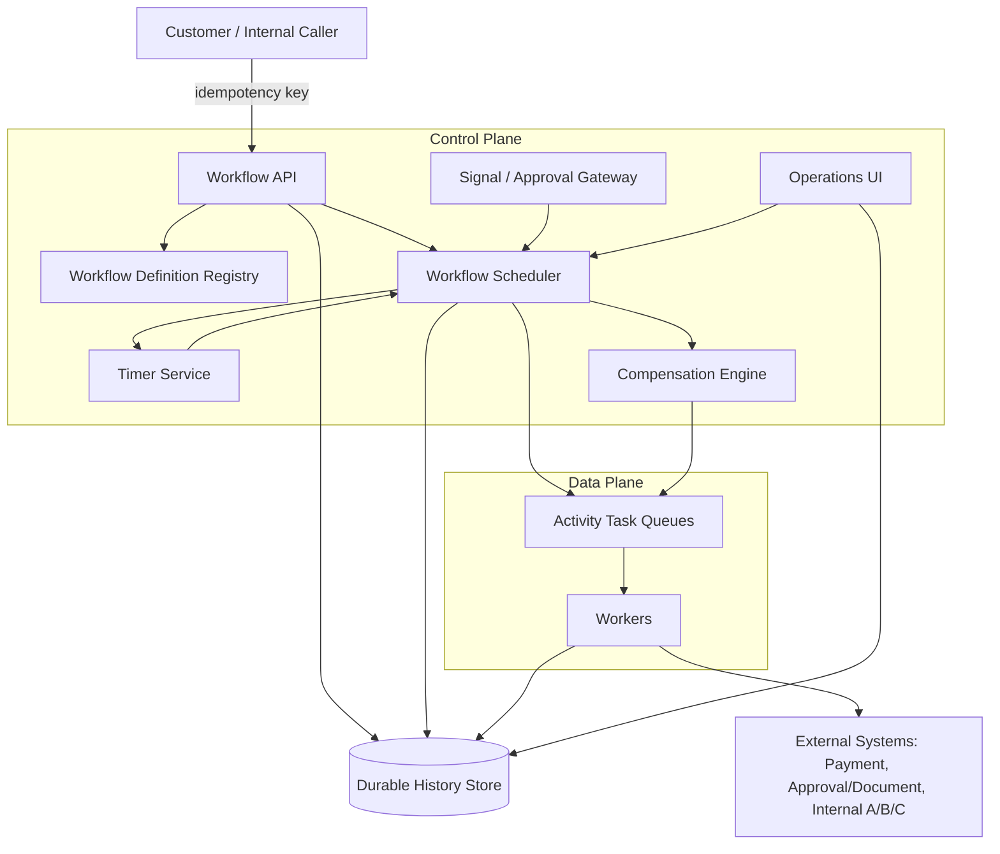
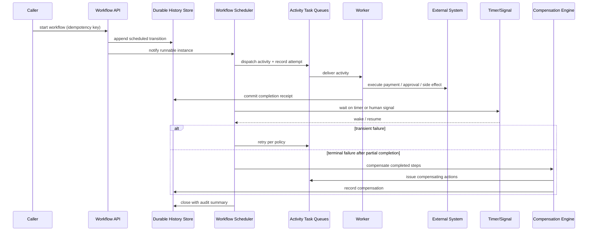
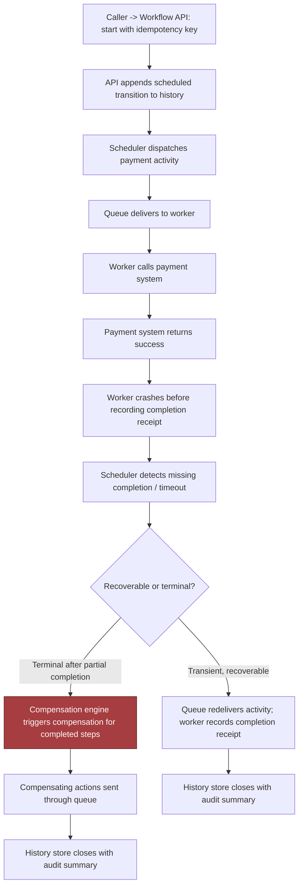

# Chapter 13: Design a Reliable Workflow Orchestration System, part 4

## 4. Architecture and End-to-End Flow

### System Boundary and Customer Outcome

- Start from the customer outcome and work backward: **execute long-running business processes exactly once at the business-effect level with visible state and compensation**.
- "Exactly once" is not a promise that no retry ever happens — it's a promise that the business never double-charges, double-sends, or silently loses a step, made observable.

### Component Map: Control Plane vs Data Plane

- The system decomposes cleanly only if you distinguish the control plane from the data plane.
- Components:
  - **Workflow definition registry** — source of truth for approved workflow templates, step order, retry rules, timeout rules, and compensation mappings.
  - **Durable history store** — system of record for every state transition, signal, attempt, receipt, and terminal outcome.
  - **Workflow scheduler** — reads durable history, decides the next runnable transition, assigns it to execution.
  - **Activity task queues** — buffered handoff between scheduling decisions and worker execution.
  - **Workers** — perform external calls, internal side effects, and local validation.
  - **Timer service** — wakes workflows after a delay, deadline, or human waiting period.
  - **Signal/approval gateway** — accepts explicit human or system signals that unblock a waiting workflow.
  - **Compensation engine** — coordinates rollback-like business actions for already-completed steps when a terminal failure occurs.
  - **Operations UI** — shows live state, who is waiting on whom, retry history, and operator controls (pause, resume, override).
- **Control plane** = registry, scheduler, timer service, signal gateway, compensation engine, operations UI — decides what should happen next.
- **Data plane** = the queue-plus-worker path that actually performs work.
- That split is the heart of the design: it lets you scale decision-making separately from side-effect execution.

### Top-Down Architecture and Trust Boundaries

- Top-down flow:
  - Customer/Internal Caller sends an HTTP/API request with an idempotency key.
  - Request enters the Workflow API.
  - API consults the Workflow Definition Registry for the allowed workflow template and policy.
  - API writes the first event to the Durable History Store.
  - API may notify the Workflow Scheduler that a new instance is ready.
  - Workflow Scheduler consults durable history and dispatches runnable work into the Activity Task Queues.
  - Workers consume from the queue and call the External Payment System, the Approval/Document Service, and Internal Systems A/B/C.
  - Workers append results and receipts back to the Durable History Store.
  - Timer Service watches deadlines and reawakens workflows that must continue later.
  - Signal/Approval Gateway accepts human approvals, rejections, or external system signals and forwards them to the scheduler.
  - Compensation Engine issues business compensations back through the queues when a workflow must unwind completed work.
  - Operations UI reads the store and scheduler state so operators can observe, pause, resume, or override safely.

- Three trust boundaries, each needing its own authentication, authorisation, and logging policy (do not blur into one generic "service layer"):
  - **Public/customer-facing API** — accepts the workflow start request and an idempotency key, but must not trust that the caller will retry carefully.
  - **Worker edge** — external systems can fail, time out, or partially complete.
  - **Human approval path** — slow, fallible, and auditable.

### State Ownership and Consistency

- The **durable history store** owns the canonical progression of the workflow.
- Queues do not own truth — they own delivery.
- Workers do not own truth — they propose effects.
- The scheduler does not "remember" through memory alone — it recomputes from durable history.
- This is the key consistency point: after each accepted event, the history store is the record that drives recovery.

### Sequence Diagram: Happy Path

- Happy-path sequence, read top-to-bottom as order of events, left-to-right as actors:
  1. Caller → Workflow API: start workflow with idempotency key.
  2. Workflow API → Durable History Store: append scheduled transition.
  3. Workflow API → Workflow Scheduler: notify that a new runnable instance exists.
  4. Workflow Scheduler → Activity Task Queues: dispatch activity and record attempt.
  5. Activity Task Queues → Worker: deliver the activity.
  6. Worker → External System(s): execute payment, approval lookup, email, or internal side effect.
  7. Worker → Durable History Store: commit completion receipt.
  8. Workflow Scheduler → Timer Service or Signal Gateway: wait on timer or human signal.
  9. Timer Service or Signal Gateway → Workflow Scheduler: wake or resume the workflow.
  10. Workflow Scheduler → Activity Task Queues: retry transient failure when policy allows.
  11. Workflow Scheduler → Compensation Engine: compensate completed steps on terminal failure.
  12. Workflow Scheduler → Durable History Store: close with audit summary.

- Narrate the sequence in order without skipping handoffs — the interviewer should hear control move from the model to deterministic services and back again.

### Failure-Path Overlay: Worker Crash After Payment

- The most important failure drill in this chapter: the **worker crashes after payment succeeds**.
- Event sequence:
  - Caller starts the workflow with an idempotency key.
  - API appends the scheduled transition to history.
  - Scheduler dispatches the payment activity and records an attempt.
  - Activity queue delivers the attempt to a worker.
  - Worker calls the external payment system.
  - Payment system returns success.
  - **Worker crashes before it records the completion receipt.**
  - Scheduler detects the missing completion or a timeout.
  - Scheduler decides whether to redeliver the activity or reconcile from recorded state.
  - If transient/recoverable → queue redelivers the activity, worker records the completion receipt.
  - If terminal failure after partial completion → compensation engine triggers compensation for completed steps, sends compensating actions through the queue.
  - History store closes the workflow with an audit summary.

- The payment may have succeeded before the worker died, so the system must never equate "worker lost" with "business action lost."
- The durable history store and completion receipt are what prevent a double charge on retry — the scheduler either reissues the step safely or escalates to compensation based on what history says already happened.

> 🎯 **Interview Pointer:** This exact drill — worker crash after payment succeeds, before the receipt is recorded — is the follow-up I'd most expect in this chapter's interview. Memorise the resolution: durable history + completion receipt decide "redeliver" vs. "compensate," never worker memory.

### End-to-End Flow, Step by Step

- The happy path as a numbered sequence, not a vague story:
  1. Caller starts the workflow with an **idempotency key** so a retry does not create a duplicate business process.
  2. API validates the request and **appends a scheduled transition** to durable history.
  3. Scheduler reads that transition and **dispatches an activity** to the queue, recording that an attempt has begun.
  4. A worker picks up the activity, performs the side effect, and **records a completion receipt** back to durable history.
  5. Workflow moves into a **wait state** for either a timer or a human signal.
  6. If the activity fails transiently, scheduler arranges a **retry** per policy rather than escalating immediately.
  7. If the workflow reaches a terminal failure after some steps have already completed, the compensation engine invokes **compensating actions** for those completed steps.
  8. Workflow closes with an **audit summary** showing the path taken, waits, retries, manual interventions, and final effect.
- This flow is a chain of consistency points: the request becomes durable before any downstream side effect; the side effect happens before the workflow claims success; the audit summary comes last because it is derived from history, not worker memory.

### Synchronous and Asynchronous Boundaries

- **Synchronous**: start request validation, authentication, permission checks, writing the initial history event, returning the workflow ID, most operations UI reads.
- **Asynchronous**: dispatching activities, waiting for approvals, timer wakeups, retries, compensation, most downstream integrations.
- This boundary is not cosmetic — it's how the API stays responsive while a business process waits for days.
- Everything-synchronous design → brittle request chain that breaks under human delay.
- Everything-asynchronous without a strong history model → loses explainability and operator control.

### Queues, Backpressure, Caches, and Policy Placement

- Queues belong at the edge between scheduling and execution, not inside the state store — they absorb bursty demand and isolate slow workers.
- Backpressure belongs in the scheduler and queue admission path: if a tenant, partition, or dependency is congested, slow new dispatches rather than let retries flood the whole fleet.
- Caches belong only for read-heavy, low-risk data (workflow definitions, UI summaries) — never the only place execution state lives.
- Policy enforcement belongs close to decision points: retry limits in the scheduler, approval requirements in the signal gateway, permission checks before compensation or manual override.
- Partitioning key (workflow ID, tenant ID, or customer/process key) determines how history and queue load spread — goal is reducing hot spots and preserving causal order where the business requires it, not just raw sharding for scale. If two steps must never race for the same process instance, the partitioning key should keep them together.

### Why This Decomposition Matters

- The same architecture must be understandable to a product owner (invoices, approvals) and an engineering team (retries, locks, queue depth) — that dual-language ability is a strong job-market signal.
- Narrate **data, identity, state, and failure** through the diagram:
  - Data flows from caller → history → scheduler → worker and back.
  - Identity flows through auth, idempotency keys, and approval context.
  - State lives in durable history.
  - Failure is handled by retries, timers, and compensation, rather than optimism.
