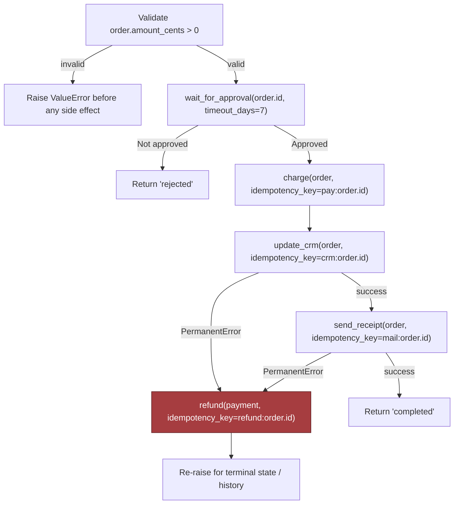

# Chapter 13: Design a Reliable Workflow Orchestration System, part 5

## 5. Data Model, APIs, and Working Code

### The Smallest Safe Slice of the System

- The design becomes interview-credible when it stops being a cloud of boxes and turns into durable records, contracts, and one code path proving the hardest part can work safely.
- Highest-risk component for this orchestrator: the state machine that decides what happens next after a step succeeds, fails, or is replayed — not the approval UI or email sender.
- If the state machine is wrong, every other subsystem can be perfectly healthy and the customer still gets duplicate charges, lost approvals, or a workflow that appears stuck forever.

### Core Durable Records

- Four core records anchor the design, each with an explicit purpose, primary key, lifecycle, and retention policy:
  - `WorkflowInstance(id, definition_version, state, next_event)` — the owning row for one business process.
    - Purpose: one durable source of truth for the workflow's current status and where it should resume.
    - Primary key: `id`.
    - Lifecycle: created when the workflow starts, updated on every transition, eventually archived or retained per customer policy.
    - Retention: keep the active row for the duration of the workflow; retain a compact historical form after completion if audit/replay is required.
  - `HistoryEvent(instance_id, sequence, type, payload_ref)` — append-only audit trail.
    - Purpose: reconstruct what happened, in order, without trusting memory or transient logs.
    - Primary key: `(instance_id, sequence)`.
    - Lifecycle: append only; never mutate past events.
    - Retention: long enough for debugging, customer audit, and replay; then cold storage or purge under policy.
  - `ActivityReceipt(idempotency_key, external_ref, status)` — records side effects already attempted or completed.
    - Purpose: prevent a retry from charging twice, emailing twice, or applying the same update twice.
    - Primary key: `idempotency_key`.
    - Lifecycle: written before or immediately after the external effect, depending on dependency semantics.
    - Retention: as long as duplicate suppression is needed.
  - `Timer(instance_id, fire_at)` — tracks delayed wake-ups.
    - Purpose: resume long waits, timeout approvals, or poll for external completion.
    - Primary key: `(instance_id, fire_at)` or equivalent scheduler key.
    - Lifecycle: created when waiting begins, deleted when the wait resolves, reinserted if the workflow is retried.
- Data ownership split: the orchestrator owns workflow state, step history, and retry intent; external systems own payment, CRM updates, document approval, and email delivery. The orchestrator can record that a payment happened, but it never becomes the financial ledger.

### API Contracts

- Four API contracts make the state machine usable, small enough to explain in one breath but strict enough that clients cannot smuggle ambiguous work into the engine:
  - `POST /v1/workflows/{type}` — starts a workflow.
    - Authentication: standard caller auth plus tenant/customer scoping.
    - Idempotency: caller-supplied idempotency key so a retry does not create two workflow instances.
    - Request: workflow type, business payload, caller context, optional correlation metadata.
    - Response: workflow instance id, initial state, stable status reference.
    - Errors: `400` invalid shape, `401/403` auth failure, `409` the same idempotency key is still being processed, `422` the key was reused with a different payload or the workflow inputs are semantically invalid (the IETF Idempotency-Key draft uses 409 and 422 this way; it's an expired Internet-Draft, not an RFC, as of Sep 2026).
  - `POST /v1/workflows/{id}/signals` — submits human or system input.
    - Authentication: caller must be authorised to signal that workflow or tenant.
    - Idempotency: signal id plus payload hash or caller key to suppress duplicate approval clicks or repeated system callbacks.
    - Response: accepted signal, resulting state transition, or a no-op if the same signal was already applied.
  - `GET /v1/workflows/{id}/history` — returns the audit trail.
    - Authentication: read access to that workflow's tenant and policy scope.
    - Semantics: read-only, paginated, ordered by sequence.
    - Errors: `404` unknown workflow, `403` hidden by access policy.
  - `POST /v1/workflows/{id}/repair` — lets operators or approved automation resume, replay, or compensate.
    - Authentication: elevated operator authorisation, tightly scoped.
    - Idempotency: every repair action needs its own idempotency token so repeated operator clicks don't multiply side effects.
    - Semantics: must be explicit about whether it is retrying a step, compensating a completed step, or resuming from a known checkpoint.
- Duplicate-request behaviour should be predictable: if the payment step receives the same idempotency key twice, the first request charges the card and stores the receipt; the second returns the existing receipt or a "completed already" response.

### The Implementation Slice That Proves the Design

- The smallest code path demonstrating the important behaviour: a saga step with approval wait, idempotent payment, a CRM update, and compensation on permanent downstream failure.
- Intentionally narrow — a real system would add persistence, serialisation, distributed locking, stronger typing, queue workers, and a scheduler; this sketch focuses on the state transitions that matter most in the interview.

```python
from dataclasses import dataclass
from typing import Protocol


class PermanentError(Exception):
    pass


@dataclass(frozen=True)
class Order:
    id: str
    amount_cents: int
    customer_email: str


@dataclass(frozen=True)
class PaymentReceipt:
    idempotency_key: str
    external_ref: str
    status: str


class Activities(Protocol):
    async def charge(self, order: Order, idempotency_key: str) -> PaymentReceipt: ...
    async def update_crm(self, order: Order, idempotency_key: str) -> None: ...
    async def send_receipt(self, order: Order, idempotency_key: str) -> None: ...
    async def refund(self, payment: PaymentReceipt, idempotency_key: str) -> None: ...


async def order_workflow(order: Order, activities: Activities, wait_for_approval):
    if order.amount_cents <= 0:
        raise ValueError("order amount must be positive")

    approved = await wait_for_approval(order.id, timeout_days=7)
    if not approved:
        return "rejected"

    payment_key = f"pay:{order.id}"
    payment = await activities.charge(order, idempotency_key=payment_key)

    try:
        await activities.update_crm(order, idempotency_key=f"crm:{order.id}")
        await activities.send_receipt(order, idempotency_key=f"mail:{order.id}")
    except PermanentError:
        await activities.refund(payment, idempotency_key=f"refund:{order.id}")
        raise

    return "completed"
```

- Line-by-line intent, useful to narrate in an interview:
  - `Order` and `PaymentReceipt` are typed boundary objects — keep the orchestration code from passing around unstructured blobs.
  - `PermanentError` distinguishes business-retryable failures from ones that should trigger compensation.
  - `Activities` is a protocol, not a concrete dependency — testable, and keeps workflow logic independent of vendor SDK details.
  - `order_workflow(...)` is the saga coordinator.
  - The first validation rejects obviously bad input before any side effect — typed boundary validation at the edge of the workflow.
  - The approval wait introduces a durable pause; in production this is backed by a timer and stored state, not a raw function call.
  - `payment_key = f"pay:{order.id}"` is the idempotency key protecting against duplicate charge attempts after retries, worker crashes, or message redelivery.
  - `activities.charge(...)` is the external side effect — the orchestrator treats the return value as a receipt, not the source of truth for the payment ledger.
  - `update_crm(...)` and `send_receipt(...)` are the next saga steps.
  - `except PermanentError` performs compensation by refunding the payment.
  - The re-raise preserves the failure signal so the orchestrator can record the terminal state and expose it in history.



> 🎯 **Interview Pointer:** Be ready to explain the idempotency-key granularity choice explicitly: one key per side-effecting business action (`pay:`, `crm:`, `mail:`, `refund:`), not one key for the whole workflow — this is the detail that separates a whiteboard sketch from a production-credible answer.

### What the Whiteboard Version Omits on Purpose

- A real implementation needs concurrency control, versioning, and observability hooks the short snippet does not show:
  - **Optimistic concurrency**: `WorkflowInstance` updated with a version check so two workers cannot advance the same instance from stale state ("update where version = expected_version," then retry or abort if the row changed underneath you).
  - **Schema and contract versioning**: `definition_version` on the workflow instance lets old and new workflow definitions run side by side; a running instance continues on the version it started with unless an explicit migration policy exists.
  - **Idempotency at every write boundary**: not just payment — approval signals, CRM updates, email sends, and repair actions should all be replay-safe where possible.
  - **Observability**: every transition emits structured logs, trace spans, and metrics keyed by `instance_id`, step name, and outcome. History table = system of record; telemetry = fast diagnosis.
  - **Policy checks around model output**: if a workflow step uses an LLM to classify, summarise, or route work, its output should pass through typed validation and policy checks before it is allowed to change state or trigger an external action — the model may suggest, it should not silently decide.

### Tests That Make the Design Believable

- A contract test proves duplicate workflow starts do not create duplicate instances: send the same `POST /v1/workflows/{type}` request twice with the same idempotency key, assert the second response returns the original instance id rather than creating a new one.
- A failure-injection test targets the critical drill: something breaks after payment succeeds. Let `charge(...)` succeed, then make the CRM update fail for good. The workflow should compensate with a refund, and replaying it from history should see the payment already happened and never charge again. A true crash-and-resume test (kill the worker between the two steps) follows the same shape: replay reads history, skips the charge, and carries on from the next unfinished step.

```python
import pytest


@pytest.mark.asyncio
async def test_start_workflow_is_idempotent(client):
    payload = {
        "workflow_type": "order_approval",
        "business_payload": {"order_id": "o-123", "amount_cents": 5000},
        "correlation_id": "corr-1",
    }
    headers = {"Idempotency-Key": "start:o-123"}

    first = await client.post("/v1/workflows/order_approval", json=payload, headers=headers)
    second = await client.post("/v1/workflows/order_approval", json=payload, headers=headers)

    assert first.status_code == 201
    assert second.status_code in (200, 201)
    assert second.json()["instance_id"] == first.json()["instance_id"]


@pytest.mark.asyncio
async def test_worker_crash_after_payment_does_not_double_charge(orchestrator, fake_activities):
    order = Order(id="o-123", amount_cents=5000, customer_email="a@example.com")
    async def approval(order_id, timeout_days):
        return True

    async def charge_succeeds(*args, **kwargs):
        return PaymentReceipt(idempotency_key="pay:o-123", external_ref="payref-1", status="captured")

    fake_activities.charge.side_effect = charge_succeeds
    fake_activities.update_crm.side_effect = PermanentError("crm unavailable")

    with pytest.raises(PermanentError):
        await order_workflow(order, fake_activities, approval)

    # On replay, the orchestrator should consult history/receipts and not charge again.
    await orchestrator.replay_from_history(order.id)
    assert fake_activities.charge.await_count == 1
    assert fake_activities.refund.await_count == 1
```

- These tests do two useful things: prove the API contract is actually idempotent (not merely described that way), and demonstrate the failure drill that matters most in this chapter — a failure after payment succeeds should end in a refund, not a double charge on replay.

### Why This Answer Sounds Credible in an Interview

- Vague answer: "We will make it reliable with retries."
- Credible answer: the orchestrator owns workflow state, every side effect has an idempotency key, every state transition is versioned, every replay is history-driven, and compensation is explicit.
- Once those pieces are concrete, the rest of the system becomes explainable instead of mystical — that's the difference between describing an orchestration system and actually being able to build one.
