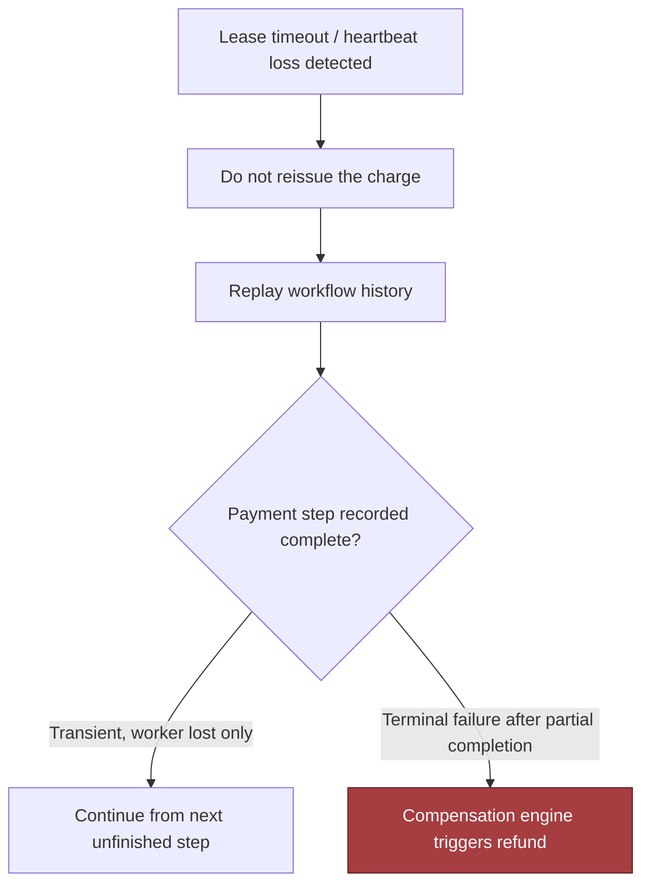
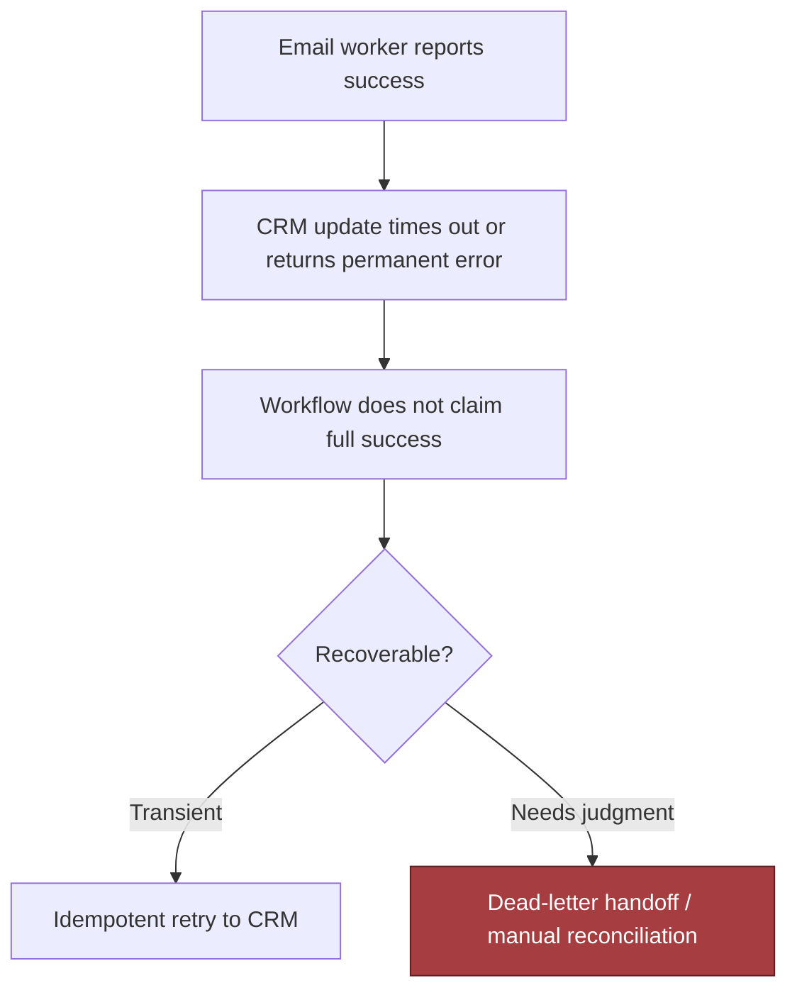
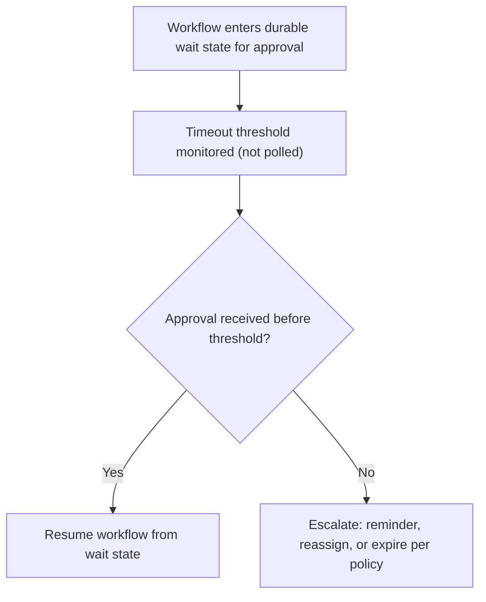
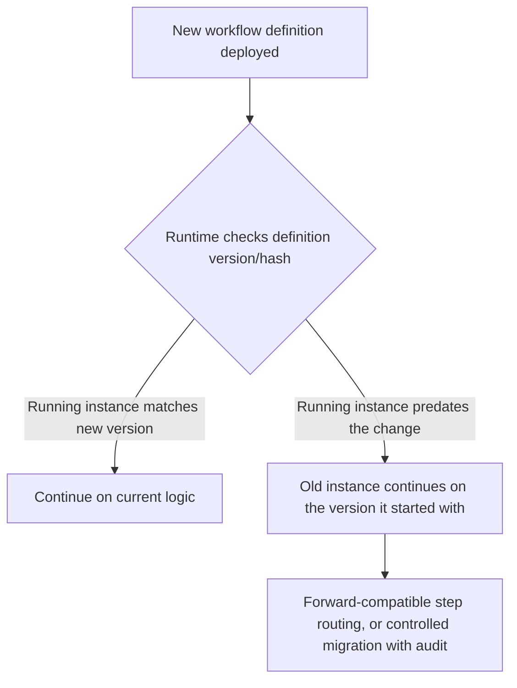
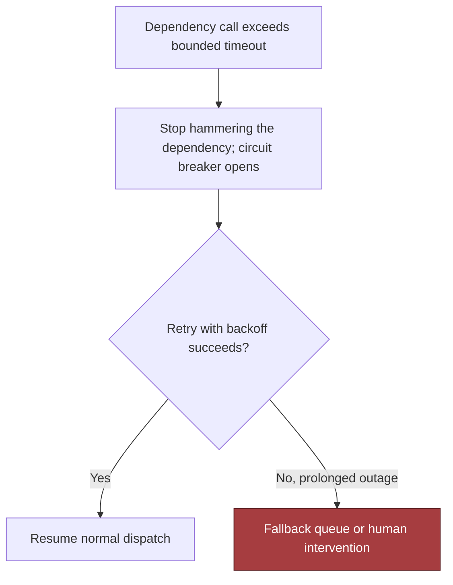

# Chapter 13: Design a Reliable Workflow Orchestration System, part 6

## 6. Security, Reliability, and Failure Handling

### The Uncomfortable Question That Anchors This Section

- A security leader, an operations lead, and a customer admin join the design review and immediately force the uncomfortable question: what happens if the worker crashes after payment succeeds?
- This single injected failure is more useful than a dozen happy-path questions — it exposes the real system boundaries.
- The orchestration layer guards money movement, approval state, customer communications, and downstream integrations against partial completion, replay, operator error, and malicious access. If the design cannot survive that drill, it is not a workflow system yet — it is a best-effort script with a database.

### Threat Model Before Failure Policy

- Four security controls anchor the design:
  - **Authorise starts, signals, and repairs at the correct strength.** Starting a workflow should require the same or stronger permission than reading the customer object it will touch. Signals (approval, rejection, resubmission, cancellation, override) should be authenticated, scoped to the correct tenant and workflow instance, and validated against the current state machine. Repair actions deserve tighter control because they can bypass the ordinary sequence and alter the business effect after the fact.
  - **Keep secrets out of history.** Workflow history is the system's memory and an attack surface — any token, API key, password, or full payment artifact in history can be replayed, exported, or exposed to operators who only need state, not credentials. Safe pattern: store opaque references in history, fetch short-lived secrets from a secret manager or KMS-backed vault at execution time, with minimal scope and explicit expiration.
  - **Restrict operator mutation paths.** Operators should pause, inspect, and resume — not rewrite arbitrary state transitions or silently mark money as collected. Manual mutation should go through a narrow repair API with validation, version checks, and approval logging. Defence in depth: authenticated admin access, role-based checks, immutable audit logs, and state-machine rules all defend the same boundary from different angles.
  - **Audit every compensation and manual override.** If a payment is reversed, a document approval is voided, or a CRM record is repaired manually, the system should preserve who initiated it, why, what instance it affected, and which state version it targeted — that evidence makes the post-incident review useful instead of speculative.

### Failure Policies Are Design Decisions, Not Afterthoughts

- The interview answer should explicitly name what fails open, fails closed, degrades, queues, or requires human intervention — that vocabulary itself shows judgement.
- Decision table for common branches:
  - **Fail closed**: payment authorisation, approval completion, repair mutations, and anything that would create a false business effect.
  - **Degrade**: email sending can degrade to queued delivery or delayed notification if the customer accepts eventual delivery.
  - **Queue**: CRM sync, internal analytics updates, and noncritical enrichment can queue behind transient outages.
  - **Human intervention**: ambiguous approvals, repeated poison-message failures, and policy exceptions that cannot be resolved safely by code.
  - **Fail open only with extreme caution**: rarely, for read-only status display; never for irreversible external side effects.
- Blast radius as a practical control: scope every retry queue, dead-letter stream, and repair lane by tenant, region, workflow type, and dependency — a stuck CRM connector should not prevent unrelated tenants from approving documents, and a regional outage should not silently cross region boundaries unless the customer contract and data policy explicitly allow it.

### Failure Drill: Worker Crashes After Payment Succeeds

- **Detection**: lease timeout, heartbeat loss, or orchestrator timeout.
- **Containment**: do not reissue the charge.
- **Recovery**: replay the workflow history, observe the charge step completed, continue from the next unfinished step.
- **Prevention**: idempotency keys on the payment request, durable history that records intent before execution and completion after acknowledgment.
- This is the critical incident drill — security and operations inject the crash, and the candidate must show how the system contains impact and preserves evidence rather than scrambling to "make it work."



> 🎯 **Interview Pointer:** When asked "what happens if the worker crashes after payment succeeds," anchor the answer on one sentence: the workflow must never equate "worker lost" with "business action lost" — detection, containment, recovery, and prevention should each reference durable history, not worker memory.

### Failure Drill: Email Succeeds but CRM Fails

- **Detection**: separate side effects by step, not by job — the email worker can report success while the CRM update times out or returns a permanent error.
- **Containment**: the workflow proceeds into a compensating or repairable state instead of pretending the whole process succeeded.
- **Recovery**: an idempotent retry to the CRM, a dead-letter handoff, or a manual reconciliation task if the CRM record requires human validation.
- **Prevention**: per-step status, explicit correlation IDs, and a policy treating notifications as non-authoritative compared with workflow state.



### Failure Drill: Approval Waits Seven Days

- Long waits are normal in orchestration — the system needs durable timers, visible state, and stale-instance handling.
- **Detection**: not a failure alarm — a timeout threshold that surfaces an instance to the right queue.
- **Containment**: avoid consuming worker capacity with endless polling.
- **Recovery**: resending reminders, escalating to a manager, or expiring the request according to policy.
- **Prevention/design intent**: the workflow expresses waiting as a first-class state, not an ad hoc sleep loop.



### Failure Drill: Definition Changes While Instances Run

- This is a versioning problem, not just a deployment problem.
- **Detection**: runtime observes a definition hash or version mismatch.
- **Containment**: old instances continue against the version they started with, unless an explicit migration path exists.
- **Recovery**: forward compatibility through versioned step routing, or a controlled migration with audit and testing.
- **Prevention**: every durable instance records its definition version; every new deployment publishes a compatible contract or an intentional break.



### Failure Drill: External API Times Out Indefinitely

- The system needs bounded timeouts, retries with backoff, a circuit breaker, and a dead-letter or escalation path.
- **Detection**: absence of progress within a known bound.
- **Containment**: stop hammering the dependency and protect the worker pool.
- **Recovery**: scheduled retry, fallback queue, or human intervention if the downstream system is in a prolonged outage.
- **Prevention**: make every dependency call time-bounded and distinguish transient from permanent failures in the orchestration policy.



### Evidence the Interviewers Want to Hear

- Before launch, be ready to describe audit evidence and runbooks: who can start a workflow, how a repair is requested and approved, where compensation logs are stored, how a replay is explained to support, and how to prove a payment was not duplicated after a crash.
- Evidence should be searchable by tenant and workflow id, with retention aligned to the customer's policy and jurisdictional constraints.
- Observability: trace every transition with correlation ids; emit counters for retries, compensations, dead-letter items, and manual overrides; alert on divergence between requested, completed, and compensated steps.
- Goal is not merely knowing something is broken, but knowing which tenant, which dependency, and which failure policy is currently absorbing the blast.

### Interview-Sized Code Sketch: No-Double-Charge Invariant

- Narrow, important test: after a crash at the worst possible moment, replay must not duplicate an irreversible side effect.
- Interview-scale teaching sketch — omits persistence details, dependency wiring, and the full workflow engine; production would back the event log with durable storage, add validation, and pin library versions.

```python
import pytest


class FakePayments:
    def __init__(self):
        self._charges = {}

    def charge(self, order_id: str) -> str:
        self._charges[order_id] = self._charges.get(order_id, 0) + 1
        return f"charge-{order_id}"

    def charge_count(self, order_id: str) -> int:
        return self._charges.get(order_id, 0)


class CrashAfterCharge(Exception):
    pass


class WorkflowEngine:
    def __init__(self, payments: FakePayments):
        self.payments = payments
        self.history = []
        self.completed = set()

    async def run_until_crash(self, order_id: str, crash_after: str | None = None):
        if "charge" not in self.completed:
            self.history.append(("intent", "charge", order_id))
            self.payments.charge(order_id)
            self.history.append(("done", "charge", order_id))
            self.completed.add("charge")
            if crash_after == "charge":
                raise CrashAfterCharge()

    async def resume_workflow(self, order_id: str):
        if "charge" not in self.completed:
            self.history.append(("resume", "charge", order_id))
            self.payments.charge(order_id)
            self.history.append(("done", "charge", order_id))
            self.completed.add("charge")
        self.history.append(("next", "crm", order_id))


@pytest.mark.asyncio
async def test_crash_after_payment_does_not_charge_twice():
    payments = FakePayments()
    engine = WorkflowEngine(payments)
    order_id = "order-123"

    with pytest.raises(CrashAfterCharge):
        await engine.run_until_crash(order_id, crash_after="charge")

    await engine.resume_workflow(order_id)
    assert payments.charge_count(order_id) == 1
```

- Teaching purpose: the workflow must record enough state to distinguish "attempted" from "completed," and recovery must read that state before deciding whether to reissue the side effect.
- Production version would add argument validation, persistence, structured logging, timeout handling, and an explicit idempotency key carried into the payment gateway request.

### What to Say When the Interviewer Pushes on Trade-offs

- If the customer demands faster recovery → automate more compensations, but raise the risk of an incorrect automated undo.
- If the business demands stronger correctness → fail closed more often, but increase queue depth and human workload.
- If the platform must support many tenants → need sharper blast-radius boundaries and tighter operator permissions.
- These are not side notes — they are the architecture.
- Production judgement signal: an FDE owns safe rollout, support, and incident response, not merely the happy path. A strong answer protects the customer's business effect, preserves evidence for the postmortem, and still moves the workflow forward without duplicating irreversible actions.
