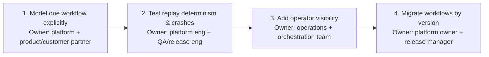

# Chapter 13: Design a Reliable Workflow Orchestration System, part 7

## 7. Delivery Plan, Observability, and Business Impact

### Start with One Workflow, Not the Whole Platform

- The prototype already works — the customer's next question is: when can this be trusted in production? Design discussion becomes a delivery plan with measurable gates, clear owners, and a path to support.
- First production step: model one workflow explicitly — e.g., document approval followed by payment, then email, then three internal updates.
- That narrow slice proves whether the system can preserve business effect across retries, pauses, and crashes, and keeps the first rollout small enough that the team can reason about every state transition.
- Goal is not feature breadth — it's learning: verify the workflow definition is stable, the state model is inspectable, and the team can explain what happens when a worker dies halfway through a charged-but-not-yet-emailed order.
- Naming that first workflow shows understanding of MVP and staged rollout rather than a risky big-bang launch.

### Determinism and Crash Recovery as the First Gate

- Before expanding traffic, test replay determinism and crashes:
  - Re-run the same workflow history and confirm it produces the same decisions.
  - Kill workers mid-flight, restart them, confirm the engine resumes from durable state instead of reissuing side effects blindly.
- This is the first real go/no-go gate because it proves whether the orchestration logic can survive the failures that matter most.
- Useful framing: "I do not promote the system until we can replay a workflow from history, recover after a worker crash, and prove we do not duplicate irreversible effects."

> 🎯 **Interview Pointer:** Naming deterministic replay + crash recovery as the *first* go/no-go gate (before operator visibility, before broader rollout) is the sequencing detail that distinguishes a mature delivery plan from a generic "we'll add monitoring" answer.

### Operator Visibility Before Broadening Scope

- Once deterministic recovery works, add operator visibility: dashboards, logs, traces, admin views that let support staff answer three questions fast — what is running, what is stuck, what needs intervention.
- Visibility is not decoration — it's the difference between a supportable workflow platform and a system that silently accumulates broken work.
- Practical rule: surface both workflow-level state (business status language: pending approval, payment authorised, compensation pending, completed) and activity-level telemetry (retries, queue depth, worker failures, timeout counts, downstream latency), linked so a user complaint traces to the exact failing step.

### Version Workflows Instead of Mutating Them

- Migrate workflows by version rather than editing old executions in place — in-flight workflows may sit idle for days waiting on approval, human review, or an external system; mutating their logic underneath them creates inconsistent behaviour between old and new instances.
- Versioning keeps the operating model understandable: old runs continue under the rules they started with, new runs pick up new logic, and operators know which history to inspect during an incident.
- This is where the customer starts to trust the platform, because the change process itself becomes predictable.

### Rollout Scorecard: Six Metric Layers

- A strong FDE answer does not collapse every metric into "system is up" — the scorecard has six distinct layers.

**Technical health metrics**

- **Workflow completion time**: how long a workflow takes from start to terminal state; source is orchestration history and timer data; owner is the platform team; alert if p95 or a customer-specific threshold drifts materially above baseline.
- **Activity retry rate**: retries divided by activity attempts; source is worker and scheduler telemetry; owner is the worker-runtime owner; alert if retries spike or stay elevated across a rolling window.
- **Stuck workflow age**: oldest workflow in a non-terminal state beyond its expected wait time; source is durable state and queue inspection; owner is operations; alert if any workflow exceeds the maximum tolerated age.

**Model quality metrics** (correctness and stability of the orchestration model itself — whether the workflow definition, replay behaviour, and state transitions stay faithful to intended business logic)

- **Replay determinism pass rate**: percentage of sampled workflow histories that replay to the same decisions; source is replay test jobs and history validation; owner is workflow-runtime engineering; alert if the pass rate falls below the release gate, since nondeterminism can invalidate the model.
- **State-transition validation failures**: count of invalid or unexpected transitions detected in tests, canaries, or runtime guards; source is workflow engine validation and canary telemetry; owner is the platform team; alert on any sustained increase, since it suggests the model or versioning rules have drifted.
- **Schema or definition compatibility failures**: count of workflow-definition changes that cannot be safely loaded by old or new runs; source is versioning checks and deployment validation; owner is release engineering; alert if compatibility breaks in staging or canary, since the workflow model must remain loadable across versions.

**Reliability and correctness metrics**

- **Duplicate effect count**: number of detected duplicate external effects (repeated payment attempts, duplicate emails); source is idempotency logs, downstream receipts, reconciliation jobs; owner is the workflow platform and integration owner; alert on any confirmed increase, since even a small number can matter.
- **Compensation rate**: percentage of workflows that reach a compensating action; source is workflow history; owner is product and operations jointly; alert if the rate rises unexpectedly, since it may signal a bad release or a fragile dependency.

**Operational burden metrics**

- **Manual repair count**: number of workflows that required human intervention; source is operator actions and ticket records; owner is support operations; alert if the count exceeds the team's handling capacity or trends upward release over release.

**Adoption metrics**

- Active workflows started by real customers, percentage of teams migrated, operator login frequency for the visibility tools. Matter because a technically elegant orchestration platform nobody trusts is not a successful product.

**Business outcome metrics**

- Fewer failed approvals, faster payment-to-email completion, fewer customer escalations, reduced cycle time for the end-to-end process. Interview distinction: technical health says the machine is behaving; business outcome says the customer is getting value.

### Phased Rollout: Owners, Exit Criteria, Rollback Triggers

- Each phase needs an explicit owner, exit criteria, and rollback trigger:
  1. **Model one workflow explicitly**
     - Owner: platform engineer with a product or customer-design partner.
     - Exit criteria: workflow definition is stable, state transitions are documented, and the business effect is clear.
     - Rollback trigger: if the first workflow cannot be represented cleanly or the customer disagrees on success criteria.
  2. **Test replay determinism and crashes**
     - Owner: platform engineering and QA or release engineering.
     - Exit criteria: crash-recovery tests pass, replay results are stable, and side effects are not duplicated in failure drills.
     - Rollback trigger: if any crash path replays an irreversible action without an idempotency safeguard.
  3. **Add operator visibility**
     - Owner: operations plus the orchestration team.
     - Exit criteria: operators can locate stuck work, explain state, and execute approved repairs using documented runbooks.
     - Rollback trigger: if the support team cannot diagnose incidents without engineering escalation.
  4. **Migrate workflows by version**
     - Owner: platform owner and release manager.
     - Exit criteria: old and new versions coexist safely, migration rules are documented, and in-flight work is not rewritten.
     - Rollback trigger: if a versioned migration produces inconsistent behaviour or blocks recovery.
- The shape of a real go/no-go gate is not "does it compile?" — it's "can support operate it, can rollback be executed, and can the customer tolerate the residual risk?"

### Connect the Dashboard to the User Journey

- A useful dashboard lets a non-expert follow the business story left to right: request arrives, approval pending, payment authorised, internal systems updated, email sent, workflow closes.
- Under each user-facing status, show relevant component telemetry: retries, latency, queue age, compensation state.
- This shortens incident triage (support sees where the story diverged) and proves to the customer the platform is not a black box — visibility becomes part of the value proposition, not just an operational aid.

### Core Product vs Adapter vs Configuration vs Shared Service

- Not everything belongs in the core orchestration engine:
  - **Core product**: durable workflow state, retry policy, compensation orchestration, replay, versioning, and operator visibility primitives — the reusable behaviours the platform should own.
  - **Adapters**: payment gateway calls, email providers, document systems, and the three internal systems — isolated behind interfaces because they vary by customer and environment.
  - **Configuration**: retry budgets, timeout windows, approval routing rules, escalation thresholds, per-tenant visibility settings — change more often than code and should be adjustable safely.
  - **Shared services**: identity, audit logging, metrics export, and notification plumbing, if the organisation already standardises them — reduces duplication, but only when the team can preserve ownership boundaries and support expectations.
- This breakdown shows product judgement: the goal is not to overbuild a custom workflow system for one customer, but to extract reusable product leverage from the pilot.

### Train Operators Before the First Wide Rollout

- Production readiness includes training and documentation.
- Support staff need a runbook for common failure modes: worker crash after payment, external timeout during approval, duplicate callback from an upstream system, workflow stuck waiting for a human response.
- Documentation should show how to read state, how to escalate, and which compensations are safe to trigger manually.
- Training should be scenario-based, not slide-based: walk the operator through a stuck workflow, a successful replay, and a rollback decision. If they cannot explain the workflow using the dashboard and runbook, the system is not ready for broad adoption.

### The Risk Register Should Be Owned, Not Implied

- A concise risk register keeps the rollout honest — each item names owner, mitigation, and trigger:
  - **Worker crash after payment succeeds**: owner platform engineering; mitigation idempotency keys, durable state, replay tests; trigger any payment event without a terminal workflow record.
  - **Replay nondeterminism**: owner workflow-runtime team; mitigation deterministic APIs and history-based replay tests; trigger any mismatch between replayed and recorded decisions.
  - **Operator overload**: owner operations; mitigation dashboards, runbooks, and alert tuning; trigger rising manual repair count.
  - **Version migration error**: owner release manager; mitigation version gating and canary rollout; trigger inconsistent outcomes between old and new workflow runs.
- This is not bureaucracy — it's the mechanism that turns a technical design into a supportable service.
- Strong rollout story: first prove one workflow end to end, then verify replay and crash recovery, then give operators visibility, then migrate by version with a canary and rollback plan; watch completion time, retry rate, stuck age, duplicate effects, compensation rate, and manual repairs at each step. Do not declare success until the customer uses it, the business process improves, and the support team can run it without heroics.
- Measurable customer impact: a workflow platform that completes long-running business processes with visible state, controlled recovery, and fewer manual interventions, so approval, payment, email, and internal updates can be operated as a reliable service rather than a sequence of fragile one-off scripts.
