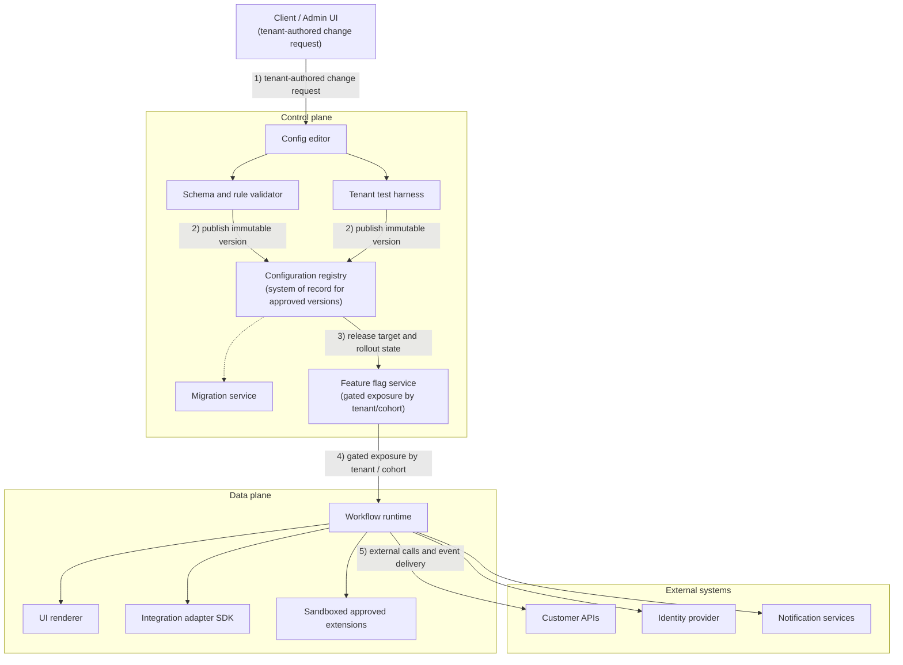
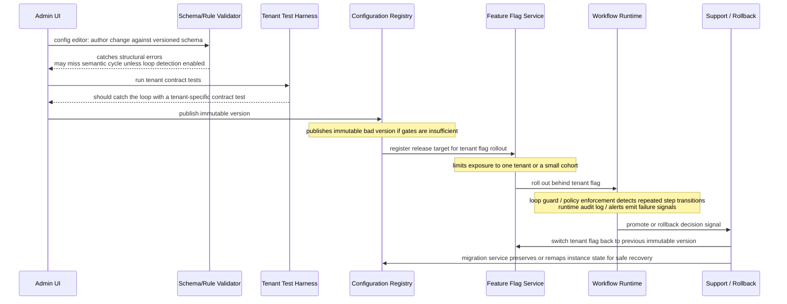
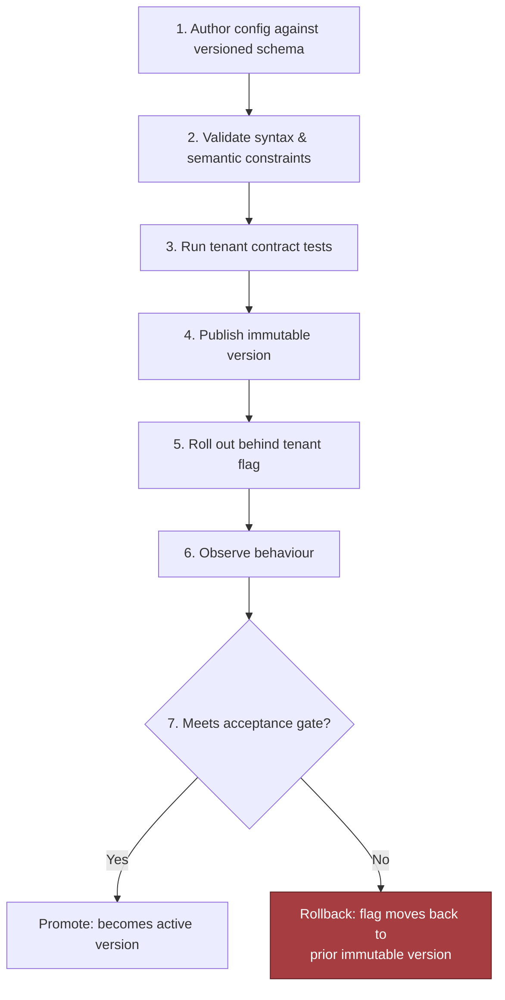

# Design a Configurable Platform for Customer-Specific Workflows, part 2

## 3. Scale Estimates, SLOs, and Capacity

### Load Shape, Not Marketing Shape

- A tidy first sketch has a single workflow engine, config store, validator and deployment pipeline, all shared. It holds up at average load. Add a deadline and it falls over.
- Customer count is the wrong thing to estimate. Ask instead how many edits, validation runs, activations and approval events land together, and what happens to them as a deadline nears.
- A working assumption: 100 tenants and 50 workflow templates, producing 1,000 configuration versions per day. That traffic mixes small edits, bulk template updates and bursts around release windows.
  - Spread evenly, that is ~42 versions/hour.
  - If half the day's changes arrive inside a 2-hour business window, the peak is ~250 versions/hour. Retries, failed validations and resubmissions come on top.
  - Size well above the average, often by several times, with a growth factor and a headroom target. Then a release-day spike does not turn configuration into an outage.

### The Four-Step Capacity Envelope

- Work through the estimate in the order that moves the architecture:
  1. **Version intake and validation throughput.** Validation means schema, policy and dependency checks plus a dry run. Say they cost 2–10 seconds of CPU-bound work (my rough guess) or a few network calls. Quick user feedback must then split from slower checks that run asynchronously. The near-term SLO: the edit saved and came back with a clear result, fast. The deeper promise: validation finished, and promoted or rejected the version, before the deployment window shut.
  2. **Deployment throughput.** Perhaps only some of the 1,000 versions/day get promoted, but each promotion fans out across tenants, regions or integrations. One template update can reach dozens of workflow instances or queue downstream sync jobs. Fan-out, more than the number of human edits, sets deployment capacity.
  3. **Limits for expressive power.** Hard caps on rules, custom fields and plugins pin down runtime cost early. Think of a moderate number of fields per form, a bounded count of rule clauses per transition, and short plugin runs with memory and network limits. Caps stop one customer's customisation from eating the shared budget every other tenant relies on.
  4. **State growth and retention.** Event history outgrows configuration history, yet config history still counts. Record volume is half the question. The other half is what audit, rollback and support require you to keep, and for what period. Keep the version graph small, store deltas where they pay off, and treat rollback metadata as a first-class record.

### SLOs Tied to Customer Pain

- **Availability:** When users need to, can they open the workflow editor, validate a change and activate a version?
- **Latency:** How long does the editor sit waiting on a save, a validation preview or an approval routing result?
- **Freshness:** Once a configuration is approved, how soon does the runtime path start using it?
- **Quality:** What share of deployments fail validation, get rolled back, or need someone to step in by hand?
- **Security:** Are audit trails, plugin and approval permissions, and tenant boundaries enforced at the right control points?
- **Cost:** What does each validated version, activated template or thousand workflow executions cost, and how does adding rules or plugins change that?
- Split the latency budget by step instead of quoting one figure. A save should feel instant and a validation preview may lag a little. Full deployment may take longer, provided you can trust and watch it. Don't make every step synchronous because it seems simpler.

### Leverage and What Belongs in Core

- The ratio below tells you where a capability lives: shared product code, configuration, or an adapter around one customer's integration.

$$ Leverage=\frac{Customers\ served\ by\ shared\ capability}{Engineering\ effort} $$

- A high ratio earns first-class core support, for example an approval model that 80 tenants use.
- A low ratio, such as one customer's brittle edge-case approval chain, goes into configuration, an adapter or a tightly scoped extension. Don't bend the whole platform around it.
- Count support cost as well. A feature can look reusable yet bring costly onboarding, hard debugging or painful upgrades, so its real ratio falls below a simpler, narrower design's.

### A Whiteboard Estimate That Changes Component Choice

- The naive plan validates inside the API that also saves the configuration. Estimate peak load and it breaks: worst-case request time tracks the slowest rule set or plugin call, and one slow tenant holds capacity everyone else needs. The control plane turns brittle.
- With peak validation throughput and deployment fan-out on the board, the design changes:
  - Save → fast and durable.
  - Validation → queued, bounded, observable.
  - Deployment → idempotent and retryable, kept apart from authoring traffic.
- Tenant count matters less than you might think. Component choice and partitioning depend most on how often validation and deployment run, and what each run costs.

### Sensitivity Table Across Growth Scenarios

I picked these volumes and peak factors for this case. They are not industry benchmarks: justify them, don't cite them.

| Scenario | Daily config versions | Peak factor | Operational implication |
|---|---|---|---|
| Baseline | 1,000 | ~6x (the 2-hour window above) | One shared validator can cope if most of the work runs asynchronously |
| Moderate growth | 10,000 | 3x–5x | Separate queues, pools of workers, tighter caps on plugin run time |
| Aggressive growth | 100,000 (100x baseline) | 5x+ | Explicit quotas per tenant, sharded queues, firmer tenant isolation |

- Growth of 10x can demand a new partitioning strategy as well as more spend. Custom fields and rules behave the same way. Deeply branched forms full of computed fields may call for cached execution plans, partial evaluation, or checks done at compile time. Plugins that run often may need a sandbox or an adapter boundary instead of running in-process.

> 🎯 **Interview Pointer:** Expect a follow-up on *why* 10x growth calls for new partitioning instead of extra servers. The reason is noisy-neighbour risk. Past a certain point, a shared validator or queue can no longer keep one misbehaving tenant's blast radius contained. Interviewers value that reasoning more than a precise spreadsheet.

### Average vs. Peak: Headroom as a Product Feature

- Average load shows whether the system makes economic sense. Peak load shows whether customers can rely on it on their worst day.
- Headroom, the gap between average and peak, stops a release window, a rush of approvals or a big tenant onboarding from becoming the day the platform breaks its promise.
- Widen the unit economics question. Running cost is one part; the support load the design creates is the other. A cheap design that needs constant hands-on work can lose to a slightly dearer one that is simpler to roll back, explain and support.

### Decision Rule to Carry Forward

- Every estimate should act as a design lever. Does the number move a queue, a quota, a latency budget, a support process or a component boundary? If not, it is likely trivia. If so, record it and be ready to defend it.

## 4. Architecture and End-to-End Flow

### Control Plane vs. Data Plane

- To present this system, follow one tenant request end to end, then replay it with a dependency in poor health.
- A customer's own approval logic becomes dangerous if it can change how the shared runtime behaves.
- So the design has two halves. The control plane is where configuration gets written, checked, versioned and promoted. The data plane runs live workflow instances. Keeping them apart moves risky change management off the hot path.
  - Control plane duties: editing configs, checking schemas, running tenant contract tests, promoting releases.
  - Data plane duties: workflow execution, runtime UI rendering, connector calls and audit events.
- If asked where the trust boundary sits, point at this split first.

### Architecture Diagram and Trust Boundaries

- Read the diagram top to bottom. A tenant's change request enters the control plane. It passes the config editor, then the schema/rule validator and tenant test harness, then the configuration registry (the system of record), then the feature flag service that gates exposure. The data plane follows: workflow runtime, UI renderer, integration adapter SDK, and approved extensions in a sandbox. External systems sit last: customer APIs, the identity provider and notification services.

- There are two trust boundaries. One lies between content a tenant writes and execution the platform owns. The other lies between platform execution and outside dependencies.
  - Config written by a tenant never runs as code with full platform trust.
  - Even approved extensions stay untrusted enough to need isolation and quotas.
  - You do not control external systems. Give every adapter call timeouts, retries, idempotency where it applies, and a backoff policy that does not make a failure worse.

### Core Components in Dependency Order

- The table lists the components in dependency order.

| Component | Responsibility | State ownership | Typical boundary |
|---|---|---|---|
| Workflow runtime | Runs workflow instances, moves between steps, fires timers and retries | Execution history, runtime state | Data plane; step decisions are synchronous, long-running work is asynchronous |
| Configuration registry | Keeps every config and schema version with its release metadata | Immutable config versions | Control plane; the system of record once a config is published |
| Schema and rule validator | Verifies syntax, semantic rules, permissions and compatibility | Only its check results | Control plane; blocks on save/publish |
| UI renderer | Turns approved config into each tenant's forms, labels and layouts | Cache only | Mostly data plane; renders synchronously from cached descriptors |
| Integration adapter SDK | A common contract for webhook, ticketing, ERP and CRM adapters | Adapter definitions, credentials references | Data plane edge facing external systems |
| Feature flag service | Controls rollout per tenant, cohort or percentage | Flag state | Spans both planes |
| Sandbox for approved extensions | Executes tightly scoped customer logic or plugins under hard limits | Ephemeral execution only | Isolated; synchronous when small, async otherwise |
| Migration service | Upgrades older configs to new schema versions, or moves instances forward | Migration jobs, compatibility mappings | Control plane; mostly asynchronous |
| Tenant test harness | Re-runs each tenant's contract tests ahead of release | Test fixtures, expected outcomes | Control plane; a synchronous approval gate or an async batch |

- The validator keeps junk out of the registry. The flag service exists because publishing a version and showing it to every tenant are two different actions. The sandbox exists because approved extensions are valuable, yet letting arbitrary code run at runtime is how customisation ends in incident response.

### Failure-Path Overlay: Infinite Approval Loop

- This overlay marks up the architecture for the infinite-approval-loop failure drill to show the blast radius. The validator, the test harness and the flags each shrink it at a separate stage. If one layer misses the defect, a later one still prevents a tenant-wide incident.

### Happy-Path Sequence: Author to Promotion

- The live release path, one step at a time:
  1. **Author config against a versioned schema.** A customer admin, an implementation engineer or a product manager edits the workflow definition, approval graph, field layout and adapter mappings.
  2. **Validate syntax and semantic constraints.** Checks cover structure, permitted field types, whether the approval graph makes sense, reference integrity, permissions, and fit with the features switched on.
  3. **Run tenant contract tests.** The harness replays typical scenarios: form submission, approval routing, odd edge inputs and integration stubs.
  4. **Publish an immutable version.** The registry keeps that precise artifact plus its version tag, schema version, release metadata and who wrote it, so it records exactly what was approved.
  5. **Roll out behind a tenant flag.** One tenant sees it first, then a cohort, then wider traffic once it proves stable.
  6. **Observe behaviour.** Watch step latency, failed validations, adapter errors, approval-loop detection and how often users finish the workflow.
  7. **Promote or rollback.** A release that clears the acceptance gate goes active. A release that fails has its flag switched back, or its tenant stays pinned to the earlier immutable version.
- Publishing a version and switching it on everywhere are separate steps. Keeping them apart stops one bad config from causing a wide outage.
- Some steps should block and some should not. Validation and contract tests are synchronous gates, because they must hold back promotion. Bulk replay, migration and some integration recovery suit async work, so the user's request does not stay open. The runtime usually does both: quick step decisions inline, and external side effects pushed to async work when a dependency is slow or flaky.

### Systems of Record, Caches, Queues, and Backpressure

- **System of record:** published versions belong to the configuration registry; execution history normally belongs to the workflow audit store.
- **Caches:** recent flag decisions, adapter metadata, form layouts once rendered, and compiled schema descriptors.
- **Queues:** test harness batches, migration tasks, event delivery, retries and adapter jobs.
- **Backpressure and flow control:** as adapter queues grow, the runtime should drop or defer noncritical work instead of letting retries stampede external systems.
- The partitioning key is normally tenant ID, sometimes paired with workflow definition ID or environment. It stops a noisy tenant from spoiling latency for the rest, makes replay easier, and gives quotas an obvious place to be enforced. A surge of approvals from one tenant should stay inside its partition.

### MVP vs. Later Evolution

- For the MVP, stay ruthlessly simple: the runtime, a versioned registry, the validator, feature flags, the tenant test harness, a small adapter SDK, and only as much sandbox as approved extensions strictly need. Prefer immutable config versions and an obvious rollback over a fancier live-editing system.
- Leave for later: config templates shared across tenants, more automated migration, a wider plugin marketplace and deeper visibility into tenant behaviour. Add them once the core release path is stable and easy to support.

### 90-Second Interview Summary

- "I'd split the system into two planes. The control plane is where people write configs, where schemas and rules get checked, where tenant contract tests run, and where versions are frozen and rolled out with feature flags. The data plane runs workflows, renders the UI and calls adapters. Published versions live in the configuration registry, which is the system of record, and the runtime only reads approved releases. I'd partition mainly by tenant ID, with queues and backpressure shielding external dependencies. The hardest trade-off is how far customer logic may go inside approved extensions, versus keeping it all as declarative config. For the MVP I'd keep extensions narrow, insist on versioned configs, and send every release through a tenant test harness and a staged flag rollout. My first production gate is one tenant, with a rollback I can run straight away."
