# Design a Configurable Platform for Customer-Specific Workflows, part 6

## 8. Interview Walkthrough, Trade-Offs, and Practice

### Minute-Zero Opening

- Lead with the result the customer wants, not the technology: "Ten customers run broadly similar workflows. What differs is their fields, their approval chains, their branding and the systems they connect to. We want one platform for all ten, with no forks. First I'd settle three questions. Which parts belong in the product core? Which parts can each tenant change safely through configuration? And which extensions must run in strict isolation? I'd lean towards a small, stable core, with tenant differences held in configuration that is versioned and tested. I'd depart from that only for a need that is genuinely one of a kind, or too dangerous to make generic."
- Those sentences carry the outcome, show architectural judgement and invite pushback. If the interviewer shifts the ground, for example with a regulated sign-off step or a proprietary connector, rework the plan instead of defending your first guess.

### The 50-Minute Pacing Plan

- Spend minutes by risk, not by the size of the boxes. A strong candidate lingers on the part whose failure would cost the business most.
- **Outcome and discovery, minutes 0–9.** Minute 0: anchor on the outcome. Minute 1: the main thing the customer gets. Minute 2: which piece of the workflow moves fastest. Minute 3: surface the hidden constraint. Minute 4: what must never shift. Minute 5: the fixed requirements, namely identity, workflow semantics, auditability, rollback and support boundaries. Minutes 6 to 8: assumptions, first on tenant numbers and change rate, next on who drafts and signs off config, last on failure tolerance and incident handling. Minute 9: offer the interviewer a chance to redirect.
- **Success and scale, minutes 10–14.** Minute 10: success for the customer and for the team running the platform. Minute 11: what that implies for SLOs and for support. Minute 12: what "safe customisation" should mean here. Minute 13: a rough load shape: tenants, workflows, connectors, admin edits. Minute 14: call every figure illustrative.
- **Architecture, minutes 15–24.** Minute 15: the overall design. Then one component a minute: authoring tools and their guardrails (16), validation and the gates before publish (17), immutable versions and how they roll out (18), the engine that runs workflows (19), connectors and where integrations stop (20), audit logs and observability (21), per-tenant identity and authorisation (22), reads and writes of workflow state (23). Minute 24: contrast the control path with the data path.
- **Config lifecycle, minutes 25–29.** Who may change a tenant's settings (25). Who checks the change (26). How it moves between environments (27). How you undo it (28). How support pins a version and reproduces a reported problem (29).
- **Happy path, failure path, loop drill, minutes 30–38.** Trace a good change from edit to publish (30), from publish to a running workflow (31), and from that run to its audit entry (32). Then break it: a config that fails validation (33), permissions that have drifted (34), a connector that stops responding (35), a bad publish that needs reverting (36). Minute 37 is the drill where approvals circle forever. Minute 38 shows how cycle detection and checks at publish time stop that loop before production.
- **Trade-offs and follow-ups, minutes 39–46.** Config against code (39). A generic engine against a domain product (40). Plugin freedom against security (41). Compatibility against simplicity (42). Then follow-ups: what belongs in the core (43), how config versions work (44), when a single-customer fork is justified (45), and how to isolate extensions (46).
- **Close, minutes 47–49.** Recap delivery, rollout gates, observability and support runbooks (47). Give the 90-second summary for executives (48). State the first gate for production rollout, then invite questions (49).

```mermaid
flowchart LR
  A["0-9 min<br/>Outcome & discovery"] --> B["10-14 min<br/>Success & scale"]
  B --> C["15-24 min<br/>Architecture"]
  C --> D["25-29 min<br/>Config lifecycle"]
  D --> E["30-38 min<br/>Happy path, failure path,<br/>loop drill"]
  E --> F["39-46 min<br/>Trade-offs & follow-ups"]
  F --> G["47-49 min<br/>Close: summary + rollout gate"]

    %% Casebook colours: entry, reasoning, results, controls, and stopped paths.
    classDef cbInput fill:#dbeafe,stroke:#2563eb,color:#172554
    class A,E cbInput
    classDef cbReason fill:#ede9fe,stroke:#7c3aed,color:#4c1d95
    class B,F cbReason
    classDef cbAction fill:#dcfce7,stroke:#15803d,color:#14532d
    class C,G cbAction
    classDef cbPolicy fill:#fef3c7,stroke:#b45309,color:#78350f
    class D cbPolicy
```

### Four Trade-Off Pairs

- **Configuration versus code.** When tenants vary only in fields, labels, approvals, routing or their choice of connector, use configuration. Such differences stay visible, carry version numbers and remain easy to support. Reach for code once the variation changes what the workflow means, adds a new invariant, or would twist the config language into a programming language nobody can read. The weak line is "make everything configurable". A better one: "Put the common variations in declarative config. When a rule becomes bespoke business behaviour, promote it to reviewed, isolated code."
- **Generic engine versus domain product.** One generic engine can host many tenants. Make it model every business process and it becomes too abstract. A domain product does less but is simpler to use and cheaper to support. Combine them: a stable core built from workflow primitives the company knows it can support repeatedly, with a constrained domain model on top. Aim at the workflow family the business intends to own, not at endless extensibility.
- **Plugin flexibility versus security.** Plugins let teams wire in unusual customer systems without touching the core, so customers go live faster. The price is a larger attack surface. Contain it: run extensions in a sandbox, give them minimal permissions, fix their interfaces, and manage every plugin as a reviewed, versioned and observable artifact. Once a plugin can read lots of data or run any code it likes, it is no longer simple; treat it as a trusted service boundary.
- **Backward compatibility versus simplification.** Compatibility shields existing tenants and keeps running workflows intact. Simplification keeps the platform easy to grasp and maintain. A good candidate values both and proposes a clear deprecation policy: schemas with versions, windows for migration, tests for compatibility, and a short list of generations still supported. Promising to "support everything forever" is the weak answer; it turns support work into archaeology.

### Expected Follow-Up Questions

- **What becomes core product?** Put in the core: the stable execution model, primitives for identity and authorisation, the state transitions every workflow goes through, audit logging, validation and the admin tools. Put in versioned configuration: per-customer labels and field definitions, the routing of approvals, and connector parameters. If something would change how workflows execute, demand custom storage behaviour, or make rollback unsafe, keep it out of the core. Promote it only after several customers have shown they can reuse it.
- **How do you version configurations?** A published version is frozen. Diffs between versions are easy for a person to read. Saving runs the schema check; publishing runs the compatibility check. Each config lives as a declarative document recording its tenant scope, version number, who wrote it and its rollout status. Production workflows only ever run against a pinned version, never a loose draft. Versions serve audit, support and reproducing customer incidents, not only rollback.
- **When is a one-off fork acceptable?** All three conditions must hold. Nobody else could reuse the requirement. The business value outweighs the support cost. You can fence the divergence off so it never seeps into the core. Keep it rare. One more valid case: refusing the fork would force the core into a shape that is less reliable or less secure for every other tenant.
- **How do you sandbox extensions?** Constrain what an extension can execute, which networks and data it can reach, and what side effects it can cause. Apply least privilege, explicit interfaces, resource limits and timeouts, and ship it as a deployment artifact a reviewer can inspect. When it handles customer data, document and audit exactly what it may read or write. Runtime isolation is one layer; sandboxing also covers interface design, review of dependencies and governed deployments.

### Weak Answers and Their Repairs

- **Weak:** "Let's just make it all configurable." → **Repair:** draw a line between declarative customisation and business logic.
- **Weak:** "A flexible plugin system will cover it." → **Repair:** name the trust boundaries, the permissions and the review gates.
- **Weak:** "If we need a fork, we can add one later." → **Repair:** count what forks add to support, testing and every upgrade.
- **Weak:** "Backward compatibility is always a good thing." → **Repair:** explain how old versions retire and how big the compatibility budget is.
- **Weak:** "We'll sort out the details once it's launched." → **Repair:** make rollout depend on validation, observability and rollback.

### Scoring Rubric

| Criterion | 1 — Weak | 3 — Adequate | 5 — Excellent |
|---|---|---|---|
| Discovery | Starts designing before asking what varies or what constrains it. | Asks a handful of basic questions about the customers and workflows. | Finds the hidden constraint fast, separates core from config, and states assumptions plainly. |
| Estimation | Frames no scale, or waves a hand at it. | Gives a rough scale but never ties it to a design choice. | Lets illustrative numbers justify the architecture, SLOs, rollout and operational risk. |
| Architecture | Draws boxes with no data, control or trust boundaries. | Covers the main components but skips one or two flows. | Walks control flow and data flow end to end, including how configuration is checked, given a version and run. |
| Depth | Stays too shallow, or digs into internals that do not matter. | Balances high-level points and detail fairly well. | Goes deep where failure costs most and stays brief elsewhere. |
| Security | Bolts security on at the end. | Mentions basic auth and sandboxing. | Builds least privilege, audit, rollback and extension boundaries into the design from day one. |
| Delivery | Leaves out rollout and support. | Gestures at a phased launch. | Describes a staged rollout, observability, gating on config and how to recover. |
| Communication | Hard to follow, with no closing summary. | Mostly clear, but the structure is loose. | Leads with the outcome, flags assumptions, makes trade-offs explicit and ends on a tight executive summary. |

### Interview Rehearsal Checklist

- Before any mock or real interview, check that you can do these five things with no notes:
  1. Say the customer outcome in a single sentence.
  2. Name the hidden constraint and the assumption that carries the most risk.
  3. Explain what goes in core product and what goes in configuration.
  4. Hold your ground on one trade-off under pressure.
  5. Finish with a short summary and the first rollout gate.

### 90-Second Architecture Summary

- "We keep the workflow core small and stable. Tenant differences go into versioned configuration: fields, approvals, branding and connector settings. Customers edit their config through guarded admin tools. Every config is validated and stored as an immutable version. It publishes only if it passes the schema, policy and cycle checks. At runtime, the engine loads whichever version is live, moves each workflow from state to state and writes audit events. So support can replay what any tenant saw. Extensions plug in only through a controlled boundary. Each gets explicit contracts and minimal privilege. The main trade-off is configuration against code. I'll reuse whatever I can. But I won't push custom business semantics into config if that weakens security or makes the system hard to maintain. My first production gate is one tenant cohort. Rollback, audit and the adapter contract tests must be proven in staging before we go wider."

### Practice Plan

- **Solo exercise:** take a blank page and talk through the 50-minute plan out loud. Then compress it to 2 minutes and to 90 seconds.
- **Pair mock:** get a partner to cut in with a hard question, for example "What becomes core product?" or "When is a one-off fork acceptable?". Practise replying calmly, without sounding defensive.
- **Implementation exercise:** design a validator for versioned configuration. It must reject cycles in approval routing and insist on safe publish-time checks before any workflow goes live.
- **Equation guidance:** this section adds no new equation, and numbers stay in prose. The capacity maths lives in the scale section in part 2, so this walkthrough stays on trade-offs.
- Forward-deployed engineers hold this conversation whenever they turn one customer's problem into a product feature that is safe to ship.
