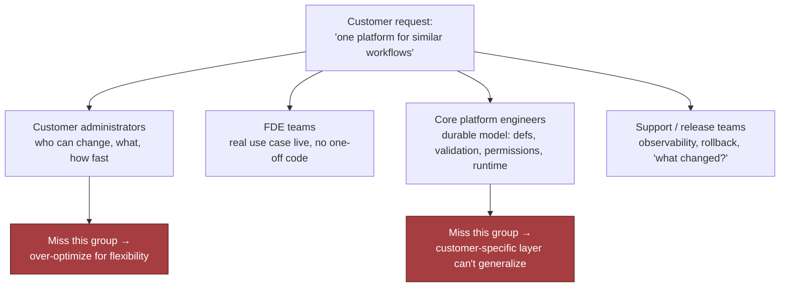
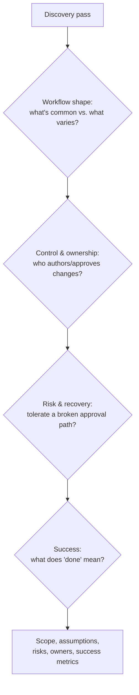
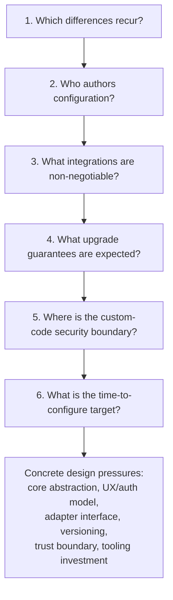

# Chapter 17: Design a Configurable Platform for Customer-Specific Workflows

*Source: THE FORWARD DEPLOYED ENGINEER SYSTEM DESIGN INTERVIEW, Chapter 17 (locations 15134–15992)*

## Table of Contents

- [1. The Customer Problem and Discovery](#1-the-customer-problem-and-discovery)
  - [Reframing the Request](#reframing-the-request)
  - [Stakeholder Map](#stakeholder-map)
  - [Discovery Question Tree](#discovery-question-tree)
  - [Assumption Ledger](#assumption-ledger)
  - [Weak vs. Strong Answers](#weak-vs-strong-answers)
- [2. Clarifying Questions, Requirements, and Constraints](#2-clarifying-questions-requirements-and-constraints)
  - [Requirement vs. Preference](#requirement-vs-preference)
  - [The Six-Question Interview Tree](#the-six-question-interview-tree)
  - [Must-Have Functional Requirements](#must-have-functional-requirements)
  - [Measurable Non-Functional Requirements](#measurable-non-functional-requirements)
  - [MVP Non-Goals / Scope Fence](#mvp-non-goals--scope-fence)
  - [Requirement-to-Component Traceability](#requirement-to-component-traceability)
  - [Handling Partial Answers](#handling-partial-answers)
  - [The Strong Candidate Move](#the-strong-candidate-move)
- [3. Scale Estimates, SLOs, and Capacity](#3-scale-estimates-slos-and-capacity)
  - [Load Shape, Not Marketing Shape](#load-shape-not-marketing-shape)
  - [The Four-Step Capacity Envelope](#the-four-step-capacity-envelope)
  - [SLOs Tied to Customer Pain](#slos-tied-to-customer-pain)
  - [Leverage and What Belongs in Core](#leverage-and-what-belongs-in-core)
  - [A Whiteboard Estimate That Changes Component Choice](#a-whiteboard-estimate-that-changes-component-choice)
  - [Sensitivity Table Across Growth Scenarios](#sensitivity-table-across-growth-scenarios)
  - [Average vs. Peak: Headroom as a Product Feature](#average-vs-peak-headroom-as-a-product-feature)
  - [Decision Rule to Carry Forward](#decision-rule-to-carry-forward)
- [4. Architecture and End-to-End Flow](#4-architecture-and-end-to-end-flow)
  - [Control Plane vs. Data Plane](#control-plane-vs-data-plane)
  - [Architecture Diagram and Trust Boundaries](#architecture-diagram-and-trust-boundaries)
  - [Core Components in Dependency Order](#core-components-in-dependency-order)
  - [Failure-Path Overlay: Infinite Approval Loop](#failure-path-overlay-infinite-approval-loop)
  - [Happy-Path Sequence: Author to Promotion](#happy-path-sequence-author-to-promotion)
  - [Systems of Record, Caches, Queues, and Backpressure](#systems-of-record-caches-queues-and-backpressure)
  - [MVP vs. Later Evolution](#mvp-vs-later-evolution)
  - [90-Second Interview Summary](#90-second-interview-summary)
- [5. Data Model, APIs, and Working Code](#5-data-model-apis-and-working-code)
  - [Four Core Records and Ownership](#four-core-records-and-ownership)
  - [Four API Contracts](#four-api-contracts)
  - [Idempotent Deployment Creation Walkthrough](#idempotent-deployment-creation-walkthrough)
  - [The Smallest Safe Code Path: Config Publication](#the-smallest-safe-code-path-config-publication)
  - [What the Whiteboard Version Omits on Purpose](#what-the-whiteboard-version-omits-on-purpose)
  - [Contract and Failure-Injection Tests](#contract-and-failure-injection-tests)
- [6. Security, Reliability, and Failure Handling](#6-security-reliability-and-failure-handling)
  - [The Red-Team Question](#the-red-team-question)
  - [Four Security Controls](#four-security-controls)
  - [Failure-Policy Decision Table](#failure-policy-decision-table)
  - [Blast-Radius Containment Levels](#blast-radius-containment-levels)
  - [Failure Drill: Infinite Approval Loop](#failure-drill-infinite-approval-loop)
  - [Other Named Failure Cases](#other-named-failure-cases)
  - [Six Operational Primitives](#six-operational-primitives)
  - [Evidence, Runbooks, and Launch Gates](#evidence-runbooks-and-launch-gates)
  - [Interview-Sized Production Sketch](#interview-sized-production-sketch)
- [7. Delivery Plan, Observability, and Business Impact](#7-delivery-plan-observability-and-business-impact)
  - [Rollout as a Series of Proofs](#rollout-as-a-series-of-proofs)
  - [The Four-Phase Rollout Plan](#the-four-phase-rollout-plan)
  - [The Six-Metric Scorecard](#the-six-metric-scorecard)
  - [Four Layers of Metrics](#four-layers-of-metrics)
  - [Dashboard in the Language of the User](#dashboard-in-the-language-of-the-user)
  - [Ownership Before Launch](#ownership-before-launch)
  - [Go/No-Go and Rollback Triggers](#gono-go-and-rollback-triggers)
  - [Config vs. Adapter vs. Shared Service vs. Core](#config-vs-adapter-vs-shared-service-vs-core)
  - [The Risk Register](#the-risk-register)
- [8. Interview Walkthrough, Trade-Offs, and Practice](#8-interview-walkthrough-trade-offs-and-practice)
  - [Minute-Zero Opening](#minute-zero-opening)
  - [The 50-Minute Pacing Plan](#the-50-minute-pacing-plan)
  - [Four Trade-Off Pairs](#four-trade-off-pairs)
  - [Expected Follow-Up Questions](#expected-follow-up-questions)
  - [Weak Answers and Their Repairs](#weak-answers-and-their-repairs)
  - [Scoring Rubric](#scoring-rubric)
  - [Interview Rehearsal Checklist](#interview-rehearsal-checklist)
  - [90-Second Architecture Summary](#90-second-architecture-summary)
  - [Practice Plan](#practice-plan)
- [Coverage Notes](#coverage-notes)
  - [My Perspective on the Gaps](#my-perspective-on-the-gaps)

## 1. The Customer Problem and Discovery

### Reframing the Request

- The customer meeting opens with agreement on the headline request ("one platform for similar workflows") but disagreement on almost everything underneath it: fields, approval paths, auditability, and release process all vary by stakeholder.
- The FDE's first job is not to sketch services — it is to turn ambiguity into a measurable outcome: build a configurable workflow platform that lets ten customers vary fields, approvals, branding, and integrations while keeping the shared product core stable, versioned, and supportable.
- Core reframe: separate the requested feature ("configuration") from the business result (serving customer-specific workflows without fragmenting the product into ten incompatible forks). This distinction is often the difference between sounding like an implementer and sounding like an FDE.
- The primary outcome should be testable:
  - "Safe" — changes do not bypass authorisation or create unreviewed runtime behaviour.
  - "Versioned" — each customer can know which workflow definition is active and what changed.
  - "Supportable" — support and release teams can diagnose issues, roll back a bad configuration, and reason about behaviour across tenants.
- A practical business outcome metric: the rate at which a new customer variation can be introduced without a fork, a hotfix, or a support escalation — not a vanity count of configurable fields.
- Job-to-be-done framing: the customer isn't buying "a workflow engine" — they're hiring the platform to remove the need for custom forks while still letting each tenant express its business process. This pushes the architecture toward a stable core plus controlled extension points, not a codebase that mutates per account.

> 🎯 **Interview Pointer:** The single highest-leverage line to memorise is the outcome statement itself — "preserve a stable product core while allowing safe, versioned, supportable customisation." I'd expect interviewers to listen for this triad (safe / versioned / supportable) because it maps directly to the architecture decisions in later sections.

### Stakeholder Map

- The same request means different things to different stakeholders:
  - Customer administrators — care about who can change a workflow, what they can customise, and how quickly they can roll it out.
  - FDE teams — care about getting a real customer use case live without turning the platform into one-off custom code.
  - Core platform engineers — care about a durable model for workflow definitions, validation, permissions, and runtime execution.
  - Support and release teams — care about observability, rollback, incident response, and the ability to answer "what changed?"
- Missing any stakeholder group risks over-optimising for flexibility or under-designing for operability (miss support → unoperable flexibility; miss platform engineers → an ungeneralisable customer-specific layer).
- Concrete stakeholder map, one line each:
  - End user — the customer employee who submits the workflow, approves it, or receives the final action.
  - Operator — the support or release team member who watches health, rolls back a bad config, and responds to incidents.
  - Security owner — accountable for permissions, auditability, and least privilege across tenants.
  - Executive sponsor — the business leader who wants one platform rollout instead of repeated forks and long customisation projects.

### Discovery Question Tree

- Under interview time pressure, the goal is not twenty generic questions — it is a small set that collapses uncertainty fastest.
- Workflow shape:
  - What stays common across customers, and what truly varies?
  - Are variations limited to fields, approval routing, branding, and integrations, or do they extend to logic and lifecycle states?
- Control and ownership:
  - Who is allowed to author and approve configuration changes?
  - Is configuration self-serve for customer admins, or does an FDE/platform team mediate every change?
- Risk and recovery:
  - What happens if a workflow is misconfigured?
  - Can the customer tolerate a broken approval path, or is a guaranteed fallback required?
- Success:
  - What does "done" mean for the first customer: one workflow live, multiple teams onboarded, or all variations migrated?
  - How will the customer judge success: lower manual handling, faster turnaround, fewer errors, or easier audits?
- These questions produce the artifacts the design needs: scope, assumptions, risks, owners, and success metrics.
- If the interviewer withholds information, state assumptions out loud — e.g., "I'll assume configuration is restricted to customer admins and approved by the vendor before it reaches production." That is disciplined boundary setting, not hedging.

### Assumption Ledger

- A good discovery pass yields four concrete outputs:
  1. Scope — which parts are configurable and which remain fixed.
  2. Assumptions — what you are temporarily accepting because the prompt did not specify it.
  3. Risks — where a bad configuration, permission mistake, or integration failure could harm customers.
  4. Success criteria — what measurable change proves the platform is working.

### Weak vs. Strong Answers

- Weak, feature-first restatement: "We should build a flexible workflow system with forms, approvals, themes, and API hooks."
- Corrected, outcome-first restatement: "We need one shared workflow platform that lets each customer customise fields, approvals, branding, and integrations without forcing separate codebases, while keeping the core stable enough for versioning, support, and safe rollout." The second version exposes the real trade-off: flexibility versus fragmentation.
- A concise opening answer: "Here's how I'd frame it. We have one workflow product, but ten customers need different fields, approval chains, branding, and system integrations. My goal is to preserve a stable shared core while allowing safe, versioned, supportable customisation, so we do not end up with ten forks. I'd start by identifying which stakeholders own configuration, which variations are truly required, what failure modes are unacceptable, and how success will be measured for the first rollout. Then I'd design the architecture around controlled extension points, validation, and rollback rather than bespoke code paths."
- Why it works: it names the business problem, names the stakeholders, and makes clear architecture comes only after the workflow owner, risk owner, and success metric are defined — translate customer language into a bounded technical problem, then choose the system design.

## 2. Clarifying Questions, Requirements, and Constraints

### Requirement vs. Preference

- The fastest way to lose control of a configurable-workflow design is to accept "we need flexibility" without asking flexibility for whom, under what governance, and with what upgrade promise.
- Separate requirement from preference and constraint from convenience — every customer asks for a slightly different surface area (fields, approvals, branding, integrations, sometimes rules); pinning down which differences recur is the first design fork.
- Failing to pin down recurring differences, who authors configuration, and where custom code stops leads to either underbuilding the platform or overbuilding a bespoke rules engine that cannot be safely supported.

### The Six-Question Interview Tree

- A concise interview question tree keeps you from wandering into feature brainstorming:
  1. **Which differences recur across customers?** Separates a shared product pattern from one-off exceptions (recurring approval-chain differences → platform capability; one seasonal override → exception path). Answer determines whether the core abstraction centres on workflow steps, policy rules, form schemas, or integration orchestration.
  2. **Who authors configuration?** An architecture question, not staffing: internal engineers tolerate more expressive power; customer admins/support need guardrails (validation, previews, narrower primitives, safer defaults). Changes UX, validation model, and authorisation model.
  3. **What extension and integration needs are non-negotiable?** Outbound notifications, webhook callbacks, CRM sync, ticket creation, document generation, or auth hooks — determines the adapter interface, sync vs. async, and whether failures block a transition or degrade gracefully.
  4. **What upgrade guarantees do customers expect?** If configs must survive core releases: versioning, migration tooling, backward-compatible schema evolution, rollback paths are required. Otherwise there is no stable product core, just a perpetual services project.
  5. **Where is the custom-code security boundary?** Whether custom code runs inside the trusted core, in a sandbox, or only through approved integration points — determines tenancy isolation and supply-chain scrutiny. Safest default: keep the core declarative and arbitrary code outside the main trust boundary.
  6. **What is the time-to-configure target?** Hours → self-service, validated, low-friction tooling; a week → more manual review is tolerable. Changes whether you optimise for admin UX, template reuse, automated testing, or partner onboarding.
- These questions turn "support customisation" into specific design pressures.

> 🎯 **Interview Pointer:** Question 5 (custom-code security boundary) is the one I'd expect interviewers to probe further — be ready to state immediately that the safest default is "declarative core, arbitrary code outside the trust boundary," and connect it forward to the sandbox component in Section 4 and the security controls in Section 6.

### Must-Have Functional Requirements

- A stable workflow engine that can execute the same core lifecycle for every customer.
- Declarative schemas, rules, and UI metadata so customers can change fields, labels, visibility, and validation without code forks.
- An adapter interface for integrations so external systems can be connected without rewriting the engine.
- Versioned configuration and validation so changes can be reviewed, tested, and rolled back.
- Controlled extension points for the few places where declarative configuration is not enough.
- Migration and rollback tooling so version changes do not strand customers on incompatible configs.
- The stable engine is the centre of gravity: one release train, one operational model, one support surface. Declarative schemas/rules keep most variation out of code. The adapter interface prevents every integration from becoming a special case. Versioning/validation make customisation supportable instead of fragile. Extension points must be narrow and explicit, not a blank check for arbitrary customer logic.

### Measurable Non-Functional Requirements

- One core release train — the platform ships as one product, not ten customer branches.
- Configuration isolation — one customer's settings, data, and test changes cannot bleed into another customer's runtime behaviour.
- Backward-compatible upgrades — old configurations continue to work until a planned migration path is executed.
- Observable customer-specific behaviour — when a workflow misbehaves, operators can see which config version, and which rule or adapter, was involved.
- These are constraints on system shape, not soft aspirations: no observability → cannot support it; no backward compatibility → configuration becomes a liability; weak isolation → customisation becomes a multi-tenant incident factory.

### MVP Non-Goals / Scope Fence

- The MVP will not support:
  - Arbitrary customer-written code inside the workflow engine.
  - Unlimited branching of the UI for each customer's branding request.
  - A general-purpose rules language that can express every possible business process.
  - Deeply bespoke integration behaviour that bypasses the adapter contract.
  - Automatic migration of every legacy configuration shape without operator review.
- These exclusions preserve the product core; the MVP proves ten customers can share one platform with safe variation, not that every conceivable workflow can be modelled on day one.

### Requirement-to-Component Traceability

- Mapping each requirement to a likely component boundary shows movement from requirements to system decomposition without hand-waving:

| Requirement | Likely component |
|---|---|
| Stable workflow engine | Workflow runtime / orchestrator |
| Declarative schemas, rules, UI metadata | Config model, schema registry, admin UI |
| Adapter interface for integrations | Integration gateway / connector layer |
| Versioned configuration and validation | Config service, validator, release pipeline |
| Controlled extension points | Sandbox or plugin boundary |
| Migration and rollback tooling | Deployment and ops tooling |
| One core release train | Shared platform build and release process |
| Configuration isolation | Tenant-aware data and authorisation layer |
| Backward-compatible upgrades | Schema evolution and compatibility checks |
| Observable customer-specific behaviour | Audit logs, metrics, tracing, config-version tags |

### Handling Partial Answers

- If the interviewer answers only some questions, do not freeze — choose reasonable assumptions and protect the highest-risk constraint.
- Example: if customers are similar but who-authors-configuration is unspecified, assume a mixed model — customer admins edit safe declarative fields, internal ops approve schema changes and extensions. This protects the most fragile boundary: safe customisation vs. unsafe code.
- The job-market signal being tested: customer discovery under ambiguity, prioritisation under incomplete information, and the discipline to preserve delivery by narrowing scope instead of widening it.

### The Strong Candidate Move

- Not "build everything flexible." Instead: identify recurring differences → determine who owns configuration → define integration/upgrade promise → set a clear custom-code boundary → commit to a stable workflow engine with declarative configuration, versioning, and strict validation.
- This sequence converts discovery into an implementable plan instead of a feature list — ask questions that change the design, then move forward with explicit assumptions instead of waiting for perfect information.
