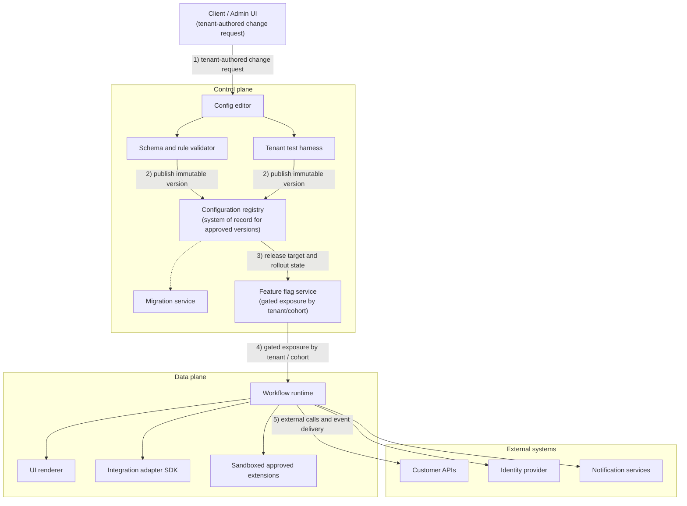
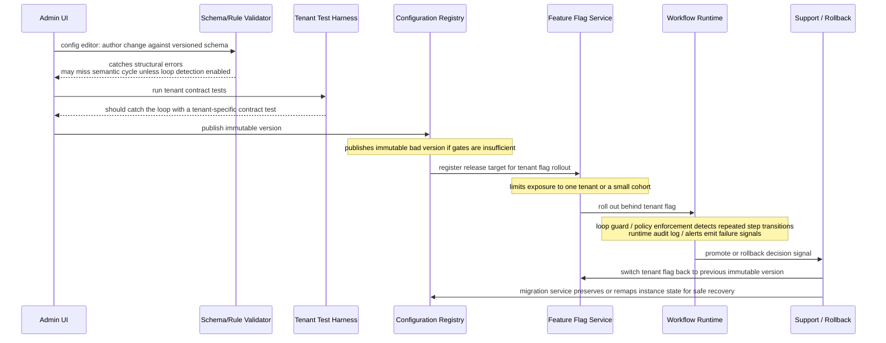
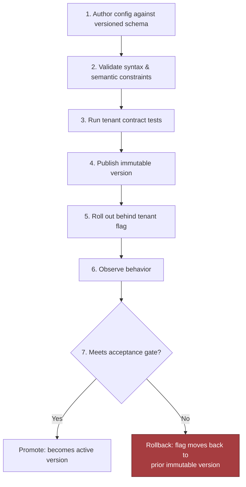

# Chapter 17: Design a Configurable Platform for Customer-Specific Workflows, part 2

## 3. Scale Estimates, SLOs, and Capacity

### Load Shape, Not Marketing Shape

- The elegant first pass (one shared workflow engine, one config store, one validator, one deployment pipeline) is plausible at average load and breaks once you put a deadline on it.
- The right estimate is not "how many customers do we have?" but "how many config changes, validations, activations, and approval events do we have at once, and what happens near a deadline?"
- Illustrative assumption: 100 tenants, 50 workflow templates, 1,000 configuration versions per day — a mix of small edits, bulk template updates, and bursty release windows.
  - Average: ~42 versions/hour.
  - Peak (half of daily changes land in a 2-hour business window): ~250 versions/hour, before retries, validation failures, or approval re-submissions.
  - Design for materially more than the average — often several times more — with a growth factor and headroom target, to survive release-day spikes without turning configuration into an outage.

### The Four-Step Capacity Envelope

- Estimate in the order that changes architecture:
  1. **Version intake and validation throughput.** Schema checks, policy checks, dependency checks, simulation/dry-run — if these add up to (my rough guess) 2–10 seconds of CPU-bound work or a few network calls, synchronous user feedback must be separated from asynchronous deeper checks. Immediate SLO: "did the edit save and return a clear result quickly?" Deeper guarantee: "did validation complete and promote/reject the version before the deployment window closes?"
  2. **Deployment throughput.** Even if only a fraction of the 1,000 versions/day are promoted, deployments fan out across tenants, regions, or integrations — a single promoted template update might touch dozens of workflow instances or enqueue downstream sync jobs. Deployment capacity is driven by fan-out, not just the count of human edits.
  3. **Limits for expressive power.** Hard limits on rules, custom fields, and plugin execution shape runtime cost early — e.g., a moderate field count per form, a bounded number of rule clauses per transition, short plugin execution windows with memory/network restrictions. These limits prevent one customer's customisation from consuming everyone else's shared service budget.
  4. **State growth and retention.** Configuration history grows more slowly than event history but still matters — the question isn't just "how many records?" but "what must be retained for audit, rollback, and support, and for how long?" Keep the version graph compact, store deltas where useful, make rollback metadata first-class.

### SLOs Tied to Customer Pain

- **Availability:** Can users load the workflow editor, validate changes, and activate a version when they need to?
- **Latency:** How long does the editor wait for save, validation preview, or approval routing results?
- **Freshness:** After a configuration is approved, how quickly does the new version become active in the runtime path?
- **Quality:** What fraction of deployments are rejected by validation, rolled back, or require manual intervention?
- **Security:** Are tenant boundaries, approval permissions, plugin permissions, and audit trails enforced at the right control points?
- **Cost:** What is the cost per validated version, per activated template, or per thousand workflow executions, and how does that change when customers add rules or plugins?
- Latency budget is partitioned, not one number: save feels interactive, validation preview tolerates a little more delay, full deployment can be slower as long as it is reliable and observable. Making every step synchronous "because it feels simpler" is the wrong design.

### Leverage and What Belongs in Core

- Leverage decides whether a capability belongs in shared product code, in configuration, or in an adapter around a customer-specific integration:

$$ Leverage=\frac{Customers\ served\ by\ shared\ capability}{Engineering\ effort} $$

- High leverage (e.g., an approval model used by 80 tenants) → deserves first-class core support.
- Low leverage (one customer's fragile edge-case approval chain) → belongs in configuration, an adapter, or a narrowly scoped extension — do not drag the whole platform into that shape.
- Support-cost matters too: a feature that seems reusable but creates expensive onboarding, debugging, or upgrade friction may have worse real leverage than a simpler, narrower design.

### A Whiteboard Estimate That Changes Component Choice

- Naively keeping validation inside the same API that saves configuration seems fine until peak load is estimated: worst-case request time grows with the slowest rule set or plugin call, producing a brittle control plane where one slow tenant ties up capacity everyone else needs.
- Once peak validation throughput and deployment fan-out are estimated, the architecture shifts:
  - Save → fast and durable.
  - Validation → queued, bounded, observable.
  - Deployment → idempotent, retryable, separated from authoring traffic.
- The rate and cost of validation/deployment — not the raw count of tenants — is the estimate that most strongly affects component selection and partitioning.

### Sensitivity Table Across Growth Scenarios

These volumes and peak factors are illustrative numbers I'd pick for this case, not industry figures — defend them, don't quote them.

| Scenario | Daily config versions | Peak factor | Operational implication |
|---|---|---|---|
| Baseline | 1,000 | ~6x (the 2-hour window above) | Single shared validator may be enough if work is mostly asynchronous |
| Moderate growth | 10,000 | 3x–5x | Queue separation, worker pools, stricter limits on plugin time |
| Aggressive growth | 100,000 (100x baseline) | 5x+ | Stronger tenant isolation, sharded queues, explicit per-tenant quotas |

- 10x growth does not just increase cost — it can force a different partitioning strategy. The same is true for custom fields/rules: highly branched forms with many calculated fields may need compile-time validation, partial evaluation, or cached execution plans; common plugin execution may need sandboxing or an adapter boundary instead of direct in-process execution.

> 🎯 **Interview Pointer:** Be ready to explain *why* 10x growth forces a partitioning change rather than just "more servers" — the answer is tenant noisy-neighbour risk crossing a threshold where a shared validator/queue can no longer contain one bad tenant's blast radius. This is the kind of qualitative reasoning interviewers reward over spreadsheet precision.

### Average vs. Peak: Headroom as a Product Feature

- Average load tells you whether the system is economically plausible. Peak load tells you whether customers trust it on their worst day.
- Headroom (the gap between average and peak) is not wasted capacity — it is what keeps a release window, approval rush, or large tenant onboarding from becoming the moment the platform betrays its promise.
- Unit economics question: not just "can we afford to run this?" but "can we afford to run this with the support burden it creates?" A design with low runtime cost but high operational toil may lose to a slightly more expensive design that is easier to support, roll back, and explain.

### Decision Rule to Carry Forward

- Treat every estimate as a design lever. If a number does not change a component boundary, a queue, a quota, a latency budget, or a support process, it is probably trivia. If it does, write it down and defend it.

## 4. Architecture and End-to-End Flow

### Control Plane vs. Data Plane

- The cleanest way to explain this system: walk one tenant request all the way through, then replay it when a dependency is unhealthy.
- Hidden constraint: one customer's custom approval logic may be dangerous if it can alter shared runtime behaviour.
- The design splits into a **control plane** (authors, validates, versions, and promotes configuration) and a **data plane** (executes live workflow instances) — this separation keeps risky change management out of the hot path.
  - Control plane owns: config editing, schema checks, tenant contract tests, release promotion.
  - Data plane owns: workflow execution, UI rendering at runtime, connector calls, audit events.
- This split is the first place to point when an interviewer asks where the trust boundary sits.

### Architecture Diagram and Trust Boundaries

- Top-down flow: tenant-authored change requests → control plane (config editor → schema/rule validator + tenant test harness → configuration registry as system of record → feature flag service for gated exposure) → data plane (workflow runtime, UI renderer, integration adapter SDK, sandboxed approved extensions) → external systems (customer APIs, identity provider, notification services).

- Trust boundaries sit (a) between tenant-authored content and platform-owned execution, and (b) between platform execution and external dependencies.
  - Tenant-authored config is never treated like code with full platform trust.
  - Approved extensions are still untrusted enough to deserve isolation and quotas.
  - External systems are not under your control — every adapter call needs timeouts, retries, idempotency where applicable, and a backoff policy that does not amplify failures.

### Core Components in Dependency Order

- Components are introduced in the order they depend on one another, not in the order they are easiest to name.

| Component | Responsibility | State ownership | Typical boundary |
|---|---|---|---|
| Workflow runtime | Executes workflow instances, step transitions, timers, and retries | Runtime state, execution history | Data plane; synchronous for step decisions, asynchronous for long-running work |
| Configuration registry | Stores versioned configs, schemas, and release metadata | Immutable config versions | Control plane; system of record for published config |
| Schema and rule validator | Checks syntax, semantic constraints, permissions, and compatibility | Validation results only | Control plane; synchronous on save/publish |
| UI renderer | Generates tenant-specific forms, labels, and layouts from approved config | None beyond cache | Mostly data plane; synchronous render, cached descriptors |
| Integration adapter SDK | Standard interface for CRM, ERP, ticketing, and webhook adapters | Adapter definitions, credentials references | Data plane edge to external systems |
| Feature flag service | Gates rollout by tenant, cohort, or percentage | Flag state | Cross-cutting control plane to data plane |
| Sandbox for approved extensions | Runs narrowly scoped customer logic or plugins with hard limits | Ephemeral execution only | Isolated boundary; synchronous if small, otherwise async |
| Migration service | Rewrites older configs into new schema versions or migrates instances forward | Migration jobs, compatibility mappings | Control plane; usually asynchronous |
| Tenant test harness | Replays tenant-specific contract tests before release | Test fixtures, expected outcomes | Control plane; synchronous approval gate or async batch |

- Every box earns its place: the validator exists so the registry never becomes a junk drawer; the flag service exists because "publish" and "expose to every tenant" are not the same action; the sandbox exists because approved extensions are useful but arbitrary runtime execution is how customizability turns into incident response.

### Failure-Path Overlay: Infinite Approval Loop

- The same architecture, annotated for the infinite-approval-loop failure drill, makes the blast radius visible — the validator, test harness, and flags each reduce blast radius at a different stage, so if one layer misses the defect, later layers still prevent a tenant-wide incident.

### Happy-Path Sequence: Author to Promotion

- Step-by-step live release path:
  1. **Author config against a versioned schema** — product manager, implementation engineer, or customer admin edits the workflow definition, field layout, approval graph, and adapter mappings.
  2. **Validate syntax and semantic constraints** — checks structure, allowed field types, approval graph sanity, reference integrity, permissions, compatibility with enabled features.
  3. **Run tenant contract tests** — replays representative scenarios: form submission, approval routing, edge-case inputs, integration stubs.
  4. **Publish an immutable version** — the registry stores the exact artifact, version tag, schema version, author, and release metadata; system of record for what was approved.
  5. **Roll out behind a tenant flag** — exposed to a single tenant, then a cohort, then broader traffic if stable.
  6. **Observe behaviour** — validation failures, step latency, adapter error rates, approval-loop detection, user completion metrics.
  7. **Promote or rollback** — if the release meets the acceptance gate it becomes active; otherwise the flag moves back or the tenant is pinned to the prior immutable version.
- Key nuance: "publish" does not mean "activate everywhere" — that separation is what keeps a bad config from becoming a broad outage.
- Synchronous vs. asynchronous: validation and contract testing are synchronous gates (must block promotion); migration, bulk replay, and some integration recovery are better asynchronous (should not hold the user's request open). The runtime itself often mixes both — quick step decisions synchronously, external side effects asynchronously when a dependency is slow or unreliable.

### Systems of Record, Caches, Queues, and Backpressure

- **System of record:** the configuration registry for published versions; usually the workflow audit store for execution history.
- **Caches:** compiled schema descriptors, rendered form layouts, adapter metadata, recent flag decisions.
- **Queues:** adapter jobs, retries, event delivery, migration tasks, test harness batches.
- **Backpressure and flow control:** the runtime should shed or delay noncritical work when adapter queues grow, rather than allowing retries to stampede external systems.
- Partitioning key: usually tenant ID, sometimes combined with workflow definition ID or environment — keeps noisy tenants from corrupting everyone else's latency profile, eases replay, and provides a natural quota-enforcement point. An unusually heavy approval storm should be contained within its partition.

### MVP vs. Later Evolution

- MVP: keep it brutally simple — versioned registry, validator, runtime, feature flags, tenant test harness, small adapter SDK, and only the smallest sandbox needed for approved extensions. Favour immutable config versions and clear rollback over a more exotic live-edit system.
- Later: cross-tenant config templates, richer migration automation, a broader plugin marketplace, deeper observability into tenant behaviour — only after the core release path is stable and supportable.

### 90-Second Interview Summary

- "I would separate a control plane from a data plane. The control plane handles authoring, schema and rule validation, tenant contract tests, immutable versioning, and rollout through feature flags. The data plane runs the workflow runtime, UI rendering, and adapter calls. The configuration registry is the system of record for published versions, and the runtime reads only approved releases. Tenant ID is the main partitioning key, with queues and backpressure protecting external dependencies. The riskiest trade-off is how much customer logic to allow in approved extensions versus keeping everything in declarative config. For an MVP, I would keep extensions narrow, require versioned configs, and gate every release behind a tenant test harness and staged flag rollout. The first production rollout gate is a single tenant with a rollback path that can be executed immediately."
