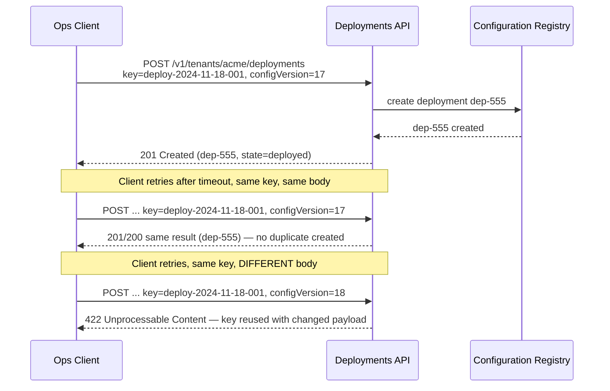
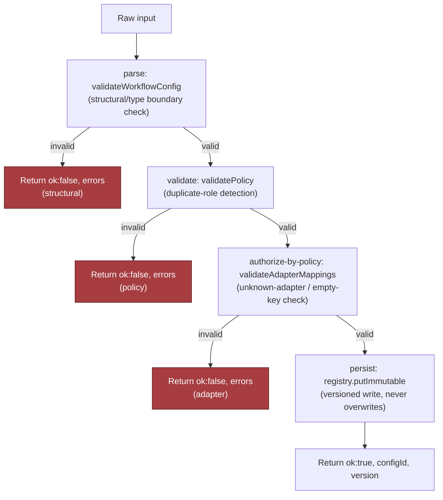

# Chapter 17: Design a Configurable Platform for Customer-Specific Workflows, part 3

## 5. Data Model, APIs, and Working Code

### Four Core Records and Ownership

- The fastest way to make this design credible: stop speaking in abstractions and pin the hardest parts to concrete state, contracts, and a small amount of code — what is durable, what is mutable, what is versioned, what is deployed, and what happens when the same request arrives twice.
- **`WorkflowTemplate(id, engine_version, schema)`** — the reusable blueprint, owned by product/platform.
  - `id` is the primary key; `engine_version` tells the runtime which evaluator/renderer understands the template; `schema` describes allowed shape of fields, approvals, integrations.
  - Lifecycle: `draft` → `published`; only a new template version can change behaviour — the published artifact is immutable.
  - Retention: keep published templates for the life of the product/contract window so old tenant configs can still resolve against the exact template they validated against; garbage-collect drafts after a safe inactivity period.
- **`TenantConfig(tenant_id, template_id, version, values)`** — the customer-specific overlay.
  - Primary key effectively `(tenant_id, version)`; `values` holds only tenant-specific parameters allowed by the template schema.
  - Lifecycle: `draft` → `validated` → `deployed` or `rolled_back`; a failed validation returns it to `draft`/`needs_fix` without changing its version.
  - Retention: keep all published and rolled-back versions for auditability/rollback; retain drafts only per platform policy until abandoned/replaced.
  - The tenant owns the business meaning of these values; the platform owns validation and persistence.
- **`AdapterDefinition(name, contract_version, permissions)`** — the integration contract for a downstream system (CRM, ticketing, storage, messaging).
  - Key is `name` + `contract_version`; `permissions` records required scopes/capabilities so the platform can reject a config asking for an adapter it cannot safely invoke.
  - Lifecycle: managed by platform/integrations team, published as versioned contracts, retired only after no active tenant config depends on them.
  - Retention: keep retired definitions long enough for historical deployments/troubleshooting, marked inactive so new configs cannot select them.
- **`ConfigDeployment(tenant_id, version, state)`** — the deployment ledger; source of truth for `draft` / `validated` / `deployed` / `rolled_back` / `failed`.
  - What ops/support inspect for "which version is live right now?"
  - Lifecycle: append-only state transitions, not in-place rewrites — a rollback is a new deployment event pointing back to a prior good version.
  - Retention: keep deployment history for the full support/audit window — it's the operational ledger for incident review, customer support, and change tracking.
- Ownership split prevents accidental coupling: template is product-owned, tenant config is customer-owned, adapter contract is integration-owned, deployment record is ops-owned. Blurring these produces forks disguised as flexibility.

> 🎯 **Interview Pointer:** When asked "what's the source of truth for what's live," name `ConfigDeployment`, not `TenantConfig` — the deployment ledger's append-only state transitions (not the config record itself) is what lets support answer "which version is live right now?" and what makes rollback a new event instead of an in-place mutation.

### Four API Contracts

- The interview-sized implementation shows one constrained declarative workflow contract and a write path that refuses unsafe input before it reaches the registry — the goal is to prove the platform can accept bounded configuration, validate it, and publish it immutably.
- `POST /v1/configurations/validate` — accepts a draft tenant config, returns validation errors and a normalised preview, never publishes state.
  - Auth: tenant-scoped bearer token/session bound to the caller's tenant; authz only allows validating configs for tenants the caller can administer.
  - Body: `template_id`, `version`, `values`, optionally `idempotency_key` (for replayable validation traces; endpoint can also be safely retried without write effects).
  - Responses: `200 OK` successful preview; `400 Bad Request` structural issues; `403 Forbidden` tenant mismatch/missing rights; `422 Unprocessable Content` schema/policy violations.
- `POST /v1/tenants/{id}/deployments` — creates a deployment for a tenant, typically from a validated config version; returns deployment ID + state.
  - Auth: binds caller to tenant `{id}` or a delegated ops role; server rejects cross-tenant deployment attempts.
  - Create-style operation → requires an idempotency key; same key + identical body → same result; same key + changed body → `422 Unprocessable Content`, which is what the IETF Idempotency-Key draft suggests; a retry that lands while the first request is still running gets `409 Conflict`.
  - Errors: `401 Unauthorized` missing/expired credentials; `403 Forbidden` missing tenant permission; `404 Not Found` referenced config version doesn't exist; `409 Conflict` stale optimistic-concurrency token, or same key still in flight; `422 Unprocessable Content` passes syntax but fails policy, or idempotency-key reuse with a different payload.
- `POST /v1/adapters/{name}/test` — exercises an adapter mapping against a safe test payload/sandbox endpoint.
  - Auth: scoped to integration-maintainer or tenant-admin permissions.
  - Body: adapter name, test payload, mapping, optional sandbox selector; also accepts an idempotency key to avoid duplicate test executions/audit records.
  - Errors: `404 Not Found` unknown adapter; `403 Forbidden` lacks permission; `422 Unprocessable Content` mapping cannot be applied; `502 Bad Gateway` (or similar) sandbox dependency fails.
- `POST /v1/deployments/{id}/rollback` — creates a new rollback state for the same tenant rather than mutating the old deployment in place.
  - Auth: tenant-scoped with elevated ops permission or an explicit approval path.
  - Body: names the target deployment or prior good version; includes an idempotency key (rollback is a write op that may be retried under failure).
  - Success returns the new deployment record, never overwrites the prior one.
  - Errors: `404 Not Found` deployment ID doesn't exist; `409 Conflict` current live state has moved on in a way that makes rollback unsafe; `422 Unprocessable Content` target version no longer compatible with current template/adapter contract.
- All four endpoints: require tenant-aware authentication and authorisation, reject cross-tenant writes, require an idempotency key on create-style operations, and return the same result for repeated requests with the same key and body. A changed body under a reused key is rejected, never a silent update.

### Idempotent Deployment Creation Walkthrough

- Concrete example: an ops client sends `POST /v1/tenants/acme/deployments` with idempotency key `deploy-2024-11-18-001` and body `{configVersion: 17, templateId: "tpl-9"}`.
  - Server creates deployment `dep-555`, returns `201 Created` with `deployment_id=dep-555`, `state=deployed`, and the same idempotency key recorded in the write log.
  - Retry with the same key after a timeout → must not create `dep-556`; returns the exact same result for `dep-555`.
  - Retry with the same key but a changed body (`configVersion: 18`) → rejected with `422` because the idempotency key no longer matches the payload.



### The Smallest Safe Code Path: Config Publication

- The highest-risk component is config publication — where unsafe structure, invalid mappings, or broken versioning can create outages. The sketch below is narrow but shows the control points that matter in production.

```typescript
type JsonValue = string | number | boolean | null | JsonValue[] | { [key: string]: JsonValue };
type JsonLogic = { op: string; args?: JsonValue[] };

type WorkflowConfig = {
  version: 1;
  fields: Array<{ key: string; type: "text" | "number" | "date"; required: boolean }>;
  approvals: Array<{ when: JsonLogic; role: string; slaHours: number }>;
  integrations: Array<{ adapter: string; mapping: Record<string, string> }>;
};

type ValidationError = { path: string; code: string; message: string };

type PublishResult =
  | { ok: true; configId: string; version: number }
  | { ok: false; errors: ValidationError[] };

class ConfigValidationError extends Error {
  constructor(public errors: ValidationError[]) {
    super("Configuration validation failed");
  }
}

function isPlainObject(value: unknown): value is Record<string, unknown> {
  return typeof value === "object" && value !== null && !Array.isArray(value);
}

function validateWorkflowConfig(input: unknown): WorkflowConfig {
  const errors: ValidationError[] = [];

  if (!isPlainObject(input)) {
    throw new ConfigValidationError([{ path: "$", code: "invalid_type", message: "Expected an object" }]);
  }

  if (input.version !== 1) {
    errors.push({ path: "version", code: "unsupported_version", message: "Only version 1 is supported" });
  }

  if (!Array.isArray(input.fields) || input.fields.length === 0) {
    errors.push({ path: "fields", code: "required", message: "At least one field is required" });
  }

  if (!Array.isArray(input.approvals)) {
    errors.push({ path: "approvals", code: "invalid_type", message: "Approvals must be an array" });
  }

  if (!Array.isArray(input.integrations)) {
    errors.push({ path: "integrations", code: "invalid_type", message: "Integrations must be an array" });
  }

  if (errors.length > 0) {
    throw new ConfigValidationError(errors);
  }

  return input as WorkflowConfig;
}

function validatePolicy(config: WorkflowConfig): void {
  const seenRoles = new Set<string>();
  for (const approval of config.approvals) {
    if (!approval.role || approval.slaHours <= 0) {
      throw new ConfigValidationError([
        { path: "approvals", code: "invalid_approval", message: "Each approval must have a role and positive SLA" },
      ]);
    }
    if (seenRoles.has(approval.role)) {
      throw new ConfigValidationError([
        { path: "approvals", code: "duplicate_role", message: `Duplicate approval role: ${approval.role}` },
      ]);
    }
    seenRoles.add(approval.role);
  }
}

function validateAdapterMappings(config: WorkflowConfig, allowedAdapters: Set<string>): void {
  for (const integration of config.integrations) {
    if (!allowedAdapters.has(integration.adapter)) {
      throw new ConfigValidationError([
        { path: "integrations", code: "unknown_adapter", message: `Unknown adapter: ${integration.adapter}` },
      ]);
    }
    for (const [from, to] of Object.entries(integration.mapping)) {
      if (!from || !to) {
        throw new ConfigValidationError([
          { path: `integrations.${integration.adapter}.mapping`, code: "invalid_mapping", message: "Mappings must not contain empty keys" },
        ]);
      }
    }
  }
}

class Registry {
  private store = new Map<string, { version: number; config: WorkflowConfig; hash: string }>();

  putImmutable(configId: string, config: WorkflowConfig): { version: number } {
    const existing = this.store.get(configId);
    const nextVersion = existing ? existing.version + 1 : 1;
    const hash = JSON.stringify(config);
    this.store.set(configId, { version: nextVersion, config, hash });
    return { version: nextVersion };
  }
}

function publish(configId: string, raw: unknown, allowedAdapters: Set<string>, registry: Registry): PublishResult {
  try {
    const config = validateWorkflowConfig(raw);
    validatePolicy(config);
    validateAdapterMappings(config, allowedAdapters);
    const result = registry.putImmutable(configId, config);
    return { ok: true, configId, version: result.version };
  } catch (error) {
    if (error instanceof ConfigValidationError) {
      return { ok: false, errors: error.errors };
    }
    return {
      ok: false,
      errors: [{ path: "$", code: "internal_error", message: "Unexpected failure during publish" }],
    };
  }
}
```

- Teaching points, line by line:
  - `WorkflowConfig` constrains the shape to a versioned declarative contract.
  - `JsonValue`/`JsonLogic` make approval conditions explicit without opening the door to arbitrary code.
  - `ValidationError` gives the API a stable error vocabulary.
  - `validateWorkflowConfig` is typed boundary validation — rejects malformed payloads before business logic sees them.
  - `validatePolicy` separates structural correctness from authorisation/workflow rules.
  - `validateAdapterMappings` checks the integration surface against an allowlist rather than trusting the config author.
  - `Registry.putImmutable` models versioned writes instead of overwrite semantics.
  - `publish` composes checks in the only order that makes sense: parse → validate → authorise-by-policy → persist.



> 🎯 **Interview Pointer:** Memorise the four-stage composition order — parse → validate → authorise-by-policy → persist — as a reusable pattern. Interviewers often ask "why this order?" The answer: cheap structural checks fail fast before expensive policy/adapter checks run, and nothing is persisted until every prior stage has passed (fail closed).

### What the Whiteboard Version Omits on Purpose

- A real service would add:
  - **Optimistic concurrency** — the write boundary should carry an expected template/config version so two operators cannot race and overwrite each other's change unnoticed. With the version in the body, a mismatch is `409 Conflict`; if you send it as an `If-Match` header instead, HTTP says `412 Precondition Failed`.
  - **Idempotency** — a retry after a timeout should not create a second deployment or version.
  - **Bounded, safe retries** — limited to safe failure classes; never replay a rejected validation/authorisation failure as though it were transient.
  - **Observability** — tag every validation, deployment, adapter test, and rollback with tenant ID, config version, request ID, and idempotency key so support can trace exactly what happened without reading application logs line by line.

### Contract and Failure-Injection Tests

- A good interview answer includes both a contract test and a failure-injection test.

```typescript
import { describe, it, expect } from "vitest";

describe("publish", () => {
  it("rejects duplicate approval roles and returns a structured validation error", () => {
    const registry = new Registry();
    const result = publish(
      "cfg-1",
      {
        version: 1,
        fields: [{ key: "requester", type: "text", required: true }],
        approvals: [
          { when: { op: "always" }, role: "manager", slaHours: 24 },
          { when: { op: "always" }, role: "manager", slaHours: 24 },
        ],
        integrations: [],
      },
      new Set(["crm"]),
      registry,
    );

    expect(result.ok).toBe(false);
    if (!result.ok) {
      expect(result.errors[0].code).toBe("duplicate_role");
    }
  });

  it("survives an adapter allowlist miss without publishing state", () => {
    const registry = new Registry();
    const result = publish(
      "cfg-2",
      {
        version: 1,
        fields: [{ key: "requester", type: "text", required: true }],
        approvals: [{ when: { op: "always" }, role: "manager", slaHours: 24 }],
        integrations: [{ adapter: "unknown", mapping: { a: "b" } }],
      },
      new Set(["crm"]),
      registry,
    );

    expect(result.ok).toBe(false);
  });
});
```

- The first test is the contract test: proves the API rejects a structurally valid but policy-violating configuration.
- The second is the failure-injection test: simulates an unsafe adapter definition and verifies the publish path fails closed.
- In a real service, extend this with duplicate idempotency-key tests, deployment rollback tests, and a concurrency test showing stale versions are rejected.
- Job-market signal: an FDE who can move from customer workflow pain to a state model, to API semantics, to production-grade validation code is operating at the level hiring teams actually need — the difference between "I can sketch a system" and "I can ship a supportable platform."
