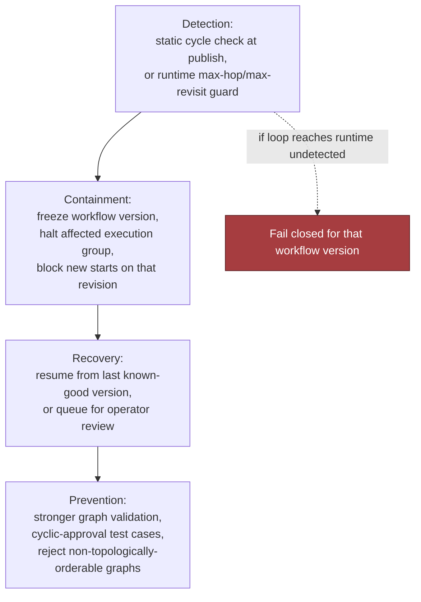

# Chapter 17: Design a Configurable Platform for Customer-Specific Workflows, part 4

## 6. Security, Reliability, and Failure Handling

### The Red-Team Question

- A security-and-ops review is where this design either becomes shippable or collapses into "works in the demo." Start by assuming the worst plausible version of the customer request: highly flexible workflow customisation, but the platform must still preserve a stable core, keep secrets compartmentalised, and survive bad config without turning one customer's mistake into everyone's outage.
- The right red-team move: "What happens if a published config creates an infinite approval loop?" This tests whether the platform can contain impact, preserve evidence, and keep operating for other tenants — not just whether the logic is correct.
- Concrete answer: the config pipeline rejects obvious cycles before activation; if a cycle is discovered after publish (hidden state or a race), the engine halts that workflow version, marks the offending revision inactive, keeps the prior known-good version available, and records the publisher, timestamp, tenant, and rule graph snapshot for audit and replay. Goal: make loops boring, bounded, and attributable — not pretend they can't happen.

### Four Security Controls

- **Disallow arbitrary code by default.** Most customisation should be declarative: fields, validation rules, routing, approvals, adapter bindings. Arbitrary code is the escape hatch, not the default path — if supported later, it should run through a heavily constrained sandbox or a separate approval-gated extension mechanism.
- **Scope adapters and secrets per tenant.** Isolate each integration so one tenant cannot read another's credentials, tokens, or request payloads. Least privilege applies twice: in the runtime that executes actions, and in the control plane that publishes configuration — a support engineer who can inspect a tenant's config should not automatically be able to invoke its external systems.
- **Validate rules for denial-of-service risk.** "Flexible validation" can become a resource-exhaustion bug — deeply nested conditions, unbounded regexes, giant lookup tables, recursive approval paths can create pathological CPU/memory usage. The publish path enforces shape limits, depth limits, size caps, and cycle detection before a config becomes active.
- **Audit configuration publishers and versions.** Every change needs a durable trail: who published it, what changed, which review/approval gate was crossed, which version superseded which. This is not compliance theater — it lets ops answer "which revision introduced the failure?" and security answer "was this an authorised change?"
- Tie each control to a failure mode in interview language: code execution, secret exposure, resource abuse, and change attribution.

### Failure-Policy Decision Table

| Event | Default behaviour | Why |
|---|---|---|
| Validation cannot prove a workflow is safe to activate | **Fail closed** | Better to block a risky publish than activate an unsafe tenant revision |
| External adapter times out during execution | **Retry with limits, then queue or dead-letter** | Transient outages should not immediately fail customer work |
| Approval graph is cyclic or loops at runtime | **Fail closed for that workflow version** | A loop is deterministic harm; continuing only amplifies it |
| A downstream integration is unavailable but the task can wait | **Degrade or queue** | Preserve work without dropping it, if the SLA allows delay |
| A customer action is irreversible, such as an external side effect | **Require human intervention on uncertainty** | Never guess when the system cannot safely compensate |
| A suspicious custom-code request appears | **Deny by default** | The platform should not grant execution rights without an explicit trust boundary |

- This table is the backbone of the interview answer because it shows failure policy as an architectural choice, not a vibes-based reaction.

### Blast-Radius Containment Levels

- **Tenant blast radius:** one customer's bad config should not affect another customer's workflow state, secrets, or run queue.
- **Region blast radius:** if multi-region, a bad deployment or dependency issue should be contained to the smallest feasible region slice.
- **Workflow blast radius:** only the affected workflow definition/version should be frozen, not the whole tenant (unless the tenant's control plane is compromised).
- **Dependency blast radius:** if a single adapter fails, isolate that adapter and keep unrelated adapters healthy.
- Defence in depth: validation is one layer, runtime sandboxing another, rate limiting another, and observability is the last layer confirming the first three are still working.

### Failure Drill: Infinite Approval Loop

- Scenario: a tenant publishes a workflow where step A routes to manager approval, manager approval routes to compliance approval, and compliance approval routes back to manager approval under a condition that is always true.
- A strong candidate response has four parts:
  1. **Detection** — the publish pipeline statically detects the cycle if possible; if the loop emerges only at runtime, the engine recognises repeated state transitions and a max-hop/max-revisit guard triggers.
  2. **Containment** — freeze the workflow version, halt only the affected execution group, prevent new starts on that revision.
  3. **Recovery** — resume from the last known-good version, or queue affected requests for operator review if the workflow already emitted side effects.
  4. **Prevention** — add stronger graph validation, test cases for cyclic approvals, and a publish-time policy that rejects configs whose approval graph cannot be topologically ordered.
- Evidence requirement: preserve the exact config revision, the transition trace, and the operator action history — a forensically useful answer, not just an error message.



### Other Named Failure Cases

- **Adapter contract changes.** A downstream service changes an expected field or response shape. Mitigation: version adapters, pin schema expectations, add compatibility checks, route mismatches into a quarantine path rather than silent partial success.
- **Tenant upgrade breaks old field mapping.** A tenant moves from version 1 to version 2 but older integrations still reference the old mapping. Mitigation: support versioned field maps, validate migrations, keep the old mapping alive until all executions have drained.
- **Feature-flag combination is untested.** Two individually safe toggles can produce a bad emergent path. Mitigation: define a known-safe matrix for high-risk flags, prohibit unsupported combinations in production, treat unreviewed combinations as fail-closed for launch.
- **Custom code escapes sandbox.** If any customer-defined logic is allowed, sandbox breakout is a high-severity event. Mitigation: do not enable arbitrary code by default; if a sandbox exists, apply least privilege, resource caps, outbound network restrictions, and separate approval gates. A breakout should revoke the extension path and trigger incident response.

### Six Operational Primitives

- **Timeouts:** explicit per-adapter timeouts so one hung dependency does not stall the whole workflow.
- **Retries:** retry only transient, idempotent operations, with bounded attempts and backoff.
- **Idempotency:** every externally visible write needs an idempotency key or equivalent dedup strategy so retries do not duplicate side effects.
- **Circuit breakers:** open the breaker when a dependency is clearly unhealthy so traffic sheds fast instead of building a queue of doomed requests.
- **Dead-letter handling:** route repeated failures to a dead-letter queue or failure inbox when automation has exhausted safe retries.
- **Human escalation:** required when the action is irreversible, the config is ambiguous, or evidence suggests a policy breach rather than a transient outage.
- The system doesn't just "handle errors" — it chooses the least dangerous next state.

### Evidence, Runbooks, and Launch Gates

- Before launch, the team should have audit evidence and runbooks for: who can publish config, how versions are approved, how a bad workflow is disabled, how adapters are rotated, how secrets are revoked, and how to replay a tenant-specific incident without leaking other tenants' data.
- If the team cannot answer those questions on paper, they are not ready to answer them during an outage.

### Interview-Sized Production Sketch

- Intentionally small — not the whole platform, just the publish-path invariant that rejects unknown adapters before config activation. The caps in it (50 fields, 10 approvals, 20 integrations, a 168-hour SLA) are placeholders I picked, not platform standards. A real companion repository would need tested dependencies, richer schema validation, structured logging, and integration with an actual persistence layer.

```typescript
export type WorkflowConfig = {
  tenantId: string;
  version: number;
  fields: Array<{ key: string; type: string; required?: boolean }>;
  approvals: Array<{ when: Record<string, unknown>; role: string; slaHours?: number }>;
  integrations: Array<{ adapter: string; mapping: Record<string, string> }>;
};

export type AdapterRegistry = {
  has(adapterName: string): boolean;
};

export type PublishResult =
  | { ok: true; activatedVersion: number }
  | { ok: false; error: string };

const ALLOWED_FIELD_TYPES = new Set(["text", "number", "date", "boolean", "email"]);
const MAX_FIELDS = 50;
const MAX_APPROVALS = 10;
const MAX_INTEGRATIONS = 20;

function isPlainObject(value: unknown): value is Record<string, unknown> {
  return typeof value === "object" && value !== null && !Array.isArray(value);
}

function validateConfig(config: WorkflowConfig, registry: AdapterRegistry): string | null {
  if (!config.tenantId || typeof config.tenantId !== "string") return "invalid tenantId";
  if (!Number.isInteger(config.version) || config.version < 1) return "invalid version";
  if (!Array.isArray(config.fields) || config.fields.length > MAX_FIELDS) return "invalid fields";
  if (!Array.isArray(config.approvals) || config.approvals.length > MAX_APPROVALS) return "invalid approvals";
  if (!Array.isArray(config.integrations) || config.integrations.length > MAX_INTEGRATIONS) return "invalid integrations";

  const seenFields = new Set<string>();
  for (const field of config.fields) {
    if (!field || typeof field.key !== "string" || !field.key.trim()) return "invalid field key";
    if (seenFields.has(field.key)) return "duplicate field key";
    seenFields.add(field.key);
    if (!ALLOWED_FIELD_TYPES.has(field.type)) return `unsupported field type: ${field.type}`;
  }

  for (const approval of config.approvals) {
    if (!approval || typeof approval.role !== "string" || !approval.role.trim()) return "invalid approval role";
    if (!isPlainObject(approval.when)) return "invalid approval condition";
    if (approval.slaHours !== undefined && (!Number.isInteger(approval.slaHours) || approval.slaHours < 1 || approval.slaHours > 168)) {
      return "invalid approval slaHours";
    }
  }

  for (const integration of config.integrations) {
    if (!integration || typeof integration.adapter !== "string" || !integration.adapter.trim()) return "invalid adapter name";
    if (!registry.has(integration.adapter)) return `unknown adapter: ${integration.adapter}`;
    if (!isPlainObject(integration.mapping)) return "invalid adapter mapping";
  }

  return null;
}

export function publish(config: WorkflowConfig, registry: AdapterRegistry): PublishResult {
  const error = validateConfig(config, registry);
  if (error) {
    return { ok: false, error };
  }

  return { ok: true, activatedVersion: config.version };
}

export function configWithAdapter(adapterName: string): WorkflowConfig {
  return {
    tenantId: "tenant-acme",
    version: 1,
    fields: [{ key: "requester", type: "text", required: true }],
    approvals: [{ when: { op: "always" }, role: "manager", slaHours: 24 }],
    integrations: [{ adapter: adapterName, mapping: { a: "b" } }],
  };
}

// Example failure test.
describe("publish", () => {
  it("rejects an unknown adapter", () => {
    const registry: AdapterRegistry = { has: (adapterName: string) => adapterName === "crm" };

    expect(() => {
      const result = publish(configWithAdapter("arbitrary-shell"), registry);
      if (result.ok) throw new Error("expected publish to fail");
      throw new Error(result.error);
    }).toThrow(/unknown adapter/);
  });

  it("accepts a known adapter", () => {
    const registry: AdapterRegistry = { has: (adapterName: string) => adapterName === "crm" };
    const result = publish(configWithAdapter("crm"), registry);
    expect(result.ok).toBe(true);
  });
});
```

- The point of the test is not that the code is complete — the invariant is explicit: a tenant cannot activate a config with an adapter the platform does not recognise, and the publish path fails closed before runtime.

### What to Say in the Interview

- Make the judgement visible: arbitrary code is denied by default; tenant secrets and adapters are isolated; risky rules are validated before activation; all publishes are audited; every external dependency or irreversible action gets a named failure policy. Connect that to supportability: the platform can degrade, queue, or block with evidence instead of guessing.
- Job-market signal: teams hiring for this role want someone who can own safe rollout, support, and incident response, not just the happy path — someone who protects the product core while still making customer-specific workflows feel flexible.
- Takeaway: every external dependency and irreversible action needs an explicit failure and recovery policy, stated by tenant, region, workflow, and dependency, with a publish-time invariant that keeps unsafe config out of production.
