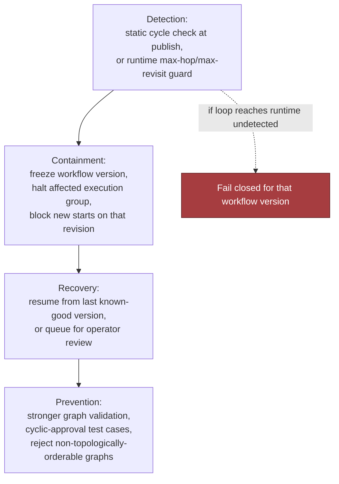

# Design a Configurable Platform for Customer-Specific Workflows, part 4

## 6. Security, Reliability, and Failure Handling

### The Red-Team Question

- The security and operations review decides whether this platform ships or stays a good demo. Assume the hardest realistic request: deep workflow control for customers, a core that stays stable anyway, secrets kept per tenant, and one customer's broken config that never becomes everyone's outage.
- A sharp reviewer asks: "A config goes live and its approvals loop forever. Then what?" The test is less about correct logic and more about whether the platform limits the damage, keeps the evidence and keeps serving every other tenant.
- Here is the concrete answer. Before activation, the config pipeline turns away any cycle it can see. Some loops only appear after publish, through hidden state or a race. When that happens, the engine stops that workflow version and marks the bad revision inactive. Customers can still use the version that last worked. For audit and replay, the system logs who published, when, for which tenant, plus a snapshot of the rule graph. Loops will happen. The aim is that each one is dull, bounded and traced to a named change.

### Four Security Controls

- **Disallow arbitrary code by default.** Customers shape workflows through declarations: fields, validation rules, routing, approvals and adapter bindings. Custom code is a last resort; if ever allowed, it runs in a tightly limited sandbox or behind a separate, approval-gated extension path.
- **Scope adapters and secrets per tenant.** Compartmentalise every integration so no tenant sees a neighbour's credentials, tokens or request bodies. Apply least privilege in two places: the runtime that carries out actions, and the control plane that publishes config. A support engineer allowed to read a tenant's config does not, by that fact, get to call that tenant's external systems.
- **Validate rules for denial-of-service risk.** Rich validation can turn into a way to exhaust resources. Deeply nested conditions, unbounded regexes, huge lookup tables and recursive approval paths can each burn CPU or memory without limit. So the publish path checks shape, depth and size against fixed caps, and runs cycle detection, before any config goes live.
- **Audit configuration publishers and versions.** Each change leaves a lasting record: the publisher, the diff, the review or approval gate it passed, and the version it replaced. It is not paperwork. With it, operations can find the revision that broke things, and security can confirm the change was authorised.
- In the interview, pair each control with the failure it stops: running code, leaking secrets, abusing resources and losing track of who changed what.

### Failure-Policy Decision Table

| Event | Default behaviour | Why |
|---|---|---|
| Checks at publish cannot show the workflow is safe to switch on | **Fail closed** | Blocking a doubtful publish costs less than running an unsafe revision for a tenant |
| An external adapter hits its timeout mid-run | **Bounded retries, then a queue or the dead-letter path** | A brief outage should not fail the customer's work on the spot |
| The approval graph contains a cycle, or starts looping while running | **Fail closed for that workflow version** | The loop will do the same harm every time; letting it run only adds more |
| An integration further down is offline, yet the task is not urgent | **Degrade or queue** | Hold the work rather than lose it, as long as the SLA tolerates the wait |
| The customer's action cannot be undone, for example a side effect in another system | **When in doubt, hand it to a human** | When the system has no safe way to undo, it must not guess |
| Someone asks for custom code that looks suspicious | **Deny by default** | Execution rights need a clear trust boundary before the platform hands them out |

- Lead with this table. It shows failure handling was designed up front, not improvised on the night.

### Blast-Radius Containment Levels

- **Tenant blast radius:** a broken config from one customer must leave every other customer's workflow state, secrets and run queue untouched.
- **Region blast radius:** in a multi-region setup, keep a faulty deploy or a failing dependency inside the smallest region slice you can.
- **Workflow blast radius:** freeze just the workflow definition or version at fault. The rest of the tenant keeps running, unless its control plane itself is compromised.
- **Dependency blast radius:** when one adapter fails, fence it off. Other adapters carry on as normal.
- Layer the defences. Validation is the first layer, the runtime sandbox the second and rate limits the third. Observability comes last and shows that the other three still hold.

### Failure Drill: Infinite Approval Loop

- The setup: a tenant publishes a workflow in which step A sends work to manager approval. Manager approval hands off to compliance approval. Compliance approval then sends it back to the manager, whenever a condition holds, and that condition never turns false.
- A good answer covers four stages:
  1. **Detection** — at publish time, static analysis finds the cycle where it can. A loop that only shows itself at runtime is caught by the engine, which spots the same state transitions repeating and trips a max-hop or max-revisit guard.
  2. **Containment** — freeze that workflow version. Stop only the execution group it affects, and block any new run from starting on that revision.
  3. **Recovery** — fall back to the last known-good version. If the workflow has already caused side effects, queue the affected requests for an operator to review.
  4. **Prevention** — tighten graph validation and add test cases for cyclic approvals. Adopt a publish-time policy that refuses any config whose approval graph has no topological order.
- Keep the evidence: the exact config revision, the trace of transitions and the history of operator actions. An error message alone does not support a forensic review; this record does.



### Other Named Failure Cases

- **Adapter contract changes.** A service downstream renames a field the platform relies on, or changes the shape of its response. To mitigate, version the adapters, pin the schema each expects, add compatibility checks, and quarantine any mismatch rather than letting it pass as a quiet partial success.
- **Tenant upgrade breaks old field mapping.** After a tenant upgrades from version 1 to version 2, integrations built earlier may still rely on the mapping it replaced. To mitigate, support versioned field maps and validate each migration. Keep the old mapping running until every execution that uses it has drained.
- **Feature-flag combination is untested.** Two toggles can each be safe alone and still create a bad path together. To mitigate, keep a matrix of combinations known to be safe for high-risk flags. Ban unsupported combinations in production. At launch, any combination nobody has reviewed fails closed.
- **Custom code escapes sandbox.** Once customer-defined logic runs anywhere, a sandbox breakout counts as a high-severity event. To mitigate, leave arbitrary code switched off by default. Where a sandbox does exist, give it least privilege, resource caps, limits on outbound network traffic and its own approval gates. A breakout should shut the extension path and start incident response.

### Six Operational Primitives

- **Timeouts:** give each adapter its own explicit timeout, so a single hung dependency cannot stall the full workflow.
- **Retries:** retry only operations that are transient and idempotent. Cap the attempts and back off between them.
- **Idempotency:** any write that the outside world can see carries an idempotency key, or some other way to dedupe, so a retry never repeats a side effect.
- **Circuit breakers:** when a dependency is plainly sick, open the breaker. Traffic is shed at once rather than piling up as requests that are bound to fail.
- **Dead-letter handling:** once automation has used up its safe retries, send the repeat failures to a dead-letter queue or a failure inbox.
- **Human escalation:** a person must step in when the action cannot be undone, when the config is unclear, or when the evidence points to a policy breach and not a passing outage.
- The point is not just handling errors: at each failure, the system picks the least dangerous next state.

### Evidence, Runbooks, and Launch Gates

- Have audit evidence and runbooks ready before launch. They cover who may publish config, how versions get approved, how to switch off a bad workflow, how to rotate adapters, how to revoke secrets, and how to replay one tenant's incident without exposing another tenant's data.
- A team that cannot write these answers down in calm conditions will not find them in the middle of an outage.

### Interview-Sized Production Sketch

- The sketch below is deliberately narrow. It shows one publish-path invariant: a config that names an unknown adapter is refused before it can go live. I chose its caps myself as stand-ins, not as platform standards: 50 fields, 10 approvals, 20 integrations and a 168-hour SLA. A real companion repository would also need tested dependencies, fuller schema validation, structured logging and a link to a real persistence layer.

```typescript
export type WorkflowConfig = {
  tenantId: string;
  version: number;
  fields: Array<{ key: string; type: string; required?: boolean }>;
  approvals: Array<{ when: Record<string, unknown>; role: string; slaHours?: number }>;
  integrations: Array<{ adapter: string; mapping: Record<string, string> }>;
};

export type AdapterRegistry = {
  has(adapterName: string): boolean;
};

export type PublishResult =
  | { ok: true; activatedVersion: number }
  | { ok: false; error: string };

const ALLOWED_FIELD_TYPES = new Set(["text", "number", "date", "boolean", "email"]);
const MAX_FIELDS = 50;
const MAX_APPROVALS = 10;
const MAX_INTEGRATIONS = 20;

function isPlainObject(value: unknown): value is Record<string, unknown> {
  return typeof value === "object" && value !== null && !Array.isArray(value);
}

function validateConfig(config: WorkflowConfig, registry: AdapterRegistry): string | null {
  if (!config.tenantId || typeof config.tenantId !== "string") return "invalid tenantId";
  if (!Number.isInteger(config.version) || config.version < 1) return "invalid version";
  if (!Array.isArray(config.fields) || config.fields.length > MAX_FIELDS) return "invalid fields";
  if (!Array.isArray(config.approvals) || config.approvals.length > MAX_APPROVALS) return "invalid approvals";
  if (!Array.isArray(config.integrations) || config.integrations.length > MAX_INTEGRATIONS) return "invalid integrations";

  const seenFields = new Set<string>();
  for (const field of config.fields) {
    if (!field || typeof field.key !== "string" || !field.key.trim()) return "invalid field key";
    if (seenFields.has(field.key)) return "duplicate field key";
    seenFields.add(field.key);
    if (!ALLOWED_FIELD_TYPES.has(field.type)) return `unsupported field type: ${field.type}`;
  }

  for (const approval of config.approvals) {
    if (!approval || typeof approval.role !== "string" || !approval.role.trim()) return "invalid approval role";
    if (!isPlainObject(approval.when)) return "invalid approval condition";
    if (approval.slaHours !== undefined && (!Number.isInteger(approval.slaHours) || approval.slaHours < 1 || approval.slaHours > 168)) {
      return "invalid approval slaHours";
    }
  }

  for (const integration of config.integrations) {
    if (!integration || typeof integration.adapter !== "string" || !integration.adapter.trim()) return "invalid adapter name";
    if (!registry.has(integration.adapter)) return `unknown adapter: ${integration.adapter}`;
    if (!isPlainObject(integration.mapping)) return "invalid adapter mapping";
  }

  return null;
}

export function publish(config: WorkflowConfig, registry: AdapterRegistry): PublishResult {
  const error = validateConfig(config, registry);
  if (error) {
    return { ok: false, error };
  }

  return { ok: true, activatedVersion: config.version };
}

export function configWithAdapter(adapterName: string): WorkflowConfig {
  return {
    tenantId: "tenant-acme",
    version: 1,
    fields: [{ key: "requester", type: "text", required: true }],
    approvals: [{ when: { op: "always" }, role: "manager", slaHours: 24 }],
    integrations: [{ adapter: adapterName, mapping: { a: "b" } }],
  };
}

// Example failure test.
describe("publish", () => {
  it("rejects an unknown adapter", () => {
    const registry: AdapterRegistry = { has: (adapterName: string) => adapterName === "crm" };

    expect(() => {
      const result = publish(configWithAdapter("arbitrary-shell"), registry);
      if (result.ok) throw new Error("expected publish to fail");
      throw new Error(result.error);
    }).toThrow(/unknown adapter/);
  });

  it("accepts a known adapter", () => {
    const registry: AdapterRegistry = { has: (adapterName: string) => adapterName === "crm" };
    const result = publish(configWithAdapter("crm"), registry);
    expect(result.ok).toBe(true);
  });
});
```

- The test does not claim the code is finished. What it does is make the invariant plain. If a config names an adapter the platform has never heard of, the tenant cannot activate it, and publish fails closed long before runtime.

### What to Say in the Interview

- Show your judgement out loud. Arbitrary code is off unless explicitly allowed. Each tenant's secrets and adapters live in their own compartment. Risky rules are checked before they go live. Every publish leaves an audit trail. Each external dependency and each irreversible action has a named failure policy. Then link all of this to supportability: with evidence in hand, the platform can degrade, queue or block, and it never has to guess.
- Hiring teams want someone who owns safe rollout, support and incident response beyond the happy path, and who guards the product core while customers still feel their workflows bend to fit them.
- The lesson to carry away: give every external dependency and every irreversible action an explicit policy for failure and recovery. State that policy at four levels (tenant, region, workflow and dependency), and back it with a publish-time invariant so unsafe config never reaches production.
