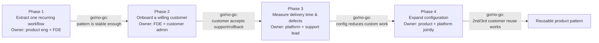
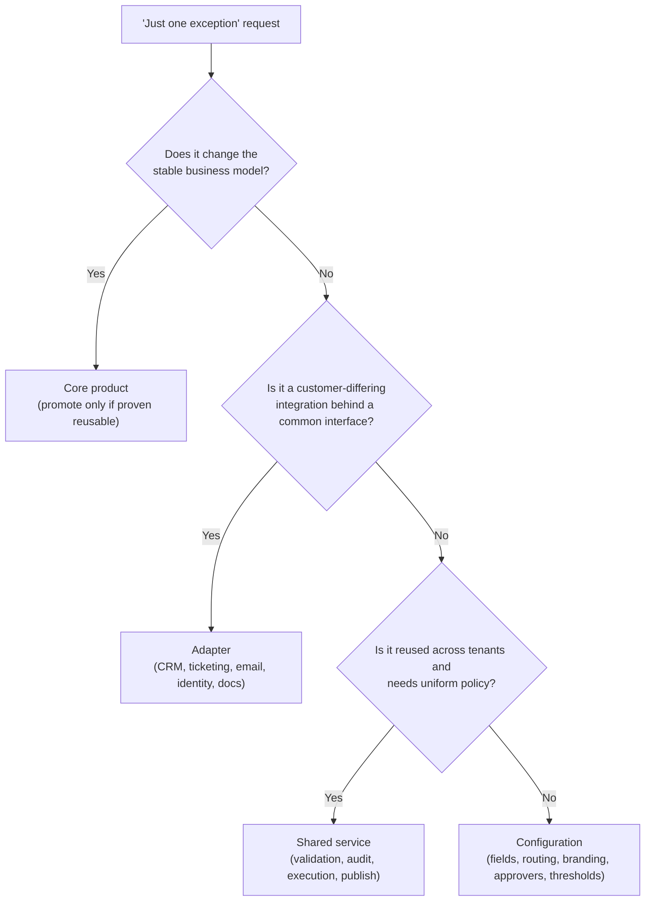

# Chapter 17: Design a Configurable Platform for Customer-Specific Workflows, part 5

## 7. Delivery Plan, Observability, and Business Impact

### Rollout as a Series of Proofs

- Once the prototype works, the real customer question changes from "can it?" to "can we trust it in production, with our data, our approvals, and our support team?" — this is where an FDE stops being a builder of a clever demo and becomes the person who converts architecture into staged delivery with measurable gates.
- Treat rollout as a series of proofs, not a single go-live event:
  - Extract one recurring workflow that already appears across several customers — pick the version with the least controversy (one approval path, one integration, one set of fields, one brand surface). Goal: prove the platform can represent a real customer need without a fork, not breadth.
  - Onboard one willing customer who can tolerate ambiguity and give fast feedback — named owner on your side, single production gate, rollback path known before the first publish. Run a canary release to a narrow slice of traffic or one low-risk tenant segment first. The first launch should be narrow enough that support can see every event, every config validation error, and every downstream integration call.
  - Expand configuration only after repeated evidence that the existing surface handles real demand, reduces duplication, and does not raise incident risk — the difference between shipping a platform and accumulating tenant-specific debt.

### The Four-Phase Rollout Plan

1. **Extract one recurring workflow.**
   - Owner: product engineer with FDE support.
   - Exit criteria: the workflow can be described in shared primitives, not a one-off fork.
   - Go/no-go gate: the team agrees the recurring pattern is stable enough to encode.
2. **Onboard a willing customer.**
   - Owner: FDE plus customer admin.
   - Exit criteria: the customer can configure the workflow, complete a pilot run, and report issues through the support channel.
   - Go/no-go gate: the customer accepts the support model and rollback procedure.
3. **Measure delivery time and defects.**
   - Owner: platform lead for telemetry; support lead for incident classification.
   - Exit criteria: baseline numbers for launch speed, defect rate, and validation failures before expanding scope.
   - Go/no-go gate: the platform shows configuration is reducing custom work rather than creating hidden rework.
4. **Expand configuration only after repeated evidence.**
   - Owner: product and platform jointly.
   - Exit criteria: a second and third customer can reuse the same mechanism with predictable effort.
   - Go/no-go gate: the new config type is approved only when it lowers forks or support burden without raising upgrade risk.

> 🎯 **Interview Pointer:** Each phase's go/no-go gate is the part interviewers probe — be ready to state all four gates from memory (pattern stability, customer acceptance of support/rollback, evidence that config reduces custom work, repeatable reuse by a 2nd/3rd customer) since this is the mechanism that keeps rollout from becoming "we shipped it because the demo worked."

### The Six-Metric Scorecard

- **Time to launch customer** — from approved request to first successful production workflow for a tenant. Source: release tracking/ticket timestamps. Owner: delivery lead. Alert: lead time drifts upward across multiple customers (brittle config, slow approvals, manual intervention).
- **Percentage handled by configuration** — share of customer-specific changes expressed through config instead of code. Source: release classification/change-request tagging. Owner: product/platform lead. Alert: percentage stalls (team silently reverting to forks).
- **Config validation failure rate** — failed publishes ÷ total publish attempts. Source: config service logs. Owner: platform engineering. Alert: failures rise (confusing UX, poor schema, unsafe requests).
- **Fork count** — number of customer-specific code branches, conditionals, or exceptions that cannot be removed. Source: architecture review/repo analysis. Owner: engineering manager. Alert: forks grow (each fork weakens the stable core).
- **Upgrade time** — effort to move one customer/tenant to a new platform version. Source: release records/migration tickets. Owner: release manager. Alert: upgrades require one-off scripts or extended freeze windows.
- **Tenant incident rate** — incidents per tenant over a rolling period, separated from platform-wide outages. Source: incident management system. Owner: support and SRE jointly. Alert: incidents cluster around a specific config type or adapter.

### Four Layers of Metrics

- **Technical health:** publish success rate, validation failures, rollback frequency, latency, incident rate.
- **Model/config quality:** whether workflow primitives actually match customer reality, often inferred from how often customers ask for exceptions.
- **Adoption:** how many customers are using the configured workflow, how often they return to it, how much of their process it covers.
- **Business outcome:** launch speed, reduced custom engineering, fewer support escalations, faster tenant expansion.
- This separation matters in interviews: a platform can be technically healthy and still fail commercially without adoption, or be adopted and still fail operationally if support cannot keep it stable.

### Dashboard in the Language of the User

- Start with the customer story, then drill into the machinery. Example (illustrative numbers): "Customer onboarding completed in under two days, with zero manual config edits, one validation retry, and no post-launch incident." Beneath that: schema validation failures, adapter errors, approval-loop blocks, publish latency, and rollout status by tenant.
- Answers "what do we watch after launch?" — not just CPU, logs, or queue depth, but the relationship between customer-facing success and internal failure modes.

### Ownership Before Launch

- **Product owner:** decides which recurring workflow becomes the first platformised path.
- **Platform owner:** maintains the shared core, config schema, and publish service.
- **FDE:** translates the customer workflow into supported configuration, validates assumptions, coordinates rollout.
- **Support lead:** owns customer communication, triage, and escalation during pilot.
- **SRE / operations lead:** owns monitoring, rollback execution, and release health.
- **Customer admin / champion:** validates the workflow in their environment and signs off on readiness.

### Go/No-Go and Rollback Triggers

- Go/no-go gate: the config is allowed to publish only if validation passes, dependency adapters are healthy, the rollback plan is rehearsed, and the customer champion confirms the workflow still matches the business process.
- Rollback trigger: repeated validation failures, unexpected integration errors, a growing incident rate in the first tenant cohort, or any sign that a new config pattern is producing unstable approval behaviour.
- If the workflow is stateful, migration and rollback must be written down separately — moving state is not the same as reverting code.
- Launch package documentation: a short admin guide, a support runbook, a rollback checklist, and a change log stating exactly what is configurable, what is fixed, and what requires engineering review.

### Config vs. Adapter vs. Shared Service vs. Core

- **Configuration** for customer-specific fields, routing choices, branding, approver lists, threshold values.
- **Adapter** for integrations that differ by customer but share a common interface: CRM, ticketing, email, identity, document systems.
- **Shared service** for capabilities reused across tenants that need uniform policy: validation, audit logging, workflow execution, publish orchestration.
- **Core product** for primitives that define the stable business model and should not be renegotiated for every tenant.
- When tempted to add "just one exception," ask whether it changes the core product, belongs in an adapter, or should be modelled as config — protects the platform from drifting into unmaintainable per-customer branching.

### The Risk Register

| Risk | Owner | Mitigation | Trigger |
|---|---|---|---|
| Infinite approval loop | Platform engineer | Cycle detection and publish-time validation | Repeated re-entry into the same approval state |
| Adapter mismatch | Integration engineer | Contract tests and explicit adapter versioning | Failed calls after publish or schema drift |
| Customer confusion during rollout | FDE | Training, playbooks, and guided setup | High support volume or repeated validation errors |
| Unsupported fork pressure | Product manager | Refusal criteria for bespoke code and a review board for exceptions | Requests that cannot be represented in configuration |

- This risk register is part of the operating model, not an appendix.
- Job-market signal: forward-deployed teams need someone who can carry the work from prototype to adoption, then turn customer feedback into a reusable product pattern. The platform is finished when customers adopt it, the workflow improves, and the operating team can support it without heroics — that is the point "customisable" becomes "supportable."
