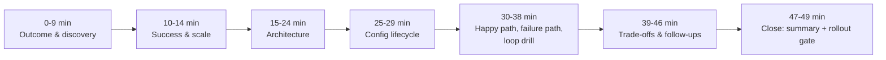

# Chapter 17: Design a Configurable Platform for Customer-Specific Workflows, part 6

## 8. Interview Walkthrough, Trade-Offs, and Practice

### Minute-Zero Opening

- Answer from the customer's outcome, not the technology: "We need one platform that can serve ten customers with similar workflows but different fields, approvals, branding, and integrations, without creating ten forks. I'd start by clarifying which parts must remain product core, which parts can vary safely by configuration, and which extensions need hard isolation. My bias is to preserve a stable core and move variation into versioned, testable configuration unless a requirement is truly unique or risky to generalise."
- This opening states the outcome, shows architectural judgement, and invites correction. If the interviewer changes the premise (e.g., a regulated approval step or proprietary connector), adapt rather than defend the first instinct.

### The 50-Minute Pacing Plan

- Use time in proportion to risk, not diagram size — a polished answer spends the most time where failure would hurt the business, not the one with the most boxes.
- **Minutes 0–9 (Outcome & discovery):** anchor the outcome (min 0); name the primary customer outcome (min 1); ask which part changes most often (min 2); identify the hidden constraint (min 3); define what must remain stable (min 4); state non-negotiables — identity, workflow semantics, auditability, rollback, support boundaries (min 5); state assumptions on tenant count/frequency (min 6); state assumptions on config authorship/approval (min 7); state assumptions on failure tolerance/incident response (min 8); invite the interviewer to redirect (min 9).
- **Minutes 10–14 (Success & scale):** define success criteria in customer/operating-model terms (min 10); state SLO/supportability implications (min 11); frame "safe customisation" (min 12); estimate system shape — tenants, workflows, connectors, admin edits (min 13); keep numeric estimates illustrative (min 14).
- **Minutes 15–24 (Architecture):** propose main architecture (min 15); config authoring and guardrails (min 16); validation and publish gates (min 17); immutable versioning and rollout (min 18); workflow execution layer (min 19); connectors and integration boundaries (min 20); audit logging and observability (min 21); tenant-scoped identity/authorisation (min 22); how workflow state is read/updated (min 23); control flow vs. data flow (min 24).
- **Minutes 25–29 (Config lifecycle):** who edits config (min 25); how config is reviewed (min 26); how config is promoted (min 27); how rollback works (min 28); how support reproduces an issue from a pinned version (min 29).
- **Minutes 30–38 (Happy path, failure path, loop drill):** happy path config-change → publish (min 30); publish → execution (min 31); execution → audit record (min 32); failure path for invalid config (min 33); failure path for permission drift (min 34); failure path for connector failure (min 35); failure path for rollback after a bad publish (min 36); the infinite approval loop drill (min 37); how cycle detection/publish-time validation prevents the loop from reaching production (min 38).
- **Minutes 39–46 (Trade-offs & follow-ups):** configuration vs. code (min 39); generic engine vs. domain product (min 40); plugin flexibility vs. security (min 41); backward compatibility vs. simplification (min 42); what becomes core product (min 43); how configurations are versioned (min 44); when a one-off fork is acceptable (min 45); how extensions are sandboxed (min 46).
- **Minutes 47–49 (Close):** summarise delivery, rollout gating, observability, support playbooks (min 47); deliver the 90-second executive summary (min 48); state the first production rollout gate and pause for questions (min 49).

### Four Trade-Off Pairs

- **Configuration versus code.** Configuration wins when customers differ in fields, labels, approvals, routing, or connector selection — those changes remain visible, versioned, and supportable. Code wins when variation changes semantics, requires a new invariant, or would turn the configuration language into an unreadable programming system. Repair for weak answers: stop saying "everything should be configurable" — instead, "make common variations declarative; when logic becomes custom business behaviour, graduate it to code with review and isolation."
- **Generic engine versus domain product.** A generic engine serves many tenants but risks becoming too abstract if it tries to model every business process. A domain product is narrower but easier to use/support. Strongest answer: define a stable core around workflow primitives the company can support repeatedly, then expose a constrained domain model around those primitives — optimise for the workflow family the company wants to own, not an endlessly extensible platform.
- **Plugin flexibility versus security.** Plugins reduce time-to-customer by letting teams integrate special systems without rebuilding the core, but enlarge the attack surface. Safe answer: sandbox extensions, restrict permissions, pin interfaces, treat plugins as governed artifacts with review, versioning, and observability. Broad data access or arbitrary execution is no longer a "simple plugin" — it's a trusted service boundary.
- **Backward compatibility versus simplification.** Backward compatibility protects existing tenants and avoids breaking active workflows; simplification keeps the platform understandable and maintainable. Good answer: both matter — propose an explicit deprecation policy (versioned schemas, migration windows, compatibility tests, a small number of supported generations). Repair for weak answers: avoid "we'll support everything forever" — that turns support into archaeology.

### Expected Follow-Up Questions

- **What becomes core product?** The stable execution model, identity/authorisation primitives, workflow state transitions, audit logging, validation, and admin tooling. Customer-specific labels, field definitions, approval routing, and connector parameters belong in versioned configuration. Anything that alters execution semantics, requires bespoke storage behaviour, or undermines safe rollback should be promoted only after it proves reusable across customers.
- **How do you version configurations?** Immutable published versions, human-readable diffs, schema validation at save time, compatibility checks at publish time. Store configuration as a declarative document with explicit tenant scope, version number, authorship, and rollout status. Never let production workflows depend on an unpinned draft. Versioning is also for audit, support, and reproduction of customer incidents — not just rollback.
- **When is a one-off fork acceptable?** Only when the requirement is genuinely non-reusable, business value justifies the support cost, and the divergence can be isolated so it doesn't infect the core — a narrow exception, not a habit. A fork is acceptable if the alternative would distort the core product into something less reliable or less secure for everyone else.
- **How do you sandbox extensions?** Limit execution context, network access, data access, and side effects. Enforce least privilege, explicit interfaces, resource controls, timeout boundaries, reviewable deployment artifacts. If the extension touches customer data, make the access model explicit and auditable. Sandboxing also includes interface design, dependency review, and deployment governance — not just runtime isolation.

### Weak Answers and Their Repairs

- **Weak:** "We'll make everything configurable." → **Repair:** distinguish declarative customisation from business logic.
- **Weak:** "We'll build a flexible plugin system." → **Repair:** define trust boundaries, permissions, and review gates.
- **Weak:** "We can always add a fork later." → **Repair:** explain the support, testing, and upgrade burden of forks.
- **Weak:** "Backward compatibility is always good." → **Repair:** describe version retirement and compatibility budgets.
- **Weak:** "We'll figure out the details after launch." → **Repair:** tie rollout to validation, observability, and rollback.

### Scoring Rubric

| Criterion | 1 — Weak | 3 — Adequate | 5 — Excellent |
|---|---|---|---|
| Discovery | Jumps into design without clarifying variation or constraints. | Asks a few basic questions about customers and workflows. | Rapidly identifies the hidden constraint, distinguishes core from config, and states assumptions clearly. |
| Estimation | No scale framing or vague hand-waving. | Provides rough scale but does not connect it to design choices. | Uses illustrative scale to motivate architecture, SLOs, rollout, and operational risk. |
| Architecture | Presents boxes without data, control, or trust boundaries. | Describes the major components but misses one or two flows. | Explains end-to-end control flow, data flow, and how configuration is validated, versioned, and executed. |
| Depth | Either too shallow or dives into irrelevant internals. | Mixes high-level and detail reasonably. | Spends depth where failure matters most and stays concise elsewhere. |
| Security | Mentions security as an afterthought. | Names basic auth and sandboxing. | Treats extension boundaries, least privilege, audit, and rollback as first-class design constraints. |
| Delivery | Ignores rollout and support. | Mentions phased launch vaguely. | Explains staged rollout, observability, config gating, and recovery paths. |
| Communication | Hard to follow, no closing summary. | Mostly understandable but lacks crisp structure. | Outcome-first, assumption-aware, trade-off explicit, and concludes with a tight executive summary. |

### Interview Rehearsal Checklist

- Before a mock or real interview, be able to do all five without notes:
  1. State the customer outcome in one sentence.
  2. Name the hidden constraint and the riskiest assumption.
  3. Explain what belongs in core product versus configuration.
  4. Defend one trade-off under pressure.
  5. Close with a concise summary and first rollout gate.

### 90-Second Architecture Summary

- "We solve this by keeping a small, stable workflow core and moving tenant variation into versioned configuration for fields, approvals, branding, and connector settings. Each customer edits config through guarded admin tools; config is validated, stored immutably, and published only if it passes schema, policy, and cycle checks. The execution layer reads the published version, runs workflow state transitions, and emits audit events so support can reproduce any tenant's behaviour. Extensions go through a controlled plugin boundary with least privilege and explicit contracts. The biggest trade-off is configuration versus code: I want as much reuse as possible, but I would not force custom business semantics into config if that would weaken security or make the system unmaintainable. My first production rollout gate would be a single tenant cohort with rollback, audit, and adapter contract tests proven in staging before broad rollout."

### Practice Plan

- **Solo exercise:** give yourself a blank page and speak the 50-minute plan out loud, then compress it into a 2-minute and a 90-second version.
- **Pair mock:** have a partner interrupt with the risky follow-up: "What becomes core product?" or "When is a one-off fork acceptable?" Practice answering without becoming defensive.
- **Implementation exercise:** design a versioned configuration validator that rejects cycles in approval routing and requires safe publish-time checks before a workflow can go live.
- **Equation guidance:** no new equation is introduced in this section — quantitative considerations are handled in prose, and deeper capacity math is deferred to Section 3 so the interview walkthrough stays focused on trade-offs, not derivations.
- Job-market advantage: this is close to the style of conversation forward-deployed teams use when moving from a customer problem to a safe productised solution.
