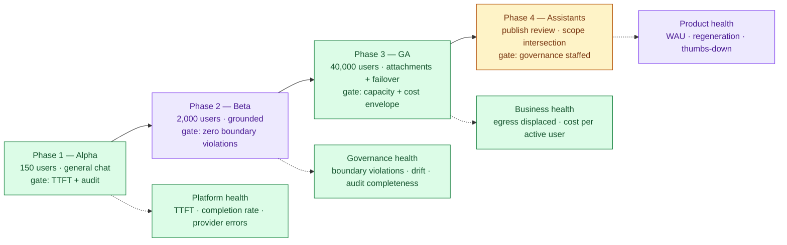

# Enterprise Chatbot Platform: "Our Own ChatGPT", part 4

## 7. Delivery, Observability, Business Impact

### The hazard

- In two weeks the demo will wow people. Then everyone wants all 40,000 employees on it, before the permission model has faced live ACLs on production corpora.
- **The delivery plan turns that excitement into risk taken in a deliberate order.**

### Four phases: gates are measurements, not dates

I chose these cohort sizes, week ranges and gate thresholds for this case. They are not an industry norm.

| Phase | Who | Adds | Gate |
|---|---|---|---|
| **1 · Alpha** (wk 1–6) | ~150 from IT, the AI team and volunteers | Plain chat; no grounding, no uploads | p95 TTFT < 1 s held for two weeks; audit trail has no gaps; security sign-off on egress |
| **2 · Beta** (wk 7–14) | ~2,000 across two departments | Retrieval that honours permissions, on two corpora with ACLs checkable at query time | **Zero permission-boundary violations**; thumbs-down below threshold; discovery runbook dry-run done |
| **3 · GA** (wk 15–22) | All 40,000 | Scanned uploads, a second provider, department budgets | Capacity proven at peak plus headroom; degraded mode run on a game day; spend inside the envelope |
| **4 · Assistants** (wk 23+) | Everyone, plus a governance group | Assistant building, reviewed before publishing | Scope intersection proven; reviewers in place; deprecation lifecycle written |

- **Defend this order: grounding, then attachments, then assistants.** Each phase adds one new kind of risk, so any failure names its cause.

```mermaid
flowchart LR
    P1["Phase 1 · wk 1-6\nAlpha, ~150 users\ngeneral chat only"] -->|"gate: TTFT + audit + egress review"| P2["Phase 2 · wk 7-14\nBeta, ~2,000 users\npermission-aware retrieval"]
    P2 -->|"gate: zero boundary violations"| P3["Phase 3 · wk 15-22\nGA, 40,000 users\nattachments + 2nd provider"]
    P3 -->|"gate: capacity + cost envelope"| P4["Phase 4 · wk 23+\nAssistants, governed publishing"]

    style P1 fill:#e4efe9,stroke:#1f6f5c
    style P2 fill:#f4ead2,stroke:#a06a08
    style P3 fill:#f4ead2,stroke:#a06a08
    style P4 fill:#e4efe9,stroke:#1f6f5c

    %% Casebook colours: entry, reasoning, results, controls, and stopped paths.
    classDef cbInput fill:#dbeafe,stroke:#2563eb,color:#172554
    class P1 cbInput
    classDef cbPolicy fill:#fef3c7,stroke:#b45309,color:#78350f
    class P2,P4 cbPolicy
    classDef cbAction fill:#dcfce7,stroke:#15803d,color:#14532d
    class P3 cbAction
```

### Metrics

| Metric | Class | Why it exists |
|---|---|---|
| Consumer-AI egress volume | Business | The headline figure; the reason the money was approved |
| Weekly active / eligible | Product | Adoption is the safety outcome: if few use it, the exposure stays |
| p95 / p99 TTFT | Platform | The adoption bar, set by the free tool people already use |
| Turn completion rate | Platform | A stream that dies at 80% still shows a healthy HTTP status |
| Regeneration rate | Product | A strong hidden quality signal; people retry when an answer missed |
| Thumbs-down + free text | Product | The direct signal, and seed material for evals |
| Citation click-through | Product | Shows people trust the grounding, which citations merely appearing cannot show |
| Permission-boundary violations | Governance | Aim for zero; any one is an incident, not a chart point |
| Policy block rate **+ false-positive rate** | Governance | Always read as a pair (see below) |
| Permission-drift divergence | Governance | Index against live ACLs; finds a missed revocation before a user does |
| Audit completeness | Governance | Turns recorded over turns served; must hit 100% |
| Cost per active user / month | Business | How finance steers the programme |
| Cached-prefix hit rate | Business | After compaction, the biggest token-cost lever |

- **Why the pair matters:** push the block rate alone and the tool turns so timid that staff go around it. The exposure you set out to remove returns, hidden behind a handsome dashboard.

### Three audiences, same telemetry

These figures are made up to show the format, not taken from a real deployment.

- **Board:** "Consumer egress fell 78% QoQ. 61% are active weekly. No permission-boundary incidents."
- **Department head:** "Your teams ran 14,000 turns last month, most of them drafting or policy lookups. Expense policy was the top gap, so that corpus is next."
- **On-call:** "We're at 1.4 s TTFT p95; the objective is 1.0 s. The SharePoint connector is slow, not the model."
- **An FDE who can tell only the on-call story will see the programme lose its funding.**

### Configuration vs. adapter vs. shared service vs. core

- **Configuration** (changed without a deploy): retention classes, quota tiers, department budgets, the allowed models for each data class, and review thresholds.
- **Adapter** (where most future requests will land): one per provider, per retrieval connector and per identity source. Fix the connector interface early. It has four steps: act as the caller, list candidates, check ACLs live, then fetch content.
- **Shared service** (exactly one implementation): policy/DLP, audit and quota. Gaps open up the moment a second copy exists.
- **Core product** (no forks, ever): the conversation model, the context assembler, the streaming relay and the permission-intersection rule.

### Risk register

| Risk | L | I | Mitigation | Owner |
|---|---|---|---|---|
| Uptake stalls; shadow use goes on | M | H | TTFT as a hard gate; general chat out early; act on regeneration rate | Product + platform |
| A too-broad assistant leaks data | M | H | Runtime scope intersection; review before publishing; usage-spike alerts | Platform + governance |
| Provider fails in working hours | H | M | Second provider; degraded mode; game day | Platform on-call |
| Spend breaks the envelope at full uptake | M | M | Compaction, prompt caching, tiered models, department budgets | Platform + finance |
| DLP over-blocks and annoys users | M | H | False-positive rate as a primary metric; quick appeals | Security + product |
| **Works council or privacy body objects to usage telemetry** | M | H | Aggregate analytics by default; consult before Phase 2, not after | Legal + HR |

- Few candidates add that final row. In European subsidiaries a works-council consultation can delay a launch like this.

### Business impact statement

The format, with invented numbers:

> - We moved AI use off unmanaged consumer tools and onto a platform that classifies each prompt, honours existing permissions on each retrieval and audits each turn.
> - Measured consumer-AI egress fell ~78% over two quarters, with 61% of staff active weekly.
> - Staff report saving ~3 hours a week; we read that as a direction, not a precise figure.
> - It costs ~$22 per active user a month versus a ~$30 vendor seat at list price; two connectors no vendor sells justify the gap.

- **Structure:** risk removed first, then adoption, then a frank caveat on the soft figure, then cost and why building paid off.
- Interviewers notice fast when self-reported time saved gets passed off as hard ROI.

### Rollout and metric layers

---

## 8. Interview Walkthrough and Trade-Offs

### Two failure modes to avoid

- **The feature list:** you tick off chat, RAG, voice, images, memory and assistants, and time runs out before permissions come up.
- **The lockdown:** a tightly governed product that nobody adopts, while the risk stays in the proxy logs.
- **Fix:** say both bars aloud and keep returning to them. They hold the answer together.

### 50-minute plan

```mermaid
flowchart LR
    A["0-5 min\nFrame outcome,\nname the two bars"] --> B["5-12 min\nDiscovery +\nbuild-vs-buy"]
    B --> C["12-18 min\nSizing: 800 streams\n+ provider TPM"]
    C --> D["18-28 min\nArchitecture in\ndependency order"]
    D --> E["28-36 min\nDefend five\ntrade-offs"]
    E --> F["36-43 min\nFailure walkthroughs,\nlead with permission\nlaundromat"]
    F --> G["43-47 min\nDelivery: four phases,\ngates as measurements"]
    G --> H["47-50 min\nSummary: built,\nexcluded, first gate"]

    %% Casebook colours: entry, reasoning, results, controls, and stopped paths.
    classDef cbInput fill:#dbeafe,stroke:#2563eb,color:#172554
    class A,E cbInput
    classDef cbReason fill:#ede9fe,stroke:#7c3aed,color:#4c1d95
    class B cbReason
    classDef cbAction fill:#dcfce7,stroke:#15803d,color:#14532d
    class C,G cbAction
    classDef cbPolicy fill:#fef3c7,stroke:#b45309,color:#78350f
    class D,F,H cbPolicy
```

| Min | Do |
|---|---|
| 0–5 | Set out the outcome; name the two bars and where they clash |
| 5–12 | Discovery, and bring up build-vs-buy before you are asked |
| 12–18 | Sizing: 800 concurrent streams first, then provider TPM |
| 18–28 | Architecture in dependency order; the coherence rule |
| 28–36 | Argue the five trade-offs |
| 36–43 | Failure walkthroughs; start with the over-scoped assistant |
| 43–47 | Delivery: four phases, measured gates, and config vs. adapter vs. core |
| 47–50 | Wrap up: built, left out, first production gate |

### Five trade-offs, balanced

- **Buy vs. build.** Plenty of candidates never raise it, so bringing it up first stands out. Buying gives a mature product in weeks; the vendor runs the models and carries much of the compliance. Building gives connectors and deployments no vendor offers, and control of the data path. **Recommend a hybrid: buy the model; build orchestration, connectors and governance.** Building because it sounds fun is disqualifying.
- **Vendor API vs. self-hosted.** An API gives top quality for the effort and no GPUs to run, but data leaves your network and the per-token bill climbs with success. Self-hosting gives a hard boundary, flat cost at volume and an air-gap option, but a lower quality ceiling and an upgrade load teams underrate. **Begin with the API behind an abstraction, and run your own models only where a data class demands it.**
- **Full history vs. compaction.** Sending everything is simple and exact, but cost grows quadratically and one day the context overflows, quietly and badly. Compaction holds cost near flat and lets chats run on, though a detail sometimes drops out. **Launch with the sliding window, add summarisation when telemetry asks for it, and keep the head pinned.**
- **Always-on vs. tool-invoked retrieval.** Retrieving on every turn grounds answers reliably, yet "rewrite this paragraph" needs no corpus search. A model-invoked tool is cheaper and quicker, but its choice can misfire either way and it opens a path for injection. **Middle route: a cheap intent classifier plus a narrow retrieval tool whose output still passes the permission filter.** The number to cite: retrieval taking 400 ms consumes about 40% of a TTFT budget of 1 second.
- **Strict DLP vs. adoption.** Each false positive teaches staff the approved tool is unreliable. A handful sends them back to consumer tools, and the exposure returns in full. **Tier the response: hard blocks for narrow, clear-cut categories; warn and log for vague ones; a named owner for the false-positive rate.** Say it plainly: *"a control that pushes people onto unsanctioned tools leaves security worse off overall."*

### Five follow-ups, compressed

- **Injection?** "I expect it to land sometimes, so I make landing worthless. Untrusted content has no authority. Orchestration, not the model, decides if a tool runs. The MVP has no write tools. Permission filtering caps the prize at what that user could already open. My eval set carries canaries. A better system prompt doesn't fix it."
- **eDiscovery?** "Each conversation carries a retention class. A legal hold beats every deletion path. A privileged endpoint needs a case reference. We audit the search *and* each conversation opened, because someone will ask who read an employee's chats. We rehearse it before launch. Some jurisdictions need works-council agreement first."
- **Provider down?** "Trip the breaker and move to the secondary or a smaller model. Users see a clear label instead of an error screen. Background jobs get shed. Retries are capped and jittered, and no message is lost. A game day proves it; failover that has never been exercised is just a guess."
- **Cost runaway?** "Cap tokens and concurrency for each user, give departments budgets, compact history, lay out context so the cache hits, and tier models by task. And kill the upstream stream when the client drops, or you pay for tokens no one reads."
- **How do you know it's working?** "First, egress in the proxy logs, measured before day one. Next, weekly active use, because uptake is what makes us safe. Then how often people regenerate, as a hidden quality signal. And permission-boundary violations held at zero, each one an incident."

### Weak answers → repairs

| Weak | Repair |
|---|---|
| "Just put the wiki in a vector DB and use RAG." | "Retrieval is the simple bit. The hard part is checking, for every chunk and at query time, what this caller may see right now, and refusing when the ACL service is slow." |
| "Our system prompt says to disregard instructions inside documents." | "Injection will sometimes land, so I make landing it pointless. Permission filtering is the last line." |
| "We'll restrict everything and make people request access." | "A locked-down tool that 8% of staff use leaves the risk where it was. I watch the DLP false-positive rate as closely as the block rate." |
| "It's basically ChatGPT — three months." | "The MVP is streaming chat with one grounded corpus. It leaves out writes, voice, fine-tuning and memory. Each phase adds one class of risk." |
| "The data model is just conversations in a Postgres table." | "Messages form a tree. Retention is a named class. A hold beats deletion. Status separates complete, blocked and failed." |
| "Autoscale the pods by requests per second." | "Request rate hides what streaming costs. At 40 turns/sec, each held for 20 s, you have 800 open connections, and that is what the relay tier is built for." |

### Rubric

| Dimension | Strong | Weak |
|---|---|---|
| Discovery | Sees shadow-AI displacement as the goal; raises build-vs-buy unasked | Takes "build ChatGPT" literally |
| Estimation | Starts from open streams at once and the provider's TPM | Gives a QPS figure and stops there |
| Architecture | Auth per turn; retrieval scoped to the principal; policy on the egress path | Draws boxes marked "LLM" and "vector DB" |
| Depth | Goes deepest on scope intersection and how streams break | Even time on low-risk detail |
| Security | Fail-closed layers; accepts injection sometimes wins | Leans on the system prompt; promises guarantees |
| Delivery | Measured gates; one risk class per phase; has the works-council row | Stops at the diagram |
| Communication | Keeps both bars in view; caveats soft numbers honestly | Pitches; sells self-reported time saved as hard ROI |

### 90-second architecture summary (rehearse verbatim)

> - We own a thin orchestration layer on top of someone else's model API.
> - Each turn, SSO signs the user in and we check their right to this exact conversation.
> - We scan and classify the input.
> - We build context from compacted history, permission-filtered retrieval and the assistant definition.
> - We route by classification and provider health.
> - We stream the reply, scanning a sliding window of output as it goes.
> - Every turn closes with citations, usage figures and an audit record, whether it completed, was blocked or failed.
> - Retrieval permissions come from the employee asking, never from whoever built the assistant.
> - Adapters wrap each provider, which turns an outage into a rerouting rather than an incident.
> - For the MVP: chat and a single grounded corpus.
> - It ships without write tools, voice or memory.

### Worksheet

| Prompt | Cover |
|---|---|
| Clarifying questions | Model source; which corpora, and are their ACLs resolvable at query time; retention, holds, discovery; assistant publishing; identity and residency; **what makes buying a non-starter** |
| Rough estimates | DAU; daily turns; peak turns/sec; **concurrent streams**; token rate set against the provider's quota; spend per active user |
| Trade-offs | Buy vs. build; API vs. self-host; full history vs. compaction; always-on vs. tool-invoked retrieval; strict DLP vs. adoption |
| Safety checks | Scope intersection; query-time ACLs that fail closed; injection with no authority; scanning streamed output; audit on every path |
| Delivery gates | Fast first token and full audit → no boundary violations → capacity and spend proven → reviewers staffed |
| Mock prompts | "Why build when you could buy?" · "Someone shares the finance assistant with the whole company. Now what?" · "The provider is out for two hours" · "Show me no one saw a document outside their access" |

### Practice plan

- **Solo:** answer aloud in 10 minutes, then cut each sentence that changes no design decision. Many find half of it was product description.
- **Pair:** a partner stops you at "secure", "scalable", "RAG" or "guardrails" and asks for the mechanism and where it runs. In one session they also play the GC *and* an annoyed employee.
- **Implementation:** set up three groups, two assistants and a handful of documents, then test permission intersection on them, shared conversations included. It is ~40 lines and teaches more than another read of these notes.

### One sentence

- A platform that staff pick over the free option. Prompts get classified before they leave, retrieval obeys the asker's live permissions, every turn leaves an audit trail, and the day the provider disappears is already planned for. Here uptake is the safety result.

---
