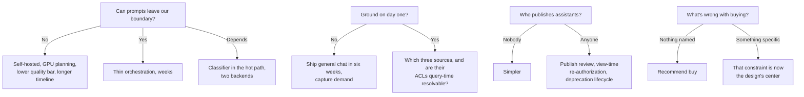

# Chapter 21 (Condensed): Enterprise Chatbot Platform — "Our Own ChatGPT"

*Scenario: custom addition to the 20-scenario set — not from the source book.*

---

## Table of Contents

- [0. The 60-Second Version](#0-the-60-second-version)
- [1. Customer Problem and Discovery](#1-customer-problem-and-discovery)
  - [The room](#the-room)
  - [Feature vs. business result](#feature-vs-business-result)
  - [Stakeholders and what each judges](#stakeholders-and-what-each-judges)
  - [Six discovery questions that change the architecture](#six-discovery-questions-that-change-the-architecture)
  - [Assumption ledger (state aloud, don't bury)](#assumption-ledger-state-aloud-dont-bury)
  - [Testable outcome](#testable-outcome)
  - [Two-minute opening (say this)](#two-minute-opening-say-this)
- [2. Requirements and Constraints](#2-requirements-and-constraints)
  - [The trap](#the-trap)
  - [Deep-dive questions → what each decides](#deep-dive-questions--what-each-decides)
  - [Functional requirements (must / should / could)](#functional-requirements-must--should--could)
  - [Safety goals as measurable behaviour](#safety-goals-as-measurable-behaviour)
  - [Explicit MVP exclusions](#explicit-mvp-exclusions)
  - [Question tree (walk this aloud in 2 minutes)](#question-tree-walk-this-aloud-in-2-minutes)
  - [Traceability: requirement → owner](#traceability-requirement--owner)
  - [When the interviewer won't answer](#when-the-interviewer-wont-answer)
- [3. Scale, SLOs, and Capacity](#3-scale-slos-and-capacity)
  - [Load shape](#load-shape)
  - [The number that actually sizes the system](#the-number-that-actually-sizes-the-system)
  - [The cost trap: quadratic history](#the-cost-trap-quadratic-history)
  - [Quotas as control surfaces](#quotas-as-control-surfaces)
  - [SLOs](#slos)
  - [Capacity, worked backward](#capacity-worked-backward)
  - [Unit economics](#unit-economics)
  - [Sensitivity](#sensitivity)
  - [Recovery bar (decide before the happy path)](#recovery-bar-decide-before-the-happy-path)
- [4. Architecture and End-to-End Flow](#4-architecture-and-end-to-end-flow)
  - [The coherence rule (write this before drawing anything)](#the-coherence-rule-write-this-before-drawing-anything)
  - [Dependency order](#dependency-order)
  - [Component responsibilities](#component-responsibilities)
  - [Happy path as a trace](#happy-path-as-a-trace)
  - [Architecture with failure overlay](#architecture-with-failure-overlay)
  - [Sequence with both failure branches](#sequence-with-both-failure-branches)
  - [State ownership and consistency](#state-ownership-and-consistency)
  - [MVP vs. evolution](#mvp-vs-evolution)
  - [The five differentiators](#the-five-differentiators)
- [5. Data Model, APIs, and Code](#5-data-model-apis-and-code)
  - [Five records](#five-records)
  - [Four endpoints](#four-endpoints)
  - [The riskiest component: the turn handler](#the-riskiest-component-the-turn-handler)
  - [The lines that carry the design](#the-lines-that-carry-the-design)
  - [Idempotency, versioning, concurrency — three places, three reasons](#idempotency-versioning-concurrency--three-places-three-reasons)
  - [Failures the whiteboard sketch omits](#failures-the-whiteboard-sketch-omits)
  - [Two tests that carry disproportionate weight](#two-tests-that-carry-disproportionate-weight)
- [6. Security, Reliability, Failure Handling](#6-security-reliability-failure-handling)
  - [The unusual threat model](#the-unusual-threat-model)
  - [Isolation layers (each fails closed)](#isolation-layers-each-fails-closed)
  - [Failure table](#failure-table)
  - [Walkthrough — the assistant as permission laundromat](#walkthrough--the-assistant-as-permission-laundromat)
  - [Walkthrough — instructions hidden in an uploaded document](#walkthrough--instructions-hidden-in-an-uploaded-document)
  - [Walkthrough — revocation the cache didn't hear about](#walkthrough--revocation-the-cache-didnt-hear-about)
  - [Walkthrough — the provider is having a bad day](#walkthrough--the-provider-is-having-a-bad-day)
  - [The three tests that prove the boundary](#the-three-tests-that-prove-the-boundary)
  - [Three artifacts required before GA](#three-artifacts-required-before-ga)
- [7. Delivery, Observability, Business Impact](#7-delivery-observability-business-impact)
  - [The hazard](#the-hazard)
  - [Four phases — gates are measurements, not dates](#four-phases--gates-are-measurements-not-dates)
  - [Metrics](#metrics)
  - [Three audiences, same telemetry](#three-audiences-same-telemetry)
  - [Configuration vs. adapter vs. shared service vs. core](#configuration-vs-adapter-vs-shared-service-vs-core)
  - [Risk register](#risk-register)
  - [Business impact statement](#business-impact-statement)
  - [Rollout and metric layers](#rollout-and-metric-layers)
- [8. Interview Walkthrough and Trade-Offs](#8-interview-walkthrough-and-trade-offs)
  - [Two failure modes to avoid](#two-failure-modes-to-avoid)
  - [50-minute plan](#50-minute-plan)
  - [Five trade-offs, balanced](#five-trade-offs-balanced)
  - [Five follow-ups, compressed](#five-follow-ups-compressed)
  - [Weak answers → repairs](#weak-answers--repairs)
  - [Rubric](#rubric)
  - [90-second architecture summary (rehearse verbatim)](#90-second-architecture-summary-rehearse-verbatim)
  - [Worksheet](#worksheet)
  - [Practice plan](#practice-plan)
  - [One sentence](#one-sentence)
- [Coverage Notes](#coverage-notes)

---

## 0. The 60-Second Version

- **Prompt:** 40,000 employees, "build us our own ChatGPT," internal data, enterprise controls.
- **Real driver:** the case gives us an egress report showing 6,400 staff already pasting company data into consumer AI tools.
- **Business result, not feature:** move AI usage from ungoverned consumer tools into a governed platform — without losing what made the consumer tools attractive.
- **Unique constraint:** you have a free, zero-friction competitor your users already have on their phones.
- **Two bars, always in tension:** governance (nothing leaves except under our agreement) and adoption (TTFT close to the free tool).
- **Design centre:** the context assembler — where permissions, cost, safety and quality all intersect.
- **The metric that matters:** consumer-AI egress volume, already instrumented in the proxy logs before you start.

> 🎯 **Interview Pointer:** Open with the two bars (governance vs. adoption) in the first breath — naming the tension up front is the single fastest way to signal you understand this isn't just "build ChatGPT."

---

## 1. Customer Problem and Discovery

### The room

- **CIO:** "6,400 employees hit consumer AI domains last month. We need our own."
- **General Counsel:** prove deal documents aren't in a third party's training set; produce an employee's history under legal process.
- **Internal Comms:** the last chatbot got 400 one-time users — if this is worse than free, people use free.
- **Platform lead:** 40,000 seats — what does it cost per month and who pays?
- **AI lead:** general chat is easy; grounding in internal systems *per person's permissions* is the actual project.

### Feature vs. business result

- **Feature:** a ChatGPT clone.
- **Business result:** retire an invisible data-leak risk while delivering a productivity gain — both must be true.
- **Weak opening:** "React frontend, vector DB, LLM gateway." Describes a product without naming its purpose.

### Stakeholders and what each judges

| Stakeholder | Judges on | Fails if ignored |
|---|---|---|
| Employees | Usefulness in the first 90 seconds | Governed tool nobody uses |
| Security / legal / compliance | Evidence: egress, retention, discoverability | Pilot never reaches production |
| Department admins / power users | Can they build and share assistants | Platform team becomes a ticket queue |
| Platform operators | One fleet they can run and survive vendor loss | Unrunnable at 40k |
| Finance | Defensible cost per employee per month | Emergency budget review in month four |

- **Jobs-to-be-done:** draft, summarise, explain, **find**. The first three are model capability; the fourth is where your engineering goes.

### Six discovery questions that change the architecture

1. **Model sourcing** — commercial API, self-hosted, or hybrid by data classification?
2. **Grounding scope** — general chat on day one, or company systems? Which three first?
3. **Retention and discovery** — how long, who may read another's conversations, under what process?
4. **Assistant publishing** — can any employee publish, or is publishing governed?
5. **Identity and residency** — SSO only? Regional deployment? Works-council constraints on usage telemetry?
6. **Build vs. buy** — what specifically rules out licensing a vendor's enterprise tier?

> 🎯 **Interview Pointer:** Question 6 (build vs. buy) is the one I'd expect many candidates to skip. Asking it unprompted, before the interviewer raises it, is one of the strongest discovery signals you can send in this scenario.

### Assumption ledger (state aloud, don't bury)

- Commercial API under a zero-retention agreement is acceptable for internal-confidential, not restricted.
- Corporate SSO is the sole identity source.
- First grounding targets: intranet, HR policy library, engineering wiki.
- Conversations belong to the employee but are discoverable under legal hold.

### Testable outcome

- **Target I'd propose:** reduce measured consumer-AI egress 80% in two quarters while reaching 50% weekly active use.
- **Why it works:** you cannot hit it by locking down, and you cannot hit it by shipping ungoverned. Both halves must be true.
- **Rare gift:** the baseline is already in the proxy logs — most AI projects argue about whether they worked.

### Two-minute opening (say this)

> "Move AI usage from consumer tools into a governed platform without losing the usefulness that drove people there. Two bars: nothing leaves our boundary except under an agreement we control, and time-to-first-token stays close to what they get for free. I'd clarify model sourcing, which systems we ground in first, retention and discovery, whether employees may publish assistants, and what rules out just buying. Default: thin owned orchestration over a commercial API, permission-filtered retrieval, provider abstraction. Success is displaced shadow-AI traffic plus weekly active use — not a launch date."

---

## 2. Requirements and Constraints

### The trap

- **Scope credulity.** The product you're pointed at represents years of work across chat, retrieval, code execution, images, voice, memory and a marketplace.
- Use the **exclusions bucket aggressively** — saying so early is strength, not retreat.
- Four buckets: functional, nonfunctional, explicit exclusions, hard constraints.

### Deep-dive questions → what each decides

| Question | What it decides |
|---|---|
| Model sourcing and data-processing terms | Thin orchestration (weeks) vs. also running a GPU fleet (quarters); whether a classification gate sits in the hot path |
| Grounding scope + **are ACLs query-time resolvable?** | One index vs. federated connectors; pre-filter vs. post-filter vs. both. If ACLs aren't resolvable, that source is phase two regardless of sponsor enthusiasm |
| Retention, legal hold, eDiscovery | Conversation store, deletion pipeline, audit schema, an admin surface that is itself audited |
| Assistant publishing | Chat app vs. platform; introduces the harder authorisation problem (scope ≤ *viewer's* permissions, not author's) |
| Identity, regions, workforce rules | Deployment topology; in some jurisdictions (Germany and the Netherlands, for example) the works council must agree to per-employee telemetry before it's an engineering matter |
| Build vs. buy | Sometimes the honest answer is "buy" — and an FDE who says so has served the customer |

### Functional requirements (must / should / could)

- **Must — authenticated streaming chat** with history, branching, regeneration, titles.
- **Must — permission-aware retrieval** returning only what the asking employee could already open, with citations.
- **Must — model routing behind a provider abstraction**; survive an outage or deprecation without a rewrite.
- **Must — input and output policy enforcement** on both directions of the model call.
- **Must — retention, legal hold, admin discovery**, with every admin read itself audited.
- **Must — usage accounting and per-user quotas** so cost is attributable and a runaway script is contained.
- **Should — custom assistants** with scoped instructions, tools and data; governed at publish, re-authorised at view.
- **Could — assistant marketplace, cross-conversation memory, images, voice.**

### Safety goals as measurable behaviour

- **Zero retrieval above caller access level** — no chunk, citation, title, snippet or cached answer from a document they can't open, *including in a shared conversation*.
- **Zero uncontrolled egress** — allowed destinations are enumerable and enforced, not conventional.
- **Complete, tamper-evident audit** — enough to answer "who saw what, when."
- **Bounded per-user spend** — one account cannot consume unbounded budget before something stops it.

### Explicit MVP exclusions

- **No writes to systems of record.** Read and draft only; agentic writes are a separate risk review.
- **No fine-tuning on company data.** Grounding is retrieval, not weights — also the sentence that most reassures Legal.
- **No voice, images, or code execution sandbox.** Each is a product of its own.
- **No external or customer-facing access.** Employees behind SSO only.
- **No cross-conversation long-term memory.** A privacy consultation before it is a feature.

### Question tree (walk this aloud in 2 minutes)

- **Can prompts leave our boundary?** No → self-hosted, GPU planning, lower quality bar, longer timeline. Yes → thin orchestration, weeks. Depends → classifier in the hot path, two backends.
- **Ground on day one?** No → ship general chat in six weeks, capture demand. Yes → which three sources, and are their ACLs query-time resolvable?
- **Who publishes assistants?** Nobody → simpler. Anyone → publish review, view-time re-authorisation, deprecation lifecycle.
- **What's wrong with buying?** Nothing named → recommend buy. Something specific → that constraint is now the design's centre.

### Traceability: requirement → owner

| Requirement | Owning component | Enforcement point |
|---|---|---|
| Authenticated streaming chat | Conversation service + streaming relay | Gateway session validation per turn |
| Permission-aware retrieval | Retrieval service + connector ACL resolvers | Query-time filter, re-checked at citation render |
| Model routing and failover | Model router + provider adapters | Route decision recorded per turn |
| Input/output policy | Policy & DLP layer | Pre-dispatch scan; streaming output scan |
| Retention, hold, discovery | Conversation store + retention worker + admin console | Retention class on conversation; hold blocks deletion |
| Custom assistants | Assistant registry | Publish review; view-time scope intersection |
| Usage accounting | Usage/quota service | Admission check before model dispatch |
| Audit completeness | Audit pipeline | Append-only write on every turn and admin read |

### When the interviewer won't answer

- Don't stall. **Default with a reason, hedge with a cost, invite redirection.**
- "I'll assume a commercial API under zero-retention terms — fastest to the adoption bar. A provider abstraction means 'actually self-hosted' changes one adapter and the capacity plan, not the architecture. Tell me to design the self-hosted case and I'll re-sequence."

---
