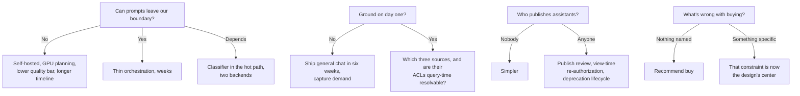

# Enterprise Chatbot Platform — "Our Own ChatGPT"

---

## Table of Contents

- [0. The 60-Second Version](#0-the-60-second-version)
- [1. Customer Problem and Discovery](#1-customer-problem-and-discovery)
  - [The room](#the-room)
  - [Feature vs. business result](#feature-vs-business-result)
  - [Stakeholders and what each judges](#stakeholders-and-what-each-judges)
  - [Six discovery questions that change the architecture](#six-discovery-questions-that-change-the-architecture)
  - [Assumption ledger (state aloud, don't bury)](#assumption-ledger-state-aloud-dont-bury)
  - [Testable outcome](#testable-outcome)
  - [Two-minute opening (say this)](#two-minute-opening-say-this)
- [2. Requirements and Constraints](#2-requirements-and-constraints)
  - [The trap](#the-trap)
  - [Deep-dive questions → what each decides](#deep-dive-questions--what-each-decides)
  - [Functional requirements (must / should / could)](#functional-requirements-must--should--could)
  - [Safety goals as measurable behaviour](#safety-goals-as-measurable-behaviour)
  - [Explicit MVP exclusions](#explicit-mvp-exclusions)
  - [Question tree (walk this aloud in 2 minutes)](#question-tree-walk-this-aloud-in-2-minutes)
  - [Traceability: requirement → owner](#traceability-requirement--owner)
  - [When the interviewer won't answer](#when-the-interviewer-wont-answer)
- [3. Scale, SLOs, and Capacity](#3-scale-slos-and-capacity)
  - [Load shape](#load-shape)
  - [The number that actually sizes the system](#the-number-that-actually-sizes-the-system)
  - [The cost trap: quadratic history](#the-cost-trap-quadratic-history)
  - [Quotas as control surfaces](#quotas-as-control-surfaces)
  - [SLOs](#slos)
  - [Capacity, worked backward](#capacity-worked-backward)
  - [Unit economics](#unit-economics)
  - [Sensitivity](#sensitivity)
  - [Recovery bar (decide before the happy path)](#recovery-bar-decide-before-the-happy-path)
- [4. Architecture and End-to-End Flow](#4-architecture-and-end-to-end-flow)
  - [The coherence rule (write this before drawing anything)](#the-coherence-rule-write-this-before-drawing-anything)
  - [Dependency order](#dependency-order)
  - [Component responsibilities](#component-responsibilities)
  - [Happy path as a trace](#happy-path-as-a-trace)
  - [Architecture with failure overlay](#architecture-with-failure-overlay)
  - [Sequence with both failure branches](#sequence-with-both-failure-branches)
  - [State ownership and consistency](#state-ownership-and-consistency)
  - [MVP vs. evolution](#mvp-vs-evolution)
  - [The five differentiators](#the-five-differentiators)
- [5. Data Model, APIs, and Code](#5-data-model-apis-and-code)
  - [Five records](#five-records)
  - [Four endpoints](#four-endpoints)
  - [The riskiest component: the turn handler](#the-riskiest-component-the-turn-handler)
  - [The lines that carry the design](#the-lines-that-carry-the-design)
  - [Idempotency, versioning, concurrency — three places, three reasons](#idempotency-versioning-concurrency--three-places-three-reasons)
  - [Failures the whiteboard sketch omits](#failures-the-whiteboard-sketch-omits)
  - [Two tests that carry disproportionate weight](#two-tests-that-carry-disproportionate-weight)
- [6. Security, Reliability, Failure Handling](#6-security-reliability-failure-handling)
  - [The unusual threat model](#the-unusual-threat-model)
  - [Isolation layers (each fails closed)](#isolation-layers-each-fails-closed)
  - [Failure table](#failure-table)
  - [Walkthrough — the assistant as permission laundromat](#walkthrough--the-assistant-as-permission-laundromat)
  - [Walkthrough — instructions hidden in an uploaded document](#walkthrough--instructions-hidden-in-an-uploaded-document)
  - [Walkthrough — revocation the cache didn't hear about](#walkthrough--revocation-the-cache-didnt-hear-about)
  - [Walkthrough — the provider is having a bad day](#walkthrough--the-provider-is-having-a-bad-day)
  - [The three tests that prove the boundary](#the-three-tests-that-prove-the-boundary)
  - [Three artifacts required before GA](#three-artifacts-required-before-ga)
- [7. Delivery, Observability, Business Impact](#7-delivery-observability-business-impact)
  - [The hazard](#the-hazard)
  - [Four phases — gates are measurements, not dates](#four-phases--gates-are-measurements-not-dates)
  - [Metrics](#metrics)
  - [Three audiences, same telemetry](#three-audiences-same-telemetry)
  - [Configuration vs. adapter vs. shared service vs. core](#configuration-vs-adapter-vs-shared-service-vs-core)
  - [Risk register](#risk-register)
  - [Business impact statement](#business-impact-statement)
  - [Rollout and metric layers](#rollout-and-metric-layers)
- [8. Interview Walkthrough and Trade-Offs](#8-interview-walkthrough-and-trade-offs)
  - [Two failure modes to avoid](#two-failure-modes-to-avoid)
  - [50-minute plan](#50-minute-plan)
  - [Five trade-offs, balanced](#five-trade-offs-balanced)
  - [Five follow-ups, compressed](#five-follow-ups-compressed)
  - [Weak answers → repairs](#weak-answers--repairs)
  - [Rubric](#rubric)
  - [90-second architecture summary (rehearse verbatim)](#90-second-architecture-summary-rehearse-verbatim)
  - [Worksheet](#worksheet)
  - [Practice plan](#practice-plan)
  - [One sentence](#one-sentence)
- [Coverage Notes](#coverage-notes)

---

## 0. The 60-Second Version

- **Prompt:** a company of 40,000 employees asks us to "build us our own ChatGPT", grounded in internal data and wrapped in enterprise controls.
- **What actually drives it:** an egress report in the case shows 6,400 staff copying company data into consumer AI tools today.
- **The result we owe, not the feature:** shift AI usage off ungoverned consumer tools and onto a governed platform, keeping what made those tools appealing.
- **What makes this case unusual:** our competitor is free, needs no setup and already sits on every employee's phone.
- **Two bars that pull against each other:** governance (nothing leaves except under an agreement we hold) and adoption (TTFT near what the free tool gives).
- **Where the design centres:** the context assembler. Permissions, cost, safety and quality all meet there.
- **The one metric that counts:** consumer-AI egress volume, which the proxy logs already record.

> 🎯 **Interview Pointer:** Name both bars, governance and adoption, in your first breath. Stating that tension early shows fastest that you see more here than "build ChatGPT".

---

## 1. Customer Problem and Discovery

### The room

- **CIO:** "Last month 6,400 employees reached consumer AI domains. We need one of our own."
- **General Counsel:** wants proof that deal documents never reach a third party's training set, and a way to produce one person's history when legal process requires it.
- **Internal Comms:** the previous chatbot drew 400 users who came once each. If ours is worse than free, people stay with free.
- **Platform lead:** what do 40,000 seats cost each month, and who pays?
- **AI lead:** plain chat is the easy bit. The real project is grounding in internal systems *within each person's permissions*.

### Feature vs. business result

- **The feature:** a clone of ChatGPT.
- **The business result:** close a data-leak risk nobody can see, and deliver a real productivity gain. Both must hold.
- **Weak way to start:** "React frontend, vector DB, LLM gateway." It lists parts and never says what they are for.

### Stakeholders and what each judges

| Stakeholder | Judges on | Fails if ignored |
|---|---|---|
| Employees | Whether it helps within 90 seconds | A governed tool that sits unused |
| Security / legal / compliance | Evidence on egress, retention and discoverability | The pilot stalls before production |
| Department admins / power users | Whether they can build and share assistants | The platform team turns into a ticket queue |
| Platform operators | A single fleet they can operate that outlives any one vendor | Cannot be run at 40k |
| Finance | A cost per employee per month they can defend | An unplanned budget review by month four |

- **Jobs-to-be-done:** summarise, draft, explain and **find**. The model already handles the first three. Finding is where our engineering goes.

### Six discovery questions that change the architecture

1. **Model sourcing:** a commercial API, our own hosted model, or a mix split by data classification?
2. **Grounding scope:** day one as plain chat, or with company systems too? If systems, which three lead?
3. **Retention and discovery:** how long do we keep conversations, and who may read someone else's, through what process?
4. **Assistant publishing:** may any employee publish an assistant, or does publishing need approval?
5. **Identity and residency:** is SSO the only login? Do we need regional deployments? Does a works council limit usage telemetry?
6. **Build vs. buy:** what exactly stops us licensing a vendor's enterprise tier?

> 🎯 **Interview Pointer:** Many candidates skip question 6, build vs. buy. Raise it yourself, before the interviewer does. In this scenario that ranks among the best discovery signals available.

### Assumption ledger (state aloud, don't bury)

- Internal-confidential data may go to a commercial API that has a zero-retention agreement. Restricted data may not.
- Identity comes only from corporate SSO.
- We ground in three systems first: the intranet, the HR policy library and the engineering wiki.
- Each conversation belongs to its employee, yet stays discoverable under legal hold.

### Testable outcome

- **The target I would put forward:** cut measured consumer-AI egress by 80% within two quarters, while weekly active use reaches 50%.
- **Why it holds up:** neither a lockdown nor an ungoverned launch can meet it. Only a design that does both passes.
- **A rare advantage:** the baseline already sits in the proxy logs. Most AI projects never settle whether they worked.

### Two-minute opening (say this)

> "The goal is to move AI usage off consumer tools and onto a governed platform, without losing what drew people there. I hold two bars. Nothing leaves our boundary unless an agreement we control covers it. And the time to first token roughly matches the free tools. First I'd clarify where the model comes from, the first systems to ground in, how long we keep conversations and who can read them, whether staff can publish assistants, and why we can't just buy. My default is a thin orchestration layer we own over a commercial API, with permission-filtered retrieval and a provider abstraction. Success means shadow-AI traffic falls and weekly active use climbs. A launch date is not success."

---

## 2. Requirements and Constraints

### The trap

- **Believing the scope.** The product we are told to copy took years to build. It spans chat, memory, retrieval, voice, images, code execution and a marketplace.
- Lean hard on the **exclusions bucket**. Naming early what we will not build reads as strength, not retreat.
- Sort everything into four buckets: functional, nonfunctional, explicit exclusions and hard constraints.

### Deep-dive questions → what each decides

| Question | What it decides |
|---|---|
| Model sourcing and data-processing terms | Weeks of thin orchestration, or quarters spent also running a GPU fleet. Also whether the hot path needs a classification gate |
| Grounding scope + **are ACLs query-time resolvable?** | A single index versus federated connectors; pre-filter, post-filter or both. A source whose ACLs we cannot resolve waits for phase two, however keen its sponsor |
| Retention, legal hold, eDiscovery | The conversation store, a deletion pipeline, the audit schema, and an admin surface that is audited too |
| Assistant publishing | A chat app or a platform. A platform brings the harder authorisation problem: scope must stay within the *viewer's* permissions, not the creator's |
| Identity, regions, workforce rules | The deployment topology. In some jurisdictions, such as Germany and the Netherlands, the works council must approve per-employee telemetry before engineering even starts |
| Build vs. buy | Sometimes the honest answer is "buy", and the FDE who says so serves the customer well |

### Functional requirements (must / should / could)

- **Must: authenticated streaming chat** with titles, history, branching and regeneration.
- **Must: permission-aware retrieval** that returns only documents the employee could already open, each with a citation.
- **Must: model routing through a provider abstraction**, so an outage or a deprecated model never forces a rewrite.
- **Must: policy checks on input and output**, covering both directions of each model call.
- **Must: retention, legal hold and admin discovery**, and each admin read goes into the audit log.
- **Must: usage metering and per-user quotas.** Every cost gets an owner, and a runaway script hits a ceiling.
- **Should: custom assistants** with their own instructions, tools and data. Governed when published, re-authorised whenever viewed.
- **Could: an assistant marketplace, memory across conversations, images and voice.**

### Safety goals as measurable behaviour

- **No retrieval above the caller's access level.** Nothing from a document they cannot open may surface: not a chunk, title, snippet, citation or cached answer, *shared conversations included*.
- **No uncontrolled egress.** Every permitted destination is listed, and the system enforces the list rather than trusting habit.
- **A complete audit that reveals tampering.** It must answer "who saw what, and when".
- **Capped spend per user.** No account can burn an unlimited budget before something stops it.

### Explicit MVP exclusions

- **Nothing writes to systems of record.** The MVP reads and drafts. Agentic writes need a risk review of their own.
- **We do not fine-tune on company data.** We ground through retrieval, not weights. No line calms Legal more.
- **No voice, no images, no code execution sandbox.** Each is a product in its own right.
- **No outside or customer access.** Only employees signed in through SSO.
- **No long-term memory across conversations.** It needs a privacy consultation first.

### Question tree (walk this aloud in 2 minutes)

- **Can prompts leave our boundary?** No: self-host, plan GPUs, accept a lower quality bar and a longer timeline. Yes: thin orchestration, delivered in weeks. It depends: a classifier in the hot path and two backends.
- **Do we ground on day one?** No: launch plain chat within six weeks and measure demand. Yes: name the three sources and check their ACLs resolve at query time.
- **Who may publish assistants?** Nobody: a simpler build. Anyone: publish review, re-authorisation at view time and a deprecation lifecycle.
- **What is wrong with buying?** Nothing specific: recommend buying. A concrete constraint: it becomes the centre of the design.

### Traceability: requirement → owner

| Requirement | Owning component | Enforcement point |
|---|---|---|
| Authenticated streaming chat | Conversation service + streaming relay | The gateway validates the session on every turn |
| Permission-aware retrieval | Retrieval service + connector ACL resolvers | Filtered at query time, checked again when the citation renders |
| Model routing and failover | Model router + provider adapters | Each turn records its route decision |
| Input/output policy | Policy & DLP layer | A scan before dispatch; a scan over the streamed output |
| Retention, hold, discovery | Conversation store + retention worker + admin console | Each conversation carries a retention class; a hold stops deletion |
| Custom assistants | Assistant registry | Review at publish; scope intersection at view time |
| Usage accounting | Usage/quota service | An admission check before the model call goes out |
| Audit completeness | Audit pipeline | An append-only write for every turn and every admin read |

### When the interviewer won't answer

- Keep moving. **Pick a default and give the reason, name the cost of being wrong, and invite a correction.**
- "I'll assume a commercial API on zero-retention terms, because it reaches the adoption bar fastest. Behind a provider abstraction, 'it's self-hosted after all' means only the capacity plan and a single adapter change. The architecture holds. If you want self-hosted, tell me and I'll change the order."

---
