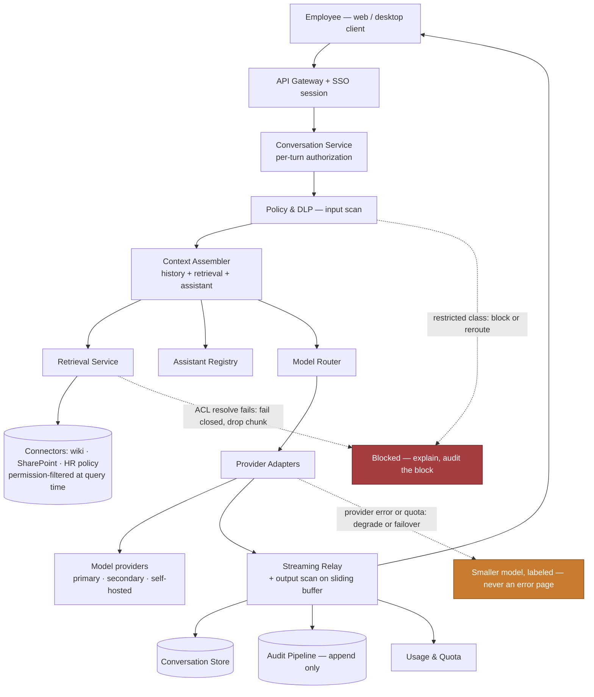
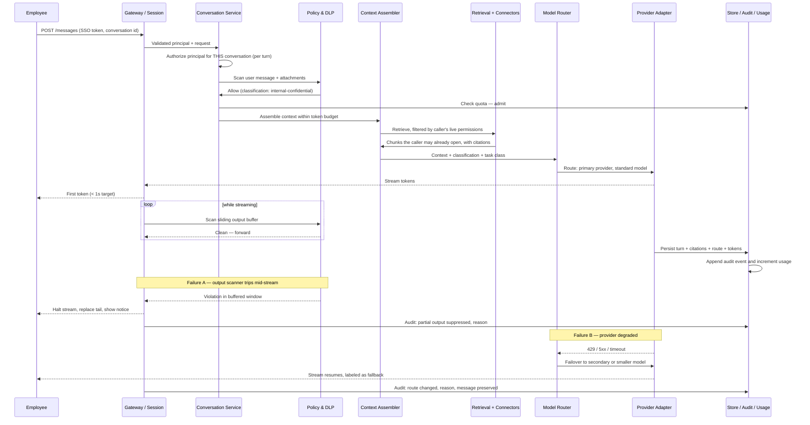

# Chapter 21 (Condensed): Enterprise Chatbot Platform — "Our Own ChatGPT", part 2

## 3. Scale, SLOs, and Capacity

### Load shape

- I'd expect enterprise chat to be **not smooth**: hard 8:30–10:00 spike, lunch dip, smaller afternoon peak, near-zero overnight.
- Working assumptions: 40,000 employees, 12,000 DAU, 8 conversations/user/day, 6 turns each.
- **576,000 turns/day.** Over a 10-hour day that's 16/sec; with an assumed 2.5× morning peak, **~40 turns/sec**.
- Four buckets: average, peak, growth (adoption is the *goal* — headroom isn't speculative), skew (power users and scripts).

### The number that actually sizes the system

- REST at 40 req/sec × 50 ms = ~2 requests in flight. **Chat at 40 turns/sec × an assumed 20-second stream = 800 concurrent connections.**
- $\text{concurrent streams} = \text{arrival rate} \times \text{hold time} = 40 \times 20 = 800$ — Little's Law, not request rate.
- **This sizes** the relay tier, load-balancer connection limits, provider concurrency quota, and deployment strategy.
- Long-lived streams are hostile to request-count autoscaling, naive round-robin, and any proxy with a 60-second idle timeout (the default on AWS ALB and nginx) once a stream goes quiet, say during a long tool call, unless you send heartbeats.
- A rolling restart that drops connections is now a **visible product failure**, not a blip.

> 🎯 **Interview Pointer:** Lead your sizing with the 800-concurrent-streams number, not raw QPS — it's the number that actually drives relay-tier and provider-quota decisions, and interviewers notice when a candidate reaches for Little's Law instead of naive request-rate math.

### The cost trap: quadratic history

- Naive full-history resend over $n$ turns: $\text{input tokens} \approx t \cdot \frac{n(n+1)}{2}$.
- By turn 40, one turn resends ~40× the first turn's tokens, and the whole conversation has sent ~820 turns' worth of input. Meanwhile the earliest turns' value has decayed to nothing.
- **Sliding window with pinned head** — always keep system prompt + assistant definition, keep last $k$ turns verbatim.
- **Rolling summarisation** — compact older turns; history cost becomes roughly constant.
- **Prompt caching** — lay out system prompt, assistant instructions and retrieved docs as a stable cacheable prefix.
- **Context layout order is a cost decision made on day one** — nearly free to design in, expensive to retrofit.

### Quotas as control surfaces

- **Per-user token quota** — caps spend, contains a compromised or scripted account.
- **Per-user concurrency cap** — a human needs 1–2 streams; 50 is not a human.
- **Per-department budget** — cost attributable to a cost centre, runaway team visible before the invoice.
- **Burst allowance** — a legitimate heavy session shouldn't be throttled into a bad experience.
- **Priority classes** — interactive turns outrank background jobs when capacity is scarce.
- **Trade-off:** too tight → artificial walls → back to the consumer tool → project defeated. Too loose → one script eats the quarter.

### SLOs

- **TTFT is the adoption SLO**, not total latency. My rule of thumb: text by 700 ms feels fast even if the answer takes 25 s; a 4-second spinner feels broken.
- **Targets I'd set for this case:** p95 TTFT < 1.0 s, p99 < 2.0 s.
- **Turn completion rate** — a stream dying at 80% is a failed turn; counting it as HTTP 200 is a common instrumentation mistake here.
- **Quality:** thumbs-down rate, regeneration rate (a strong implicit signal), citation click-through, sampled groundedness.
- **Permission-filter correctness:** a hard gate at zero, not a quality metric.
- **Cost:** per active user per month, per turn, cached-prefix hit rate.
- **By task class, not globally:** drafting needs TTFT; policy lookup needs total time, because you can't act on a partial answer.

### Capacity, worked backward

- Peak throughput ≈ 40 turns/sec × an assumed 2,400 tokens per turn = 96,000 tokens/sec ≈ **5.8M tokens/minute**.
- **At this scale, I'd expect the binding constraint to be the provider's TPM/RPM quota — a contract, not a cluster.**
- If the quota is below it: higher tier, multiple deployments/regions, or route cheap traffic to a smaller model at peak.
- Headroom for: adoption growth, retry storms (which spike exactly when capacity is tight), failover concentration, deploy-time drain, and the all-hands demo effect.

### Unit economics

$$ C_{\text{user}} = \frac{C_{\text{fixed}}}{N} + C_{\text{tokens}} + C_{\text{retrieval}} + C_{\text{storage}} $$

- $C_{fixed}/N$ — small at 40,000 seats, brutal at 500. This is why the build case is scale-dependent.
- $C_{tokens}$ — dominant term; compaction and prompt caching attack it directly.
- $C_{retrieval}$ — largely fixed per corpus, not per user.
- $C_{storage}$ — driven by retention class; 7-year retention is a legal decision with an engineering invoice.
- **Say it out loud:** "Our estimated $22/user/month vs. a ~$30 vendor seat (Microsoft 365 Copilot's list price, checked Sep 2026) means the build case rests on the capability that forced us to build, not on cost."

### Sensitivity

These are my working assumptions scaled up, not measured figures.

| Assumption | Now | Full adoption |
|---|---|---|
| Daily active | 12,000 | 32,000 |
| Turns per user/day | 48 | ~144 (assumed: heavier use, about 3×) |
| Turns/day | 576,000 | ~4,600,000 |
| Peak turns/sec | 40 | ~320 |
| Concurrent streams | ~800 | ~6,400 |
| Peak tokens/min | ~5.8M | ~46M |
| Binding constraint | provider TPM | provider TPM **and** relay connection limits |
| Cost strategy | compaction + caching | add task-based model tiering; possibly self-host bulk classes |

- **What changes at the top:** one gateway to one provider stops being viable; you need a router across deployments. Design it in early — retrofitting during an incident costs a quarter.

### Recovery bar (decide before the happy path)

- **The likely outage is upstream and not yours.**
- **Failover** — secondary provider; only counts if you've tested the fallback's output quality, not discovered it live.
- **Degrade** — smaller model with a visible label. A labelled lesser answer beats an error.
- **Shed** — pause background work to preserve interactive capacity.
- **Preserve** — never lose the user's typed message. Cheapest reliability win; often omitted.
- **Differentiated targets I'd set:** conversation store RPO ≈ 0 (it's their work product); retrieval index RPO in hours (stale degrades quality, doesn't lose data).

---

## 4. Architecture and End-to-End Flow

### The coherence rule (write this before drawing anything)

- **Identity is established at the session, re-evaluated per turn, and nothing enters the context window without passing policy and being recorded in audit.**
- There is no side door into the prompt — history, retrieved chunk, attachment, assistant instruction all take the same path.

### Dependency order

1. **Identity and session** — corporate SSO, short-lived token, device binding.
2. **Conversation authorisation** — per turn, because sharing and revocation happen between turns.
3. **Input policy** — classify and scan message + attachments before any egress.
4. **Context assembly** — system prompt, assistant definition, compacted history, permission-filtered retrieval, in cache-friendly order, within budget.
5. **Model routing** — by task class, data classification, cost policy, live health.
6. **Provider adapter** — translate to vendor API, normalise the stream.
7. **Streaming relay + output policy** — deliver tokens while scanning a sliding buffer; able to halt mid-flight.
8. **Persistence** — write the turn idempotently with citations, tokens, route decision.
9. **Audit and usage** — append-only record; increment the quota ledger.

- **Why this order:** authorisation precedes assembly (assembly reads data); policy precedes dispatch (dispatch is egress); routing follows classification (classification can forbid a destination); audit follows the action but stays close enough to be trustworthy.

### Component responsibilities

| Component | Responsibility | Trust boundary | Plane |
|---|---|---|---|
| Client | Render the stream, hold a draft, never hold authority | Untrusted user | Edge |
| Gateway + session | Validate SSO token, admit and shape traffic | Corporate network → platform | Data |
| Conversation service | Own conversation/message state; authorise per turn | Application authority | Data |
| Policy & DLP | Classify input, scan streamed output, block or redact | Egress control | Data + control policy |
| **Context assembler** | Build the prompt within budget — **the highest-risk boundary** | Prompt construction | Data |
| Retrieval + connectors | Fetch candidates filtered by the caller's **live** permissions | Source-system access | Data |
| Assistant registry | Store, version, govern assistant definitions and scopes | Publishing / delegation | Control |
| Model router | Choose provider/deployment/model by class, cost, health | Vendor selection | Control + data hooks |
| Provider adapters | Normalise vendor APIs; own retries and timeouts | External vendor | Data |
| Streaming relay | Hold long-lived connections; handle mid-stream abort | Connection management | Data |
| Conversation store | Persist under a retention class | Storage and retention | Data |
| Attachment store + scanner | Hold uploads, malware-scan, extract text | Untrusted content | Data |
| Usage & quota | Meter tokens, enforce limits | Shared-resource governance | Control |
| Audit pipeline | Append-only record incl. admin reads | Compliance evidence | Data |
| Admin console | Retention, legal hold, discovery, assistant review | Privileged administrative | Control |

### Happy path as a trace

1. **Authenticate** via SSO; gateway attaches a verified principal.
2. **Authorise this conversation** — now, not cached from session start.
3. **Scan input** — a restricted classification can reroute or block.
4. **Admit against quota** — before spending anything.
5. **Assemble** — pin head, compact history, permission-filtered retrieval, cache-prefix-first layout.
6. **Route** — model and deployment from class, cost, health.
7. **Dispatch and stream** — tokens forward while the output scanner watches a sliding buffer.
8. **Finalise** — persist with citations, tokens, route; increment usage; emit audit.
9. **Recover** — on mid-stream failure, mark failed, preserve the user's message, offer retry or degraded model.

### Architecture with failure overlay

- **Overlay 1:** restricted class → block or reroute, **and audit the block** — "we stopped it" is evidence only if recorded.
- **Overlay 2:** ACL resolver fails → **drop the chunk**. An unavailable ACL service must never widen access.
- **Overlay 3:** provider fails → degrade with a visible label, never an error page.

### Sequence with both failure branches

### State ownership and consistency

- **The client is never authoritative.** A client that can set its own model or assistant scope is a privilege-escalation path.
- **Conversation service owns message state** — the relay hands it a completed turn; the admin console reads *through* it, never around it.
- **Assistant registry owns delegation.** Scope is a **ceiling**, not a grant — effective scope = assistant scope ∩ viewer permissions.
- **Audit is append-only, written on the action path**, not reconstructed from logs later.
- **Split consistency:** eventual is fine for the retrieval index (stale = worse quality); **unacceptable for permissions** (stale revocation = incident). Say this explicitly — it's a senior signal.

### MVP vs. evolution

- **MVP:** one gateway, one conversation service, one provider adapter, one retrieval connector, policy layer, store, audit. No assistants, no attachments, no second provider.
- **Then, in value order:** second provider (reliability) → attachments with scanning (top user request) → assistant registry (leverage) → federated connectors (breadth) → model tiering (cost).
- **Present with triggers, not dates:** "we add the second provider when the first has its first incident, and it will."

### The five differentiators

- Re-authorising **per turn**, not per session.
- The **assistant-scope intersection** rule.
- **Fail-closed** retrieval when an ACL lookup fails.
- **Streaming-specific** failure handling.
- Treating the provider as a dependency **you expect to lose**.

---
