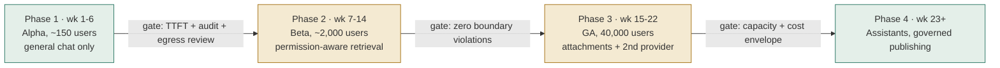
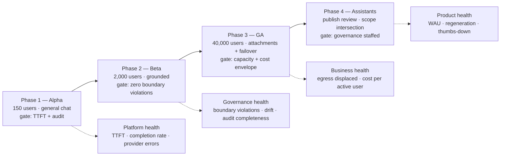
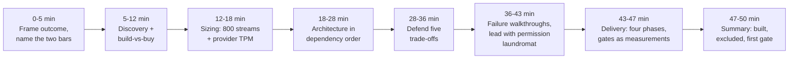

# Chapter 21 (Condensed): Enterprise Chatbot Platform — "Our Own ChatGPT", part 4

## 7. Delivery, Observability, Business Impact

### The hazard

- The demo will be impressive in two weeks — which creates pressure to launch to 40,000 people before the permission model has met real ACLs on real corpora.
- **The delivery plan exists to convert enthusiasm into sequenced risk.**

### Four phases — gates are measurements, not dates

The cohort sizes, week ranges and gate thresholds below are my plan for this case, not a standard rollout.

| Phase | Who | Adds | Gate |
|---|---|---|---|
| **1 · Alpha** (wk 1–6) | ~150 IT, AI team, volunteers | General chat only; no grounding, no attachments | p95 TTFT < 1 s for two weeks; zero audit gaps; egress security review passed |
| **2 · Beta** (wk 7–14) | ~2,000 in two departments | Permission-aware retrieval over two corpora with query-time-resolvable ACLs | **Zero permission-boundary violations**; thumbs-down under threshold; discovery runbook rehearsed |
| **3 · GA** (wk 15–22) | All 40,000 | Attachments + scanning, second provider, department budgets | Capacity validated at peak + headroom; degraded mode exercised in a game day; cost inside envelope |
| **4 · Assistants** (wk 23+) | All, with governance group | Assistant authoring with publish review | Scope-intersection verified; review staffed; deprecation lifecycle defined |

- **The shape to defend: grounding → attachments → assistants.** Each phase adds exactly one class of risk, so when something breaks you know what caused it.

### Metrics

| Metric | Class | Why it exists |
|---|---|---|
| Consumer-AI egress volume | Business | What the project was funded on; the headline measure |
| Weekly active / eligible | Product | **Adoption is the safety outcome** — low adoption means the risk persists |
| p95 / p99 TTFT | Platform | The adoption bar, versus the free alternative |
| Turn completion rate | Platform | Streams dying at 80% are failures HTTP status codes hide |
| Regeneration rate | Product | A strong implicit quality signal — users regenerate when the answer was wrong |
| Thumbs-down + free text | Product | Explicit signal, and the seed corpus for the eval set |
| Citation click-through | Product | Whether grounding is *trusted*, not just present |
| Permission-boundary violations | Governance | Target zero; any nonzero is an incident, never a trend line |
| Policy block rate **+ false-positive rate** | Governance | Read together, always — see below |
| Permission-drift divergence | Governance | Index vs. live ACLs; catches stale revocation before a user does |
| Audit completeness | Governance | Turns recorded / turns served; must be 100% |
| Cost per active user / month | Business | The number finance governs the program with |
| Cached-prefix hit rate | Business | Main token-cost lever once compaction is in |

- **The pairing that matters:** optimise block rate alone and you build a system so cautious employees route around it — reproducing the original risk behind a beautiful dashboard.

### Three audiences, same telemetry

The numbers in these three lines are illustrative, to show the shape — not results from a real rollout.

- **Board:** "Egress down 78% QoQ; 61% weekly active; zero permission-boundary incidents."
- **Department head:** "14,000 turns last month, mostly drafting and policy lookup; top unmet need was expense policy — that's the next corpus."
- **On-call:** "TTFT p95 is 1.4 s against a 1.0 s objective, driven by SharePoint connector latency, not the model."
- **An FDE who can only tell the third story will not keep the program funded.**

### Configuration vs. adapter vs. shared service vs. core

- **Configuration** (never a deploy): retention classes, quota tiers, department budgets, model allow-lists per data class, review thresholds.
- **Adapter** (the most-requested future work): each provider, each retrieval connector, each identity source. Get the connector interface right early — *authenticate as caller, list candidates, resolve live ACLs, fetch content.*
- **Shared service** (one implementation, always): policy/DLP, audit, quota. A second implementation is how a gap appears.
- **Core product** (never forked): conversation model, context assembler, streaming relay, permission-intersection rule.

### Risk register

| Risk | L | I | Mitigation | Owner |
|---|---|---|---|---|
| Adoption stalls; shadow usage continues | M | H | TTFT as a hard gate; ship general chat early; act on regeneration rate | Product + platform |
| Over-scoped assistant leaks data | M | H | Runtime scope intersection; publish review; usage-spike alerts | Platform + governance |
| Provider outage in business hours | H | M | Second provider; degraded mode; game day | Platform on-call |
| Cost exceeds envelope at full adoption | M | M | Compaction, prompt caching, model tiering, department budgets | Platform + finance |
| DLP over-blocks and frustrates users | M | H | False-positive rate as first-class metric; fast appeal path | Security + product |
| **Works-council / privacy objection to usage telemetry** | M | H | Aggregate-by-default analytics; consult before Phase 2, not after | Legal + HR |

- **That last row is the one candidates rarely include** — and works-council consultation can genuinely delay a rollout like this in European subsidiaries.

### Business impact statement

An example of the shape — the numbers are illustrative, not from a real rollout:

> "Moved AI usage from ungoverned consumer tools into a platform where every prompt is classified, every retrieval respects existing permissions, and every turn is auditable — cutting measured consumer-AI egress ~78% in two quarters at 61% weekly active use. Employees self-report ~3 hours/week saved, which we treat as directional, not precise. ~$22/active user/month against a ~$30 list-price vendor seat, with the difference justified by two connectors nobody sells."

- **Structure:** risk reduction first → adoption → **honest qualifier on the soft number** → cost comparison naming *why* building was right.
- Interviewers notice candidates who inflate self-reported time savings into hard ROI.

### Rollout and metric layers

---

## 8. Interview Walkthrough and Trade-Offs

### Two failure modes to avoid

- **The feature list** — enumerate chat, RAG, voice, images, memory, assistants; run out of time before mentioning permissions.
- **The lockdown** — a beautifully governed product nobody uses, while the risk still sits in the proxy logs.
- **Fix:** state both bars out loud, repeatedly. That's the spine of the answer.

### 50-minute plan

| Min | Do |
|---|---|
| 0–5 | Frame the outcome; name the two bars and say where they conflict |
| 5–12 | Discovery — **and ask build-vs-buy unprompted** |
| 12–18 | Sizing — lead with 800 concurrent streams and provider TPM |
| 18–28 | Architecture in dependency order; the coherence rule |
| 28–36 | Defend the five trade-offs |
| 36–43 | Failure walkthroughs — **lead with the over-scoped assistant** |
| 43–47 | Delivery: four phases, gates as measurements, config vs. adapter vs. core |
| 47–50 | Summary: what you built, what you excluded, first production gate |

### Five trade-offs, balanced

- **Buy vs. build** — *many candidates skip this; raising it first is a strong signal.* Buy = mature product in weeks, vendor carries model ops and much compliance. Build = connectors nobody sells, deployment nobody offers, control of the data path. **Honest answer: hybrid — buy the model, build orchestration, connectors, governance.** Disqualifying: building reflexively because it's interesting.
- **Vendor API vs. self-hosted** — API = best quality per unit effort, no GPU fleet, but external data path and per-token cost that scales with success. Self-host = hard boundary, fixed cost at volume, air-gap capable, but lower quality ceiling and an upgrade burden teams underestimate. **Start with API behind an abstraction; self-host only the data classes that require it.**
- **Full history vs. compaction** — full = simple, perfect fidelity, quadratic cost, eventually overflows context *silently and badly*. Compaction = roughly constant cost, unbounded conversations, occasional lost detail. **Ship the sliding window day one; add summarisation when telemetry says so; always pin the head.**
- **Always-on vs. tool-invoked retrieval** — always-on = reliable grounding, but "rewrite this paragraph" doesn't need a corpus search. Tool-invoked = cheaper and faster, but a decision that can be wrong both ways and a surface for injection. **Middle path: cheap intent classifier, plus a constrained retrieval tool whose results are still permission-filtered.** Anchor it: 400 ms of retrieval eats about 40% of a 1-second TTFT budget.
- **Strict DLP vs. adoption** — every false positive teaches employees the sanctioned tool is unreliable, and a few of those reproduce the original risk at full severity. **Asymmetric answer: block hard on narrow unambiguous categories, warn-and-log on fuzzy ones, track false-positive rate with an owner.** Say: *"security controls that drive users to unsanctioned tools are net-negative security."*

### Five follow-ups, compressed

- **Injection?** "I assume it sometimes succeeds and design so success is worthless — untrusted content carries no authority, orchestration decides tool execution, no write tools in the MVP, and permission filtering means the best case is retrieving what they could already see. Canaries in the eval set. I would not claim a better system prompt solves it."
- **eDiscovery?** "Retention class on the conversation, legal hold overriding every deletion path, a privileged endpoint requiring a case reference, and audit events for the search *and* each conversation opened — because 'who read the employee's chats' is a question someone asks. Rehearsed before launch. In some jurisdictions this surface needs works-council agreement before shipping."
- **Provider down?** "Circuit break, shift to secondary or smaller model, visible label not an error page, shed background work, bounded retries with jitter, message never lost. Tested in a game day — a failover path that has never run is a hypothesis."
- **Cost runaway?** "Per-user token and concurrency quotas, department budgets, compaction, cache-friendly context layout, task-based model tiering — and cancel the upstream stream on client disconnect, or you pay for tokens nobody reads."
- **How do you know it's working?** "Egress in the proxy logs — instrumented before we started. Then weekly active use, because adoption is the safety metric. Then regeneration rate as implicit quality, and permission-boundary violations at zero, treated as incidents."

### Weak answers → repairs

| Weak | Repair |
|---|---|
| "Add a vector DB and do RAG over the wiki." | "Retrieval is easy; resolving each caller's live permissions per chunk at query time, failing closed when the ACL service is slow, is the actual design." |
| "The system prompt will tell it to ignore document instructions." | "I assume injection succeeds sometimes and make success worthless; permission filtering is the backstop." |
| "We'd lock it down and require approval." | "A controlled tool at 8% adoption leaves the risk in place. I track DLP false-positive rate as carefully as block rate." |
| "It's basically ChatGPT — three months." | "MVP is streaming chat plus one grounded corpus. No writes, no voice, no fine-tuning, no memory. One risk class per phase." |
| "Store conversations in Postgres — that's the data model." | "Messages are a tree, retention is a named class, hold overrides deletion, and status distinguishes complete from blocked from failed." |
| "Scale pods on request rate." | "Request rate under-describes streaming — 40 turns/sec at 20 s each is 800 concurrent connections, and that sizes the relay tier." |

### Rubric

| Dimension | Strong | Weak |
|---|---|---|
| Discovery | Names shadow-AI displacement; asks build-vs-buy unprompted | Accepts "build ChatGPT" at face value |
| Estimation | Leads with concurrent streams and provider TPM | Quotes QPS and stops |
| Architecture | Per-turn auth; principal-scoped retrieval; policy on the egress path | Boxes labelled "LLM" and "vector DB" |
| Depth | Deep on scope intersection and streaming failure semantics | Spreads evenly over low-risk detail |
| Security | Layered, fail-closed, assumes injection sometimes wins | Relies on the system prompt; claims guarantees |
| Delivery | Gates as measurements; one risk class per phase; works-council row | Ends at the diagram |
| Communication | Holds both bars; qualifies soft numbers honestly | Sells; inflates self-reported savings into hard ROI |

### 90-second architecture summary (rehearse verbatim)

> "A thin orchestration layer we own over a model API we don't. Every turn: authenticate through SSO, re-authorise the specific conversation, scan and classify the input, assemble a context window from compacted history plus permission-filtered retrieval plus the assistant definition, route on classification and health, then stream while scanning a sliding output buffer, and finalise with citations, usage and an audit event on every path — complete, blocked or failed. Retrieval permissions always derive from the asking employee, never the assistant's author. Providers sit behind adapters so an outage is a route change, not an incident. MVP is chat plus one grounded corpus; no write tools, no voice, no memory."

### Worksheet

| Prompt | Cover |
|---|---|
| Clarifying questions | Model sourcing; corpora and whether ACLs resolve at query time; retention/hold/discovery; assistant publishing; identity and residency; **what rules out buying** |
| Rough estimates | DAU, turns/day, peak turns/sec, **concurrent streams**, tokens/min vs. provider quota, cost per active user |
| Trade-offs | Buy vs. build; API vs. self-host; full history vs. compaction; always-on vs. tool-invoked retrieval; strict DLP vs. adoption |
| Safety checks | Scope intersection; query-time ACLs failing closed; injection without authority; streaming output scan; audit on every path |
| Delivery gates | TTFT + audit → zero boundary violations → capacity + cost → governance staffed |
| Mock prompts | "Why not just buy it?" · "Finance assistant gets shared company-wide — what happens?" · "Provider down two hours" · "Prove nobody read a document they shouldn't have" |

### Practice plan

- **Solo:** answer aloud in 10 min, then cut every sentence that doesn't change a design decision. Many people find about half was product description.
- **Pair:** partner interrupts on "secure," "scalable," "RAG," "guardrails" and demands the mechanism and where it runs. Then have them play GC *and* frustrated employee in one session.
- **Implementation:** write the permission-intersection test against a toy corpus with three groups and two assistants, including the shared-conversation case. ~40 lines; teaches more than rereading the chapter.

### One sentence

- A platform employees **prefer to the free alternative**, where every prompt is classified before leaving the boundary, every retrieval is filtered by the asking employee's live permissions, every turn is auditable, and the provider is a dependency you have already planned to lose — and where **adoption is not a vanity metric but the safety outcome itself.**

---
