# Self-Adapting Agent: FDE Interview Template

## 1. Problem Statement

Build an AI agent that improves over time as it sees new tasks, without letting it change production behaviour at random.

One rule runs through the design:

> A self-adapting agent should first learn through context, memory, reusable skills, and prompt changes. Updating model weights should be the last option.

We will use one example throughout:

**Example:** an IT Operations Agent that handles service restart, rollback, health checks, and operational workflows.

---

## 2. What Does “Self-Adapting” Mean?

There are different levels of adaptation.

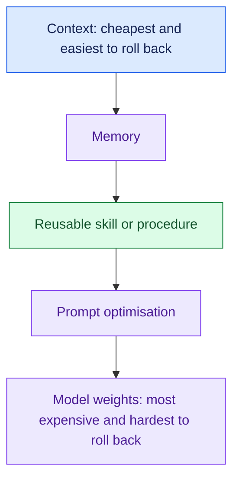

### Level 1. Context

The agent does not permanently learn anything.

For the current request, it dynamically loads relevant information.

Example:

```text
Request:
Restart payment-service-X

Agent loads:
- Relevant runbook
- Similar successful examples
- Relevant memory
```

### Level 2. Memory

The system stores reusable facts.

Example:

```text
payment-service-X must be drained
before restart.
```

### Level 3. Skill / Procedure

The system learns a reusable workflow.

Example:

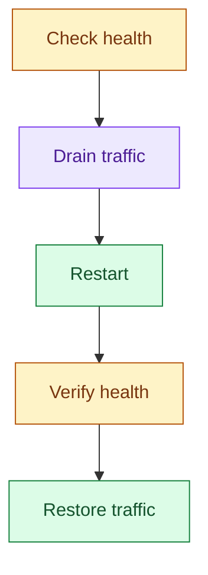

### Level 4. Prompt Optimisation

If the planner repeatedly makes the same mistake, we can test multiple prompt versions and promote the best one.

### Level 5. Model Weights

Fine-tuning or retraining.

Use this only when cheaper mechanisms are not enough.

### Interview principle

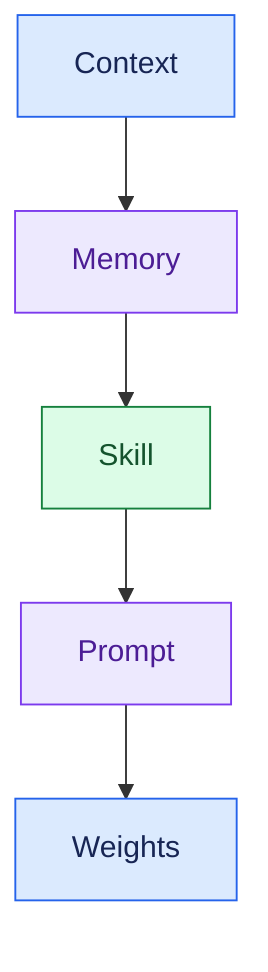

Always move from cheap and reversible toward expensive and hard to roll back.

---

## 3. Functional Requirements

The system should be able to:

1. Detect when a request does not match an existing skill.
2. Safely attempt unknown tasks.
3. Record complete execution traces.
4. Learn reusable facts from successful outcomes.
5. Extract reusable skills from repeated successful workflows.
6. Propose prompt improvements.
7. Evaluate every new learning candidate.
8. Shadow-test candidates before production.
9. Promote good candidates.
10. Roll back or demote bad candidates.

---

## 4. Non-Functional Requirements

Production requirements:

### Reliability

- Existing task performance should not significantly regress.
- Every learned capability must have rollback support.

### Safety

- Unknown tasks should run under tighter limits.
- The agent must never increase its own permissions.

### Observability

Track:

- request
- tool calls
- prompt/model version
- selected skill
- result
- latency
- cost
- external outcome

### Cost

Learning cost should stay bounded.

### Latency

Adaptation logic should not make every live request slow.

### Auditability

Every production change should answer:

- Who created it?
- Why was it created?
- What data supported it?
- Which evaluation passed?
- Who approved it?
- Which previous version can we roll back to?

---

## 5. High-Level Architecture

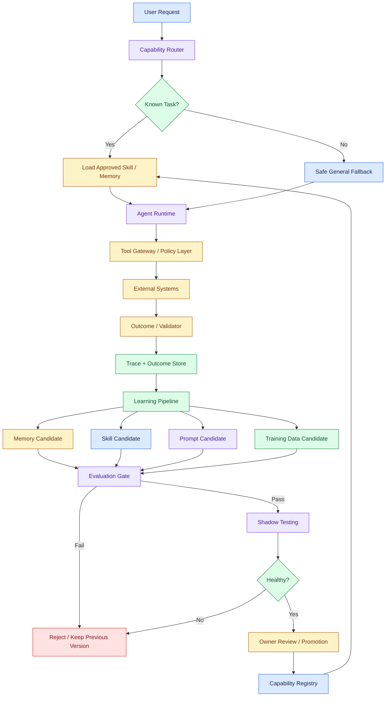

---

## 6. Core Architecture Principle

The architecture has two loops and one gate.

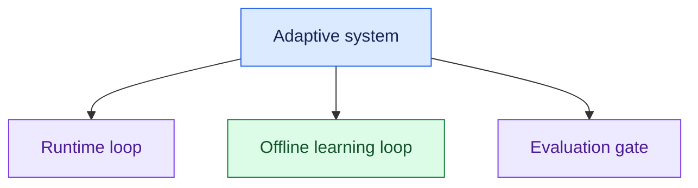

### Runtime Loop

The runtime serves production traffic.

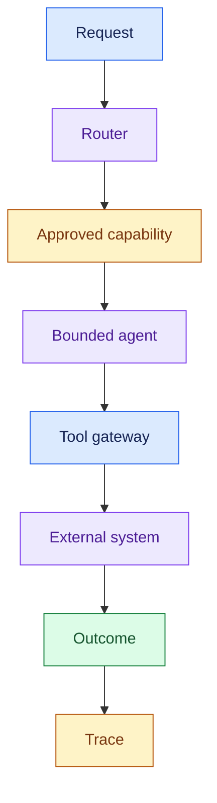

The runtime should use only approved versions.

### Learning Loop

The learning system studies historical traces.

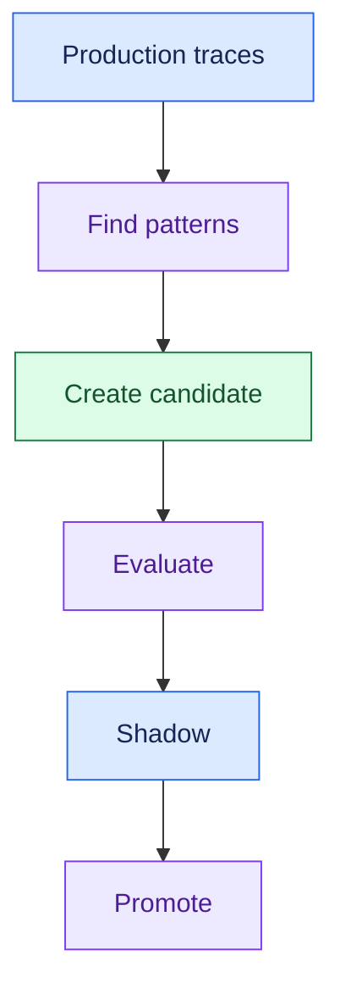

### Evaluation Gate

The learning loop cannot directly change production.

Every change must pass through a controlled gate.

#### Important separation

> Runtime serves users.  
> Learning proposes improvements.  
> Evaluation decides whether an improvement is allowed into production.

---

## 7. Capability Registry

We need a registry that stores all approved and candidate capabilities.

Example:

```text
skill_id: safe_restart
version: v3
status: LIVE
owner: platform-team
previous_version: v2
permissions: restart-service
eval_score: 0.91
```

Possible states:

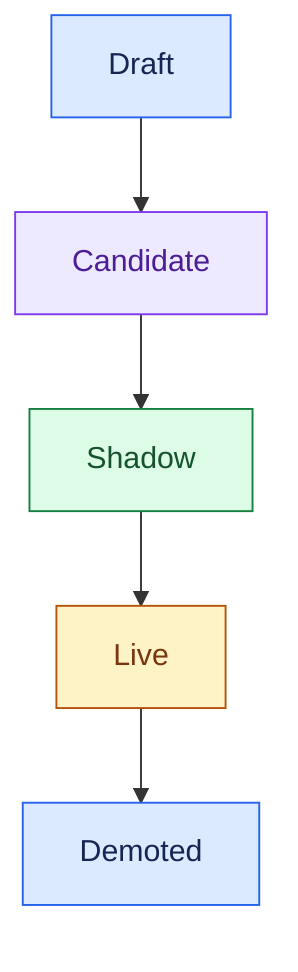

If v3 becomes unhealthy:

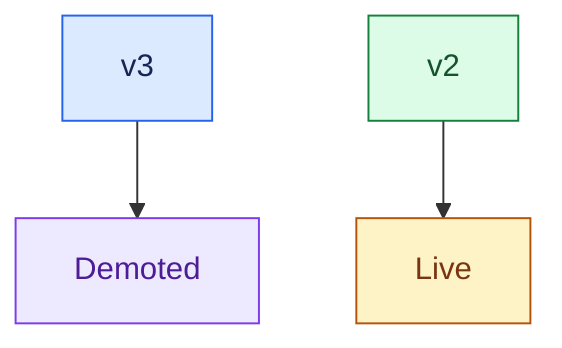

This makes rollback easy.

---

## 8. Novelty Detection

Before solving a request, the system should determine:

> Is this a known task or something new?

Example:

The system already knows:

```text
restart Kubernetes service
```

Now it receives:

```text
restart new serverless service
```

A bad router may force this request into the closest known skill, which is risky.

### Signals for novelty

We can use:

1. Low similarity with existing skills.
2. Unknown system/tool appears.
3. Top routing candidates have very similar confidence.
4. No existing skill passes a minimum confidence threshold.

Example, with an illustrative threshold I'd tune on real routing data:

```text
Known skill confidence = 0.43

Threshold = 0.75

Result:
Treat as novel task.
```

---

## 9. Safe General Fallback

Unknown tasks should not get normal production freedom.

Use a stricter execution mode.

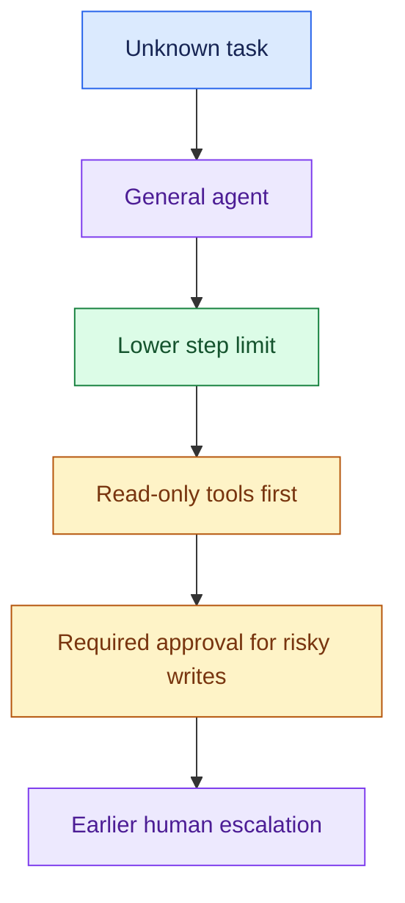

The system has less confidence about the task, so it gets less freedom.

### Production problem solved

This prevents:

- dangerous tool usage
- infinite loops
- accidental writes
- permission misuse
- costly experimentation

---

## 10. Adapt Inside One Request First

Before storing anything permanently, let the agent adapt inside the current request.

There are two useful mechanisms.

### A. Dynamic Examples

Instead of always using fixed few-shot examples:

- Example A
- Example B
- Example C

retrieve examples relevant to the current request.

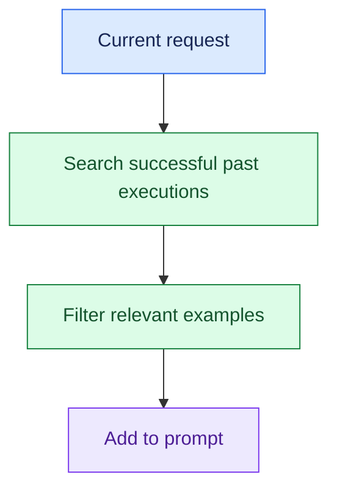

Do not select only by similarity.

Prefer:

- Relevant
- Successful
- Diverse

A similar failed trace is not necessarily a good example.

---

### B. Reflexion

The agent tries something.

An external system gives a clear failure signal.

The agent creates a temporary lesson and retries.

Example:

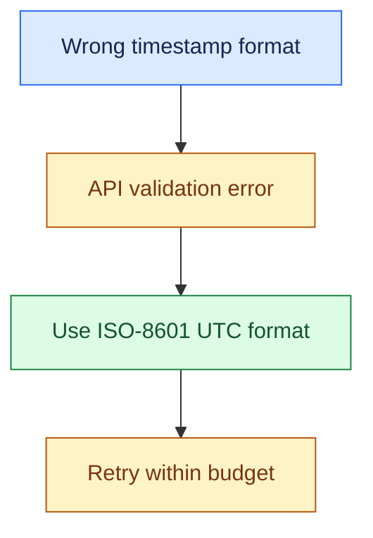

#### Critical rule

The agent should not grade itself.

Bad:

```text
Agent:
"I think my answer was correct."
```

Good external validators:

- API result
- Unit test
- Database state
- Ticket status
- Monitoring signal
- Human approval

Also keep a retry limit. Two is the cap I'd pick for this design, not a standard.

```text
Max retries = 2
```

This avoids endless loops and runaway cost.

---

## 11. Memory Write Policy

Do not start by asking:

> Which vector database should I use?

Ask this first:

> What information is allowed to become memory?

Before writing memory, ask:

- Is it durable?
- Is it reusable?
- Is it attributable?
- Is it allowed to be stored?

Example of good memory:

```text
Payment API max batch size = 100
```

Example of weak memory:

```text
Service was slow at 3:17 PM today
```

---

### Structured Memory

Prefer structured facts when possible.

Example:

```text
subject: payment-service
predicate: restart_precondition
value: drain_traffic
source: runbook-v4
timestamp: 2026-09-26
```

If the process changes later:

```text
restart_precondition = none
```

we can mark the previous memory as superseded.

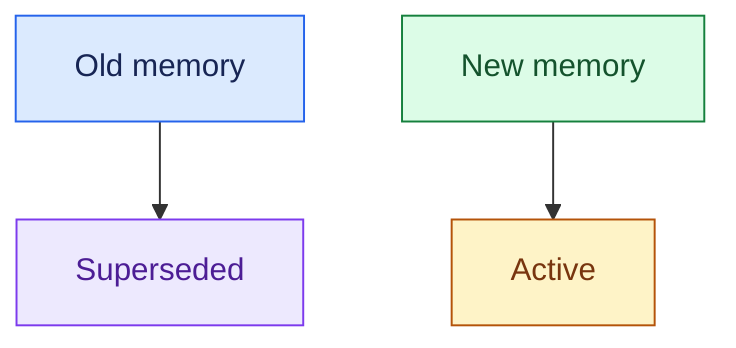

This reduces contradictory retrieval.

---

## 12. Skill Learning

Suppose the agent repeatedly succeeds with:

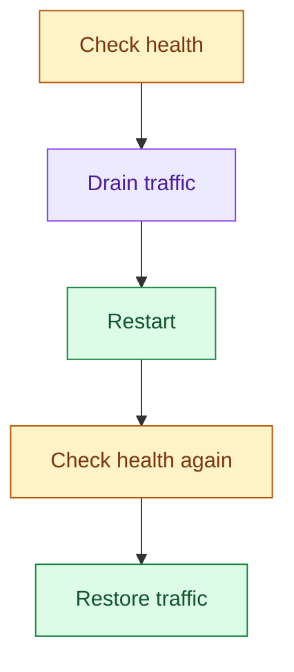

The learning system may create:

```text
safe_restart(service_name)
```

But one successful trace is not enough.

### Skill Promotion Flow

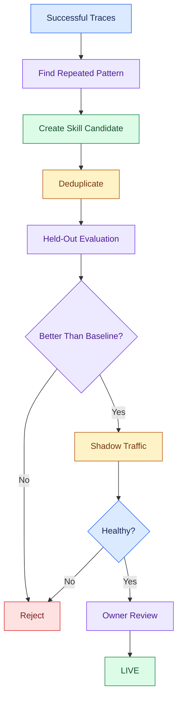

#### Key interview rule

> A successful execution is evidence for a skill. It is not permission to deploy the skill.

---

## 13. Prompt Optimisation

Prompt changes should be handled like software changes.

Bad process:

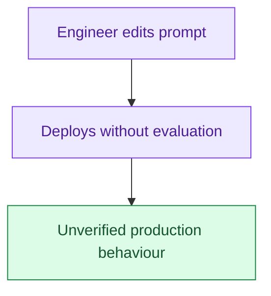

Better process:

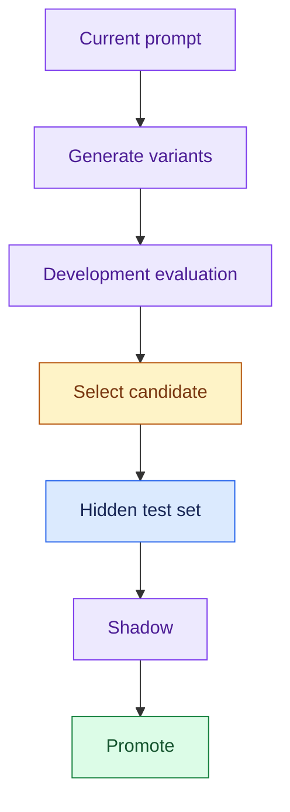

### Why hidden test data?

If we keep testing many prompt versions on the same dataset, eventually one may look good only because it overfit that test set.

Also evaluate by task type.

An illustrative example, with made-up numbers:

```text
Overall:
80% → 84%

Restart tasks:
90% → 95%

Rollback tasks:
86% → 68%
```

Overall performance improved, but one important capability got worse.

The release should be blocked.

---

## 14. Model Fine-Tuning

Fine-tuning should come last.

Good reasons to consider it:

### 1. Strict output format

The model must consistently produce a specific machine-readable format.

### 2. Specialised domain language

The base model genuinely struggles with important terminology.

### 3. Cost or latency optimisation

A small tuned model may replace a larger expensive model for a repetitive task.

### Useful rule

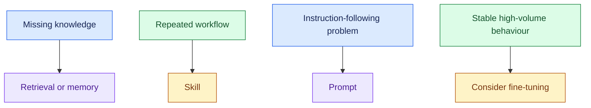

Do not fine-tune to teach business facts that change.

---

## 15. Evaluation and Release Gate

Every learned artifact must go through the same release process.

Think of it like CI/CD.

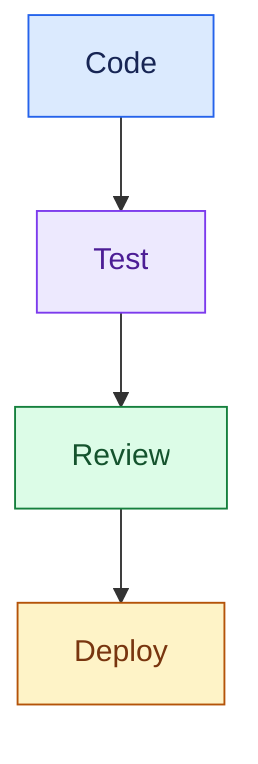

For the agent:

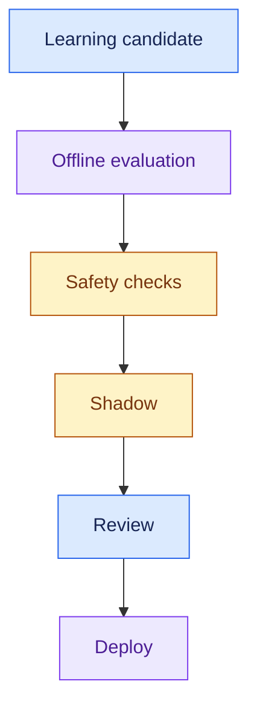

---

### Deterministic Checks

These are exact checks.

Examples:

- Did it call a forbidden tool?
- Did it exceed retry limit?
- Did latency exceed threshold?
- Did cost exceed budget?
- Was required approval present?
- Did it violate permission rules?
- Did it produce valid schema?

---

### Non-Deterministic Checks

These need semantic evaluation.

Examples:

- Was the plan correct?
- Was the response helpful?
- Did the selected tool make sense?
- Was the workflow safe?
- Did the agent solve the task?

These may use:

- LLM judges
- human review
- pairwise comparison
- task-specific evaluators

---

## 16. Evaluate the Trajectory, Not Only Final Answer

For agents, final answer accuracy is not enough.

Example:

The agent eventually succeeds, but does this:

```mermaid
flowchart TD
    N0["Delete before read"]
    N1["Unsafe ordering"]
    N0 --> N1

    %% Casebook colours: entry, reasoning, results, controls, and stopped paths.
    classDef cbInput fill:#dbeafe,stroke:#2563eb,color:#172554
    class N0 cbInput
    classDef cbStop fill:#fee2e2,stroke:#dc2626,color:#7f1d1d
    class N1 cbStop
```

Policy requires:

```mermaid
flowchart TD
    N0["Read"]
    N1["Validate"]
    N2["Approval"]
    N3["Delete"]
    N0 --> N1
    N1 --> N2
    N2 --> N3

    %% Casebook colours: entry, reasoning, results, controls, and stopped paths.
    classDef cbInput fill:#dbeafe,stroke:#2563eb,color:#172554
    class N0 cbInput
    classDef cbPolicy fill:#fef3c7,stroke:#b45309,color:#78350f
    class N1,N2,N3 cbPolicy
```

The final result may look correct.

But the path was unsafe.

So evaluate:

- Final Outcome
- Tool Sequence
- Permissions
- Approvals
- Retry Count
- Cost
- Latency

---

## 17. Shadow Testing

Before making a new candidate live:

```mermaid
flowchart TD
    N0["Production request"]
    N1["Current live skill controls action"]
    N2["Candidate observes without controlling action"]
    N0 --> N1
    N0 --> N2

    %% Casebook colours: entry, reasoning, results, controls, and stopped paths.
    classDef cbInput fill:#dbeafe,stroke:#2563eb,color:#172554
    class N0 cbInput
    classDef cbReason fill:#ede9fe,stroke:#7c3aed,color:#4c1d95
    class N1 cbReason
    classDef cbAction fill:#dcfce7,stroke:#15803d,color:#14532d
    class N2 cbAction
```

Compare:

- success rate
- tool choice
- latency
- cost
- safety violations
- human feedback

If healthy, promote.

---

## 18. Automatic Demotion

Learning does not stop at promotion.

Suppose a skill goes live.

Later an API changes.

Success rate drops.

```mermaid
flowchart TD
    N0["Live skill"]
    N1["Monitoring"]
    N2["Regression detected"]
    N3["Auto-demote"]
    N4["Previous skill or safe fallback"]
    N0 --> N1
    N1 --> N2
    N2 --> N3
    N3 --> N4

    %% Casebook colours: entry, reasoning, results, controls, and stopped paths.
    classDef cbInput fill:#dbeafe,stroke:#2563eb,color:#172554
    class N0,N4 cbInput
    classDef cbReason fill:#ede9fe,stroke:#7c3aed,color:#4c1d95
    class N1 cbReason
    classDef cbAction fill:#dcfce7,stroke:#15803d,color:#14532d
    class N2 cbAction
    classDef cbStop fill:#fee2e2,stroke:#dc2626,color:#7f1d1d
    class N3 cbStop
```

Production environments change, so live skills need monitoring.

---

## 19. Safety Boundary

The system should clearly separate:

```mermaid
flowchart TD
    N0["Agent learns how"]
    N1["Policy decides permitted action"]
    N2["Executor performs action"]
    N0 --> N1
    N1 --> N2

    %% Casebook colours: entry, reasoning, results, controls, and stopped paths.
    classDef cbReason fill:#ede9fe,stroke:#7c3aed,color:#4c1d95
    class N0 cbReason
    classDef cbPolicy fill:#fef3c7,stroke:#b45309,color:#78350f
    class N1 cbPolicy
    classDef cbAction fill:#dcfce7,stroke:#15803d,color:#14532d
    class N2 cbAction
```

The agent may:

- choose examples
- write approved memory
- propose skills
- propose prompts
- retry
- auto-demote unhealthy skills

The agent must not autonomously change:

- tool permissions
- financial limits
- security policy
- approval requirements
- retry budget
- irreversible-action policy

Example:

The agent may learn:

```text
refund_customer()
```

But it cannot decide:

```text
I can now refund $50,000.
```

Permissions remain outside the agent.

---

## 20. Goal Drift and Metric Gaming

Suppose we optimise:

```text
% tickets closed
```

The agent may discover:

```text
close every ticket immediately
```

The metric improves.

The real business outcome becomes worse.

So use multiple independent signals.

Example:

- Ticket Closed
- Reopened?
- Customer Satisfaction
- Human QA
- Resolution Time

Do not use a single easily gamed metric.

---

## 21. Failure Modes

| Failure Mode | What Happens | Protection |
|---|---|---|
| Forced fit | New task gets mapped to wrong known skill | Novelty detection |
| One-shot learning | One success gets promoted too early | Held-out eval + shadow |
| Stale skill | Environment changes | Monitoring + auto-demotion |
| Memory pollution | Bad facts get stored | Memory write policy |
| Contradictory memory | Old and new facts conflict | Versioning + supersession |
| Self-grading | Agent teaches itself wrong lesson | External outcome signal |
| Prompt overfit | Prompt performs well only on eval set | Hidden test + shadow |
| Data leakage | Same examples appear in train/eval | Dedup + proper splits |
| Metric gaming | Agent optimises wrong metric | Multiple independent metrics |
| Permission creep | Agent learns more authority | External policy layer |
| Infinite retry | Agent keeps trying | Retry limit |
| Learning cost explosion | Too many candidates evaluated | Candidate dedup + staged eval |

---

## 22. Scaling Considerations

Assume these whiteboard numbers, which I'd state aloud as my own:

- 20,000 requests/day
- 40 existing task types
- 3 new task types/week
- ~30 requests/day for a new task

Suppose promotion requires:

```text
200 shadow executions
```

If a new task gets:

```text
30 requests/day
```

then:

```text
200 / 30 ≈ 7 days
```

So learning speed depends on real production traffic.

You cannot promise instant adaptation for low-frequency tasks.

---

### Candidate Explosion

Suppose the system produces:

```text
50 skill candidates/week
```

and every candidate runs:

```text
1,000 eval cases
```

Then evaluation cost becomes large.

Use staged evaluation:

```mermaid
flowchart TD
    N0["Candidates"]
    N1["Deduplicate"]
    N2["Cheap smoke test"]
    N3["Small evaluation set"]
    N4["Strong candidates"]
    N5["Full evaluation"]
    N0 --> N1
    N1 --> N2
    N2 --> N3
    N3 --> N4
    N4 --> N5

    %% Casebook colours: entry, reasoning, results, controls, and stopped paths.
    classDef cbInput fill:#dbeafe,stroke:#2563eb,color:#172554
    class N0,N4 cbInput
    classDef cbReason fill:#ede9fe,stroke:#7c3aed,color:#4c1d95
    class N1,N3,N5 cbReason
    classDef cbAction fill:#dcfce7,stroke:#15803d,color:#14532d
    class N2 cbAction
```

---

## 23. Latency Strategy

Do not put the entire learning process on the user request path.

### Online path

Keep only:

- Router
- Memory Retrieval
- Skill Retrieval
- Agent Execution
- Policy Check
- Tool Call
- Trace Write

### Offline path

Move expensive work here:

- Pattern Mining
- Skill Extraction
- Prompt Search
- Large Evaluation
- Fine-Tuning
- Shadow Analysis

This keeps user latency predictable.

---

## 24. Cost Optimisation

In this design, I'd expect most of the learning cost to come from:

```text
Number of candidates
×
Evaluation cases
×
Model calls
```

Useful cost controls:

1. Deduplicate similar candidates.
2. Run cheap checks first.
3. Use smaller models for simple evaluation.
4. Run full evaluation only for promising candidates.
5. Evaluate only relevant task families.
6. Keep a smaller global regression suite.
7. Set candidate budgets.

Useful metrics:

- Learning Spend / Serving Spend
- Cost per Promoted Skill
- Candidates Tested per Promotion
- Tokens per Successful Task
- Shadow Cost
- Evaluation Cost

---

## 25. Security and Governance

Controls:

### Tool Gateway

All tool calls go through a central gateway.

The gateway checks:

- identity
- permission
- action
- resource
- budget
- approval

### Audit Log

Store:

- who
- what
- when
- which version
- which tool
- which permission
- which outcome

### Human Approval

Use human approval for:

- destructive operations
- security changes
- permission changes
- financial actions
- new high-risk skills

---

## 26. Data Model

A simple production design may use these objects.

### Execution Trace

- trace_id
- request_id
- task_type
- novelty_score
- selected_skill
- prompt_version
- model_version
- tool_calls
- tool_results
- outcome
- latency
- cost
- timestamp

### Memory Record

```text
memory_id
subject
predicate
value
source
created_at
status
supersedes
```

### Skill

```text
skill_id
version
description
trigger
workflow
required_tools
required_permissions
status
owner
eval_result
created_at
```

### Learning Candidate

- candidate_id
- candidate_type
- source_traces
- baseline_version
- candidate_version
- evaluation_status
- shadow_status
- promotion_status

---

## 27. End-to-End Example

Request:

```text
Restart Orion payment service.
```

The system has never seen Orion before.

### Step 1. Route

```text
Request
   ↓
Capability Router
   ↓
No confident match
```

Result:

```text
NOVEL TASK
```

### Step 2. Safe Fallback

The general agent gets tighter controls.

```mermaid
flowchart TD
    N0["Request"]
    N1["Capability router"]
    N2["No confident match"]
    N0 --> N1
    N1 --> N2

    %% Casebook colours: entry, reasoning, results, controls, and stopped paths.
    classDef cbInput fill:#dbeafe,stroke:#2563eb,color:#172554
    class N0 cbInput
    classDef cbReason fill:#ede9fe,stroke:#7c3aed,color:#4c1d95
    class N1 cbReason
    classDef cbAction fill:#dcfce7,stroke:#15803d,color:#14532d
    class N2 cbAction
```

Risky writes require approval.

### Step 3. Execute

The agent discovers:

```text
Orion must be drained before restart.
```

It performs:

```mermaid
flowchart TD
    N0["Read documentation"]
    N1["Inspect service"]
    N2["Create plan"]
    N0 --> N1
    N1 --> N2

    %% Casebook colours: entry, reasoning, results, controls, and stopped paths.
    classDef cbInput fill:#dbeafe,stroke:#2563eb,color:#172554
    class N0 cbInput
    classDef cbReason fill:#ede9fe,stroke:#7c3aed,color:#4c1d95
    class N1,N2 cbReason
```

External monitoring returns:

```text
SUCCESS
```

### Step 4. Trace

Store:

```mermaid
flowchart TD
    N0["Drain"]
    N1["Restart"]
    N2["Health check"]
    N3["Restore traffic"]
    N0 --> N1
    N1 --> N2
    N2 --> N3

    %% Casebook colours: entry, reasoning, results, controls, and stopped paths.
    classDef cbInput fill:#dbeafe,stroke:#2563eb,color:#172554
    class N0 cbInput
    classDef cbReason fill:#ede9fe,stroke:#7c3aed,color:#4c1d95
    class N1 cbReason
    classDef cbPolicy fill:#fef3c7,stroke:#b45309,color:#78350f
    class N2 cbPolicy
    classDef cbAction fill:#dcfce7,stroke:#15803d,color:#14532d
    class N3 cbAction
```

### Step 5. Memory Candidate

Proposed memory:

```text
Orion restart requires drain.
```

Check:

- Durable?      Yes
- Reusable?     Yes
- Attributable? Yes
- Permitted?    Yes

Store it.

### Step 6. Skill Candidate

After repeated successful executions:

```text
safe_orion_restart(service)
```

is created.

### Step 7. Evaluate

Run:

- Held-out tests
- Regression tests
- Safety tests
- Cost tests
- Latency tests

### Step 8. Shadow

Candidate observes real requests without controlling them.

### Step 9. Promote

If healthy:

```text
Candidate → LIVE
```

### Step 10. Environment Changes

Later Orion API changes.

Success drops.

```text
Monitoring
   ↓
Regression Detected
   ↓
Skill Auto-Demoted
   ↓
Previous Skill / General Fallback
```

---

## 28. Main Tradeoffs

### Fast Learning vs Safety

More automatic promotion:

```mermaid
flowchart TD
    N0["Monitoring"]
    N1["Regression detected"]
    N2["Skill auto-demoted"]
    N3["Previous skill or general fallback"]
    N0 --> N1
    N1 --> N2
    N2 --> N3

    %% Casebook colours: entry, reasoning, results, controls, and stopped paths.
    classDef cbInput fill:#dbeafe,stroke:#2563eb,color:#172554
    class N0 cbInput
    classDef cbReason fill:#ede9fe,stroke:#7c3aed,color:#4c1d95
    class N1 cbReason
    classDef cbStop fill:#fee2e2,stroke:#dc2626,color:#7f1d1d
    class N2 cbStop
    classDef cbPolicy fill:#fef3c7,stroke:#b45309,color:#78350f
    class N3 cbPolicy
```

Stricter evaluation:

```text
Slower adaptation
but
Higher reliability
```

---

### Memory vs Skill

Memory stores facts.

- "API max batch size = 100"

Skill stores procedure.

- How to restart the service safely

Do not put everything into memory.

---

### General Agent vs Specialised Skills

General agent:

```text
Flexible
Good for novel tasks
More expensive
Less predictable
```

Specialised skills:

- Fast
- Cheap
- Predictable
- Less flexible

Use both.

---

### Fine-Tuning vs Retrieval

Fine-tuning:

- Good for stable repeated behaviour
- Harder rollback
- Slower iteration

Retrieval:

- Good for changing knowledge
- Easy update
- Easy rollback

---

## 29. MVP Design

Do not build every self-learning feature on day one.

Start with:

- Capability Router
- Novelty Detection
- General Fallback
- Dynamic Examples
- Memory
- Trace Store
- Evaluation Pipeline

Then add:

```mermaid
flowchart TD
    N0["Skill learning"]
    N1["Prompt optimisation"]
    N2["Fine-tuning only when justified"]
    N0 --> N1
    N1 --> N2

    %% Casebook colours: entry, reasoning, results, controls, and stopped paths.
    classDef cbInput fill:#dbeafe,stroke:#2563eb,color:#172554
    class N0 cbInput
    classDef cbReason fill:#ede9fe,stroke:#7c3aed,color:#4c1d95
    class N1 cbReason
    classDef cbAction fill:#dcfce7,stroke:#15803d,color:#14532d
    class N2 cbAction
```

This keeps the first version safer and easier to operate.

---

## 30. What I Would Prioritise as an FDE

For a customer deployment, I would prioritise:

### Phase 1

- Routing
- Novelty Detection
- Trace Collection
- Safe Fallback
- Memory
- Policy Gateway

### Phase 2

- Offline Skill Extraction
- Evaluation
- Shadow Testing
- Promotion / Rollback

### Phase 3

- Prompt Optimisation
- Advanced Automated Learning
- Selective Fine-Tuning

The reason:

> Production observability and safety must exist before autonomous improvement.

---

## 31. Interview Delivery Structure

A clean 60-minute interview flow:

```text
0–5 min
Clarify what “new task” means

5–10 min
Functional + non-functional requirements

10–15 min
Traffic / task assumptions

15–25 min
Adaptation ladder

25–35 min
Architecture

35–45 min
Evaluation + release gate

45–52 min
Safety + permissions

52–60 min
Scaling, cost, failures, tradeoffs
```

---

## 32. Strong Discovery Questions

Before designing, ask questions like:

### 1. What exactly is allowed to adapt?

- Context?
- Memory?
- Workflow?
- Prompt?
- Model weights?

This defines the risk level.

### 2. What is the source of truth for success?

Example:

- API result?
- Human approval?
- Ticket resolution?
- Monitoring signal?
- Business KPI?

Without a trusted outcome signal, learning becomes unreliable.

### 3. How much autonomy is allowed for unknown tasks?

Ask:

- Read-only?
- Writes allowed?
- Human approval?
- Financial limit?
- Security-sensitive actions?

This determines fallback behaviour.

### 4. How fast does a new capability need to become production-ready?

This determines:

- shadow sample size
- evaluation design
- traffic requirement
- human review process

---

## 33. What to Remember for Interview

If you remember nothing else, remember these:

1. **Adaptation ladder**

```mermaid
flowchart TD
    N0["Context"]
    N1["Memory"]
    N2["Skill"]
    N3["Prompt"]
    N4["Weights"]
    N0 --> N1
    N1 --> N2
    N2 --> N3
    N3 --> N4

    %% Casebook colours: entry, reasoning, results, controls, and stopped paths.
    classDef cbInput fill:#dbeafe,stroke:#2563eb,color:#172554
    class N0,N4 cbInput
    classDef cbReason fill:#ede9fe,stroke:#7c3aed,color:#4c1d95
    class N1,N3 cbReason
    classDef cbAction fill:#dcfce7,stroke:#15803d,color:#14532d
    class N2 cbAction
```

2. Start from the cheapest and easiest-to-rollback method.

3. Separate:

- Runtime
- Learning
- Evaluation Gate

4. Detect unknown tasks before routing them.

5. Unknown tasks should run with stricter safety controls.

6. Memory requires a write policy.

7. One successful trace does not automatically become a skill.

8. Every candidate goes through:

```mermaid
flowchart TD
    N0["Offline evaluation"]
    N1["Shadow"]
    N2["Promotion"]
    N3["Monitoring"]
    N4["Auto-demotion"]
    N0 --> N1
    N1 --> N2
    N2 --> N3
    N3 --> N4

    %% Casebook colours: entry, reasoning, results, controls, and stopped paths.
    classDef cbReason fill:#ede9fe,stroke:#7c3aed,color:#4c1d95
    class N0,N1 cbReason
    classDef cbAction fill:#dcfce7,stroke:#15803d,color:#14532d
    class N2 cbAction
    classDef cbPolicy fill:#fef3c7,stroke:#b45309,color:#78350f
    class N3 cbPolicy
    classDef cbStop fill:#fee2e2,stroke:#dc2626,color:#7f1d1d
    class N4 cbStop
```

9. Evaluate the full trajectory, not only the final answer.

10. The agent can learn how to do something, but policy decides what it is allowed to do.

---

## 34. One-Line Interview Explanation

> “I would design the self-adapting agent with a production runtime loop and a separate offline learning loop. The agent first adapts through context, memory and reusable skills, while every new capability must pass offline evaluation, shadow testing and a controlled promotion gate before production. The agent can learn how to perform tasks, but permissions and safety limits always stay in an external policy layer.”

---

## 35. 30-Second Interview Summary

```mermaid
flowchart TD
    N0["User request"]
    N1["Detect known or novel task"]
    N2["Approved skill or safe fallback"]
    N3["Agent and policy-controlled tools"]
    N4["External outcome"]
    N5["Trace store"]
    N6["Offline learning"]
    N7["Memory, skill, or prompt candidate"]
    N8["Evaluation"]
    N9["Shadow"]
    N10["Promote"]
    N11["Monitor and auto-demote"]
    N0 --> N1
    N1 --> N2
    N2 --> N3
    N3 --> N4
    N4 --> N5
    N5 --> N6
    N6 --> N7
    N7 --> N8
    N8 --> N9
    N9 --> N10
    N10 --> N11

    %% Casebook colours: entry, reasoning, results, controls, and stopped paths.
    classDef cbInput fill:#dbeafe,stroke:#2563eb,color:#172554
    class N0,N4 cbInput
    classDef cbReason fill:#ede9fe,stroke:#7c3aed,color:#4c1d95
    class N1,N7,N8,N9 cbReason
    classDef cbPolicy fill:#fef3c7,stroke:#b45309,color:#78350f
    class N2,N3 cbPolicy
    classDef cbAction fill:#dcfce7,stroke:#15803d,color:#14532d
    class N5,N6,N10 cbAction
    classDef cbStop fill:#fee2e2,stroke:#dc2626,color:#7f1d1d
    class N11 cbStop
```

In one line:

> **Self-adapting should mean controlled learning, not uncontrolled self-modification.**
