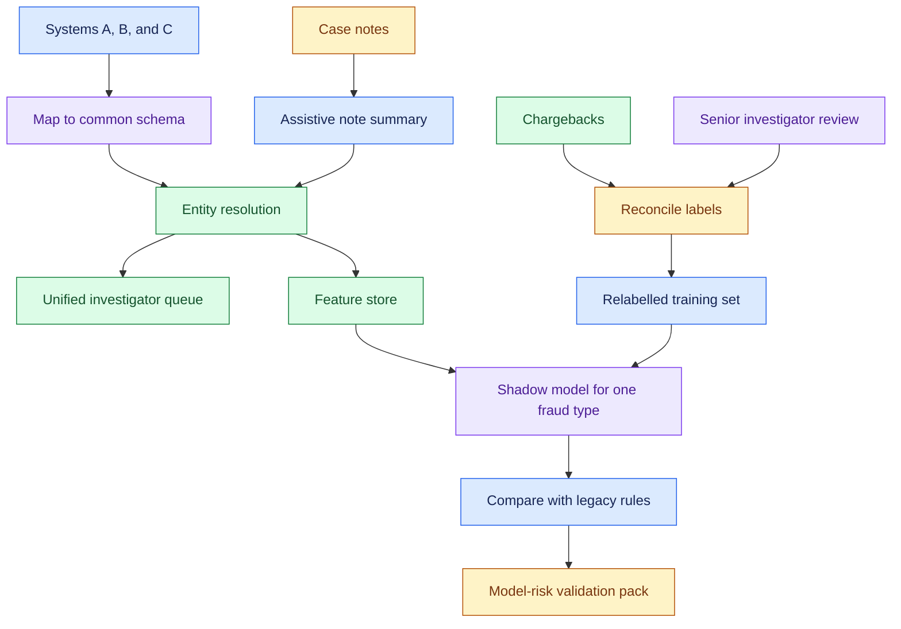
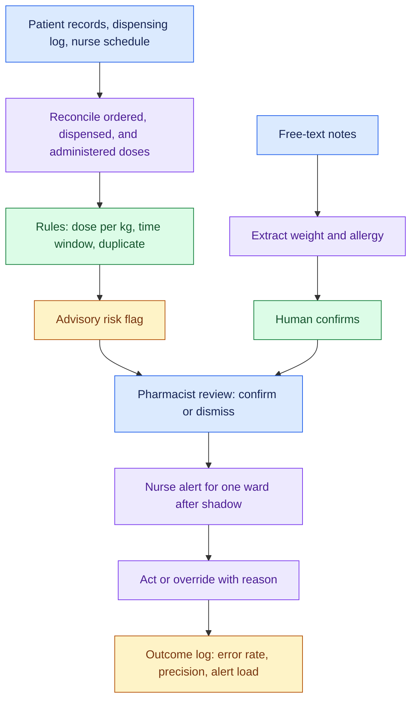
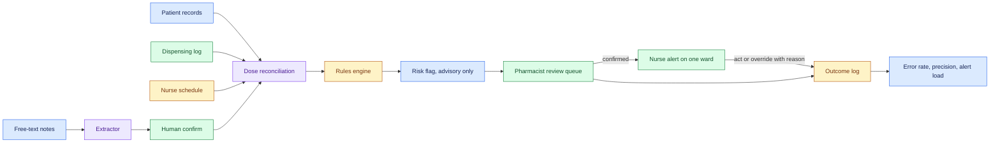

# Decomposition Classics: 911 Response Times, Bank Fraud, Medication Errors, part 2

## 6. Decompose Bank Fraud: Scope Fraud Unification in Ninety Days

*Everything in this section is (own construction). Numbers are assumptions.*

### 6.1 Clarify the mission

"Unify fraud detection" can mean three different projects. One is a single case queue for investigators. Another is one shared set of rules. The third is one new model. They carry different risk, and only the first honestly fits in 90 days.

| Ask | Assumed answer | Implication |
|---|---|---|
| What hurts today: losses, investigator workload, or customer friction? | Investigators work three queues and miss cross-system fraud | Unify the view and the entity first |
| Which fraud types matter most? | Card fraud and account takeover | Scope the first model to one type |
| What does the regulator expect before a model changes decisions? | Model risk review with documented validation | Plan a validation phase inside the 90 days |
| Can legacy systems be switched off? | No; all three stay live through the period | Run beside them, in shadow |
| Who owns "confirmed fraud"? | Each legacy team, each with its own definition | Label reconciliation is its own workstream |

### 6.2 Name stakeholders and metrics

The fraud investigators use the output. The head of fraud owns losses. Model risk and compliance approve anything that changes a decision. Customers feel false positives as declined cards.

The north-star metric is fraud losses caught per investigator hour. Guardrails sit beside it: false-positive rate on legitimate customers, alert volume per investigator, and time to decision.

### 6.3 Map the inputs

| Source | Shape | Owner | Freshness | What it can answer | Quality risk |
|---|---|---|---|---|---|
| Legacy system A: transactions and alerts | Rows, one schema | Team A | Near real time | Its own alerts and outcomes | Its "fraud" label includes chargebacks later found legitimate |
| Legacy system B | Rows, a second schema | Team B | Hourly batch | Its alerts and outcomes | Unlabelled cases mean "not investigated," not "not fraud" |
| Legacy system C | Nightly files | Team C | Daily | Its alerts and outcomes | Customer identifiers differ from A and B |
| Investigator case notes | Free text | All three teams | On case close | Why a case was confirmed or cleared | Inconsistent wording; the richest signal, the least structured |
| Chargebacks and customer disputes | Events | Card operations | Weeks to months (card dispute windows often run to about 120 days) | Late but independent ground truth | Arrives long after the transaction |

The prompt's hardest constraint sits in this table. "None of the data is labelled consistently" has two layers: the definitions differ between systems, and a missing label means something different in each. A model trained on the union of the three would learn three definitions of fraud at once.

### 6.4 Plan the ninety days

Sequence by risk. The riskiest unknown is whether one consistent label can exist at all. So the label workstream starts on day one, beside entity resolution.

| Days | Phase | Exit gate | Signed by |
|---|---|---|---|
| 1–15 | **Discover.** Data access, profiling per system, one written definition of confirmed fraud per type | Access is live; profiling report published; draft label definition exists | Head of fraud; data owners |
| 16–40 | **Unify.** Entity resolution across A, B and C; relabel a stratified sample of past cases to the new definition | Match rate measured on a hand-checked sample; relabelled set reviewed by senior investigators | Senior investigators |
| 41–60 | **Single queue.** One investigator view across all three systems, with cross-system entity links; no new model | Investigators use the unified queue; cross-system cases now visible | Head of fraud |
| 61–80 | **Shadow model.** A first model on one fraud type, scoring in shadow beside legacy rules | Beats legacy rules on the relabelled holdout at the agreed false-positive rate | Model risk |
| 81–90 | **Validate and decide.** Model documentation, validation pack, go or no-go for a limited pilot | Model risk approval, or a documented reason to wait | Model risk; compliance |

The honest 90-day deliverable is the single queue plus a validated shadow model, not a new production model deciding on transactions. Say so early; that is the regulatory realism the source asks for.

### 6.5 Choose the model last

The first value comes with no model at all. Entity resolution plus a single queue shows fraud that crosses the three systems, which none of them could see alone.

- The model then follows from the labels. With a few thousand relabelled cases, a gradient-boosted classifier over transaction features is the sensible first choice.
- Model risk reviewers can follow its explanations. Graph features over the resolved entities come next, since fraud rings show up as shared devices and accounts.
- A language model gets one bounded role: summarising case notes for investigators, and extracting structured reasons from them to help relabelling.
- A human still confirms every label.

### 6.6 Draw the architecture

```mermaid
flowchart LR
  A[System A] --> I[Ingest to one schema]
  B[System B] --> I
  C[System C] --> I
  I --> E[Entity resolution]
  E --> Q[Unified investigator queue]
  E --> F[Feature store]
  N[Case notes] --> S[Note summariser]
  S --> Q
  CB[Chargebacks] --> L[Label reconciliation]
  R[Senior investigator review] --> L
  L --> F
  F --> M[Shadow model]
  M --> V[Compare with legacy rules]
  V --> MR[Model-risk validation pack]

    %% Casebook colours: entry, reasoning, results, controls, and stopped paths.
    classDef cbInput fill:#dbeafe,stroke:#2563eb,color:#172554
    class A,E,S cbInput
    classDef cbReason fill:#ede9fe,stroke:#7c3aed,color:#4c1d95
    class I,CB,M,V cbReason
    classDef cbAction fill:#dcfce7,stroke:#15803d,color:#14532d
    class B,Q,F,L cbAction
    classDef cbPolicy fill:#fef3c7,stroke:#b45309,color:#78350f
    class C,N,R,MR cbPolicy
```

| Component | Job | Why it exists |
|---|---|---|
| Ingest to one schema | Map three schemas to one | Nothing else can compare across systems |
| Entity resolution | Decide which customers, cards and devices are the same | Cross-system fraud is invisible without it |
| Label reconciliation | Apply one definition of confirmed fraud | The prompt's core problem |
| Unified investigator queue | One place to work every case | The first delivered value, with no model risk |
| Note summariser | Condense free-text case history | Speeds investigators; decides nothing |
| Shadow model | Score transactions without acting | Earns evidence before any decision changes |
| Validation pack | Document data, method, performance and limits | What model risk needs to approve a pilot |

### 6.7 Evaluate against a label you trust

Hold out a relabelled sample that no training run ever sees. Compare the shadow model with the legacy rules on that holdout, at a fixed false-positive rate. The claim to prove is a higher catch rate at the same customer friction.

Score chargebacks separately, as a late but independent check. They arrive weeks or months after the transaction, so they validate rather than train. Measure the note summariser against investigator judgement on a sample, never as a label source.

### 6.8 Name the failure modes

| Failure | Consequence | Control |
|---|---|---|
| Training on the raw union of three label definitions | A model that learns the labelling team, not the fraud | Train only on the reconciled label |
| Reading "unlabelled" as "legitimate" | Uninvestigated fraud becomes negative training data | Treat unlabelled as unknown; sample and relabel |
| Entity resolution merges two real customers | One customer's fraud blocks another's card | Match threshold set on a hand-checked sample; merges reviewable |
| A model changes decisions before validation | Regulatory breach | Shadow only until model risk signs |
| The summariser invents a reason | Wrong label enters training | Summaries assist; a human writes the label |

### 6.9 Adapt when a legacy system cannot be accessed

Assume the interviewer says system C's vendor will not release data for 60 days. Re-derive: deliver the single queue across A and B, and design entity resolution to accept C when it arrives. Then say what that costs. Cross-system fraud touching C stays invisible, so report the queue's coverage as two of three systems and do not claim unification.

---

## 7. Decompose Medication Errors: Start Medication Safety at the Human Check

*Everything in this section is (own construction). Numbers are assumptions. Clinical practice named here is general knowledge, not sourced material.*

### 7.1 Clarify the mission

The source says this case tests safety-first decomposition. Start with what the system may do. The only answer that survives a hospital's review is narrow: flag risk for a nurse or pharmacist, never change an order.

| Ask | Assumed answer | Implication |
|---|---|---|
| Which errors matter: wrong dose, wrong drug, wrong time, missed dose? | Missed and late doses of time-critical drugs, and wrong-dose opioids | Start with two error types, not all of them |
| How are errors recorded today? | Voluntary incident reports, known to undercount | Build a measured error rate before claiming a reduction |
| What must a clinician confirm? | Every alert is advisory; clinicians act | The system flags, a human decides |
| What alerts already exist? | Pharmacy checks at order time | Avoid duplicating them, and avoid adding noise |
| Who governs clinical decision support? | A pharmacy and therapeutics committee | It approves thresholds and rules |

Alert fatigue hides behind "safety-first." A system that fires constantly gets ignored, and I'd argue an ignored alert is worse than none. So precision is a safety property here.

### 7.2 Name stakeholders and metrics

Nurses administer the drugs. Pharmacists verify orders. The chief nursing officer owns ward practice. Patient safety leads own the error measurement. Patients bear the harm.

The north-star metric is the measured rate of target errors per 1,000 doses administered after surgery. Guardrails sit beside it: alerts per nurse per shift, alert override rate, and time added to administration.

### 7.3 Map the inputs

| Source | Shape | Owner | Freshness | What it can answer | Quality risk |
|---|---|---|---|---|---|
| Patient records | Orders, allergies, weights, labs, notes | Clinical informatics | Minutes | What was ordered, and for whom | Weight missing or stale; free-text notes |
| Pharmacy dispensing logs | Rows per dispense | Pharmacy | Real time | What left the pharmacy, when | Dispensed is not administered |
| Nurse assignment schedules | Nurse to patient to shift | Nursing management | Per shift | Who was responsible, and their load | Swaps and float staff not updated |

The finding is the gap between the first two rows. The data shows ordered and dispensed. It may not show administered. If bedside barcode scanning exists, administration records close the gap. If not, the first slice has to measure errors by reconciling orders against dispensing times.

### 7.4 Sequence by risk

| Order | Workstream | Why here |
|---|---|---|
| 1 | Measure: reconcile orders, dispensing and administration into a baseline error rate | Without a baseline, no reduction can be claimed |
| 2 | Find where errors cluster: drug, ward, shift, nurse load | Chooses the intervention |
| 3 | Retrospective rules, validated by pharmacists | Proves precision before anything reaches a ward |
| 4 | Advisory alerts on one ward, in shadow first | Adoption and alert fatigue are tested on real shifts |

The nurse schedule enters at step two, not as a target. It answers whether errors rise with patient load or at handover. That answer should drive staffing and handover decisions, never a score for individual nurses. A tool seen as surveillance tends to lose honest incident reports.

### 7.5 Build the first slice

The first slice is retrospective. Take three months of post-surgical orders for the target drugs. Reconcile each scheduled dose against dispensing and administration records. Flag doses that were late, missed, or outside the weight-based range. Pharmacists review a sample of flags and mark each true or false.

That gives a baseline error rate and a precision figure for the rules at once, without touching a patient.

The model comes last. Rules cover the first version: dose range per kilogram, time windows for time-critical drugs, duplicate therapy. A learned risk score comes later, ranking which patients need a pharmacist review first. A language model has one narrow role: extracting weight or allergy from free-text notes when the structured field is empty. A human confirms every extraction.

### 7.6 Draw the architecture

| Component | Job | Why it exists |
|---|---|---|
| Dose reconciliation | Line up ordered, dispensed and administered per dose | Produces the baseline and the signal |
| Rules engine | Apply committee-approved checks | Explainable, auditable, fast to change |
| Pharmacist review queue | Confirm a flag before it reaches a nurse | The human check that keeps precision high |
| Nurse alert | Show a confirmed risk at the right moment | The intervention itself |
| Extractor with human confirm | Fill missing structured fields from notes | Never writes to the record unconfirmed |
| Outcome log | Record every flag, action and override | The evaluation data and the audit trail |

### 7.7 Evaluate for precision and harm, not accuracy

Three numbers gate the pilot. First, precision of flags, measured by pharmacist review; low precision breeds alert fatigue. Second, recall on known incidents: how many reported errors the rules would have caught. Third, the measured error rate on the pilot ward against a matched ward.

Watch alert load per nurse per shift as a hard ceiling. Read override reasons weekly. A cluster of identical overrides means a rule is wrong.

### 7.8 Name the failure modes

| Failure | Consequence | Control |
|---|---|---|
| Too many alerts | Nurses ignore all of them, including the real ones | Pharmacist confirmation first; per-shift alert ceiling |
| A stale weight drives a dose check | A false alarm, or a missed overdose | Weight age shown with every flag; stale weight is itself a flag |
| Dispensed read as administered | Missed doses stay invisible | Use administration records, or say plainly they are missing |
| Schedules used to rank nurses | Reporting stops; safety culture erodes | Aggregate by ward and shift only; governance rule |
| System outage | Loss of a secondary check | Existing pharmacy checks remain the primary control |

### 7.9 Adapt when administration records do not exist

Assume the interviewer says there is no bedside scanning. Re-derive: measure what can be measured, which is ordered against dispensed timing. Say what that misses: wrong-patient and wrong-time administration stay invisible. The strongest recommendation may then be bedside scanning itself, not software. Saying so is the "is AI the right solution" judgement the question bank asks for.

---
