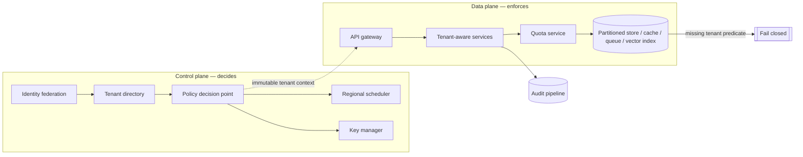

# Secure Multi-Tenant AI Platform - Answer Key

Try the worksheet before you read this key. It shows what a strong GenAI FDE candidate asks, designs, measures, secures and explains on the way from a demo to a production system.

## Strong discovery questions
- For the first release, which classes of tenant data are in, and which have we deliberately left out?
- Are the regional controls fixed rules, nice-to-haves or one-off deals for particular customers? The answer changes how we route, store, back up and log.
- When people say "predictable performance", do they mean latency, throughput, time spent queued or fair shares between tenants?
- Which tenants may sit on shared infrastructure, and which need a dedicated tier? That tells us whether we run one topology or a hybrid.
- What will auditors ask to see: access reviews, data lineage, logs or snapshots of policy?
- Which failure would cost us most: leaked data, an outage, slow inference or traffic sent to the wrong region?
- Do customers supply the identity provider and the encryption keys themselves? Must deletion be guaranteed, or is best effort acceptable?
- Is the load steady, spiky, lopsided or a mix of these? How much noisy-neighbour impact can we live with?

## Strong functional requirements
- Core workflow: a user signs in through their organisation's IdP. The platform turns that into tenant context that cannot change, authorises the call and runs inference for that one tenant only.
- Give the control plane tenant awareness. Through it we onboard tenants, attach policies, set configuration, manage keys and log every admin action.
- Pass tenant identity and policy along every hop of the data plane. No service should work out tenancy again from loose metadata.
- Apply each tenant's policy, quotas, keys and settings through shared code. No customer gets a bespoke branch.
- Send requests and artifacts only to permitted regions, and keep or delete them as the tenant's policy says.
- Keep a dedicated deployment tier as a deliberate way out for unusual customers, not as the starting point.

## Strong non-functional requirements
- Latency: measure p95 for each tenant and alert on it separately. With a 2-second budget we must cut hops; a 15-second budget leaves room for durable queues.
- Availability: plan for the shape of the load rather than its average. This case assumes a 200 QPS peak with 20x skew, so treating tenants as uniform is unsafe.
- Security: no tenant may ever read or write another tenant's data. We take tenant context from a verified identity. The request body is never trusted for it.
- Compliance: an append-only audit log records tenant, actor, action, resource and decision, and each tenant's policy sets how long it is kept.
- Reliability: keep contention bounded and the blast radius scoped to tenants. A faulty policy or deploy should reach as few tenants as possible.
- Cost: `C_tenant = C_fixed/N + C_usage + C_isolation`. Isolation costs extra, so buy it only when a stated requirement demands it.

## Architecture explanation
- We establish who the tenant is once. From then on that identity is fixed and every later decision depends on it; no step decides tenancy a second time.
- The control plane settles who can do what, in which region and within which limits. It covers identity federation, the tenant directory, the policy decision point, the regional scheduler, quota settings and key choice.
- The data plane carries out the work. Inference workers, queues, caches, partitioned databases and indexes, tenant-aware services and the API gateway all live here.
- Order matters. Federate identity first, then look up the tenant's membership and posture, then evaluate policy. Only after that does the gateway admit the request, before anything costly runs.
- Tenant-aware services act only on the fixed context. Partitioned stores use the tenant key twice: in how data is laid out and in every query predicate.
- Before inference, the quota service enforces limits on concurrency, tokens and bursts. The key manager picks the tenant's encryption context, and the regional scheduler runs the work in a permitted region.
- Isolation has seven layers, each checking on its own: key, vector index, log, queue, cache, object and row. If one check is missed, the others still hold.
- The audit pipeline writes tenant-scoped events just after each action. No cache is ever trusted as the record of membership or authorisation.

## Data model / integration assumptions
- Tenant(id, region, tier, key_ref, retention_policy); Membership(user_id, tenant_id, role, status); UsageLedger(tenant_id, period, tokens, requests, cost); AuditEvent(tenant_id, actor, action, resource, decision).
- Each of these four records marks a boundary of ownership as well as a table. In order, they stand for who owns the data, who holds authority, who controls the commercial side and how we defend our decisions.
- Retention lives in the data model. It hangs off the tenant record, or off a versioned policy that record points to, so no service has to dig policy out of fragile config.
- Every write boundary uses two guards. An idempotency key stops a retry from writing twice, and optimistic concurrency stops two writers from overwriting each other's update.
- Model output never enters the system as raw text. We parse it into a typed schema and check it against policy before saving it. The typed boundary is where the application begins.

## Red-team risks
- a query with no tenant predicate, cache keys that ignore the tenant, metadata leaking through a shared queue, one tenant draining the shared quota, traffic routed to the wrong region
- A tenant predicate left out of a query, a cache lookup, an export job or an admin action. The system has to fail closed rather than return any row that happens to match.
- Cache bleed: the database stays protected, but a shared cache serves one tenant an object that belongs to another. Handle it as a security incident, not a speed problem.
- A shared queue or dead-letter channel whose metadata shows the shape of another customer's workload, even though the payload itself is encrypted.
- Vector-index leakage: semantic search returns a nearby customer's content. At ingestion nobody tagged the vectors with a tenant namespace or tenant metadata, so the query-time filter had nothing reliable to work with.
- A noisy neighbour uses up the model quota. That breaks fairness and reliability rather than confidentiality, and only the offending tenant should feel the slowdown.

## Rollout plan
- Week 0-1: identify stakeholders, the failure we fear most and how success will be measured, and list what the MVP leaves out.
- Week 1-2: set up internal test tenants. Show that identity flows end to end, that rows are filtered, that partitioning works and that every admin action can be traced to a person.
- Week 2-3: attack the isolation boundary on purpose: replayed tokens, stale caches, missing predicates and attempts to reach across tenants.
- Week 3-4: do not promote until those attacks all fail. A single boundary failure we cannot explain keeps external tenants out.
- Week 5: admit shared tenants with low risk, put them on cautious quotas and keep support on call.
- Week 6-8: confirm the boundaries hold and latency stays on target, and that operators can explain an incident from evidence rather than guesswork.
- After pilot: grant the dedicated tier when measurable thresholds are met, not to whichever customer pushes hardest.

## Evaluation plan
I chose these thresholds for this case. They are not industry standards, so be ready to defend them rather than recite them.

| Metric | What it proves | Strong threshold | Dataset / method |
|---|---|---|---|
| Cross-tenant incident count | The platform keeps its main promise | No confirmed incidents; one incident stops promotion | Review of incident reports and audit logs |
| Isolation-test pass rate | Under attack, the boundary fails safely and in plain sight | Every test passes; a new boundary failure blocks the release | Suite of adversarial negative tests |
| Per-tenant p95 latency | Sharing capacity does not make it unpredictable | Inside the SLO for every tenant, not only overall | Request telemetry split by tenant |
| Quota rejection rate | Quotas shield neighbours without rejecting good requests | Low, with a reason for each tenant class | Admission and quota logs |
| Cost per tenant | The savings from pooling appear | Inside the expected range for that tenant class | Billing matched to each tenant's usage |
| Regional failover time | Residency and recovery commitments hold in a real outage | Inside the agreed RTO | Failover drills and game days |

## Weak answer
I'd run microservices on Kubernetes, add a tenant_id column to every row and switch on row-level security. This is weak because it starts from the tooling and never names a customer outcome. It also treats a single row label as the entire defence, forgets caches, queues, vector indexes, backups and regional routing, and has no answer for a query that leaves the predicate out.

## Average answer
I'd build a shared platform with authorisation per tenant, quotas to hold back noisy neighbours and regional routing to meet residency rules. I'd also log for audit and watch each tenant's latency. Better, but it never says where tenant context comes from, it does not make the isolation layers agree with each other, and it gives no rule for when a customer should move to dedicated infrastructure.

## Strong answer
My default is a shared platform, because pooling is what makes 500 tenants affordable. Isolation then has to be defensible, not absolute. I take tenant context once, from verified identity and never from the request body, and after that nothing can change it. The control plane chooses policy, region, quota and key. The data plane enforces those choices at the gateway, in each service and in every store. Seven layers check independently, so a single missed check does not become a breach, and a query without a tenant predicate fails closed. Before any external tenant arrives, an adversarial isolation suite has to pass. Then I'd move through internal tenants and small shared tenants, and offer a dedicated tier only when policy and cost justify it. The test is whether the boundary holds and whether we recover from failure without widening the blast radius.

## Interviewer scorecard
| Area | 1 - Weak | 3 - Average | 5 - Strong |
|---|---|---|---|
| Problem framing | Goes straight to Kubernetes and microservices | Lists who the tenants are and sets a goal for isolation | Pulls the business result apart from the feature, picks shared by default with a way out |
| Requirements | "Keep tenants apart" | Covers functional needs and a few limits | MoSCoW split, safety goals you can measure, stated MVP exclusions, each traced to a component |
| Architecture | A line of generic services | Gateway, policy and partitioned storage | Separate control and data planes, fixed dependency order, immutable context, enforcement that fails closed |
| Data/integration | Refers to a tenants table | Names the core records | Ownership boundaries, retention held in the model, idempotency together with optimistic concurrency |
| Evaluation | "We would test isolation" | A few negative tests | Adversarial suite used as a gate, latency per tenant, quota rejections, cost per tenant, failover drills |
| Safety/security | "tenant_id on every query" | Adds RBAC and audit logs | Defence in depth over key, vector, log, queue, cache, object and row; blast radius as the unit of design |
| Rollout | Opens to every tenant at once | Pilot first, then grow | Starts with internal tenants, gates on isolation, then small shared tenants, then a dedicated tier, each with an owner and a rollback |
| Communication | Reads the whiteboard out loud | Clear, but generic | Opens with the outcome, states assumptions, invites the interviewer to redirect, ends on the first production gate |

## Final 2-minute spoken answer
I wouldn't open with the model. The ask is one AI application for 500 tenants, and I'd first separate that feature from the business result. The result is a shared platform that keeps costs down, with isolation we can defend and a dedicated route for the exceptions. There are four stakeholders, so there are four versions of success. I'd pin down which data classes are in scope and whether regional controls are hard rules. I'd also ask what predictable performance means to them and which failure would hurt most. My starting point is shared by default, with isolation in tiers. One rule is not up for debate. We derive the tenant from a verified identity, not from anything in the request body, and once set it stays fixed. In the control plane, I'd federate identity, look up the tenant directory, evaluate policy, pick the region and choose keys. In the data plane, the gateway admits the request and quotas apply before any costly inference. After that, the system only touches resources scoped to that tenant. Isolation has seven layers, each checking on its own: key, vector index, log, queue, cache, object and row. One missed check is therefore not a breach. If a query arrives without a tenant predicate, it fails closed instead of returning whatever matches. I'd plan capacity for the shape of the load, not the average, because with the 20x skew we're assuming a handful of tenants drive the peak. No tenant goes live until the adversarial isolation tests pass. Next come internal tenants, then small shared tenants, and last a dedicated tier granted on measurable thresholds. Success means people adopt it, the workflow gets better and the operations team can keep it running.
