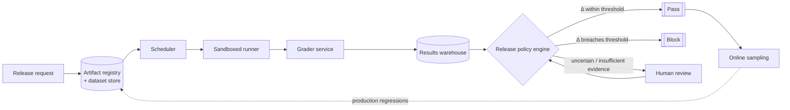

# LLM Evaluation and Release-Gating Platform - Answer Key

Try the worksheet before you read this key. It shows what a strong GenAI FDE candidate asks, designs, measures, secures and explains on the way from a demo to a production system.

## Strong discovery questions
- Which changes count as a release? Every prompt tweak, only a model swap, or only a production deploy?
- What does a candidate need to show to pass? Human rubric scores, automated checks, safety limits, latency budgets, or the full set?
- Which failure hurts most here: a wrong answer, a policy breach, latency creeping up unseen, runaway cost or a misused tool?
- Who has authority to override a failed gate, and where does that override get logged?
- Do the 30 applications share evaluation data, or does each one need its own datasets and policies?
- Which checks have to run offline before release? Which ones belong online, fed by sampled or shadow traffic?
- What labels and human reviewers do we have? When reviewers disagree, how do we keep that signal instead of throwing it away?
- How much regression is acceptable for each class of application? Without those limits nobody will believe the gate.

## Strong functional requirements
- Core workflow: the owner of a release puts forward a candidate change. The platform measures it against a pinned baseline and answers pass, block or hold, with the evidence attached.
- Put a version on every dataset, prompt, model, tool and grader. Nothing else lets you replay a decision later.
- Offer deterministic and probabilistic evaluations side by side. Some checks have to give the same answer every time, while others rely on judgement against a rubric.
- Always score a candidate relative to the pinned production baseline. An absolute score on its own says little.
- Include human review, and treat disagreement between reviewers as a signal in its own right that goes into the release record.
- Feed production failures back into later test suites, with privacy protected. The tests then grow along with the product.

## Strong non-functional requirements
- Latency: the gate has to complete within the release window. I'd say a p95 run time above roughly 20 minutes is where the gate starts blocking people.
- Availability: design for the peak, not the average. If 30 teams all release in the same business hour, a design sized on the daily average falls over.
- Security: treat the sandboxed runner as nearly hostile. Enforce timeouts, limit egress, scope secrets tightly and cap concurrency for each run.
- Compliance: isolate tenants and their data. Traces, labels and evaluations from one application must never show up in another team's workspace.
- Reliability: if evidence is missing, the release decision fails closed. A run that is incomplete or not yet validated never earns an approval.
- Cost: split suites into tiers, since this case expects about 3,000,000 test-case executions every day. When every release is expensive, teams find ways to skip the gate.

## Architecture explanation
- Keep a control plane that chooses what to evaluate apart from a data plane that runs it. Policy then stays deterministic even when runners are slow or broken.
- Each candidate's definition is frozen in the artifact registry, our system of record. It holds the model ID, the prompt version, the tool allowlist, the retrieval settings and the baseline reference. A candidate cannot shift while a run is in progress.
- The dataset store holds suites, labels, rubrics and scenario metadata. Between them, the registry and the dataset store pin down what was tested and what it was compared against.
- The evaluation scheduler spreads work out asynchronously. Quotas per tenant and admission control stop one busy application from starving all the others.
- The sandboxed runner carries out prompts, model calls and tool calls in isolation. We treat it as an execution boundary we do not trust.
- Scoring sits with the grader service, which rates safety, cost, latency and whether the task succeeded. When the grader is unsure or the rubric is unclear, it hands the case to a human.
- The results warehouse stores outcomes per run and in aggregate. The release policy engine reads only records that are complete and validated, then judges `Δ = Metric_candidate − Metric_baseline` against the thresholds.
- After rollout, an online sampling pipeline watches live or shadow traffic. It links evaluation before release to monitoring after it.

## Data model / integration assumptions
- EvalArtifact(id, type, version, hash); EvalCase(id, input_ref, expected, rubric, sensitivity); EvalRun(id, candidate, baseline, status); EvalResult(run_id, case_id, scores, trace_ref).
- Nobody edits an artifact in place. Each new version gets a fresh ID, so we can always rebuild an earlier decision.
- An EvalRun only ever moves forward through its states: submitted, queued, running, then completed, failed or blocked.
- Once an EvalResult is written it does not change. The one exception is an explicit correction that supersedes it and carries its own version.
- The decision record and a redacted summary of scores are kept longer than the raw trace. A shorter retention rule for traces therefore never breaks the audit trail.

## Red-team risks
- a grader that prefers wordy answers to correct ones, test sets gone stale, candidates tuned to the benchmark, PII inside online samples, tiny runs that look convincing
- The grader gives long answers high marks. Scores drift towards verbose responses that do not match the facts well.
- The test set goes stale. It stops telling candidates apart, and incidents pile up in areas it never covered.
- A candidate overfits the benchmark. Offline numbers jump while real-world behaviour stays flat or gets worse.
- Samples taken online contain customer secrets, retrieved documents, prompts or PII. These then leak into prompts, analytics or logs that developers can read.
- A small sample breeds false confidence. Every score looks fine, but the run is too narrow to back a release decision.

## Rollout plan
- Week 0-1: define what the gate covers, what evidence it demands to pass, who can override it and the regression limits for each application.
- Week 1-2: run one critical application through the platform from start to finish instead of bringing all thirty on board.
- Week 2-3: check the automated graders against a sample of human labels. Include answers that are short and right as well as answers that are long and wrong.
- Week 3-4: keep the gate in advisory mode until agreement between humans and graders on that application is steady enough to rely on.
- Week 5: bring in latency and cost gates next to quality and safety. No dimension should get better while another slips unnoticed.
- Week 6-8: grow onto a shared schema with rubrics specific to each application. Tenant isolation and quotas stay in place.
- After pilot: widen the rollout only while escape rate, flaky-case rate and coverage all stay healthy. Retire any suite from gating once it no longer separates good candidates from bad.

## Evaluation plan
These are thresholds I'd pick for this case. They are not industry standards, so be ready to defend them rather than recite them.

| Metric | What it proves | Strong threshold | Dataset / method |
|---|---|---|---|
| Release regression escape rate | The gate really stops harmful changes before production | Under 5% over a rolling 30 days; no severe escapes in critical apps | Compare release outcomes with incident tickets |
| Human-grader agreement | The automated grader is reliable enough to gate | 85% or higher on a stable rubric | Adjudicate against sampled human labels |
| Evaluation coverage | Enough of the suite ran for the result to matter | 95% or higher for critical applications | Match runner logs to the dataset manifest |
| Flaky case rate | Results repeat instead of being noise | Under 2% overall and under 5% for each rubric dimension | Rerun with versioned inputs |
| Run duration | The gate finishes within the release window | p95 below 20 minutes during the release window | Timestamps from orchestration and queue events |
| Production failure capture rate | The suite tracks the real risks in production | 80% or higher each release quarter | Review incidents against the gate's decisions |

## Weak answer
My plan: an evaluation dashboard showing test runs, scorecards and approvals, so each team can see where it stands. This is weak because it starts from features. It never pins a baseline or says which regression blocks a release. It never names who may override, and it produces numbers that no one has to act on.

## Average answer
I would run a test suite on each candidate, score it for quality and safety, compare it with the last version and stop the release when scores fall. The results would go into storage. That is an improvement, but gaps remain. Graders and rubrics have no versions, grader drift goes unhandled, and a few good scores on a small sample count as enough to ship.

## Strong answer
I'd treat this as a controlled decision process, not a dashboard. Its job: let teams measure a candidate against a pinned baseline, catch regressions in quality, safety, latency and cost, and keep the evidence behind each call. The control plane picks what to evaluate. The data plane runs it in a sandbox I don't trust. I'd version everything, from datasets and prompts to models, tools and graders, because the point is to replay any decision later. The policy engine looks only at runs that are complete and validated, and computes the delta against thresholds set by how critical the application is. When evidence is missing, the gate fails closed. When the sample is too small, it holds instead of approving. My first step is a single critical application. I'd calibrate graders against people and add cost and latency gates before any wider launch.

## Interviewer scorecard
| Area | 1 - Weak | 3 - Average | 5 - Strong |
|---|---|---|---|
| Problem framing | "Let's build an eval dashboard" | Mentions engineers and release managers | Frames a controlled decision process and splits out the separate question each of the four stakeholders asks |
| Requirements | "Give the model a score" | Covers suites and thresholds | Versioning, comparison to a baseline, human disagreement and sampling of production failures |
| Architecture | A queue, some workers and a database | Scheduler, runner and a results store | Splits control and data planes, pins artifacts, sandboxes the runner, and lets the policy engine read validated runs only |
| Data/integration | Refers to test results | Names runs and cases | Immutable artifacts, run status that only moves forward, write-once results, separate retention for traces and decisions |
| Evaluation | "The scores improved" | Tracks the pass rate | Escape rate, grader agreement, coverage, flakiness and capture rate, each with a threshold |
| Safety/security | "It's internal" | Adds separation between tenants | A runner treated as nearly hostile, egress limits, PII filtered on the way in, least-privilege access to traces |
| Rollout | Bring all 30 apps on at once | Pilot first, then expand | One critical app, graders calibrated, latency and cost gates added, a shared schema with rubrics per app |
| Communication | Lists the metrics | Clear but generic | Opens with the decision, says what fails closed and ends on the calibration gate |

## Final 2-minute spoken answer
I'd begin somewhere other than the model. On paper the ask is a single platform that lets 30 applications decide whether a change is safe to ship. The platform itself is not the goal, though. The goal is to surface regressions in quality, safety, latency and cost, both before and after a deploy. So I'd restate it as a release gate that measures a candidate against the current baseline and keeps the evidence behind each decision. Then I'd separate the four stakeholders, because they do different jobs. An engineer wants to know if the change made behaviour worse. An evaluator wants to know what to score. A safety lead wants to know if it is safe enough. A release manager wants evidence to sign off on. In the architecture, a control plane chooses what to evaluate, and a data plane runs it in a sandbox I treat as nearly hostile. The candidate is frozen in an artifact registry, so nothing about it moves mid-run. A dataset store holds the suites and rubrics. A scheduler spreads the work out with quotas per tenant. A grader covers all four dimensions. The policy engine then takes only finished, validated runs and checks the delta against each threshold. If evidence is missing, the gate fails closed. If the sample is too small to decide, it holds instead of approving. My named failure is a grader that prefers long answers to correct ones. So graders get versions, we store the rubric hashes, and the calibration suite includes short correct answers and long wrong ones. I'd start with a single critical application and calibrate the graders on human labels. Cost and latency gates come next, and only then a wider launch. A gate only helps if teams trust it enough not to work around it.
