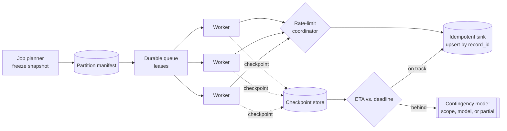

# High-Volume Batch Inference System - Answer Key

Try the worksheet before you read this key. It shows what a strong GenAI FDE candidate asks, designs, measures, secures and explains on the way from a demo to a production system.

## Strong discovery questions
- Who reads the classifications, and what goes wrong for them when the output arrives late? Is 6 a.m. a hard cut-off, a soft target, or different per segment?
- Is a partial batch worth anything, or does it ship whole or not at all? Retries, checkpoints and handoff all follow from that one answer.
- If we are behind schedule at 4 a.m., what do we do: go faster, shrink the scope, switch to a cheaper model, or publish what we have?
- Who signs off a new model version, and how often does that happen? The answer sets how tightly we pin versions and control rollout.
- Which system takes the results next, and how much load can it accept?
- Must results land in the input order, or is one logical result per record, exactly once, enough?
- Does the provider offer a native batch API, and what are the rate limits per tenant? Those turn a plain worker pool into a submission scheduler.
- What is the spending ceiling? If catching up would breach it, which degraded mode does the business prefer?

## Strong functional requirements
- Core workflow: take a frozen snapshot of the nightly input, split it, classify each record within quota, and publish usable output ahead of the deadline.
- Cut the work into balanced, independent units. The system then scales by adding parallel workers.
- Schedule workers, scale them automatically, and group model calls into batches wherever the provider allows it.
- Apply rate limits both globally and per tenant. Retries must never swamp the provider and cause throttling we brought on ourselves.
- Record progress in checkpoints and make every write idempotent. Replaying a partition must not create a second logical result.
- Keep a running forecast of the finish time. When the deadline is in danger, switch to the contingency mode agreed in advance.

## Strong non-functional requirements
- Latency: `RPS = (N_records / T_window) × (1 + h)`. Over a 6-hour window, 100M records works out at about 4,630 records/sec. My 15% headroom lifts that to 5,320.
- Availability: plan capacity for the slow tail rather than the average. In my experience the big, sluggish records gather at the end of a run.
- Security: every hop must protect inputs, prompts and outputs according to the customer's access and retention rules.
- Compliance: for any classification, we can show the snapshot, the model version and the partition behind it.
- Reliability: no logical result goes missing and none appears twice. After a crash, replay starts from a durable checkpoint and stays bounded.
- Cost: track spend per million records. Two things push it up: retries, which can double token spend, and stragglers that keep workers busy.

## Architecture explanation
- When the nightly run arrives, the job planner locks the input snapshot and produces the batch plan. That snapshot defines exactly what "this batch" contains.
- The partition manifest lists each balanced work unit with its status and attempt count. It lets us replay and audit the run.
- Partitions are balanced on processing cost, not on where the data sits. They mix tenant, payload-size band or past latency rather than counting rows.
- A durable work queue issues leases on partitions. The planner never waits for a worker, and a dead worker cannot block the run.
- Backpressure sits in the rate-limit coordinator. Each worker asks it for capacity before a call, so a tighter quota slows the leases instead of setting off a wave of retries.
- Inference workers scale automatically. They group records, call the model and check the output against a typed boundary before storing anything.
- The checkpoint store keeps finished ranges, so recovery never rescans old work. Results land in an idempotent sink keyed on record ID, so replaying a range cannot duplicate anything.
- An ETA forecaster and an operations console show progress and deadline risk hours before the final stretch. An operator can then decide instead of firefighting.

## Data model / integration assumptions
- BatchJob(id, input_snapshot, deadline, model, state); Partition(job_id, partition_id, range, lease, attempts, checkpoint); InferenceResult(record_id, label, confidence, model_version, run_id).
- `input_snapshot` points at one fixed version of the dataset and never changes. That fixed pointer makes replay possible.
- A partition goes from available to leased to completed. A transient failure marks it retryable, and too many attempts send it to the dead-letter queue.
- Writes to the sink are upserts keyed on each record's logical ID. Repeated work is then harmless, and the producer does not have to avoid it perfectly.
- Transient errors retry with backoff. Validation errors are reported as data-quality issues and are never retried without end.

## Red-team risks
- In short: running late at 4 a.m., a provider quota cut, stragglers from hot partitions, a worker crash after the model call, and a throttled result sink
- The run falls behind with no realistic way to finish in time. For the business, late output can be worse than no output.
- The provider lowers the quota mid-run. Naive retries then pile up and keep the throttling in place.
- A hot partition turns into a straggler. One bad shard holds the fleet hostage while most workers sit idle.
- A worker dies after calling the model but before writing the result. Without an idempotent sink, we pay twice and store the result twice.
- A corrupted checkpoint, a snapshot hash that does not match, or an unrecognised model version must stop the run, never let it carry on.

## Rollout plan
- Week 0-1: settle who uses the output, whether a partial batch is worth anything, and what the spending ceiling is.
- Week 1-2: benchmark against the real token distribution, not a toy sample: short records, long ones, edge cases and the skew we already know about.
- Week 2-3: run a load test at 1%. It must show that parsing, auth, model calls, sink writes and checkpoints survive real concurrency.
- Week 3-4: run a load test at 10%. It must show that retries, throttling and downstream capacity still fit inside the deadline. If the 1% gate failed, this step does not start.
- Week 5: break things deliberately. Kill a worker, cut the quota, take down a downstream dependency, and drain then restore a queue.
- Week 6-8: confirm that replay stays bounded, checkpoints survive, and the system degrades smoothly instead of swinging between retry storms.
- After pilot: write the deadline contingency modes, each with a named owner, before the job ever runs late, not after the first miss.

## Evaluation plan
I chose these thresholds for this case. They are not industry standards, so be ready to defend them rather than recite them.

| Metric | What it proves | Strong threshold | Dataset / method |
|---|---|---|---|
| Completion forecast vs. deadline | The run will finish before 6 a.m. | Never passes the deadline unless a contingency mode is already active | Rate of progress compared with the work left |
| Duplicate logical result count | Replays are safe and the sink is idempotent | Stays inside the replay window we accept | Compare logical keys, not storage rows |
| Records per second | Throughput holds at the rate we need | Matches or beats the rate the forecast says we need | Worker telemetry plus sink acknowledgements |
| Straggler age | No one partition can tie up the fleet | The oldest running partition stays within the recovery budget | Histograms of partition duration |
| Retry rate | Failures are passing glitches, not a systemic fault | Inside the normal band for each failure class | Retry counters plus a failure taxonomy |
| Cost per million records | Unit costs survive retries and stragglers | Within the approved budget | Cloud bill plus model usage logs |

## Weak answer
I'd stand up an inference service and a scheduler and run a batch classifier every night. This is weak because it lists tools, not value. It never freezes a snapshot, never says what happens at 4 a.m., and never explains how a crashed worker replays without creating duplicates.

## Average answer
I'd split the records into partitions, point a worker pool with retries at the model, checkpoint as we go and write the results to a table. If the job runs late, I'd raise an alert. Better, but the deadline is not treated as a design constraint, outbound calls are not shaped to the quota, and "alert when late" stands in for a recovery plan.

## Strong answer
I'd restate the goal: a batch we can replay and keep within budget, delivered by the deadline, with recovery decisions agreed for when we fall behind. First the input is locked as an immutable snapshot, so it cannot drift. The manifest makes each partition replayable, and leases keep scheduling apart from execution. A rate-limit coordinator holds the backpressure, slowing leases so retries never flood the provider. Recovery is bounded by checkpoints, and every write is a keyed upsert, so repeated work does no harm. I'd size for the tail, not the average, and show a finish-time forecast well before the last hour. And if we are 45% done at 4 a.m., a named owner has already agreed which contingency mode we use.

## Interviewer scorecard
| Area | 1 - Weak | 3 - Average | 5 - Strong |
|---|---|---|---|
| Problem framing | "Run inference on 100M records" | Mentions the deadline and who consumes the output | A replayable batch held to a cost limit, with recovery decisions; separates the four stakeholders |
| Requirements | "Finish on time" | Covers partitioning and retries | Asks about partial results first; keeps functional needs apart from quality bars and sets a cost ceiling |
| Architecture | A queue and some workers | Adds checkpoints and scaling | Frozen snapshot and manifest, leased partitions, a rate-limit coordinator, an idempotent sink and an ETA forecaster |
| Data/integration | Mentions a table for results | Names jobs and partitions | Immutable snapshot pointer, lease lifecycle, upsert on the logical key, typed check on output |
| Evaluation | "The job finished" | Measures throughput | Forecast against the deadline, duplicate count, oldest straggler, retries, spend per million |
| Safety/security | Not covered | Mentions access control | Stops on a bad snapshot hash, an unknown model version, a corrupted checkpoint or an unauthorised worker |
| Rollout | Go straight to full scale | Test, then launch | Benchmark on real token mix, 1% and 10% steps with gates, planned failure drills, contingency modes |
| Communication | Recites throughput figures | Clear but generic | Opens with the 4 a.m. decision, names owners, ends on the go/no-go gate |

## Final 2-minute spoken answer
I wouldn't begin with the model. On the surface this is about throughput: classify 100 million records every night and finish before 6 a.m. But the people in the room want three different things. For the business owner, the labels must be ready by morning. The platform lead cares that the warehouse survives. On-call needs a safe way to rerun after a failure. So I'd restate the target: a replayable batch, kept within budget, finished by the deadline, with clear recovery decisions for when we're behind. My first question is whether a partial batch has any value. That answer sets the retry strategy, how often we checkpoint, and how much we're willing to spend on the last ten percent. For sizing, say we have a six-hour window. That works out at roughly 4,630 records a second for 100 million. With the fifteen percent headroom I'd keep for retries and stragglers, it's roughly 5,320. I'd size for the tail of big records, not the average. For the design, the input is locked first as an immutable snapshot. A manifest splits it into partitions balanced on processing cost, not row count. A durable queue hands out leases. A rate-limit coordinator holds the backpressure, so a tighter quota slows the leases rather than starting a retry storm. Recovery stays bounded thanks to checkpoints, and since every write is an upsert keyed on the record, a replay can't duplicate anything. The failure I'd talk through out loud is being 45% done at 4 a.m. My answer is that we chose the contingency mode before launch, with a named owner: a narrower scope, a cheaper model, or partial output marked with its status.
