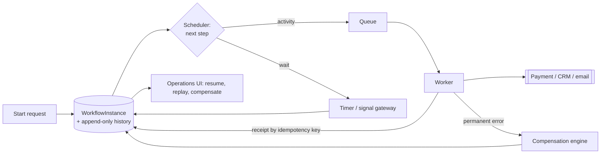

# Reliable Workflow Orchestration System - Answer Key

Work through the worksheet on your own first, then compare. This key models the questions, design, metrics, security controls and explanation a strong GenAI FDE candidate brings when a demo has to become a production system.

## Strong discovery questions
- Which outcome counts as success here: every technical step done, or the business effect landing exactly once? We would build differently for each.
- When something fails, do we roll it back or compensate for it? Each path is its own design.
- How much of this process runs without people? Which steps pause for minutes, which for hours, and which for days?
- After it starts, may a workflow branch, return to an earlier step or be cancelled part way?
- Which team owns each internal integration, and whose pager goes off when a workflow stalls?
- Who has the right to resume, rerun or override a stuck case?
- Will the payment provider honour idempotency keys? Without them, no retry can be called safe.
- Which audit evidence do we have to retain, and which actions require an approval log or a signature trail?

## Strong functional requirements
- Core workflow: one process has to span payment, email, document approval and three internal systems, and its business effect must land exactly once.
- Persist state durably, with a history that is only ever appended to. A worker that dies then resumes from its last point rather than restarting.
- Model waiting as a proper state that timers and signals drive. While a person decides, no worker sleeps in a loop.
- Pair each step with an action that undoes its effect. Partial failure then leaves something repairable, never a silent half-success.
- Put a version on every workflow definition. An instance finishes on the version it began with.
- Operators need to resume, replay or compensate a single named instance, and each of those actions goes into the audit trail.

## Strong non-functional requirements
- Latency: budget each step separately rather than the whole workflow. A person may take seven days to answer, yet every automatic step still has a bounded run time.
- Availability: we size for 10 million active workflows plus 100 million activities daily, which works out near 1,200 activities a second. Most of that pressure should land on the queue and the history store.
- Security: check identity and permissions at workflow start and on each signal after it. Resuming or repairing an instance is as powerful as starting one.
- Compliance: from the append-only history alone, we must be able to rebuild who approved what, at what time, on which definition version.
- Reliability: the exactly-once promise covers the business effect, not message delivery. Retries are safe only when backed by an idempotency key and a stored receipt.
- Cost: hold payloads outside workflow state. Inline documents would make the history store the largest cost we have.

## Architecture explanation
- Deciding what happens next is the control plane's job. Its parts are the definition registry, the scheduler, the timer service, the signal gateway, the compensation engine and the operations UI.
- Doing the work is the data plane's job. Its queues and workers make the calls to payment, email, the CRM and the internal systems.
- Only the start call runs synchronously. It validates input, authenticates the caller, checks permissions, appends the first history event and hands back the workflow ID.
- All later work is asynchronous. That covers dispatching activities, waiting on approvals, waking on timers, retrying and compensating.
- Ownership splits cleanly. Workflow state, the step history and the intent to retry belong to the orchestrator. External systems own the rest: CRM records, the payment itself, email delivery and document approval.
- History only grows. Before a step runs, it records the intent; once the external system acknowledges, it records completion. Because of that order, replaying after a crash is safe.
- A deadline wakes an instance through the timer service, and a human action wakes it through the signal gateway. So a wait of seven days ties up no worker.
- Each instance row uses optimistic concurrency. Two workers holding stale state cannot both advance it.

## Data model / integration assumptions
- Core records: WorkflowInstance carries id, state, definition_version and next_event. HistoryEvent carries instance_id, sequence, type and payload_ref. ActivityReceipt carries idempotency_key, external_ref and status. Timer carries instance_id and fire_at.
- Nobody edits a HistoryEvent once written. When a workflow crashes, replaying those events tells it what has already been done.
- An ActivityReceipt exists for every external side effect. A repeat of the same idempotency key gets the saved receipt back, and the card is not charged again.
- Every instance keeps the definition version it started on. Deploying mid-run therefore cannot silently swap the rules under it.
- Documents live in external storage, and payload_ref is just a pointer to them. That keeps state small and replay cheap.

## Red-team risks
- Summary: a worker dying just after payment, a sent email beside a failed CRM write, days-long approvals, definitions changing under live runs, and a hung external API
- The charge succeeds, then the worker dies before writing the acknowledgement. Retry naively and the customer pays twice.
- Steps can half-work. Email says it sent, the CRM write times out, and the workflow moves on pretending all is well.
- An approval can sit for days. The right home for it is a waiting queue that reminds and escalates. It should not fire an alert or spin a polling loop.
- Definitions can change under running instances. Unless someone writes an explicit migration, older instances stay on the version they pinned.
- An external API can hang. Give every call a time limit and classify its errors as transient or permanent, so no retry runs forever.

## Rollout plan
- Week 0-1: pick a single workflow; do not build a platform. Record what we assume about payment idempotency and how long waits may last.
- Week 1-2: gate one is determinism plus crash recovery. Kill a worker mid-run and demonstrate the instance resuming from its history.
- Week 2-3: prove that no crash, retry or replay produces a second external effect. Use the receipts and reconcile against downstream systems.
- Week 3-4: before scope grows, build the operator view. It has to show what is stuck, the reason, and the way out.
- Week 5: rehearse repairs on a stuck instance from real traffic. Resume it, replay it and compensate it, with audit on every action.
- Week 6-8: ship each change as a new workflow version and leave live versions untouched. A change is compatible, or it is a planned break that has been tested.
- After pilot: a second workflow comes on board only when stuck-workflow age, duplicate effects and the manual repair count are all within tolerance.

## Evaluation plan
These thresholds are my own choices for this case, not industry standards. Expect to defend them, not just state them.

| Metric | What it proves | Strong threshold | Dataset / method |
|---|---|---|---|
| Duplicate effect count | The business outcome really happens once | A customer never gets a second charge or email | Reconcile idempotency logs against downstream systems |
| Replay determinism pass rate | After a crash, a workflow reaches the same decisions again | Each sampled history gives an identical replay | Replay jobs over stored history |
| Stuck workflow age | No instance hides in a non-final state | Every instance inside its expected wait | Inspecting durable state and the queues |
| Activity retry rate | Failures are short-lived blips, not a systemic fault | Flat; a sustained spike triggers an investigation | Telemetry from workers and the scheduler |
| Compensation rate | Partial failures get cleared rather than building up | Flat, with a reason for each workflow type | Workflow history |
| Manual repair count | Recovery does not depend on operators | Within the tolerance we agreed | Records of operator actions and tickets |

## Weak answer
I'd build an orchestrator that hits email, payment and the internal APIs one after another and retries on any failure. This answer is weak because it is about wiring, not about what the customer gets. Nothing makes state durable, nothing makes the business effect exactly once, and nothing compensates. Retry after a charge has gone through and the customer is charged again.

## Average answer
I'd pick a workflow engine that keeps state durably, add backoff retries to each step, and write an audit log. An approval would hold the workflow until a signal comes in. That is an improvement, yet gaps remain. Retry and compensation get blurred into one idea. Instances are not pinned to a definition version. And nothing explains how an operator can safely fix an instance that is genuinely stuck.

## Strong answer
I'd open by restating the goal: long business processes where each business effect happens exactly once, state is visible, and a failed step has a compensation path. The thing at risk is a business transaction that lasts days, not messages in transit. That drives the design. History is durable and append-only, with intent logged before each step and completion logged after the acknowledgement. Retries stay safe thanks to idempotency keys and stored receipts. A wait is a timer or signal state. Every step has its own compensation. Each instance keeps its definition version, so deploying mid-run cannot rewrite its rules. Operators resume, replay or compensate, and all of it is audited. A second workflow waits until crash recovery works and nobody has ever been charged twice.

## Interviewer scorecard
| Area | 1 - Weak | 3 - Average | 5 - Strong |
|---|---|---|---|
| Problem framing | "We need an orchestrator" | Names the steps, adds retries | Targets a business effect that happens once; separates the four stakeholder jobs |
| Requirements | "It should finish" | Wants durable state plus retries | Rollback or compensation, waiting as a true state, versioned definitions, repair rights |
| Architecture | API calls in a chain | A durable-state engine | Separate control and data planes; timer and signal services; a compensation engine; an operations UI |
| Data/integration | Mentions an audit log | Names instances and events | History that is only appended, receipts keyed on idempotency key, a pinned version, payload references |
| Evaluation | "It finished" | Counts failures | Stuck age, duplicate effects, replay determinism, plus compensation and repair rates |
| Safety/security | Not covered | Authenticates at start | Authorises every signal and every repair; the audit trail rebuilds approvals and controls |
| Rollout | Builds the platform | Pilots one process | A single workflow, a crash-recovery gate, operator visibility, new versions in place of edits |
| Communication | Describes the engine | Clear but generic | Starts from the double-charge case, names its assumptions, finishes on the first gate |

## Final 2-minute spoken answer
I'd hold off on choosing an engine. We're asked to make payment, email, three internal systems and document approval work as one process, and any step in it may fail or stall for days. The tempting summary is "build an orchestrator that calls these APIs." That's only wiring. A better summary starts from the outcome. Long business processes must apply each business effect exactly once, show their state, and compensate when a step fails. Framed like that, the requirements fall out at once: idempotency, durable state, retries, pauses for human approval, an audit trail and compensating actions. The thing we're guarding is a single business transaction stretched over days, not messages crossing a network. For the architecture, the control plane has the definition registry, the scheduler, the timer service, the signal gateway, the compensation engine and the operations UI. The data plane is queues plus workers, and those workers call payment, the CRM and email. Only the start is synchronous. It authenticates, authorises, appends the first history event and returns the ID. The rest runs asynchronously. History only grows: intent goes in before a step, completion goes in after the acknowledgement. The key drill shows why that matters. Say a worker dies just after the payment succeeds. We don't charge again. We replay history, find the completed charge, and continue at the next step still open. Waiting seven days for approval is just a timer state; nothing polls. Each instance keeps its definition version, so a deployment can't alter its rules partway. My first move is one workflow. It goes live only after crash recovery works and duplicate effects are zero, and operators get visibility before we widen scope.
