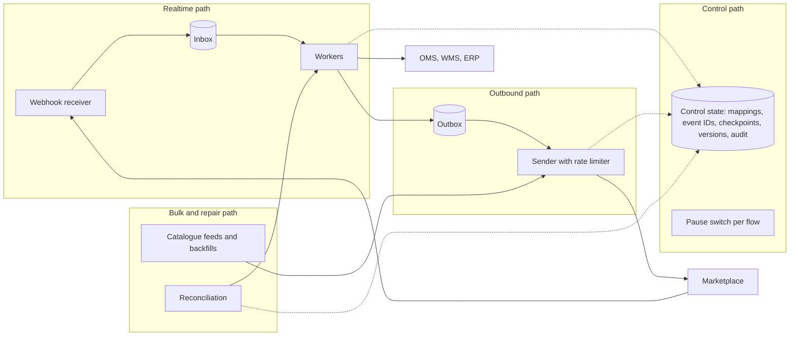

## Start with the borrowed number

Nia, a forward deployed engineer, joined Stanway Outdoor, a retailer of tents, boots and camping kit with 22 shops and its own website, after its first marketplace connector oversold. The connector pushed stock every 30 minutes from the ERP (enterprise resource planning) system, because the ERP had a tidy API and the warehouse system did not, but the ERP's stock figure is a finance copy that the warehouse posts to once a night. On a Saturday in May the marketplace featured Stanway's two-person tent: the website and shops sold the last units by 11:00, the ERP still showed 39, and by 18:00 the marketplace had sold 37 tents that did not exist. Stanway cancelled and refunded 37 orders, and the marketplace suspended the listing for a week over the cancellation rate. Every call had succeeded. The connector read a copy and treated it as the owner. Call this **the borrowed number**.

> **What you'll learn**
>
> - How to name commerce systems by their job and give every field one owner.
> - How to split the integration into four one-way flows, each with a freshness target, a key and a repair path.
> - How one order stays consistent across five systems without a distributed transaction.
> - How a single repair loop serves every flow.
> - How a four-path architecture shares one control state, and what each failure does to it.

## Name each system by its job

Product names hide what a system is for. Name each by its responsibility, as [owners before boxes](../framing-an-integration/01_Owners_Before_Boxes.md) teaches, then decide which facts it owns.

| Label | Its job | What it owns |
|---|---|---|
| Product information (PIM) | Product content for every channel | Titles, descriptions, images, attributes |
| Order management (OMS) | Order life cycle and allocation | Orders after acceptance, available-to-sell per SKU (stock keeping unit) |
| Warehouse (WMS) | Stock on hand, picking and shipping | On-hand counts, shipments, carrier and tracking |
| ERP | Finance and purchasing | Price, invoices, ledger |
| Marketplace | Listings and buyer checkout | Orders as placed, buyer cancellation requests, listing IDs |

*Table 1: Stanway's systems by responsibility. The ERP holds a stock figure but does not own it.*

The ownership map gives each field one owner and one direction:

- **Content:** PIM to marketplace.
- **Price:** ERP to marketplace.
- **Available-to-sell:** OMS, computed from WMS on-hand minus open allocations, to marketplace.
- **Order as placed:** marketplace to OMS.
- **Order status, shipment and tracking:** WMS to OMS to marketplace.
- **Invoice:** OMS to ERP.

The integration owns none of these. It owns only its **control state**: ID mappings (SKU to listing ID, marketplace order ID to OMS order ID), event-ID records, checkpoints, the last version sent per item, delivery status and an audit trail. How to model that state so a restart resumes cleanly is in [modelling the integration's own state](../../../../01_Concept_Tutorials/Consolidated_Lessons/SQL_and_Data_Modelling/06_Modelling_the_Integrations_Own_State.md).

## Four flows, one direction each

A two-way "sync" between Stanway and the marketplace is four one-way flows. Each has its own owner, target and repair, so a fault in one does not stall the others.

| Flow | Direction | Freshness target | Idempotency key | Repair path |
|---|---|---|---|---|
| Product | PIM to marketplace | 1 hour | SKU plus content version | Nightly compare of a content hash per listing |
| Inventory | OMS to marketplace | 60 seconds | SKU plus stock sequence number | Hourly compare of every listed SKU |
| Order | Marketplace to OMS | 2 minutes | Marketplace order ID | Poll "changed since" every 5 minutes, nightly compare |
| Fulfilment | WMS to OMS to marketplace | 15 minutes | Shipment ID | Nightly compare of shipped orders without tracking |

*Table 2: The four flows. Each row can be paused, replayed and measured on its own.*

The order flow arrives as webhooks, received as in [the webhook receiver](../receiving-webhooks-safely/01_The_Webhook_Receiver.md), with a poll as the backstop. Product content moves as a nightly bulk file plus API calls for urgent changes, as in [moving large datasets](../partner-apis-and-bulk-transfer/02_Moving_Large_Datasets.md).

Updates arrive out of order, so each flow checks transitions, not arrival time. An order moves placed, accepted, allocated, shipped, delivered. Cancellation is valid only before shipping. A stale update, such as "allocated" after "shipped", is skipped and logged. A cancellation after shipping becomes a return request. Inventory uses the stock sequence number: a figure with a lower number than the last one sent is dropped.

## One order across the systems

There is no transaction spanning five systems. Each boundary is crossed at least once, with a key that makes repeats harmless, and each step records its result in the control state. Step through marketplace order MP-40218: one two-person tent and two packs of pegs.

Follow one order across each boundary. Each step names what crosses, what is guaranteed and which key makes a repeat harmless.

<button type="button" data-step="0" aria-pressed="false" aria-controls="stanway-step-0">1. Receive</button><button type="button" data-step="1" aria-pressed="false" aria-controls="stanway-step-1">2. Create</button><button type="button" data-step="2" aria-pressed="false" aria-controls="stanway-step-2">3. Accept</button><button type="button" data-step="3" aria-pressed="false" aria-controls="stanway-step-3">4. Ship</button><button type="button" data-step="4" aria-pressed="false" aria-controls="stanway-step-4">5. Invoice</button>

<section id="stanway-step-0" class="step-panel" aria-labelledby="stanway-heading-0"><h4 id="stanway-heading-0">1. Marketplace to receiver</h4><dl><dt>Crosses</dt><dd>The order webhook for MP-40218.</dd><dt>Guarantee</dt><dd>Verified, claimed and stored in the inbox before the 200 reply.</dd><dt>Key</dt><dd>The event ID.</dd></dl></section><section id="stanway-step-1" class="step-panel" aria-labelledby="stanway-heading-1"><h4 id="stanway-heading-1">2. Worker to order management</h4><dl><dt>Crosses</dt><dd>A create-order call. OMS returns SO-118734 and allocates the tent.</dd><dt>Guarantee</dt><dd>OMS refuses a second order with the same external reference. The mapping is saved with an outbox row in one transaction.</dd><dt>Key</dt><dd>Marketplace order ID as the external reference.</dd></dl></section><section id="stanway-step-2" class="step-panel" aria-labelledby="stanway-heading-2"><h4 id="stanway-heading-2">3. Integration to marketplace</h4><dl><dt>Crosses</dt><dd>Accept MP-40218, and push the tent's available-to-sell, now 5 after allocation, as sequence 9,413.</dd><dt>Guarantee</dt><dd>The sender retries from the outbox until the marketplace confirms.</dd><dt>Key</dt><dd>Order ID plus "accept". SKU plus sequence for stock.</dd></dl></section><section id="stanway-step-3" class="step-panel" aria-labelledby="stanway-heading-3"><h4 id="stanway-heading-3">4. Warehouse to marketplace</h4><dl><dt>Crosses</dt><dd>Shipment SH-77120 with carrier and tracking, through OMS.</dd><dt>Guarantee</dt><dd>Applied only if the order is allocated. A late buyer cancellation becomes a return.</dd><dt>Key</dt><dd>Shipment ID.</dd></dl></section><section id="stanway-step-4" class="step-panel" aria-labelledby="stanway-heading-4"><h4 id="stanway-heading-4">5. Order management to ERP</h4><dl><dt>Crosses</dt><dd>The invoice for SO-118734.</dd><dt>Guarantee</dt><dd>Posted once. The nightly compare finds shipped orders with no invoice.</dd><dt>Key</dt><dd>OMS order ID.</dd></dl></section>

<button type="button" data-walk="previous">Previous</button>

<button type="button" data-walk="next">Next step</button>

If step 3 fails for good, because the buyer cancelled on the marketplace first, the integration runs a **compensating step**: it cancels SO-118734 in OMS, which releases the allocation and pushes the stock back up. The [saga pattern](https://learn.microsoft.com/en-us/azure/architecture/patterns/saga) names this approach. Writing the mapping and the outbound message in one local transaction is the outbox, taught in [reliability and consistency](../../../../01_Concept_Tutorials/AI_System_Design_Course/07_reliability_consistency/02_learn_and_design.md).

## One repair loop for every flow

Events get lost, skipped or misapplied. Retries fix failures you can see. Drift you cannot see needs a compare. Stanway runs one loop for all four flows:

1. Read the owner's truth in pages, from a checkpoint.
2. Read the copy on the other side.
3. Compare by key and version.
4. Send each difference through the same idempotent processor that handles live events.
5. Record the drift count per flow, and alert above a threshold.

For inventory, 12,000 listed SKUs at 500 per page is 24 read calls on each side every hour. An alert fires if more than 60 SKUs, half a percent, differ. A steady trickle of drift points at a bug in the live path. A sudden jump points at an outage or a bad deploy.

Replay and reconciliation are different tools. Replay re-runs events you know about. Reconciliation finds differences no event revealed. The general method is in [recoverable data syncs](../../../../01_Concept_Tutorials/Consolidated_Lessons/T1.5_Distributed_Systems_Essentials/04_Recoverable_Data_Syncs.md). Loading a new marketplace's catalogue while live orders flow is in [backfills while live](../../fde-building-in-the-estate/customer-data-pipelines/05_Backfills_While_Live.md).

## Four paths and the control state

Figure 1 groups the work into four paths. They share one control database and nothing else.

*Figure 1: Stanway's integration in four paths. Repair sends differences through the same workers as live events.*

The marketplace allows 20 calls a second. The sender gives the outbound path 14, bulk and repair 4, and keeps 2 as headroom. A backfill never delays a live order acceptance. Budgeting against limits is taught in [rate limits, backlogs and two-way sync](../connecting-enterprise-systems/04_Rate_Limits_Backlogs_and_Two_Way_Sync.md).

| Failure | Detected by | Contained by | Recovery |
|---|---|---|---|
| Marketplace API down | Sender errors, outbox age | Outbox holds changes | Resume, coalesced per SKU |
| Webhook never arrives | 5-minute poll | Poll checkpoint | Order created by the same worker |
| Worker crashes mid-order | Inbox row not done | OMS external reference | Row reprocessed, no duplicate |
| OMS down | Worker errors, inbox age | Inbox. Receiver still replies 200 | Workers drain on recovery |
| Rate limit reached | 429 replies | Lanes and `Retry-After` | Repair lane yields first |
| Bad catalogue file | Validation on load | Staging area | Keep the last good catalogue |
| Control database down | Health check | Receiver replies 503, sender pauses | Marketplace retries, sender resumes |

*Table 3: The failure map. Every row names how the failure is seen and what stops it spreading.*

## Limits of this lesson

- **One marketplace.** A second one adds a mapping set and a flow per direction. The control state and repair loop stay shared.
- **No returns or payouts.** Both are further flows with the same shape.
- **Composite engagement.** Stanway Outdoor, Nia, its systems and its figures are illustrative, not a real customer.

## Interview angle

Each answer is an outline to say in about two minutes. Open the question and try it aloud before reading.

Interview question 1. A retailer oversells on a marketplace although every stock update succeeds. Where do you look?

- **Answer:** At ownership first. Find which system the stock figure comes from and whether it owns available-to-sell or holds a copy. Then check freshness: how often it is pushed, against how fast the item sells. Then ordering: whether stale figures can overwrite newer ones. Fix the source, push changes within a minute with a sequence number, and add an hourly compare with a drift alert.
- **Trade-off:** Pushing every change costs API calls. Coalesce per SKU over a few seconds.
- **Follow-up to expect:** "Fast sellers still oversell." Hold back a small buffer for those SKUs.

Interview question 2. How do you keep one order consistent across the marketplace, order management, warehouse and finance without a distributed transaction?

- **Answer:** Treat each boundary as at-least-once with a key that makes repeats harmless: event ID at the receiver, marketplace order ID in order management, shipment ID for fulfilment, order ID for the invoice. Save mappings and outbound messages together in a local transaction. Check state transitions before applying updates. Compensate when a later step fails for good, and run a nightly compare to catch what slips through.
- **Trade-off:** Systems are briefly inconsistent. You accept minutes of lag in exchange for no cross-system locks.
- **Follow-up to expect:** "The buyer cancels after shipping." The transition is invalid, so it becomes a return.

## References

1. Microsoft, [Saga distributed transactions pattern](https://learn.microsoft.com/en-us/azure/architecture/patterns/saga), Microsoft Learn, accessed 17 November 2026. Local transactions with compensating steps.
2. AWS, [Transactional outbox pattern](https://docs.aws.amazon.com/prescriptive-guidance/latest/cloud-design-patterns/transactional-outbox.html), AWS Prescriptive Guidance, accessed 17 November 2026. The dual-write problem and its fix.
3. Google, [Monitoring Distributed Systems](https://sre.google/sre-book/monitoring-distributed-systems/), Site Reliability Engineering, accessed 17 November 2026. Alerting on symptoms such as drift and age.
4. The author's own field experience, the basis for the flow table and failure map.

## Key takeaways

- Name systems by their job and give every field one owner and one direction.
- Split the integration into one-way flows, each with a freshness target, a key and a repair path.
- Cross each boundary at least once with a key, and check transitions instead of arrival order.
- Run one repair loop that sends differences through the live processor.
- Keep four paths that share only the control state, and write down what each failure does.

## Check yourself

1. Why did Stanway oversell although every call succeeded?

It pushed the ERP's nightly finance copy of stock, not the available-to-sell figure that order management owns.

2. Why does reconciliation send differences through the live workers?

So repairs get the same keys, transition checks and audit as live events, and a repair repeated is harmless.

3. Why give the bulk and repair path its own share of the rate limit?

So a backfill or a large compare can never delay live order acceptances.

