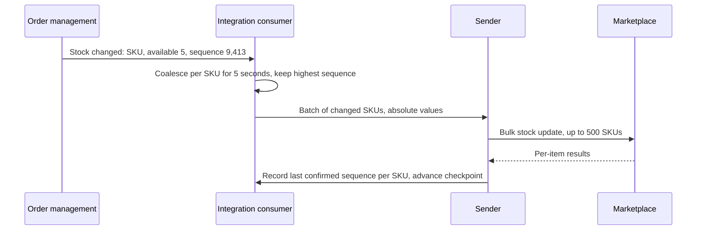

## Start with the diagram with no owner

Aled, a candidate for a forward deployed role, was given a one-line prompt: "A retailer wants its stock levels on an online marketplace. Design it." Within three minutes he had drawn a message queue, a stream processor, a cache and a sync service, with arrows in both directions. Then the interviewer asked which system owned the number being sent, and Aled did not know. Everything he drew was reasonable, and none of it could be judged without an owner, the only question that decides whether the marketplace oversells. Call this **the diagram with no owner**.

This lesson replays the round properly, using Stanway Outdoor from [designing a retailer marketplace integration](01_Designing_a_Retailer_Marketplace_Integration.md). The order of the answer matters as much as its content. The general shape of a design round is in [the twelve-part design framework](../../../../01_Concept_Tutorials/Consolidated_Lessons/T5.1_The_Design_Framework/01_The_Twelve_Part_Design_Framework.md); an integration round compresses it around ownership and one flow.

> **What you'll learn**
>
> - How to spend the first five minutes on ownership and numbers.
> - How to trace one core flow before adding anything else.
> - How to argue correctness at each boundary the update crosses.
> - Which scale, security and observability points to add, and when.
> - How to close on the main trade-off in one sentence.

## Minutes 0 to 5: owners and numbers

Ask before you draw. Each answer narrows the design.

- **Which systems hold a stock figure, and which owns the one buyers should see?** At Stanway, order management (OMS) owns available-to-sell: warehouse on-hand minus open allocations. The ERP (enterprise resource planning) system holds a nightly finance copy.
- **How many items and how fast do they change?** 12,000 listed SKUs (stock keeping units). Normal load is about 4 stock changes a second. A sale peak reaches 40.
- **What does the marketplace allow?** 20 API calls a second, and a bulk stock call that takes up to 500 SKUs.
- **How fresh, and what does an oversell cost?** A target of 60 seconds. Each oversell is a cancellation, and the marketplace suspends listings with too many.

Say the result aloud: "OMS owns available-to-sell, flowing one way to the marketplace, within a minute." That sentence is the spine of everything after it.

## Minutes 5 to 15: one core flow

Trace one update end to end before adding scale. A shop sells a tent. Figure 1 follows it.

*Figure 1: The core inventory flow. The checkpoint moves only after the marketplace confirms.*

Two choices carry the design. First, send **absolute values**, "available is 5", never "subtract 1". A repeated absolute value is harmless. A repeated delta corrupts stock. Second, **coalesce per SKU**. If a tent changes eight times in five seconds, only the last value matters. Coalescing and lanes against a rate limit are taught in [rate limits, backlogs and two-way sync](../connecting-enterprise-systems/04_Rate_Limits_Backlogs_and_Two_Way_Sync.md).

The numbers work. At the 40-a-second peak, Stanway sees about 150 distinct SKUs change in a five-second window. That is one bulk call every five seconds, well under one call a second, far inside the 14 a second the live outbound lane is given.

## Minutes 15 to 25: correctness at each boundary

Now walk the boundaries the update crosses and say what can go wrong at each.

| Boundary | What can go wrong | What makes it correct |
|---|---|---|
| OMS to consumer | Events repeat or arrive out of order | Keep the highest sequence per SKU, drop lower ones |
| OMS cannot emit events | Changes never arrive | Poll "changed since" with a checkpoint every 30 seconds |
| Inside the consumer | Crash after reading, before sending | Checkpoint advances only after confirmation, so events replay |
| Sender to marketplace | Part of a bulk call fails | Retry failed items only, never re-send older sequences |
| Marketplace limit | 429 replies | Honour `Retry-After` and keep within the lane's share |
| Across the whole flow | Silent drift | Hourly compare of all 12,000 SKUs, through the same sender |

*Table 1: Correctness at each boundary. Every row survives a repeat.*

This is where an interviewer probes, so keep each answer to one sentence and offer depth only when asked. The partner-facing contract that the bulk call relies on is taught in [an API partners build against](../partner-apis-and-bulk-transfer/01_An_API_Partners_Build_Against.md). Retry policy has its own home in [retries, circuit breakers and bulkheads](../../../../01_Concept_Tutorials/Consolidated_Lessons/T4.6_Scaling_and_Reliability/04_Retries_Circuit_Breakers_and_Bulkheads.md).

## Minutes 25 to 35: scale, security, observability

Add these only once the core flow is sound.

- **Scale.** On the biggest sale day of the year, changes may reach 400 a second. Coalescing grows with load: more changes per SKU, not more calls. If distinct SKUs per window pass 500, split into two bulk calls. A full refresh runs in the bulk and repair lane with its own share of the limit.
- **Security.** The marketplace credential grants inventory writes only, sits in a secret store, and rotates on a schedule. If the integration serves several retailers, each gets its own credential and its own rate budget. How to authenticate as the right principal is in [authenticating as whom](../connecting-enterprise-systems/02_Authenticating_as_Whom.md).
- **Observability.** Measure freshness lag, from OMS change to marketplace confirmation, at the 95th percentile against the 60-second target. Watch the age of the oldest unsent change, the per-item rejection rate and the hourly drift count. Track oversell cancellations as the business symptom.

## Minutes 35 to 40: the main trade-off

Close with one trade-off, stated plainly. For inventory it is freshness against oversell risk and lost sales.

Even at 60 seconds, a fast seller can sell its last unit in the shop and again on the marketplace in the same minute. Stanway holds back a **buffer**: for SKUs selling more than 10 units an hour, it lists 2 fewer than are available. Those last units sell only in shops and on the website.

"I accept a few lost marketplace sales on fast sellers to keep cancellations near zero, because the marketplace penalises cancellations and not missed sales. I would tune the buffer from the drift and cancellation data after launch."

The walkthrough replays the round as five stages.

Step through the round. Each stage shows what you say, what you draw and what the interviewer is checking.

<button type="button" data-step="0" aria-pressed="false" aria-controls="round-step-0">1. Owners</button><button type="button" data-step="1" aria-pressed="false" aria-controls="round-step-1">2. Core flow</button><button type="button" data-step="2" aria-pressed="false" aria-controls="round-step-2">3. Boundaries</button><button type="button" data-step="3" aria-pressed="false" aria-controls="round-step-3">4. Scale and safety</button><button type="button" data-step="4" aria-pressed="false" aria-controls="round-step-4">5. Trade-off</button>

<section id="round-step-0" class="step-panel" aria-labelledby="round-heading-0"><h4 id="round-heading-0">1. Owners and numbers</h4><dl><dt>You say</dt><dd>OMS owns available-to-sell, one way, within a minute.</dd><dt>You draw</dt><dd>Five systems labelled by job.</dd><dt>Checked</dt><dd>That you ask before you design.</dd></dl></section><section id="round-step-1" class="step-panel" aria-labelledby="round-heading-1"><h4 id="round-heading-1">2. One core flow</h4><dl><dt>You say</dt><dd>Absolute values, coalesced per SKU, sent in bulk.</dd><dt>You draw</dt><dd>One update from OMS to marketplace confirmation.</dd><dt>Checked</dt><dd>That the arithmetic fits the limit.</dd></dl></section><section id="round-step-2" class="step-panel" aria-labelledby="round-heading-2"><h4 id="round-heading-2">3. Correctness at each boundary</h4><dl><dt>You say</dt><dd>Sequences, checkpoints after confirmation, partial retries, hourly compare.</dd><dt>You draw</dt><dd>A mark on each arrow with its guarantee.</dd><dt>Checked</dt><dd>That repeats and reordering are harmless.</dd></dl></section><section id="round-step-3" class="step-panel" aria-labelledby="round-heading-3"><h4 id="round-heading-3">4. Scale, security, observability</h4><dl><dt>You say</dt><dd>Coalescing absorbs peaks, a scoped credential, freshness lag as the main measure.</dd><dt>You draw</dt><dd>A separate repair lane and the measures.</dd><dt>Checked</dt><dd>That you can run it, not only build it.</dd></dl></section><section id="round-step-4" class="step-panel" aria-labelledby="round-heading-4"><h4 id="round-heading-4">5. The main trade-off</h4><dl><dt>You say</dt><dd>A small buffer on fast sellers trades lost sales for near-zero cancellations.</dd><dt>You draw</dt><dd>Nothing new.</dd><dt>Checked</dt><dd>That you choose and can defend it.</dd></dl></section>

<button type="button" data-walk="previous">Previous</button>

<button type="button" data-walk="next">Next step</button>

## Limits of this lesson

- **One flow.** A full round may ask for orders or fulfilment as well. Use the same five stages for each, briefly, after the first. The other three flows are worked in [designing a retailer marketplace integration](01_Designing_a_Retailer_Marketplace_Integration.md).
- **Time boxes are a guide.** Follow the interviewer when they steer, then return to the stage you left.
- **Composite engagement.** The round, Aled, Stanway Outdoor and its figures are illustrative, not a real interview or customer.

## Interview angle

Each answer is an outline to say in about two minutes. Open the question and try it aloud before reading.

Interview question 1. Design how a retailer's stock levels reach an online marketplace.

- **Answer:** Ask who owns available-to-sell, the SKU count, change rate, the marketplace's limits, the freshness target and the cost of an oversell. State the owner and direction. Trace one update: an event with a sequence number, coalesced per SKU, sent as absolute values in bulk, checkpoint advanced after confirmation. Walk each boundary for repeats and reordering. Add the repair compare, scoped credentials and freshness-lag measures. Close on the buffer trade-off.
- **Trade-off:** A buffer on fast sellers loses some marketplace sales but keeps cancellations near zero.
- **Follow-up to expect:** "Why not send deltas?" A repeated delta corrupts stock. A repeated absolute value does not.

Interview question 2. Midway through, the interviewer says order management can only export a full stock file once an hour. What changes?

- **Answer:** Freshness drops from a minute to over an hour, so say what that costs: more oversells on fast sellers. Diff each file against the last values sent and push only changed SKUs. Raise the buffer for fast sellers to cover an hour of sales. Ask whether order management can expose a "changed since" query, which would restore minute-level freshness without events.
- **Trade-off:** A larger buffer loses more sales. Pushing for a better source costs the customer engineering time.
- **Follow-up to expect:** "The file arrives late." Alert on its age, and keep the last figures, with the buffer, until it arrives.

Interview question 3. The marketplace halves your rate limit to 10 calls a second during its own peak season. Does the design still work?

- **Answer:** Recompute the lanes. Give live updates 7 a second, repair 2 and keep 1 as headroom. Live inventory needs well under one call a second because of coalescing and bulk calls, so it fits. The hourly compare still needs only 24 calls each side. Order acceptances share the live lane, so check their peak rate too. Lengthen the coalescing window if acceptances crowd stock updates.
- **Trade-off:** A longer coalescing window saves calls but adds seconds of staleness.
- **Follow-up to expect:** "What gets cut first?" Repair work, then content updates. Order acceptance never.

## References

1. IETF, [RFC 6585: Additional HTTP Status Codes](https://www.rfc-editor.org/rfc/rfc6585), accessed 17 November 2026. Status 429 and `Retry-After`.
2. Google, [Monitoring Distributed Systems](https://sre.google/sre-book/monitoring-distributed-systems/), Site Reliability Engineering, accessed 17 November 2026. Measuring latency and symptoms users see.
3. The author's own field experience, the basis for the stage order and the buffer trade-off.

## Key takeaways

- Spend the first five minutes on owners and numbers, and say the owner and direction aloud.
- Trace one update end to end before adding scale.
- Send absolute values, coalesce per SKU, and advance the checkpoint only after confirmation.
- Argue correctness boundary by boundary, then add scale, security and observability.
- Close on one trade-off, stated as a choice with its cost.

## Check yourself

1. What was missing from the diagram with no owner?

Which system owns the stock figure being sent. Without it, no part of the design could be judged.

2. Why does coalescing let the design absorb a tenfold peak without more calls?

More changes land on the same SKUs within each window, and only the last value per SKU is sent.

3. Why is "lose a few marketplace sales" acceptable here?

The marketplace penalises cancellations, not missed sales, so an oversell costs more than a lost sale.

