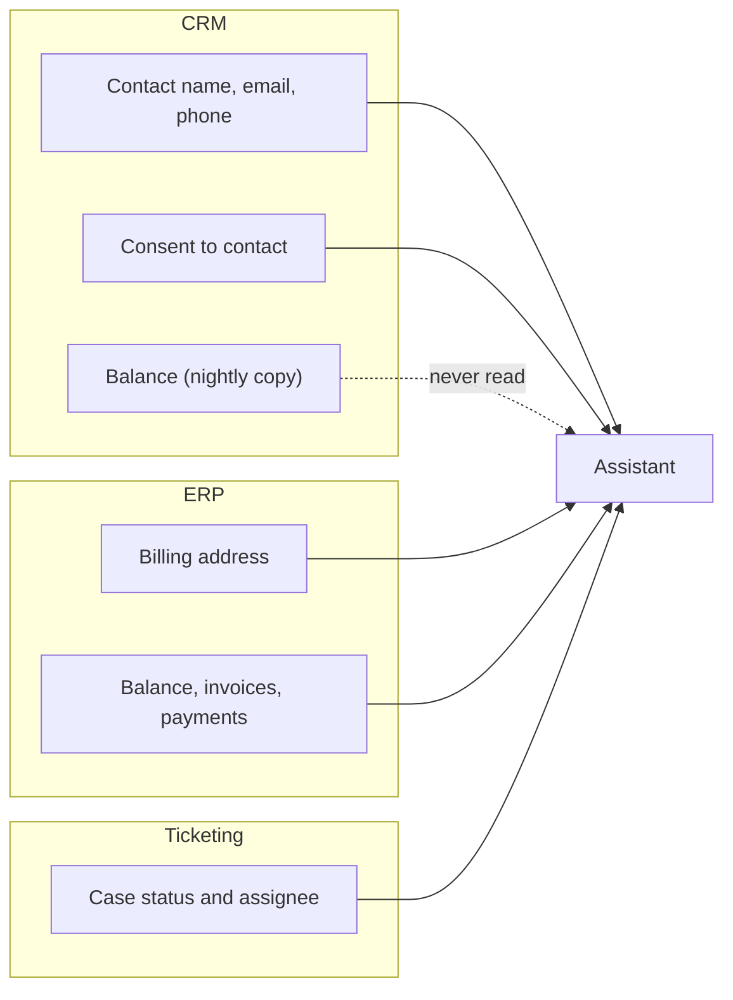

## Start with the balance that was a day old

Bransdale Water, a fictional regional water company, asked for an assistant that drafts replies to billing questions for its contact-centre agents. The team pulled customer data from the customer relationship management (CRM) system, because it held contacts, accounts and every past conversation in one place.

The CRM also showed each account's balance. Nobody asked where that number came from. It was a copy, loaded from the finance system every night at 01:00.

On a Thursday a customer's direct debit of £186.40 bounced at 10:00. At 15:00 she asked whether she owed anything. The assistant read the CRM, saw a balance of £0.00, and drafted "Your account is fully paid". The agent sent it. Two weeks later the customer received a reminder letter with a late-payment fee, and complained.

The balance belonged to the enterprise resource planning (ERP) system, where finance posts invoices and payments. The CRM held a convenient copy, and the assistant treated it as the truth. Call this **the copy that looked like the source**.

> **What you'll learn**
>
> - What CRM, ERP and ticketing systems each exist to do, and who owns them.
> - The objects, workflows and limits that shape any connector to them.
> - How to decide a source of truth for each field, not each system.
> - What to ask the customer before the first call to their system.

## Three systems, three jobs

Each of these systems is a **system of record**: the place the organisation agrees is right for some kind of data. They overlap at the edges, and those edges are where connectors go wrong.

| System | Exists to | Typical objects | Usual owner |
|---|---|---|---|
| CRM | Manage relationships with customers and prospects | Accounts, contacts, leads, opportunities, activities, consent | Sales or customer service operations |
| ERP | Run the money and the operations behind it | Customers as billing parties, orders, invoices, payments, ledger entries, stock | Finance and operations |
| Ticketing | Track requests and incidents until they are resolved | Tickets or cases, status, assignee, priority, comments, service-level timers | Support or service management teams |

*Table 1: What each system is for and who usually owns it. Products differ, so confirm each row with the customer.*

The same real-world customer appears in all three. In the CRM she is a contact on an account. In the ERP she is a billing party with a customer number. In the ticketing system she is the requester on a case. The identifiers differ, and so do the meanings. "Customer" in sales may include prospects who have never paid. "Customer" in finance means someone who can be invoiced.

Domain-driven design calls each of these a **bounded context**: each system models the same word for its own purpose. Your connector translates between contexts. It should not pretend they are one model.

## What each system cares about

Before you read or write, learn what the owner protects in each system.

- **CRM: relationships and consent.** Sales and service teams care about duplicates, ownership of accounts by named staff, and consent to contact. Records are edited by many people, often by hand, and custom fields are common. A connector that creates contacts carelessly creates duplicates that the sales team then cleans up.
- **ERP: money and audit.** Finance cares that posted documents never change. A posted invoice is corrected by a credit note or a reversal, not an edit. Periods close at month end, and writes may be blocked during the close. Every write is audited, and changes go through a formal change process.
- **Ticketing: flow and timers.** Support cares about status, assignment and service-level timers. Updating a ticket can trigger automation: an email to the requester, a reassignment, a timer pause. A connector that writes a comment may send the customer an email you did not intend.

The rule that follows: a write to a system of record is a business event in that system, not only a data change. Ask what each write triggers before you make it.

## Limits that shape the connector

Each system puts limits on you, and they decide the design more than your preferences do.

- **Request limits.** Software-as-a-service systems usually cap requests per second, per day or per licence. The quota is often shared with the customer's other integrations. Measure your expected calls against it before you build.
- **Bulk and incremental access.** Many systems offer a bulk export or a "changed since" query alongside the record-by-record interface. Reading 400,000 accounts one at a time can take days. A bulk export takes minutes.
- **Environments.** Ask whether a test copy exists with realistic data. Some ERP test environments are refreshed rarely, and their data can be months old.
- **Change windows.** Finance may freeze ERP changes during the month-end close. A deployment planned for the last working day of the month may have to wait.
- **Customisation.** Field names and workflows are configured per customer. The "status" field you saw in the vendor's documentation may be replaced by a custom one.

The lesson on [pagination, filtering and versioning](../../../../01_Concept_Tutorials/Consolidated_Lessons/T1.2_APIs_and_Backend/08_Pagination_Filtering_and_Versioning.md) covers how to page through large result sets safely once you know the limits.

## A source of truth for each field

Bransdale's mistake was choosing a source of truth per system. The fix is to choose one per field. Figure 1 shows the map the team drew after the complaint.

*Figure 1: Each field the assistant uses comes from the system that owns it. The CRM's copy of the balance stays in the CRM.*

To build the map, list every field your feature reads or writes. For each one, record:

1. **Owner system.** Where the value is created and changed by the business.
2. **Owner team.** Who to ask when the value looks wrong.
3. **Copies.** Other systems that hold a copy, and how often each is refreshed.
4. **Freshness need.** How old the value may be for your use. A balance quoted to a customer needs to be current. A customer's name can be a day old.

Where the freshness need is tighter than the copy's refresh, read from the owner. The switcher shows the same question answered both ways.

Thursday, 15:00. A direct debit of £186.40 bounced at 10:00. The customer asks what she owes.

<button type="button" data-mode="copy" aria-pressed="false" aria-controls="copy-result">CRM copy</button>
<button type="button" data-mode="owner" aria-pressed="false" aria-controls="owner-result">ERP, the owner</button>

<section id="copy-result" class="mode-panel" data-announcement="CRM copy selected. The assistant says nothing is owed."><h4>Read the CRM copy</h4><ul><li>The copy was loaded at 01:00, before the payment failed.</li><li>The assistant reads £0.00 and drafts "fully paid".</li><li>The customer is told the wrong thing and later charged a fee.</li></ul>
Fast and cheap, and wrong whenever the money moved since 01:00.
</section>
<section id="owner-result" class="mode-panel" data-announcement="ERP selected. The assistant quotes 186 pounds 40 with the time it was read."><h4>Read the ERP balance</h4><ul><li>The connector asks the ERP for the account's open items.</li><li>It finds the returned payment and a balance of £186.40.</li><li>The draft quotes £186.40 "as of 15:00 today" and explains the returned payment.</li></ul>
One extra call per question, and the answer matches what finance will send.
</section>

Reading from the owner costs a call each time. If the ERP's request limit cannot take one call per question, cache the balance for a few minutes and show the time it was read. A labelled five-minute-old value is honest. An unlabelled day-old value is not.

## Before the first call

The first week with a new system goes better with a short list of questions for its owners.

- Which team owns this system, and who approves a new integration?
- Which objects and fields will we read, and which will we write?
- What does each write trigger: emails, approvals, timers, ledger postings?
- What are the request limits, and who else shares them?
- Is there a test environment, and how recent is its data?
- Which fields are customised, and where is that configuration written down?
- When are the change freezes?

Write the answers next to the field map. They become the connector's design notes, and the first thing a new engineer reads.

## Limits of this lesson

- **Product details vary.** Object names, limits and automation differ between vendors and between customers' configurations. Treat Table 1 as a starting point and confirm it on site.
- **Identity matching is a separate problem.** Linking the CRM contact to the ERP customer number is taught in [duplicates and entity resolution](../../fde-building-in-the-estate/customer-data-pipelines/03_Duplicates_and_Entity_Resolution.md).
- **Fictional data.** Bransdale Water and its figures are illustrative.

## Interview angle

Each answer is an outline to say in about two minutes. Open the question and try it aloud before reading.

Interview question 1. Your assistant will read from a customer's CRM, ERP and ticketing system. What does each system care about, and what do you check before connecting?

- **Answer:** The CRM cares about relationships: contacts, accounts, ownership by named staff and consent, edited by many people. The ERP cares about money and audit: posted documents are corrected by reversal, periods close, and writes go through change control. The ticketing system cares about flow: status, assignment and service-level timers, with automation on every update. Before connecting, map each field to its owner system and team, note copies and their refresh times, learn what each write triggers, and measure your calls against the shared request limits.
- **Trade-off:** Reading every field from its owner is correct but costs more calls than reading one convenient copy.
- **Follow-up to expect:** "The CRM already has the balance." Ask when it was copied. If it is older than the answer can be, read the ERP.

## References

1. Martin Fowler, [Bounded Context](https://martinfowler.com/bliki/BoundedContext.html), accessed 17 November 2026. The same word modelled differently by different parts of an organisation.
2. Gregor Hohpe and Bobby Woolf, [Canonical Data Model](https://www.enterpriseintegrationpatterns.com/patterns/messaging/CanonicalDataModel.html), Enterprise Integration Patterns, accessed 17 November 2026. Translating between applications that each have their own data format.
3. The site's [pagination, filtering and versioning](../../../../01_Concept_Tutorials/Consolidated_Lessons/T1.2_APIs_and_Backend/08_Pagination_Filtering_and_Versioning.md) lesson, for reading large result sets.
4. The author's own field experience, the basis for the field map and the first-call questions.

## Key takeaways

- The CRM manages relationships, the ERP manages money and audit, and ticketing manages flow and timers.
- A write to a system of record is a business event. Learn what it triggers before you make it.
- Request limits, bulk access, environments and change freezes shape the connector more than preference does.
- Choose a source of truth per field, with its owner team, copies and freshness need.
- Read from the owner when the copy is older than the answer may be, and label any cached value with its time.

## Check yourself

1. Why was the CRM balance wrong at 15:00?

It was a copy loaded from the ERP at 01:00. The payment failed at 10:00, so the copy did not know.

2. Why can writing a comment to a ticket be risky?

Ticketing systems run automation on updates. A comment may email the requester or pause a timer.

3. A customer's name is in both the CRM and the ERP, and they differ. What do you look up first?

The field map: which system owns the name for your use, and how often the other copy is refreshed.

