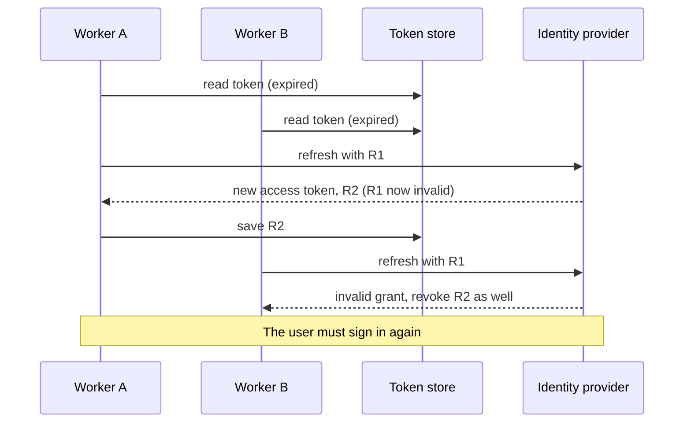

## Start with the assistant that saw everything

Coverack Insurance, a fictional commercial insurer, built an assistant for its broker-support staff. It answered questions about policies and renewals by reading the customer relationship management (CRM) system.

To get going quickly, the team connected the assistant with one integration account. The CRM administrator gave it a role that could read every account, "so it never hits a permission error".

Coverack's 40 largest clients were restricted in the CRM to the key-accounts team. In week three, a support assistant in her first month asked about one of them by name. The assistant returned the renewal premium, the claims history and a note about a pricing dispute. In the CRM's own screens she could not have opened that account.

The CRM checked permissions on every call. It checked them for the integration account, which could see everything. Call this **the assistant that saw everything**.

> **What you'll learn**
>
> - The two identities a connector can use, and how OAuth issues each one.
> - How scopes and roles limit what a token can do.
> - A rule for choosing the identity per call, not per connector.
> - Why concurrent token refreshes fail, and how to refresh safely.

## Two identities for one connector

Every call a connector makes runs as someone. The [service accounts and least privilege](../../fde-deploying-in-the-estate/networks-and-identity/03_Service_Accounts_and_Least_Privilege.md) lesson introduces delegated and service access. Here is how each looks when you connect to a customer's software-as-a-service system with OAuth 2.0, the common standard for issuing access tokens.

- **On behalf of a user.** The user signs in to the customer's identity provider and agrees to let your application act for them. Your application receives an **access token**, which carries that user's permissions, and usually a **refresh token** to get new access tokens later. This is the authorisation code flow.
- **As a service account.** Your application authenticates as itself, with a client ID and a secret or a signed assertion, and receives an access token for its own account. No user is involved, and the client credentials flow does not issue a refresh token. The application asks for a new access token when the old one expires.

The switcher replays Coverack's question with each identity.

A new support assistant asks: "What is the renewal premium for Penhallow Marine?" The account is restricted to the key-accounts team.

<button type="button" data-mode="service" aria-pressed="false" aria-controls="service-result">Integration account</button>
<button type="button" data-mode="delegated" aria-pressed="false" aria-controls="delegated-result">On behalf of the user</button>

<section id="service-result" class="mode-panel" data-announcement="Integration account selected. The restricted account is returned."><h4>Integration account with read-all</h4><ul><li>The CRM sees the integration account, which may read every account.</li><li>It returns the premium, the claims history and the dispute note.</li><li>The audit log shows the integration account, not the person who asked.</li></ul>
The CRM's own restriction is bypassed, and nobody can tell who saw what.
</section>
<section id="delegated-result" class="mode-panel" data-announcement="On behalf of the user selected. The CRM refuses access."><h4>Token issued for the support assistant</h4><ul><li>The CRM sees the support assistant's identity and her role.</li><li>It refuses the restricted account, as its own screens would.</li><li>The assistant replies that she does not have access and names the team that does.</li></ul>
The CRM enforces its own rules, and the audit log names the person.
</section>

The scenario is illustrative. Its point: when the connector runs as the user, the customer's system keeps doing the permission checks it already does well. When it runs as a service account, your code must reproduce those checks, and it rarely reproduces all of them.

## Scopes ask for less

A **scope** names what a token may be used for, such as reading contacts or writing tickets. The application asks for scopes, the user or an administrator consents, and the token is limited to them. Scopes cap the token. The user's own permissions still apply underneath for a delegated token.

- **Ask for the smallest set.** If the assistant only reads, do not request write scopes. A leaked read-only token does less harm.
- **Split readers and writers.** A nightly export and an agent that updates tickets need different scopes. Give them different clients or accounts. Then you can revoke one without stopping the other.
- **Expect administrator consent.** Many customers require an administrator to approve an application's scopes for the whole organisation. Book that approval early. It can take weeks.

For a service account, the role assigned in the customer's system matters more than the scope. Ask for a role built for the connector, with only the objects and fields it needs, and an owner on the customer's side.

## Choose the identity per call

Coverack's mistake was choosing one identity for the whole connector. Choose it for each kind of call.

| Call | Identity | Why |
|---|---|---|
| A user asks the assistant about a record | On behalf of the user | The system of record applies that user's permissions and logs their name |
| A nightly sync of all open tickets | Service account with a narrow role | No user is present, and the job needs a consistent view |
| An agent updates a ticket after a user approves | On behalf of the user, or a service account that records the approver | The change must be traceable to a person |
| A search index built from many users' records | Service account, with permissions stored per record and filtered at query time | The index is shared. Every answer must be filtered for the asker |

*Table 1: Identity by kind of call.*

The last row is the hard one. If the connector copies records into your own index, the customer's permission checks no longer run. Store who may see each record with it, refresh those permissions on a schedule, and filter every answer for the person asking.

## Tokens expire, and refreshes collide

Access tokens are short-lived, often an hour. A stolen one stops working soon. A delegated connection uses its refresh token to get a new access token without asking the user to sign in again.

Many identity providers now **rotate** refresh tokens. Each refresh returns a new refresh token and invalidates the old one. If the old one is presented again, the provider treats it as a possible theft and may revoke the whole chain, as the OAuth security best practice describes. That protection creates a race inside your own connector, shown in Figure 1.

*Figure 1: Two workers refresh the same connection at once. With rotation, the second refresh looks like a stolen token.*

At Coverack, after the fix to delegated access, eight workers shared each user's connection. Every hour, a few users were logged out of the assistant with no explanation. The cause was two workers seeing the same expired token within milliseconds of each other.

## Refresh safely

The cure is to make one refresh per connection happen at a time, and to make everyone else wait for its result.

- **One refresher per connection.** Take a lock keyed by the connection before refreshing, with a lease so a crashed worker cannot hold it for ever. Other workers wait, then read the new token from the store.
- **Check again after the lock.** A worker that gets the lock re-reads the store first. If another worker already refreshed, it uses that token and skips its own refresh.
- **Save before use.** Write the new access token and refresh token together, in one step, before any call uses them. A crash after the refresh but before the save loses the only valid refresh token.
- **Refresh early.** Refresh a few minutes before expiry, from one place. Requests then rarely meet an expired token.
- **Treat a rejected refresh as final.** An "invalid grant" answer means retrying will not help. Mark the connection as needing the user to reconnect, tell them, and stop calling.

Service accounts have a milder form of the same problem. Many workers fetching new tokens at once waste requests against the provider's limits. One shared token cache, refreshed early, solves both.

Tokens are secrets. Store them encrypted, keep them out of logs, and delete a user's tokens when they leave. The [secrets and leaks](../../fde-deploying-in-the-estate/networks-and-identity/04_Secrets_and_Leaks.md) lesson covers storage and rotation.

## Limits of this lesson

- **Providers differ.** Token lifetimes, rotation, grace periods for a reused refresh token and consent rules vary. Read the provider's documentation before relying on any of them.
- **Sign-in is taught elsewhere.** How users sign in with the customer's identity provider is in the [single sign-on and tokens](../../fde-deploying-in-the-estate/networks-and-identity/02_SSO_OIDC_and_Tokens.md) lesson.
- **Fictional data.** Coverack Insurance, Penhallow Marine and the figures are illustrative.

## Interview angle

Each answer is an outline to say in about two minutes. Open the question and try it aloud before reading.

Interview question 1. Your connector reads and writes a customer's ticketing system. When do you use OAuth on behalf of a user, and when a service account?

- **Answer:** Use the user's delegated token when a person asks for something, so the ticketing system applies their permissions and its audit log names them. Use a service account for work no user starts, such as a nightly sync, with a role built for the connector and the smallest scopes. Where a service account writes after a person approves, record the approver with the change. If you copy records into your own store, keep each record's permissions and filter every answer for the asker.
- **Trade-off:** Delegated tokens keep the customer's checks but expire, need consent and fail for long jobs. Service accounts are simpler but make your code the permission check.
- **Follow-up to expect:** "The admin offers a read-all account to save time." Decline for user-facing calls, and show what a junior user could then see.

Interview question 2. Users are randomly logged out of your integration about once an hour. Logs show "invalid grant" on refresh. What is happening and how do you fix it?

- **Answer:** Likely a refresh race. Access tokens last an hour, several workers see the same expired token, and each refreshes with the same refresh token. The provider rotates refresh tokens, so the second use looks like a replay and it revokes the connection. Fix it with one refresher per connection behind a lock with a lease, a re-read of the store after taking the lock, saving the new token pair atomically before use, and refreshing a few minutes early from one place.
- **Trade-off:** The lock adds a short wait for other workers once an hour. Without it, users are logged out.
- **Follow-up to expect:** "Could you turn rotation off?" It protects against stolen tokens. Fix the race instead.

## References

1. IETF, [RFC 6749: The OAuth 2.0 Authorization Framework](https://www.rfc-editor.org/rfc/rfc6749), accessed 17 November 2026. The authorisation code and client credentials flows, scopes and refresh tokens.
2. IETF, [RFC 9700: Best Current Practice for OAuth 2.0 Security](https://www.rfc-editor.org/rfc/rfc9700), accessed 17 November 2026. Refresh token rotation and revoking a token chain on reuse.
3. The site's [service accounts and least privilege](../../fde-deploying-in-the-estate/networks-and-identity/03_Service_Accounts_and_Least_Privilege.md) lesson, for delegated and service access in general.
4. The author's own field experience, the basis for the per-call identity table and the refresh rules.

## Key takeaways

- A connector call runs either on behalf of a user or as a service account. Choose per kind of call.
- Delegated tokens let the customer's system apply its own permissions and name the person in its audit log.
- Ask for the smallest scopes, split readers from writers, and book administrator consent early.
- Rotated refresh tokens turn concurrent refreshes into revoked connections.
- Refresh once per connection behind a lock, save the new pair before use, refresh early, and stop on "invalid grant".

## Check yourself

1. Why did the CRM's restriction on key accounts not stop Coverack's assistant?

The CRM checked permissions for the integration account, which could read every account, not for the person asking.

2. Why does the second refresh in Figure 1 also break the first worker's new token?

The provider sees an old refresh token reused, treats it as theft and revokes the whole chain, including R2.

3. Why re-read the token store after taking the refresh lock?

Another worker may have refreshed while this one waited. Using the stored token avoids a second, conflicting refresh.

