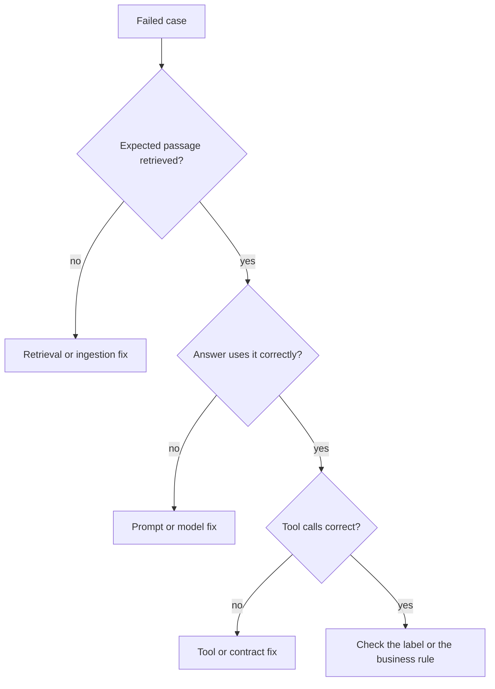

## Start with the exam the team wrote

Brisco Utilities built an assistant that helps contact-centre agents answer billing questions. Imran, the forward deployed engineer, and the project team wrote 300 test questions, each with one clear answer in one document; the assistant scored 92%, and the sponsor approved the rollout. Within a month agents rated it poorly and many stopped using it. Their real questions were long, had several parts, mixed two accounts or concerned a disputed bill where the answer depended on the customer's history, and a sample of 200 of them scored 64%. Call this **the exam the team wrote for itself**: the test set measured what the team expected people to ask.

> **What you'll learn**
>
> - Build an evaluation set from the customer's real work.
> - Measure output quality, task success and business outcome.
> - Combine retrieval and answer accuracy, and attribute each failure.
> - Calibrate an LLM judge and catch its preference for long answers.
> - Find rare, costly regressions that an average hides.

## Sample the real work

An evaluation set should look like the work the system will do. Build it from the customer's records, not from imagination:

- **Pull real requests.** Take questions from call notes, tickets or search logs across at least a full billing cycle, so seasonal topics appear.
- **Stratify by category.** Make sure each kind of request appears, in rough proportion to how often it occurs.
- **Over-sample the costly cases.** Disconnections, vulnerable customers and complaints are rare and expensive to get wrong. Include enough to measure them, at least 25 each.
- **Have experts label.** Brisco's team leaders wrote the expected answer and the source passage for each case. A smaller set with expert labels beats a larger one with guessed labels.
- **Freeze a test split.** Keep a set you never tune against, and a separate development set you look at freely.

For a policy assistant the same steps apply, with two additions: include questions whose answer changed when a policy was updated, and questions the policies do not answer, where the right response is to decline. The site's [golden sets and sample size](../../../../01_Concept_Tutorials/Consolidated_Lessons/T4.2_Evaluation_and_Release_Gates/03_Golden_Sets_and_Sample_Size.md) lesson covers how many cases a given confidence needs. The same set can pick the model, as in [picking a model for a customer](../choosing-the-ai-approach/02_Picking_a_Model_for_a_Customer.md).

## Three levels of success

A system can produce good answers and still fail the business. Measure at three levels, at different speeds:

| Level | Brisco example | How measured | How often |
| --- | --- | --- | --- |
| Output quality | Answer correct and cited | Evaluation set, automated | Every change |
| Task success | Billing query resolved on the first call | Call records | Weekly |
| Business outcome | Average handling time, repeat calls | Contact-centre reports | Monthly |

*Table 1: Three levels of success at Brisco. The sponsor signed for the third.*

Agreeing these measures and their bars with the sponsor is discovery work, covered in [success metrics and evaluation data](../../../../01_Concept_Tutorials/Consolidated_Lessons/T6.1_Customer_Discovery_and_Problem_Decomposition/03_Success_Metrics_and_Evaluation_Data.md).

When output quality rises and the business outcome does not move, look outside the model. At Brisco, agents re-checked every answer in the billing system because early answers had been wrong. Handling time fell only after trust returned.

## Retrieval and answer accuracy together

A retrieval-augmented generation (RAG) answer can fail at retrieval, at generation or, for agents, at a tool call. Measure each stage on the same labelled cases:

- **Retrieval hit rate.** Was the expected passage among the top five retrieved? Brisco: 88%.
- **Answer accuracy given the right passage.** Of the cases where it was retrieved, how many answers were correct? Brisco: 90%.
- **End-to-end accuracy.** Measured directly on all cases: 78%.

If the stages failed independently, end-to-end accuracy would be about 0.88 × 0.90 = 79%. The measured 78% is close, and the gap is worth a look. Always measure end to end directly, because stages interact.

The same labelled set lets you compare retrieval designs. Brisco ran keyword, vector and hybrid search on 300 labelled questions. Hit rates were 71%, 80% and 88%, and hybrid search went live.

Figure 1 shows how to attribute a single failure.

*Figure 1: Attributing a failure stage by stage. Each answer sends the fix to the stage that broke.*

This needs the trace of every stage stored with each case. See [component and trajectory metrics](../../../../01_Concept_Tutorials/Consolidated_Lessons/T4.2_Evaluation_and_Release_Gates/02_Component_and_Trajectory_Metrics.md).

## Judges that prefer long answers

An **LLM judge** is a large language model (LLM) that scores another model's output. It is cheap and fast, and it has known biases. Research on judges reports a preference for longer answers and for the answer shown first.

Brisco found this. Two team leaders labelled 150 answers as acceptable or not. The judge agreed with them on 71% of cases. Where a short correct answer was compared with a longer one, the judge preferred the longer one in 68% of pairs, including some that were wrong.

Calibrate before trusting a judge:

- **Write a rubric of checks**, such as "states the correct amount" and "cites the tariff", instead of asking for an overall score.
- **Swap positions** in pairwise comparisons and count only consistent verdicts.
- **Measure agreement** with human labels, and set the bar in advance. Brisco required 85%.
- **Re-check** after any change to the judge's model or prompt.

After a rubric and swapped positions, agreement reached 87%. People also need a rubric: score an operations agent on correctness, completeness, the action taken and tone, with an example of each grade. See [validating LLM judges](../../../../01_Concept_Tutorials/Consolidated_Lessons/T4.2_Evaluation_and_Release_Gates/04_Validating_LLM_Judges.md).

## Rare, costly regressions

An average can rise while the cases that matter most get worse. Brisco tagged 25 cases about disconnections and vulnerable customers. The switcher compares two releases.

Brisco's evaluation set has 600 cases, 25 of them tagged high impact. Each release ran three times, because outputs vary between runs.

<button type="button" data-mode="overall" aria-pressed="false" aria-controls="overall-result">Overall score</button>
<button type="button" data-mode="slice" aria-pressed="false" aria-controls="slice-result">High-impact slice</button>

<section id="overall-result" class="mode-panel" data-announcement="Overall score selected. New release scores higher."><h4>Overall score</h4><ul><li>Current release: 548 of 600 correct, 91.3%.</li><li>New release: 560 of 600 correct, 93.3%.</li><li>The new release looks better by two points.</li></ul>
On this view the release ships.
</section>
<section id="slice-result" class="mode-panel" data-announcement="High-impact slice selected. New release drops from 24 to 19 of 25."><h4>High-impact slice</h4><ul><li>Current release: 24 of 25 correct.</li><li>New release: 19, 18 and 20 of 25 across three runs.</li><li>Every run is lower, so the drop is not noise.</li></ul>
The new prompt shortened answers and dropped the step that offers a priority support referral. The release is blocked.
</section>

Make the rule explicit: a release gate checks each tagged slice on its own, with a threshold set by the business owner, such as no drop at all for high-impact cases. Run each release several times, because model outputs vary, and compare the range rather than one score. See [release gates](../../../../01_Concept_Tutorials/Consolidated_Lessons/T4.2_Evaluation_and_Release_Gates/05_Release_Gates_Safety_Quality_and_Cost.md).

## Limits of this lesson

- **Labels drift.** When a policy changes, old expected answers become wrong. Date every label.
- **Small slices are noisy.** With 25 cases, one case is four points. Repeat runs and read the range.
- **Composite engagement.** Brisco Utilities, Imran and their figures are illustrative, not a real customer.

## Interview angle

Each answer is an outline to say in about two minutes. Open each question and try it aloud before reading.

Interview question 1. Your assistant scores well on the evaluation set, but users say it is poor. What do you do?

- **Answer:** Assume the set does not match the work. Sample 200 real requests from logs or tickets, have the customer's experts label them, and score the system. Compare categories with the set to find what is missing, such as multi-part or account-specific questions. Rebuild the set by stratified sampling from real work, and add every complaint as a case.
- **Trade-off:** Expert labelling is slow. A set nobody trusts is slower.
- **Follow-up to expect:** "Users never complain, they stop using it." Track usage and abandonment per category.
- **Go deeper:** [Golden sets and sample size](../../../../01_Concept_Tutorials/Consolidated_Lessons/T4.2_Evaluation_and_Release_Gates/03_Golden_Sets_and_Sample_Size.md).

Interview question 2. A new release improves the average but gets worse on a rare, high-stakes case type. How would you catch it?

- **Answer:** Tag the high-impact cases and report them as their own slice. Set a gate per slice with the business owner, such as no drop at all. Over-sample those cases so the slice has at least 25. Run each release several times and compare ranges, because outputs vary. Block the release when the slice falls in every run.
- **Trade-off:** Strict slice gates block some releases that help most users. That is the right cost for cases where an error harms someone.
- **Follow-up to expect:** "The slice is too small to be significant." Add cases, and treat a consistent drop across runs as a stop.
- **Go deeper:** [Release gates](../../../../01_Concept_Tutorials/Consolidated_Lessons/T4.2_Evaluation_and_Release_Gates/05_Release_Gates_Safety_Quality_and_Cost.md).

Interview question 3. Your LLM judge keeps rating long answers higher than short correct ones. How do you fix it?

- **Answer:** Replace the overall score with a rubric of specific checks, such as correct amount and correct citation. In pairwise comparisons, swap positions and keep only consistent verdicts. Label 150 cases with people, measure the judge's agreement, and require a threshold agreed in advance before using it. Re-check after any change to the judge.
- **Trade-off:** A calibrated rubric costs labelling time. An uncalibrated judge rewards padding.
- **Follow-up to expect:** "What agreement is good enough?" Close to the agreement between two human labellers on the same cases.
- **Go deeper:** [Validating LLM judges](../../../../01_Concept_Tutorials/Consolidated_Lessons/T4.2_Evaluation_and_Release_Gates/04_Validating_LLM_Judges.md).

## References

1. Lianmin Zheng and others, [Judging LLM-as-a-judge with MT-Bench and Chatbot Arena](https://arxiv.org/abs/2306.05685), accessed 17 November 2026. Position, verbosity and self-enhancement biases in LLM judges.
2. Google, [Monitoring distributed systems](https://sre.google/sre-book/monitoring-distributed-systems/), accessed 17 November 2026. Why an average hides the tail of a distribution, from the Site Reliability Engineering book.
3. The site's [component and trajectory metrics](../../../../01_Concept_Tutorials/Consolidated_Lessons/T4.2_Evaluation_and_Release_Gates/02_Component_and_Trajectory_Metrics.md) lesson, the deep dive on stage-level metrics.
4. The author's own field experience, the basis for the three-level measurement table.

## Key takeaways

- Build evaluation sets from real requests, stratified, with costly cases over-sampled.
- Measure output quality, task success and business outcome, each at its own speed.
- Measure retrieval, answer and end-to-end accuracy on the same cases, and attribute each failure.
- Calibrate judges against people with a rubric, swapped positions and an agreed bar.
- Gate releases on high-impact slices, with repeated runs.

## Check yourself

1. Why did Brisco's 92% not predict real performance?

The team wrote the questions, and they were simpler than real ones. Real questions were multi-part and account-specific, and scored 64%.

2. Retrieval hit rate is 88% and answer accuracy given the right passage is 90%. What end-to-end accuracy would you expect, and why measure it anyway?

About 79% if the stages failed independently. Stages interact, so measure end to end directly. Brisco measured 78%.

3. Why did the new release fail even though its overall score rose?

The high-impact slice dropped from 24 to between 18 and 20 of 25 in every run, and the gate checks that slice on its own.

