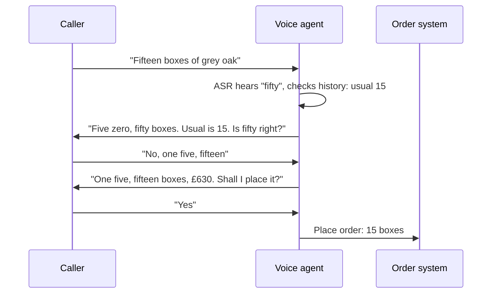

## Start with the fifty that was fifteen

Tarrow Retail runs a trade counter for builders and fitters, and Martha, the forward deployed engineer, added a voice agent to the trade phone line so customers could place repeat orders without waiting for staff. A fitter called from a van on a busy road and ordered "fifteen boxes of the grey oak floor tiles". The speech recogniser heard "fifty", the agent placed the order, and the warehouse delivered 50 boxes the next morning. Returning the extra 35 boxes at £42 each sent £1,470 of stock back through the warehouse and left an annoyed customer. Call this **the fifty that was fifteen**: the agent did exactly what it heard, and nobody checked what it heard.

> **What you'll learn**
>
> - Know where speech recognition fails on numbers, codes and names.
> - Confirm before acting, in a form that catches the common errors.
> - Use screenshots and photos as input, and check what the model reads.
> - Choose where support and operations automation should start.

## Where speech goes wrong

**Automatic speech recognition (ASR)** turns audio into text. It does well on everyday words and worse on exactly what operations depend on:

- **Numbers that sound alike.** Fifteen and fifty, thirteen and thirty, especially on a phone line with background noise.
- **Codes and references.** Order numbers, postcodes and product codes, where every character matters and nothing in the language helps.
- **Names.** Customer and street names, often outside the recogniser's vocabulary.
- **Accents and line quality.** Error rates rise on mobile calls from vans and building sites, which is where Tarrow's trade customers call from.

Recognisers let you help them. Google's Speech-to-Text, for example, supports class tokens for digit sequences, and most services accept phrase hints such as the customer's product names. Use them, and measure the error on recorded calls from the customer's own lines, labelled by a person. Vendor accuracy figures come from other audio.

## Confirm before acting

A **confirmation** reads the key facts back to the caller and waits for a clear yes before any action. Voice platforms such as Amazon Lex build confirmation prompts into their intent design. The question is what to read back.

Tarrow's trade line takes about 1,200 voice orders a week, and about 1 in 100 had a misheard quantity. The switcher compares three confirmation designs on those 12 orders a week.

About 12 orders a week arrive with a misheard quantity. Each design is applied to the same calls.

<button type="button" data-mode="noconfirm" aria-pressed="false" aria-controls="noconfirm-result">No confirmation</button>
<button type="button" data-mode="readback" aria-pressed="false" aria-controls="readback-result">Read back the order</button>
<button type="button" data-mode="twoforms" aria-pressed="false" aria-controls="twoforms-result">Two forms and a sense check</button>

<section id="noconfirm-result" class="mode-panel" data-announcement="No confirmation selected. All 12 wrong orders reach the warehouse."><h4>No confirmation</h4><ul><li>The agent places the order as heard.</li><li>All 12 wrong orders a week reach the warehouse.</li></ul>
The fastest call, and the most returns.
</section>
<section id="readback-result" class="mode-panel" data-announcement="Read back selected. About 5 wrong orders a week still get a yes."><h4>Read back the order</h4><ul><li>"Fifty boxes of grey oak floor tiles. Shall I place that?"</li><li>Callers in a hurry say yes without listening. About 5 of the 12 still go through.</li></ul>
Better, and the same mishearing can repeat in the read-back.
</section>
<section id="twoforms-result" class="mode-panel" data-announcement="Two forms and a sense check selected. About 1 wrong order a week gets through."><h4>Two forms and a sense check</h4><ul><li>"That is five zero, fifty boxes. Your usual order is 15. Is fifty right?"</li><li>Digits plus words, and a comparison with the customer's history, catch most errors.</li><li>About 1 of the 12 still gets through.</li></ul>
Adds a few seconds per call. Tarrow chose this.
</section>

The design principles behind the third option:

- **Say numbers two ways.** Digit by digit and as a word, so "one five" and "five zero" sound different.
- **Spell codes back** in groups, using the phonetic alphabet for letters.
- **Compare with what is normal** for this customer, such as order history or account balance, and say so when the request is unusual.
- **Confirm the total** for money: "That comes to £2,100 before VAT."
- **Escalate after two failed confirmations** to a person, keeping the transcript.

Figure 1 shows a voice turn with confirmation before the action.

*Figure 1: A voice turn at Tarrow. The sense check against history catches the mishearing before any order is placed.*

The same rule applies in any channel where the model's input is uncertain: confirm the facts that drive an irreversible action, in a form that exposes likely errors.

## Speed on a live call

People notice gaps in conversation quickly. A voice agent needs short turns, which pushes towards smaller or faster models, streaming speech output and shorter prompts. Keep slow work, such as stock checks, running while the agent speaks, and say what is happening during a wait. Do not trade away the confirmation for speed. A few seconds is cheaper than a returned delivery.

## Screenshots and photos as input

Multimodal models read images. In operations that means screenshots of error messages, photos of damaged goods, delivery notes and meter readings. They help diagnose problems fast, and they bring three risks:

- **Misread values.** A model reading a screenshot is doing extraction. Check order numbers against the system and amounts against records, as in [extraction you can trust](02_Extraction_You_Can_Trust.md).
- **Other people's data.** A support screenshot often shows other customers, open tabs or a password manager. Ask for a cropped image, redact before storage, and keep retention short.
- **Text that gives orders.** Text inside an image is untrusted content, covered in [untrusted content in customer data](06_Untrusted_Content_in_Customer_Data.md).

A support flow that combines voice and screenshots works best when each input confirms the other. At Tarrow, a customer reporting a website error describes it on the call, sends a screenshot by text message, and the agent reads back the order number it sees: "I can see order 88213, a sofa, with a payment error. Is that the one?" See the site's [multimodal prompting](../../../../01_Concept_Tutorials/RAG_Agents_Engineering/p02_prompt_engineering/m05_multimodal_prompting/00_overview.md) module for the mechanics.

## Where automation pays first

Support and operations work ranges from tasks where an error is cheap to tasks where it is costly. Start where mistakes are cheap and volume is high, and earn the right to act:

| Stage | Example at Tarrow | Cost of an error |
| --- | --- | --- |
| Assist staff | Call summaries and suggested replies, edited by staff | Low, a person checks |
| Route and look up | Sending calls to the right team, reading order status | Low, a wrong queue is moved |
| Act with confirmation | Repeat orders, delivery rebooking | Medium, reversible |
| Act on money | Refunds, credit limits | High, keep approvals |

*Table 1: Stages of support automation at Tarrow. Each stage starts only when the one before has measured results.*

Each stage produces the evidence for the next: transcripts with labels, error rates on real calls and a record of what customers accept.

## Limits of this lesson

- **Recognition varies by line and caller.** Measure on the customer's own recorded calls, with consent and their retention rules.
- **Confirmations annoy regular callers.** Tune what is read back by risk, but keep it for actions that are costly to reverse.
- **Composite engagement.** Tarrow Retail, Martha and their figures are illustrative, not a real customer.

## Interview angle

Each answer is an outline to say in about two minutes. Open each question and try it aloud before reading.

Interview question 1. A company wants AI to take phone calls and read customer photos in its support and operations teams. What changes compared with a text chatbot?

- **Answer:** Speech recognition mishears numbers, codes and names, so confirm key facts before acting. Latency matters more on a call, which favours faster models and streaming. Images help diagnosis. Reading one is extraction: check values against records and redact other people's data. Start with summaries and routing, where errors are cheap, then act with confirmation.
- **Trade-off:** Confirmations and checks lengthen calls. They prevent costly wrong actions.
- **Follow-up to expect:** "Where would you start in a contact centre?" After-call summaries, edited by staff.
- **Go deeper:** [Multimodal prompting](../../../../01_Concept_Tutorials/RAG_Agents_Engineering/p02_prompt_engineering/m05_multimodal_prompting/00_overview.md).

Interview question 2. A voice agent places an order for the wrong quantity because it misheard a number. How do you redesign it?

- **Answer:** Confirm before any order. Read numbers back two ways, digits and words, and compare with the customer's normal order, saying when it is unusual. Confirm the total. Give the recogniser hints for numbers and product names. Escalate to a person after two failed confirmations. Measure mishearing on labelled recordings of real calls.
- **Trade-off:** A sense check adds seconds to each call. It removes most costly errors.
- **Follow-up to expect:** "Customers find it slow." Skip the sense check when the request matches history, and keep the read-back.

## References

1. Google Cloud, [Supported class tokens](https://cloud.google.com/speech-to-text/docs/class-tokens), accessed 17 November 2026. Recognition hints for digit sequences and other number formats.
2. Amazon Web Services, [Confirmation in Amazon Lex V2](https://docs.aws.amazon.com/lexv2/latest/dg/intent-confirm.html), accessed 17 November 2026. Confirmation prompts before an intent is fulfilled.
3. OWASP, [LLM01: Prompt injection](https://genai.owasp.org/llmrisk/llm01-prompt-injection/), accessed 17 November 2026. Instructions hidden in images as an injection route.
4. The site's [multimodal prompting](../../../../01_Concept_Tutorials/RAG_Agents_Engineering/p02_prompt_engineering/m05_multimodal_prompting/00_overview.md) module, the deep dive on image inputs.

## Key takeaways

- Expect speech recognition to fail on numbers, codes and names, and measure it on real calls.
- Confirm before acting: numbers two ways, codes spelled, totals stated, unusual requests flagged.
- Keep calls fast, but never by dropping the confirmation.
- Treat reading a screenshot as extraction, and redact other people's data.
- Automate where errors are cheap first, and act on money last.

## Check yourself

1. Why did a plain read-back still let about 5 of the 12 wrong orders through?

Callers in a hurry say yes without listening, and the read-back repeats the misheard number in the same form.

2. In Figure 1, what catches the mishearing?

The sense check. The agent compares 50 with the customer's usual 15 and says so, prompting the caller to correct it.

3. Why are after-call summaries a good first step for support automation?

A person reads and edits each one, so an error is cheap, and the summaries build labelled data for later stages.

