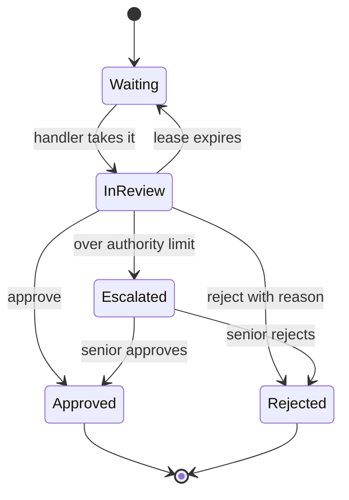

## Start with the overpaid claim

Pelham Insurance, a home insurer, reviews every claim a model has read before paying it, on a review screen that Marcus, the forward deployed engineer, built to save whatever arrived last. One morning a water-damage claim arrived with a proposed payout of £4,200, and two handlers opened it within a minute of each other. Aisha spotted that the model had missed the £400 excess and the depreciation on a five-year-old carpet, corrected the payout to £2,400 and saved at 10:14:02. Ben, still looking at the version he had loaded earlier, approved at 10:14:09. His approval wrote the whole record back, £4,200 included, over Aisha's correction, and Pelham paid £1,800 too much. The record showed only "last modified by Ben", so Aisha's correction left no trace. Call this **the silent overwrite**.

> **What you'll learn**
>
> - Design a review queue: what enters it, in what order and who works each item.
> - Store corrections as data, not as overwrites.
> - Stop two reviewers overwriting each other, with leases or version checks.
> - Bind an approval to the exact version that was approved.
> - Keep an audit history that answers who changed what, when and why.

## The review queue

A **review queue** is the list of items waiting for a person's decision. Three design choices shape it.

**What enters the queue.** Not every item needs a person. Pelham routes a claim to review when the model's extraction fails a business check, when its confidence is below a threshold measured on past claims, or when the payout is over £1,000. Everything else is paid automatically and sampled for quality. The thresholds come from measured error, not intuition.

**What order it is worked in.** Order by what the business cares about: claims near their service deadline first, then by value. A queue sorted by arrival time hides the urgent items, which is the same mistake as the dashboard of everything in [screens built around decisions](01_Screens_Built_Around_Decisions.md).

**Who works each item.** A handler takes the next item, and the queue marks it as theirs. This is the first defence against two people working on the same claim.

Each item moves through a small set of states. Figure 1 shows Pelham's.

*Figure 1: Review states at Pelham. A claim taken by a handler returns to the queue if the lease expires, and a claim above the handler's limit goes to a senior.*

## Corrections are data

When Aisha changes £4,200 to £2,400, the system should keep both numbers. Store each correction as its own record: the field, the original value, the new value, who changed it, when, and a reason chosen from a short list, such as "excess not applied" or "depreciation missed".

This pays three times:

- **Trust.** Anyone can see that the model proposed £4,200 and a person changed it.
- **Measurement.** Correction rates per field show where the model is weak. If 30% of payouts are corrected for a missed excess, that is a fix for the extraction, not for the handlers.
- **Review thresholds.** The routing thresholds in the queue are set and reset from these measured correction rates.

Never write the correction over the model's output and lose the original. That throws away the evidence needed to improve the system.

## Two reviewers, one record

The queue's assignment reduces collisions, but it does not stop them. A supervisor can open any claim, and a handler can keep an old tab open. Pelham's failure is the classic **lost update**: two people read the same version, both change it, and the second save silently discards the first.

There are three common designs. The switcher compares them on Pelham's morning.

Aisha saves a corrected payout of £2,400 at 10:14:02. Ben approves from a stale screen showing £4,200 at 10:14:09. Compare what each design does with Ben's request.

<button type="button" data-mode="last-write" aria-pressed="false" aria-controls="last-write-result">Last write wins</button>
<button type="button" data-mode="lease" aria-pressed="false" aria-controls="lease-result">Lease on the claim</button>
<button type="button" data-mode="version" aria-pressed="false" aria-controls="version-result">Version check</button>

<section id="last-write-result" class="mode-panel" data-announcement="Last write wins selected. Correction lost, 1,800 pounds overpaid."><h4>Last write wins</h4><ul><li>Ben's save writes £4,200 over Aisha's £2,400.</li><li>Nobody is warned. Pelham pays £1,800 too much.</li></ul>
Simplest to build. Silently wrong whenever two people overlap.
</section>
<section id="lease-result" class="mode-panel" data-announcement="Lease selected. Ben cannot edit while Aisha holds the claim."><h4>Lease on the claim</h4><ul><li>Aisha took the claim at 10:12 with a 15-minute lease.</li><li>Ben opens it read-only: "Aisha is reviewing this claim."</li><li>If Aisha goes to lunch, the lease expires and the claim returns to the queue.</li></ul>
Prevents the overlap, at the cost of waits and expired leases.
</section>
<section id="version-result" class="mode-panel" data-announcement="Version check selected. Ben's approval rejected as stale."><h4>Version check</h4><ul><li>Ben loaded version 7. Aisha's save made it version 8.</li><li>Ben's approval says "approve version 7", and the server refuses it.</li><li>Ben's screen shows Aisha's change and asks him to review again.</li></ul>
No waiting, and no silent loss. The second person redoes a check.
</section>

The **lease** is a form of pessimistic locking: the item belongs to one person for a fixed time. Use an expiry, or one handler's closed laptop blocks the claim all day.

The **version check** is optimistic concurrency. Every record carries a version number that changes on each save. A save or approval states the version it was based on, and the server refuses it if the record has moved on. Martin Fowler's catalogue calls this an optimistic offline lock. Over HTTP, the same idea uses an ETag and an If-Match header, and the server answers 412 Precondition Failed when they do not match.

Pelham uses both. The lease keeps two handlers apart in normal work, and the version check catches the cases the lease misses, such as a supervisor or a stale tab.

## Approval bound to the exact version

An approval is a decision about specific content. Record it as "Ben approved version 8 of claim 55210, payout £2,400", never as a flag on whatever the claim says later. If anything changes after approval, the approval no longer applies and the claim returns for review. An agent's tool call needs the same binding, by a hash of its arguments, as [agents that touch business systems](../ai-delivery-in-customer-estates/04_Agents_That_Touch_Business_Systems.md) shows.

Two further rules protect money and reputations:

- **Authority limits.** Each handler can approve up to a set amount. Above it, the claim escalates to a senior.
- **Separation of duties.** The person who made a change cannot also approve it alone. NIST defines separation of duty as dividing roles so that no single person can misuse the system unchecked. At Pelham, Aisha's correction to £2,400 needs another handler's approval.

## Audit history

An **audit history** answers, for any record and any moment, who did what, when, and why. Build it as an append-only list of events: claim created by the model, field changed by a person, claim approved, payment sent. Each event records the actor, the time, the before and after values, and the reason.

Three properties make it trustworthy:

- **Append-only.** Events are added, never edited or deleted by the application.
- **Written with the change.** The event and the change commit in the same transaction, so one cannot exist without the other.
- **Readable by people.** A claim page shows its history in plain words, so a handler or an auditor can follow it without a database query.

With this in place, finance's question has an answer in seconds: the model proposed £4,200, Aisha corrected it to £2,400 with a reason, and Ben's stale approval was refused. The site's [checkpoints, interrupts and human approval](../../../../01_Concept_Tutorials/Consolidated_Lessons/T2.5_LangChain_and_LangGraph/06_Checkpoints_Interrupts_and_Human_Approval.md) lesson shows the same pattern inside an agent workflow.

## Limits of this lesson

- **Retention rules vary.** How long to keep audit history depends on the customer's regulators and contracts. Ask their compliance lead.
- **Merging edits is out of scope.** Some systems merge non-conflicting changes field by field. That is harder to get right and rarely needed for review queues.
- **Composite engagement.** Pelham Insurance, its handlers and its figures are illustrative, not a real customer.

## Interview angle

Each answer is an outline to say in about two minutes. Open each question and try it aloud before reading.

Interview question 1. Two reviewers open the same record. One corrects a value and saves, and the other approves a few seconds later from an old screen. What should happen, and how do you build it?

- **Answer:** The approval must not overwrite the correction. Give each record a version number. Saves and approvals state the version they were based on, and the server refuses a stale one, returning the reviewer to the latest version with the change shown. Add a lease from the review queue so two people rarely open the same item, and record every change and approval in an append-only history.
- **Trade-off:** Version checks make the second reviewer redo work. Leases prevent that but leave items stuck when people walk away, which is why leases expire.
- **Follow-up to expect:** "Why not lock the record?" A plain lock with no expiry blocks the queue.

## References

1. Martin Fowler, [Optimistic Offline Lock](https://martinfowler.com/eaaCatalog/optimisticOfflineLock.html), accessed 17 November 2026. Detecting conflicts between concurrent business transactions with a version check.
2. IETF, [RFC 9110: HTTP Semantics](https://www.rfc-editor.org/rfc/rfc9110), accessed 17 November 2026. Conditional requests with If-Match and the 412 Precondition Failed status.
3. NIST CSRC, [Separation of duty](https://csrc.nist.gov/glossary/term/separation_of_duty), accessed 17 November 2026. Definition of separation of duty.
4. The site's [checkpoints, interrupts and human approval](../../../../01_Concept_Tutorials/Consolidated_Lessons/T2.5_LangChain_and_LangGraph/06_Checkpoints_Interrupts_and_Human_Approval.md) lesson, for human approval inside agent workflows.

## Key takeaways

- Route items to review by measured error and business rules, ordered by what the business cares about.
- Store each correction with the original value, the new value, the person and the reason.
- Prevent lost updates with expiring leases and a version check on every save and approval.
- Bind each approval to one version, with authority limits and separation of duties.
- Keep an append-only audit history, written in the same transaction as each change.

## Check yourself

1. Why did Ben's approval erase Aisha's correction?

The system wrote the whole record from Ben's stale screen and saved whatever arrived last. Nothing checked that the record had changed since Ben loaded it.

2. Why does Pelham use a version check as well as leases?

Leases keep handlers apart in normal queue work, but a supervisor or a stale tab can still edit. The version check catches those cases on the server.

3. Why keep the model's original value after a person corrects it?

It shows what the model proposed, and correction rates per field show where the model is weak and where review thresholds should sit.

