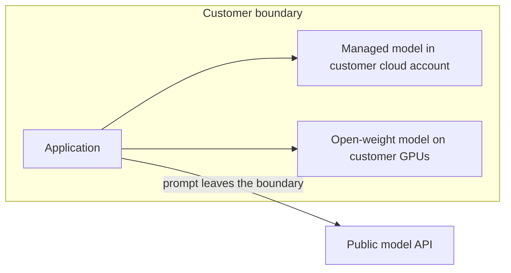

## Start with the boundary found late

Mirelle Pharma, a drug maker, receives about 30,000 adverse-event reports a month and wants a model to draft their coding and flag serious cases. Hana, the forward deployed engineer, built a prototype on a public model API in six weeks, using synthetic reports, and it worked well. When she asked to send the first real report, Ilse, the data-protection officer, said no: reports hold patient health data, and Mirelle's policy keeps that data inside its own cloud account. The rebuild for a different deployment took a month. Call this **the boundary found late**: a deployment choice made by default and found by the customer's data owner after the build.

> **What you'll learn**
>
> - Name three places a model can run, and where the prompt goes in each.
> - Ask the boundary questions in the first week.
> - Count what moving a model inside the customer's boundary costs in money and in people.
> - Weigh version control against upgrade work.

## Three places a model can run

The useful question is where the prompt goes and who runs the thing that answers it. There are three common answers, shown in Figure 1.

*Figure 1: Where the prompt goes. A public API sends it outside the customer's boundary. A managed model in their own cloud account and an open-weight model on their GPUs keep it inside.*

- **Public model API.** The application calls the model provider's endpoint over the internet. The provider runs everything.
- **Managed model in the customer's cloud account.** The customer's cloud provider serves the model in their account and chosen region, under the contract they already have. Amazon Bedrock and Azure OpenAI are examples, and both document how prompts and outputs are handled.
- **Open-weight model on the customer's GPUs.** The customer downloads published model weights and serves them on their own graphics processing units (GPUs), in their cloud network or their data centre. Their team runs it.

Table 1 compares the three on what a customer will ask.

| Question | Public API | Managed in their account | Open-weight on their GPUs |
| --- | --- | --- | --- |
| Where does the prompt go? | Provider's systems | Customer's cloud account and region | Customer's own machines |
| Who runs serving? | Provider | Cloud provider | Customer's team |
| Who chooses when the model changes? | Provider, on its retirement schedule | Cloud provider, on its schedule | Customer |
| Cost shape | Per token | Per token, sometimes reserved capacity | Per GPU-hour, used or not |
| Model choice | That provider's models | The models offered in that region | Published open-weight models |
| Time to first call | Hours | Days, after account approvals | Weeks |

*Table 1: Three deployment options compared on data path, operations, change control and cost shape.*

## Ask the boundary questions in week one

The boundary is a policy written by the customer, so read the policy itself, not a summary of it. Five questions settle most cases:

1. **What data will the prompts contain?** Personal, health, payment or trade-secret data each carry their own rules.
2. **Where may that data be processed?** A region, a cloud account, a named network, or only machines the customer owns.
3. **Who may process it?** Some policies allow a cloud provider already under contract but no new processor.
4. **May anyone keep it or train on it?** Ask for the provider's written terms on retention and training, not a sales answer.
5. **Who signs off?** Name the person, such as the data-protection officer, and book their review before any build.

At Mirelle, the answers were: health data, processed only in Mirelle's cloud account in one European region, by processors already under contract, no retention, sign-off by Ilse. A public API failed question 2. The managed service in Mirelle's own account could pass, if the model they needed was offered in that region.

The model is one part of the deployment. [SaaS, customer cloud or on-premises](../../fde-deploying-in-the-estate/deployment-models-and-environments/01_SaaS_Customer_Cloud_or_On_Prem.md) covers where the rest of the system runs and who operates it, and [residency, retention and deletion](../../fde-deploying-in-the-estate/security-reviews-and-compliance/03_Residency_Retention_and_Deletion.md) covers keeping every copy of the data in its region.

## What moving inside the boundary costs

Running an open-weight model inside the boundary keeps every prompt on the customer's machines. It also hands their team every job the provider used to do. Count both the money and the work.

The money first, with illustrative prices. Mirelle's 30,000 reports average 3,000 input and 500 output tokens.

| Line | Managed model, per token | Open-weight, per GPU-hour |
| --- | --- | --- |
| Usage | 90 million input, 15 million output tokens | 2 GPUs, 730 hours a month each |
| Price | $3 and $15 per million | $4 per GPU-hour |
| Monthly cost | $270 + $225 = $495 | 2 × 730 × $4 = $5,840 |

*Table 2: Illustrative monthly cost at Mirelle's volume. Two GPUs give one spare for failures and maintenance. Check current prices before quoting either figure.*

At this volume, owned GPUs cost about 12 times more, because they cost the same whether they are busy or idle. Per-GPU cost wins only with steady, high volume that keeps the GPUs busy, so work out the break-even volume before claiming a saving.

Then the work, which no price list shows:

- **Serving.** Install, configure and tune an inference server, and size it for peak load. The next lesson covers that test.
- **Patching.** The server, drivers and libraries need security updates like any other system.
- **On-call.** When the model is down at 02:00, it is the customer's team that gets paged.
- **Evaluation of new versions.** Better open models appear often. Each candidate needs the full evaluation set before it replaces the current one.

A team with no GPU experience needs time to learn this. Ask who will own it after you leave, and get a name.

## Version control against upgrade work

Mirelle's quality team treats the safety system as validated. Any change of model means retesting and a formal sign-off, which takes about three months.

That cuts both ways. A hosted model, public or managed, is retired on the provider's schedule. Anthropic and OpenAI both publish deprecation pages with retirement dates and replacements. If the notice is shorter than Mirelle's three-month retest, the system can be forced off a validated model before its replacement is signed off. An open-weight model never changes unless Mirelle changes it. In exchange, Mirelle owns every patch, and a security fix to the serving stack can itself trigger a retest.

The walkthrough follows Mirelle's decision from policy to a recorded choice.

Follow Mirelle's deployment decision. Each stage shows the input, the decision and what changed.

<button type="button" data-step="0" aria-pressed="false" aria-controls="boundary-step-0">1. Policy</button><button type="button" data-step="1" aria-pressed="false" aria-controls="boundary-step-1">2. Options</button><button type="button" data-step="2" aria-pressed="false" aria-controls="boundary-step-2">3. Cost and work</button><button type="button" data-step="3" aria-pressed="false" aria-controls="boundary-step-3">4. Record</button>

<section id="boundary-step-0" class="step-panel" aria-labelledby="boundary-heading-0"><h4 id="boundary-heading-0">1. Read the policy with its owner</h4><dl><dt>Input</dt><dd>Mirelle's data policy and an hour with Ilse.</dd><dt>Decision</dt><dd>Health data stays in Mirelle's cloud account in one region, with existing processors only.</dd><dt>What changes</dt><dd>The public API is out before any more code is written.</dd></dl></section><section id="boundary-step-1" class="step-panel" aria-labelledby="boundary-heading-1"><h4 id="boundary-heading-1">2. Check what runs inside</h4><dl><dt>Input</dt><dd>The cloud provider's model list for that region.</dd><dt>Decision</dt><dd>Two suitable models are offered as a managed service in Mirelle's account. Two open-weight models are also candidates.</dd><dt>What changes</dt><dd>Four candidates go into the evaluation set of 300 labelled reports.</dd></dl></section><section id="boundary-step-2" class="step-panel" aria-labelledby="boundary-heading-2"><h4 id="boundary-heading-2">3. Compare cost and work</h4><dl><dt>Input</dt><dd>Evaluation results and Table 2.</dd><dt>Decision</dt><dd>One managed model and one open-weight model clear the quality bar. The managed one costs $495 a month against $5,840 and needs no GPU team.</dd><dt>What changes</dt><dd>The managed model is the choice, with one open risk: its retirement date.</dd></dl></section><section id="boundary-step-3" class="step-panel" aria-labelledby="boundary-heading-3"><h4 id="boundary-heading-3">4. Record the choice and its trigger</h4><dl><dt>Input</dt><dd>The decision and the three-month retest.</dd><dt>Decision</dt><dd>Write a decision record. Move to the open-weight model if retirement notice ever falls below three months.</dd><dt>What changes</dt><dd>The fallback is tested and documented, not invented in a hurry later.</dd></dl></section>

<button type="button" data-walk="previous">Previous</button>

<button type="button" data-walk="next">Next step</button>

The stepper is a scripted illustration. Its figures come from Table 2 and are illustrative.

> **Key distinction:** "Inside the boundary" does not always mean "run it yourself". A managed model in the customer's own cloud account often meets the policy with a fraction of the work. Check that option before you sign a customer up to run GPUs.

## Limits of this lesson

- **Composite engagement.** Mirelle Pharma, Hana, Ilse and every figure are illustrative, not a real customer. Real policies, prices and validation periods vary.
- **Provider terms change.** Retention, training and regional availability are set by each provider's current terms. Read them at the time of the decision, with the customer's legal team.
- **Licences.** Open-weight models come under different licences, and some restrict commercial use. The customer's legal team must review the licence before deployment.

## Interview angle

Each answer is an outline to say in about two minutes. Open the question and try it aloud before reading.

Interview question 1. When would you recommend a hosted model API, and when an open-weight model the customer runs themselves?

- **Answer:** Start from the customer's data policy. If it allows a hosted API, use one: it ships faster and someone else runs it. If data must stay inside their boundary, check for a managed model in their own cloud account first. Choose open-weight on their GPUs when nothing managed meets the policy, when they must control model changes for years, or when steady high volume makes owned GPUs cheaper.
- **Trade-off:** Open-weight moves serving, patching, on-call and evaluation of new versions onto the customer's team, and GPUs cost the same busy or idle.
- **Follow-up to expect:** "Their security team says nothing leaves, and they have no GPU team." Show the managed option in their account, with the provider's written terms, before proposing GPUs.

## References

1. Amazon Web Services, [Data protection in Amazon Bedrock](https://docs.aws.amazon.com/bedrock/latest/userguide/data-protection.html), accessed 17 November 2026. How prompts and completions are handled in a customer's account.
2. Microsoft, [Data, privacy and security for Azure OpenAI](https://learn.microsoft.com/en-us/azure/ai-foundry/responsible-ai/openai/data-privacy), accessed 17 November 2026. Data handling for models served in a customer's Azure subscription.
3. Anthropic, [Model deprecations](https://docs.claude.com/en/docs/about-claude/model-deprecations), accessed 17 November 2026. Retirement dates and replacement models for a hosted provider.
4. OpenAI, [Deprecations](https://platform.openai.com/docs/deprecations), accessed 17 November 2026. A second provider's retirement schedule.

## Key takeaways

- Ask where the data may go in week one, and read the policy with its owner.
- There are three common places a model runs: a public API, a managed model in the customer's cloud account, and open-weight on their GPUs.
- Check the managed option inside the customer's account before proposing GPUs.
- Owned GPUs cost the same busy or idle, and they hand serving, patching, on-call and upgrades to the customer's team.
- Hosted models retire on the provider's schedule. Compare the notice period with the customer's retest time, and record a fallback.

## Check yourself

1. Why did Mirelle's prototype need rebuilding, and which question would have prevented it?

It called a public API, and Mirelle's policy keeps health data inside its own cloud account. Asking where the data may be processed, in week one, would have ruled the public API out before the build.

2. Why are two GPUs about 12 times more expensive than per-token pricing at Mirelle's volume?

The GPUs cost $5,840 a month whether busy or idle, while 30,000 reports cost $495 in tokens. Owned GPUs pay off only when steady, high volume keeps them busy.

3. What would make Mirelle switch to the open-weight fallback?

A retirement notice for the managed model shorter than the three months Mirelle needs to retest and sign off a replacement.

