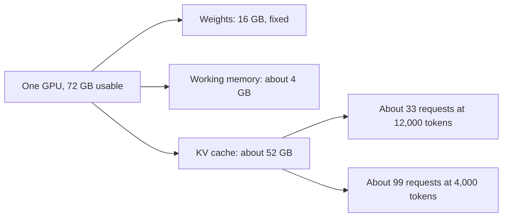
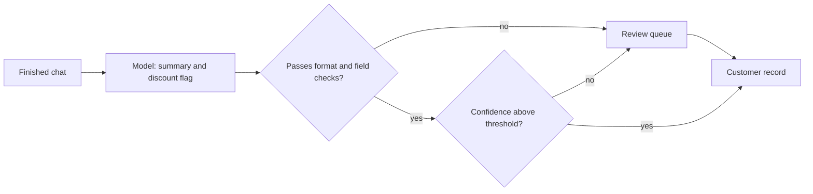

## Start with the four-user load test

Kestrel Telecom, a mobile operator, runs an open-weight model on its own graphics processing units (GPUs) to summarise about 90,000 support chats a month into the customer record. Ravi, the forward deployed engineer, load-tested it with four people clicking at once on short chats, and every summary came back in about 4 seconds. At go-live, 60 agents summarised long chats in the same few minutes at the end of the evening shift. The server held about half of them, the slowest summaries took 48 seconds, and agents went back to writing notes by hand. The test had checked that the model worked, not how many requests one GPU could hold at once. Call this **the four-user load test**.

> **What you'll learn**
>
> - Work out where GPU memory goes: weights, working memory and a cache for each request.
> - Estimate how many requests of a given length fit on one GPU.
> - Run a capacity and acceptance test with real inputs at peak load.
> - Route the outputs a model is unsure about to a review queue.

## Where GPU memory goes

A model served on a GPU uses its memory in three parts:

- **Weights.** The model's parameters. An 8-billion-parameter model stored at 16 bits per parameter needs 16 GB. This part is fixed.
- **Working memory.** Space the server and the calculations need. A few GB, roughly fixed.
- **The key-value (KV) cache.** For every token of every request in progress, the model keeps intermediate values so it does not recompute them. This part grows with the number of requests and with each request's length.

The KV cache is what runs out. Its size per token depends on the model's shape: two values (key and value), times the number of layers, times the number of key-value heads, times the size of each head, times the bytes per number. For the illustrative model in Table 1, that is 2 × 32 × 8 × 128 × 2 bytes, or 128 KiB, about 0.13 MB per token.

| Item | Value |
| --- | --- |
| GPU memory | 80 GB, of which the server is set to use 90%: 72 GB |
| Weights, 8 billion parameters at 16 bits | 16 GB |
| Working memory | about 4 GB |
| Left for the KV cache | about 52 GB |
| Cache per token | about 0.13 MB |
| One request at 12,000 tokens | about 1.6 GB |
| One request at 4,000 tokens | about 0.5 GB |

*Table 1: An illustrative memory budget for one GPU serving an 8-billion-parameter model. Real figures depend on the model and the server.*

Divide the cache space by the size of one request. At Kestrel's longest chats, 12,000 tokens including instructions and output, about 33 requests fit at once. At the typical 4,000 tokens, about 99 fit. Figure 1 shows the split.

*Figure 1: Fixed weights and working memory come off the top. What is left holds the cache for requests in progress, and longer requests mean fewer at once.*

Modern inference servers, such as vLLM, allocate the cache in small blocks as each request grows. The PagedAttention paper that introduced this design shows it wastes far less memory than reserving the maximum length up front. When the cache is full, the server queues new requests or pauses running ones. Either way, users wait. That is what Kestrel's agents saw at 18:00.

## What to change when memory runs out

There are five levers, and each one has a cost:

| Lever | Effect at Kestrel | Cost |
| --- | --- | --- |
| Cap the input | Keep the last 6,000 tokens of a chat, so the longest request is 8,000 tokens: about 49 fit | The summary may miss the start of a long chat |
| Smaller weights | Store weights at 8 bits: 8 GB freed, about 38 long requests fit | Quality may drop, so rerun the evaluation set |
| Add a GPU | A second server doubles capacity to about 66 long requests | Another GPU to pay for and run |
| Queue on purpose | Admit 30 at once and show the agent "summary in progress" | Some agents wait, but nothing fails |
| Smaller model | More room for cache | Quality may drop |

*Table 2: Five ways to fit more concurrent requests, with illustrative effects on Kestrel's longest chats.*

Kestrel chose a second GPU and a queue with a visible status. Peak demand was 60 long requests, and two GPUs hold about 66. The queue handles the rare minute above that.

## The capacity and acceptance test

A **capacity test** measures how much load the service handles before it breaks its targets. An **acceptance test** is the same run against a bar the customer has signed. Google's Site Reliability Engineering book makes the point that capacity depends on the cost of each request, not only on requests per second. For a language model, that cost is mostly the request's length.

The walkthrough follows Kestrel's second attempt.

Follow Kestrel's capacity and acceptance test. Each stage shows the input, the decision and what changed.

<button type="button" data-step="0" aria-pressed="false" aria-controls="capacity-step-0">1. Profile</button><button type="button" data-step="1" aria-pressed="false" aria-controls="capacity-step-1">2. Budget</button><button type="button" data-step="2" aria-pressed="false" aria-controls="capacity-step-2">3. Load</button><button type="button" data-step="3" aria-pressed="false" aria-controls="capacity-step-3">4. Measure</button><button type="button" data-step="4" aria-pressed="false" aria-controls="capacity-step-4">5. Accept</button>

<section id="capacity-step-0" class="step-panel" aria-labelledby="capacity-heading-0"><h4 id="capacity-heading-0">1. Profile the real workload</h4><dl><dt>Input</dt><dd>Chat logs and shift rotas.</dd><dt>Decision</dt><dd>Record the peak: 60 agents within five minutes of 18:00. Record the lengths: 4,000 tokens typical, 12,000 at the longest.</dd><dt>What changes</dt><dd>The test now targets the shift change, not an average hour.</dd></dl></section><section id="capacity-step-1" class="step-panel" aria-labelledby="capacity-heading-1"><h4 id="capacity-heading-1">2. Work out the memory budget</h4><dl><dt>Input</dt><dd>Table 1.</dd><dt>Decision</dt><dd>About 33 long requests fit per GPU, so 60 need two GPUs.</dd><dt>What changes</dt><dd>The team has a prediction to check, not a hope.</dd></dl></section><section id="capacity-step-2" class="step-panel" aria-labelledby="capacity-heading-2"><h4 id="capacity-heading-2">3. Replay real inputs at peak and above</h4><dl><dt>Input</dt><dd>2,000 real chats with the same length mix.</dd><dt>Decision</dt><dd>Ramp to 90 concurrent requests, one and a half times the peak, and hold for 30 minutes.</dd><dt>What changes</dt><dd>The test finds the breaking point instead of stopping below it.</dd></dl></section><section id="capacity-step-3" class="step-panel" aria-labelledby="capacity-heading-3"><h4 id="capacity-heading-3">4. Measure what users and operators see</h4><dl><dt>Input</dt><dd>Server and client metrics.</dd><dt>Decision</dt><dd>Record time to first token, 95th-percentile (p95) time to a finished summary, errors, queue length and cache use.</dd><dt>What changes</dt><dd>At 60 concurrent, p95 is 7 seconds. At 90, the queue grows and p95 reaches 19 seconds.</dd></dl></section><section id="capacity-step-4" class="step-panel" aria-labelledby="capacity-heading-4"><h4 id="capacity-heading-4">5. Check against the signed bar</h4><dl><dt>Input</dt><dd>The bar: at 60 concurrent, p95 under 10 seconds, no out-of-memory errors, quality unchanged on the evaluation set.</dd><dt>Decision</dt><dd>Pass at 60. Above 66, agents see "summary in progress".</dd><dt>What changes</dt><dd>The operations lead signs, and the test is rerun before any model or traffic change.</dd></dl></section>

<button type="button" data-walk="previous">Previous</button>

<button type="button" data-walk="next">Next step</button>

The stepper is a scripted illustration with illustrative figures.

> **Pitfall:** Synthetic prompts of one fixed length hide the long requests that fill the cache. Replay real inputs with their real length mix.

## Route uncertain outputs to review

Capacity keeps the service up. A second question is what happens when an answer is doubtful. Kestrel's summary also records one fact with consequences: whether the agent promised the customer a discount. A wrong "no" means a broken promise and a complaint.

The design sends doubtful cases to a short human queue instead of the record. Figure 2 shows the path.

*Figure 2: Deterministic checks catch malformed output first. A confidence signal sends the doubtful remainder to people before anything reaches the record.*

Three kinds of signal can feed the threshold:

- **Checks in code.** The output must match the schema, and the discount flag must agree with any discount code the agent entered in the billing system.
- **The model's own label.** Ask for "unsure" as an allowed answer. Research on verbalised confidence finds models tend to be overconfident. Never trust the label alone.
- **Token probabilities.** Many self-hosted servers return the probability of each output token. A low probability on the flag is a useful signal.

Set the threshold on labelled data. Kestrel labelled 500 chats. The model was wrong about the discount flag on 40. Sending the least confident 10% to review caught 28 of those 40. At 90,000 chats a month, 10% is 9,000 reviews. At 30 seconds each, that is 75 hours a month of review, which the customer agreed to fund. Keep the reviewers' corrections as new labelled examples. [Human review and approval](../building-for-operators/03_Human_Review_and_Approval.md) covers the review queue itself: what reviewers see, corrections kept as data, and locks so two reviewers never overwrite each other.

## Limits of this lesson

- **Composite engagement.** Kestrel, Ravi, the model shape, memory budget, latencies and review figures are illustrative, not a real customer. Real servers add overheads this lesson leaves out.
- **Throughput is a separate question.** This lesson sizes memory for concurrent requests. Tokens per second per GPU, batching and scheduling are not covered here. For the latency side, see [latency: prefill, decode, streaming and the tail](../../../../01_Concept_Tutorials/Consolidated_Lessons/T4.5_Cost_and_Latency/03_Latency_Prefill_Decode_Streaming_and_the_Tail.md).
- **Threshold drift.** A threshold set on last quarter's chats can drift. Recheck it against reviewers' corrections each month.

## Interview angle

Each answer is an outline to say in about two minutes. Open the question and try it aloud before reading.

Interview question 1. What limits a self-hosted model in production, and what do you do with outputs it is unsure about?

- **Answer:** Memory limits it first. Weights take a fixed share, and each request in progress adds a cache that grows with its length. Profile the real peak and length mix, work out how many requests fit, and load-test with real inputs above the peak against a signed latency bar. For quality, combine checks in code with a confidence signal, and send low-confidence outputs to a review queue sized from labelled data.
- **Trade-off:** Quantised weights or capped inputs fit more requests but can cost accuracy. Rerun the evaluation set after either change.
- **Follow-up to expect:** "Traffic doubles next quarter." Show requests per GPU from the test and the GPUs the doubled peak needs.

## References

1. Woosuk Kwon and others, [Efficient Memory Management for Large Language Model Serving with PagedAttention](https://arxiv.org/abs/2309.06180), arXiv, accessed 17 November 2026. KV cache growth and block allocation in vLLM.
2. vLLM, [Optimization and tuning](https://docs.vllm.ai/en/latest/configuration/optimization.html), accessed 17 November 2026. Preemption when the cache is full, and memory settings.
3. Google, [Handling overload](https://sre.google/sre-book/handling-overload/), Site Reliability Engineering, accessed 17 November 2026. Capacity measured by request cost, not request count.
4. Miao Xiong and others, [Can LLMs Express Their Uncertainty?](https://arxiv.org/abs/2306.13063), arXiv, accessed 17 November 2026. Verbalised confidence tends to be overconfident.

## Key takeaways

- GPU memory holds fixed weights, working memory and a cache that grows with every request's length.
- Estimate concurrent capacity as cache space divided by the size of one long request.
- Load-test with real inputs and their length mix, above the real peak, against a bar the customer signs.
- When memory runs out, cap inputs, shrink weights, add GPUs or queue on purpose, and rerun the evaluation after any change to quality.
- Route doubtful outputs to people, using checks in code plus a confidence signal set on labelled data.

## Check yourself

1. Why did Kestrel's four-user test pass while go-live failed?

Four short chats used a small part of the cache. Sixty long chats needed about twice what one GPU could hold. Half of them queued.

2. If Kestrel caps every request at 8,000 tokens, roughly how many fit on one GPU?

Each request needs about 8,000 × 0.13 MB, close to 1 GB. About 49 fit in 52 GB of cache.

3. Why not route on the model's own "unsure" label alone?

Models tend to be overconfident when they state their confidence. Many wrong answers would not be labelled unsure. Combine the label with checks in code and token probabilities, and set the threshold on labelled data.

