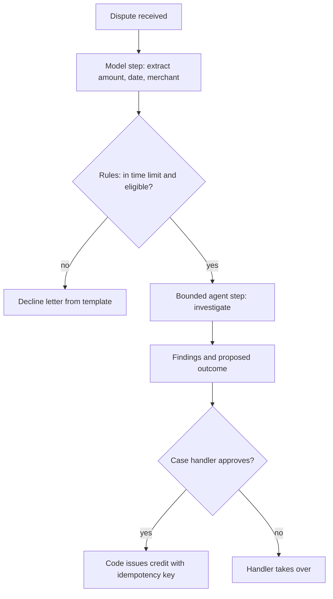
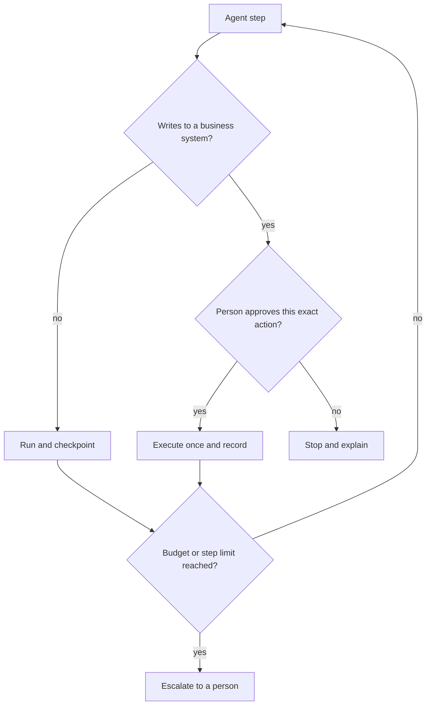

## Start with autonomy by default

Arden Bank, a fictional retail bank, handles about 8,000 card disputes a month. A customer says a payment was wrong, and a case handler investigates, contacts the merchant if needed, and may give the customer a provisional credit while the case is open.

A delivery team built an agent for the whole job. It had 14 tools, from reading statements to issuing credits, and it decided each next step itself. In a pilot on 500 disputes, a credit call timed out and the agent retried it. Six customers received the same provisional credit twice. On another dispute, the agent called the statement tool 40 times in a loop before anyone noticed.

The process had fixed steps that the bank already followed. Only one step, the investigation, needed a model to choose its own path. Call this **autonomy by default**: giving a model control of a whole process when most of it could be drawn in advance.

> **What you'll learn**
>
> - Place a task on an autonomy scale from fixed workflow to open agent.
> - Draw the process first and find the one step that needs agent behaviour.
> - Give an agent a small tool set, state owned by code, and memory used on purpose.
> - Set action boundaries, approvals, checkpoints, budgets and stopping rules.

## An autonomy scale

Anthropic's guide to building agents draws the main line clearly. In a **workflow**, models and tools run along code paths someone defined in advance. In an **agent**, the model directs its own process and tool use. Between the two sit useful middle levels.

| Level | Who decides the next step | Fits when | Arden example |
| --- | --- | --- | --- |
| Fixed workflow | Code, every time | The steps and rules are known | Checking the dispute is within the time limit |
| Workflow with model steps | Code, with a model filling one step | A step needs language, such as reading or drafting | Extracting the disputed amount from the customer's message |
| Workflow with a bounded agent step | The model, inside one step, with limits | The path depends on what it finds | Investigating which transactions explain the dispute |
| Open agent | The model, end to end | Steps cannot be known in advance and errors are cheap | Rarely right for a process that moves money |

*Table 1: An autonomy scale. Choose the lowest level that handles the task, step by step.*

Each level up handles more variety. It also costs more per task, is harder to test, and fails in less predictable ways.

## Draw the workflow first

Ask the customer's case handlers to walk you through a dispute, and draw it. Figure 1 shows Arden's.

*Figure 1: Arden's dispute process. Code and rules own most steps. The agent investigates and proposes, and code performs the write after a person approves.*

Most of the process is fixed: eligibility follows written rules, and a credit follows approval. The investigation is different. The agent may need two statement lookups or eight, a merchant record, or a past dispute on the same card. That one step earns agent behaviour, and it only reads.

## Tools, state and memory

An agent picks tools from the names and descriptions it is given. More tools give more reach and more wrong picks. Arden's investigation step gets four read-only tools: statements, merchant records, past disputes and card events. Each description says what it returns and when to use it, so no two overlap.

**State** is what the current task has done so far: the dispute ID, the current step, the evidence found, the actions taken. Keep it in a structured record that code owns and saves, not only in the conversation history. Code can then check it, resume from it and show it to the case handler.

**Memory** across tasks is a separate store. Write to it on purpose, such as a note that a merchant often settles disputes without evidence, and read it with a query. Unplanned memory turns into stale context that nobody reviews. The site's [agentic workflow patterns](../../../../01_Concept_Tutorials/RAG_Agents_Engineering/p06_agent_foundations/m24_agentic_workflow_patterns/00_overview.md) and [long-term and agentic memory](../../../../01_Concept_Tutorials/RAG_Agents_Engineering/p09_memory_layer/m34_long_term_agentic_memory/00_overview.md) modules cover both in depth.

## Action boundaries

An **action boundary** is a rule in code about what the agent may change and under what conditions. Figure 2 shows the boundaries around Arden's agent loop.

*Figure 2: Boundaries around an agent loop. Writes need approval of the exact action, every step is checkpointed, and limits end the loop with an escalation.*

Four rules make up the boundary:

- **Least privilege.** The agent acts with the case handler's permissions and only the tools the step needs. The Open Worldwide Application Security Project (OWASP) lists excessive functionality, permissions and autonomy as a top risk for applications built on language models.
- **Approve the exact action.** The handler sees the action and its arguments: "credit $84.20 to card ending 4417". A vague "proceed?" invites a click without reading.
- **Write once.** Every write carries an idempotency key, so a retry after a timeout cannot credit twice. That one rule would have stopped Arden's duplicate credits.
- **Checkpoint every step.** Save state after each step. A crash then resumes where it stopped instead of repeating a write.

The site's [confirmation gate and memoization](../../../../01_Concept_Tutorials/Consolidated_Lessons/T3.5_Robust_Agents/01_The_Confirmation_Gate_and_Memoization.md) lesson builds these in code.

## Budgets and stopping

An agent loop needs limits that code enforces, because the model will not reliably stop itself:

- **Step limit.** In Arden's pilot, 95% of investigations finished within 9 tool calls. The limit is 15.
- **Spend limit.** A token budget per dispute, set at $0.40, about twice the measured average.
- **Time limit.** A wall-clock timeout for the step.
- **Repeat detection.** The same tool with the same arguments twice in a row ends the loop.

When a limit trips, the agent stops, saves its state and hands the case to a person with a summary of what it found. Set the limits from the measured distribution on real tasks, and review the escalations each week. The site's [budgets and spend guardrails](../../../../01_Concept_Tutorials/Consolidated_Lessons/T4.5_Cost_and_Latency/07_Budgets_and_Spend_Guardrails.md) lesson covers spend controls.

The switcher compares the pilot's open agent with the redesigned workflow on the same 500 disputes.

Compare two designs on the same 500 Arden disputes.

<button type="button" data-mode="open" aria-pressed="false" aria-controls="open-result">Open agent</button>
<button type="button" data-mode="bounded" aria-pressed="false" aria-controls="bounded-result">Workflow with bounded agent</button>

<section id="open-result" class="mode-panel" data-announcement="Open agent selected. 6 duplicate credits, $0.62 per dispute."><h4>Open agent</h4><ul><li>Duplicate provisional credits: 6.</li><li>Longest loop: 40 tool calls on one dispute.</li><li>Average model cost: $0.62 per dispute. Handed to people: 3%.</li></ul>
Fewer handovers, but the agent made writes nobody approved.
</section>
<section id="bounded-result" class="mode-panel" data-announcement="Workflow with bounded agent selected. No duplicate credits, $0.21 per dispute."><h4>Workflow with bounded agent</h4><ul><li>Duplicate credits: 0. Every credit was approved and written once.</li><li>Longest investigation: 15 tool calls, then escalation.</li><li>Average model cost: $0.21 per dispute. Handed to people: 7%, each with a summary.</li></ul>
More handovers, no unapproved writes, and a third of the cost.
</section>

The bounded design costs less because code runs the fixed steps without a model, and the agent sees four tools instead of 14. The extra handovers are the price of the limits, and the bank chose to pay it.

## Limits of this lesson

- **Fictional figures.** Arden Bank and every pilot figure are illustrative. They show the method, not expected results.
- **Approvals wear out.** Approvers who see hundreds of requests a day stop reading them. Track how often they reject, and sample approved actions for review.
- **One process.** Some tasks, such as open research across many sources, need more autonomy than a dispute. The scale still applies: choose the lowest level that works.

## Interview angle

Each answer is an outline to say in about two minutes. Open each question and try it aloud before reading.

Interview question 1. A customer asks for an agent. How do you decide between a fixed workflow and an agent?

- **Answer:** Draw the process with the people who do it. Where the steps can be written down in advance, build a workflow, with model steps for reading or drafting. Use an agent only for a step whose path depends on what it finds, such as an investigation, and keep it inside the workflow so code controls entry, exit and writes.
- **Trade-off:** An agent handles variety but costs more per task, is harder to test and fails less predictably.
- **Follow-up to expect:** "The sponsor wants a fully autonomous agent." Show the drawn workflow and the one step that needs agent behaviour, with pilot numbers for both designs.
- **Go deeper:** [Agentic workflow patterns](../../../../01_Concept_Tutorials/RAG_Agents_Engineering/p06_agent_foundations/m24_agentic_workflow_patterns/00_overview.md).

Interview question 2. How does an agent choose its tools, keep track of its state and remember across tasks?

- **Answer:** It picks tools from the names and descriptions it receives, so keep the set small and the descriptions distinct. Keep task state in a structured record that code owns and saves after each step. Keep long-term memory in a separate store, written on purpose and read with a query.
- **Trade-off:** More tools give reach but more wrong picks. More memory gives continuity but more stale context.
- **Follow-up to expect:** "It keeps choosing the wrong tool." Check which descriptions overlap, cut the set, or give each step its own small set.
- **Go deeper:** [Long-term and agentic memory](../../../../01_Concept_Tutorials/RAG_Agents_Engineering/p09_memory_layer/m34_long_term_agentic_memory/00_overview.md).

Interview question 3. What checkpoints, approvals and boundaries do you put around an agent that can change customer data?

- **Answer:** Give it least privilege: the user's permissions and only the tools the step needs. Require approval of the exact action with its arguments before any write. Give every write an idempotency key so retries cannot repeat it. Checkpoint state after each step so a crash resumes without repeating work.
- **Trade-off:** Each approval costs a person's time and adds delay. Keep them for writes, payments and messages that leave the company.
- **Follow-up to expect:** "Approvers click yes without reading." Show the exact change, measure the rejection rate, and sample approved actions.
- **Go deeper:** [The confirmation gate and memoization](../../../../01_Concept_Tutorials/Consolidated_Lessons/T3.5_Robust_Agents/01_The_Confirmation_Gate_and_Memoization.md).

Interview question 4. How do you stop an agent from looping or overspending?

- **Answer:** Enforce limits in code: a step count, a spend budget per task and a timeout, plus a check for the same tool called with the same arguments. Set them from the measured distribution on real tasks. When one trips, stop, save state and hand the task to a person with a summary.
- **Trade-off:** Tight limits stop some tasks that would have succeeded. Loose limits let a loop run up cost before anyone sees it.
- **Follow-up to expect:** "Spend tripled last week." Break spend down by task type and step to find the loop or the new long input.
- **Go deeper:** [Budgets and spend guardrails](../../../../01_Concept_Tutorials/Consolidated_Lessons/T4.5_Cost_and_Latency/07_Budgets_and_Spend_Guardrails.md).

## References

1. Anthropic, [Building effective agents](https://www.anthropic.com/engineering/building-effective-agents), accessed 17 November 2026. Workflows against agents, and starting with the simplest design.
2. OWASP GenAI Security Project, [LLM06:2025 Excessive Agency](https://genai.owasp.org/llmrisk/llm062025-excessive-agency/), accessed 17 November 2026. Excessive functionality, permissions and autonomy.
3. LangChain, [Human-in-the-loop](https://langchain-ai.github.io/langgraph/concepts/human_in_the_loop/), LangGraph documentation, accessed 17 November 2026. Pausing for approval and resuming from saved state.
4. The site's [confirmation gate and memoization](../../../../01_Concept_Tutorials/Consolidated_Lessons/T3.5_Robust_Agents/01_The_Confirmation_Gate_and_Memoization.md) lesson.

## Key takeaways

- Place each step on the autonomy scale, and choose the lowest level that handles it.
- Draw the process first, and give agent behaviour only to the step whose path depends on what it finds.
- Keep the tool set small and distinct, state in a record code owns, and memory in a store written on purpose.
- Put writes behind approval of the exact action, an idempotency key and a checkpoint.
- Enforce step, spend and time limits in code, and escalate to a person with a summary.

## Check yourself

1. Which single rule would have prevented Arden's duplicate credits, and why?

An idempotency key on every write. The retried credit call would carry the same key, so the payment system would apply it only once.

2. Why does the bounded design cost less per dispute than the open agent?

Code runs the fixed steps without a model, the agent sees four tools instead of 14, and the step limit ends loops early.

3. Why keep task state in a record code owns instead of the conversation history?

Code can save it after each step, check it, resume from it after a crash and show it to the person who approves, none of which is reliable from free text.

